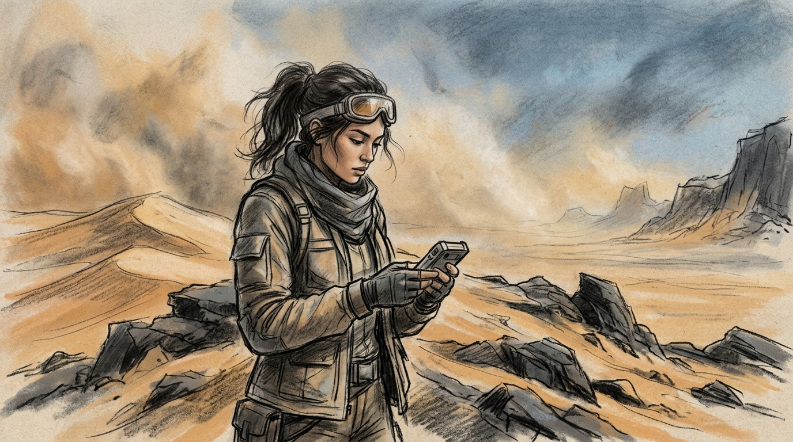

# CHAPITRE 01 : L'ÉCLAIREUSE DE CONDORCÉ

> *« On reconnaît une recrue fraîchement débarquée d’Aqi à ce qu’elle écoute le vent d’Oark en cherchant encore le bruit d’un blizzard. Au bout de 3 mois, elle comprend que la silice ne fond jamais, que l’eau recyclée a toujours le goût des bottes de la veille, et que les seuls fantômes qui hantent ce désert sont ceux que nos propres foreuses refusent de laisser dormir. »*
> — **Carnet d’établi de l’Éclaireuse Koda (Mat. 44-K), page de garde tachée d’huile, Base Zêta-3**

{.chapter-illustration}

Le vent d’Oark ne soufflait jamais vraiment ; il raclait.

À travers la visière en verre renforcé de son casque pressurisé, Koda contemplait la tempête de silice qui achevait de s’éteindre sur l’horizon ocre. Poussées par des bourrasques sèches, des milliards de particules minérales, dures comme du diamant brut, crépitaient contre l’alliage lourd de son plastron avec le bruit continu d’une pluie statique. Dans son oreillette, le ronflement sourd du filtre thermique de son armure d’exploration couvrait à peine la longue plainte du désert. L’odeur confinée d’ozone, de graisse silicone et de sueur séchée lui était devenue si familière qu’elle ne la remarquait même plus.

Elle inclina le poignet. Sous une couche de rayures héritées de 6 mois de prospection dans le secteur Zêta, l’écran à cristaux liquides affichait une température extérieure de 47 degrés. Une fin d’après-midi presque clémente pour la saison.

— Secteur 7, balayage terminé, annonça-t-elle sur le canal de courte portée.

Sa propre voix lui revint dans les tympans, métallique et légèrement décalée par le vocodeur — le codeur électronique de son casque qui comprimait la parole pour la glisser dans les fréquences radio. Elle relâcha la pression dans les vérins hydrauliques de ses genoux, ces cylindres d’acier gorgés d’huile sous pression qui soulageaient ses articulations mais sifflaient à chaque flexion comme 2 bêtes fatiguées, et s’agenouilla lourdement au pied d’une paroi de basalte, une antique coulée de roche volcanique noire fendue par l’érosion. Avec une délicatesse qui jurait avec la brutalité de ses 40 kilos de blindage céramique et d’acier, elle décrocha le scanner géologique de sa cuisse.

26 ans. Elle les avait fêtés la veille, toute seule à minuit dans le fouillis de son atelier, devant une ration thermique au goût de carton bouilli et une demi-cartouche d’eau recyclée. D’Aqi, sa planète natale, Koda ne gardait que des éclats de mémoire givrés : des sirènes d’alerte hurlant sous des cieux couleur de plomb, des quais d’embarquement noirs de givre et de foule, et la silhouette d’un orphelinat d’État où l’on apprenait aux enfants sans nom que leur sang appartenait au conglomérat Condorcé. Là-haut, de l’autre côté du vide interplanétaire, des millions de Plotéris et d’Afistéaans continuaient de s’éventrer sur des banquises à moins 40 degrés dans une guerre d’usure dont plus personne ne savait réciter la première cause sans mentir.

Ici, au milieu d’un monde mort depuis 6 millénaires, Koda respirait enfin.

Elle fit glisser le pinceau laser rougeâtre du scanner le long de la fracture rocheuse. L’appareil répondit par une quinte de bips graves et dépités : quartz stérile, oxydes de fer vitrifiés — fondus jadis par une chaleur si foudroyante que le minerai s’était figé en une croûte de verre sombre —, zéro poche d’isotopes lourds, ces atomes radioactifs denses capables d’alimenter un cœur énergétique, zéro veine exploitable. Une journée de marche de plus pour rien. Les ingénieurs de forage allaient faire la grimace.

Mais tandis que Condorcé retournait la croûte d’Oark pour nourrir ses réacteurs à fusion et ses fonderies d’obus, Koda, elle, cherchait des fantômes.

Autodidacte passionnée, incapable de voir un mécanisme en panne sans éprouver une démangeaison au bout des doigts, elle passait ses nuits à ressusciter les drones de reconnaissance que le sable avait éventrés. Elle aimait l’architecture secrète des circuits, l’élégance d’un pont de soudure improvisé avec un fil de cuivre, ce moment précis où une machine inerte recommençait à battre. Et plus que tout, elle était obsédée par ceux qui avaient foulé cette poussière avant eux : les anciens Oarkins. L’histoire officielle d’Aqi les décrivait comme des ancêtres primitifs, balayés par leur propre arriération. Koda n’en croyait pas un mot. On ne vitrifiait pas les 3 quarts d’une planète — en changeant des continents entiers de pierre en miroirs de verre calciné — avec des frondes et des moteurs à charbon.

Elle se redressa dans un grognement de servomoteurs et verrouilla son scanner à sa ceinture.

— Base Zêta-3, ici Éclaireuse Koda. Retour au bercail. Le secteur 7 est aussi vide que les promesses du ravitaillement.

Un crépitement de parasites précéda la réponse :

— Reçu, Koda, fit la voix tendue de Borras. Ne traîne pas en route. Le baromètre vient de plonger de 12 hectopascals : un front de poussière descend du nord-est et sera sur nous d’ici moins d’une heure. Et garde ton circuit étanche verrouillé : la balise septentrionale a relevé des bouffées gamma erratiques à 6 kilomètres de ta crête, de brusques bouffées de radiations invisibles capables de traverser une combinaison mal scellée.

— Toujours aussi maternel, Borras. Prépare le café, j’arrive.

Borras. Ce qui ressemblait le plus à un frère dans son existence décousue. Ils avaient usé leurs fonds de culotte sur les mêmes bancs des écoles techniques de Condorcé avant d’être expédiés sur Oark. Officier des transmissions de leur petite garnison de 15 âmes, Borras croyait dur comme fer à l’ordre, aux manuels de procédure et aux communiqués du Directoire. Il rêvait d’une médaille de campagne et d’un poste d’état-major sur Aqi. Koda, elle, ne rêvait que d’une journée où personne ne lui demanderait de chiffrer la rentabilité d’un caillou. Le lourd fusil à impulsion magnétique sanglé contre son omoplate — une arme dont les rails électromagnétiques catapullaient des fléchettes d’acier sans poudre ni détonation — n’avait jamais servi qu’à effrayer des charognards à carapace dans les ravines ; l’idée de le braquer sur un être humain lui donnait la nausée.

Au bout de 40 minutes de marche cadencée, la silhouette trapue de Zêta-3 émergea du rideau d’ocre.

Contrairement aux campements mobiles des Afistéaans qui plantaient des dômes souples entre deux dunes, Condorcé bâtissait avec la paranoïa d’une forteresse assiégée. 5 modules octogonaux en béton de régolithe — un ciment grossier pétri avec la poussière et la rocaille concassée du désert — et en acier trempé s’enfonçaient à mi-hauteur dans le substrat rocheux, reliés par des boyaux blindés et hérissés de tourelles automatiques dont les canons doubles balayaient inlassablement le néant. C’était toute l’âme de la machinerie aqine : une industrie massive, anguleuse, bruyante, qui sentait l’effort, le cambouis et la peur de mourir.

Koda s’engouffra dans le sas extérieur. Les buses de décontamination crachèrent une brume glacée de solvant neutralisant qui fit perler la poussière rouge sur son blindage. Dès que le voyant bascula au vert, elle fit sauter les loquets de son collier cervical et souleva son casque dans un long soupir de délivrance.

Elle secoua la tête. Ses mèches brunes, trempées de sueur, lui fouettèrent les pommettes. Malgré la pâleur que donnaient les semaines sous scaphandre et la fine cicatrice d’éclat de soudure au coin de son sourcil gauche, son visage gardait une vivacité insolente, éclairée par 2 yeux sombres qui semblaient toujours chercher quelle vis démonter. L’air tiède de la coursive lui emplit les poumons d’un mélange familier de lubrifiant chauffé, d’ozone et de chicorée synthétique.

— Eh, Koda ! Encore à courir après des cailloux morts ? lança une voix rocailleuse depuis l’embrasure du poste de maintenance.

Jaro n’avait que les jambes qui dépassaient sous le ventre ouvert de la tourelle sud, une clé dynamométrique — ce lourd levier gradué qui claquait dès qu’un boulon atteignait le serrage exact — coincée entre les dents. Koda s’approcha et donna une tape sonore sur la botte ferrée du géant.

— Si tu savais, Jaro ! Mes cailloux ont infiniment plus de répartie que toi avant ta deuxième tasse de jus de batterie, répliqua-t-elle d’un ton chantant. Ton compresseur hydraulique fait encore sa tête de mule ?

Jaro sortit son torse couvert de cambouis et s’essuya le front du revers de l’avant-bras.

— M’en parle pas. La pression retombe dès que les canons pivotent de plus de 30 degrés. J’ai purgé 3 fois.

Koda se pencha par-dessus l’épaule du mécanicien, plissa les paupières devant l’enchevêtrement de conduites de cuivre et désigna du bout du gant un boîtier grisâtre.

— Shunte le relais secondaire de la pompe d’amorçage avec un pont de fil de cuivre. Il prend la poussière fine par l’évent inférieur et coupe le solénoïde trop tôt — la bobine aimantée n’a plus assez de jus pour maintenir la valve ouverte. J’ai eu exactement le même caprice sur le vérin de ma jambe droite mardi dernier. 2 gouttes d’étain pour dériver le circuit et on n’en parle plus.

La figure burinée de Jaro se fendit d’un sourire presque incrédule.

— Le jour où tu décides de passer le brevet d’ingénieur d’armement, petite, tu nous mets tous au chômage. Merci.

— Garde-moi plutôt tes vieux condensateurs grillés, ces petits cylindres qui gardent encore un reste d’étincelle sous le capot, lui lança-t-elle par-dessus son épaule avec un clin d’œil.

Lorsqu’elle poussa la porte pneumatique du réfectoire, le brouhaha métallique des couverts contre les plateaux d’aluminium l’enveloppa. À 19 heures, les 15 membres de Zêta-3 oubliaient les grades pour redevenir une tribu d’exilés serrés sous la même tôle.

— Par tous les démons du sable, l’éclaireuse n’a pas été mangée par le vent ! claironna Marek, le pilote de drone, en levant son gobelet d’étain.

— Le vent a essayé, il s’est cassé les dents sur mon mauvais caractère ! rétorqua Koda en happant un plateau au passage.

Elle alla s’affaler à califourchon sur le banc face à Borras. Toujours impeccable dans sa vareuse grise au col boutonné malgré la chaleur des conduites, son ami d’enfance faisait défiler des colonnes de télémétrie sur sa tablette militaire tout en mâchant distraitement sa pâte protéinée.

— Alors ? demanda-t-il sans lever le nez. Tes relevés de la faille 7 ?

— Stérile de chez stérile, dit Koda en plantant sa fourchette dans le bloc grisâtre de son assiette, qui tint bon avec une élasticité suspecte. Pas un gramme de thorium, pas une goutte d’hélium-3 — pas l’ombre des combustibles nucléaires que réclament nos centrales. Le Directoire va devoir se chauffer avec ses propres discours une semaine de plus.

Cette fois, Borras ne sourit pas. Il posa sa tablette à plat sur la table. Sous la lumière crue des néons, des cernes violacés creusaient ses joues.

— Ils ne se chauffent plus, Koda. Les dépêches de 16 heures viennent de tomber par le relais orbital.

Le ton de sa voix fit baisser d’un cran les conversations aux tables voisines. Borras fit pivoter son écran vers elle. Une carte radar du continent boréal d’Aqi y clignotait, barrée d’une large estafilade écarlate.

— Le front du glacier d’Ostre a cédé cette nuit, reprit-il à voix basse. 3 divisions blindées afistéannes ont enfoncé nos lignes. À moins 42 degrés, les réacteurs secondaires de 2 cités ouvrières se sont mis en sécurité faute de combustible lourd. Le commandement parle de 40 000 civils sans chauffage d’ici 48 heures si les cargos d’Oark ne doublent pas les quotas. Condorcé est en train de saigner à blanc.

Le silence tomba sur la travée. Même Marek avait reposé son gobelet. La guerre d’Aqi n’était jamais loin ; elle pendait au-dessus de leurs têtes comme ce plafond de béton qui les protégeait des radiations.

— Raison de plus pour bénir notre fournaise, murmura doucement Koda afin de desserrer l’étau qui prenait la table. Ici, au moins, personne ne meurt de froid, et le sable ne choisit pas de drapeau avant de nous tomber dessus.

— C’est quand même un foutu cimetière, grommela l’artilleur assis au bout du banc. 6 000 ans que cette boule de crasse est cuite.

— Elle ne s’est pas cuite toute seule, répliqua Koda, une lueur soudaine s’allumant au fond de ses prunelles. C’est ça qui devrait nous empêcher de dormir. Les Oarkins avaient bâti un âge d’or. Ils avaient dompté leur climat, érigé des cités dont les fondations défient encore nos foreuses au diamant… et au sommet de leur génie, ils ont trouvé le moyen de tout vitrifier jusqu’au manteau terrestre pour une querelle de frontières.

Borras secoua la tête, partagé entre l’affection et une vieille lassitude.

— Tes fantômes ne feront pas tourner les turbines du glacier d’Ostre, Koda. On n’a pas le luxe de philosopher sur des morts qui ont perdu la raison il y a 60 siècles. On a une guerre à gagner aujourd’hui.

*Et nous courons exactement vers le même mur qu’eux, en klaxonnant 2 fois plus fort*, songea Koda. Mais elle garda la phrase pour elle. À quoi bon assombrir encore le regard de Borras ? Dans ce désert, la bonne humeur était une ration de survie aussi précieuse que l’eau.

Elle tendit soudain le bras par-dessus la table et ébouriffa d’un geste vif la mèche impeccablement peignée de l’officier.

— Promis, mon lieutenant, demain je creuse jusqu’au noyau planétaire ! En attendant, passe-moi le sel de synthèse. Je crois que ma ration manque de désespoir.

L’éclat de rire de Jaro et de Marek fit voler en éclats la chape de plomb. Borras lui-même ne put retenir un sourire en repoussant la main de son amie. Durant près d’une heure, Koda tint le réfectoire à bout de bras, imitant les pannes du drone numéro 4, arbitrant les paris stupides des foreurs, offrant à ces 14 hommes et femmes fatigués l’illusion que le monde s’arrêtait aux portes blindées de Zêta-3.

Pourtant, dès que les plateaux furent débarrassés, son sourire s’effaça dans la solitude du couloir.

Tout au bout de l’aile technique, derrière une cloison que les vibrations du générateur principal faisaient trembler jour et nuit, se trouvait son royaume. Un ancien débarras de décontamination que personne ne disputait à l’orpheline.

Lorsque Koda referma le loquet intérieur, elle laissa tomber son masque d’insouciance. Sur l’établi métallique, 3 vieux moniteurs cathodiques récupérés à la casse — d’épais écrans à tube de verre dont le faisceau d’électrons balayait le phosphore avec un sifflement aigu — diffusaient une lueur verte et tremblotante sur une forêt de cartes mères éventrées, de servomoteurs orphelins et de bobines d’étain. L’odeur âcre du flux de soudure flottait dans la pièce comme un encens.

C’était là, au milieu des carcasses de métal que l’armée jugeait bonnes pour le broyeur, que Koda luttait contre le vide de sa propre naissance. Elle qui ne saurait jamais quel visage avaient eu son père et sa mère passait ses nuits à coudre des nerfs de cuivre dans des carcasses froides, possédée par un besoin viscéral, presque enfantin, de prouver que ce qui avait été brisé pouvait encore s’éveiller.

Elle posa son casque cabossé près du fer à souder, loin de se douter que le désert d’Oark s’apprêtait à lui répondre.
