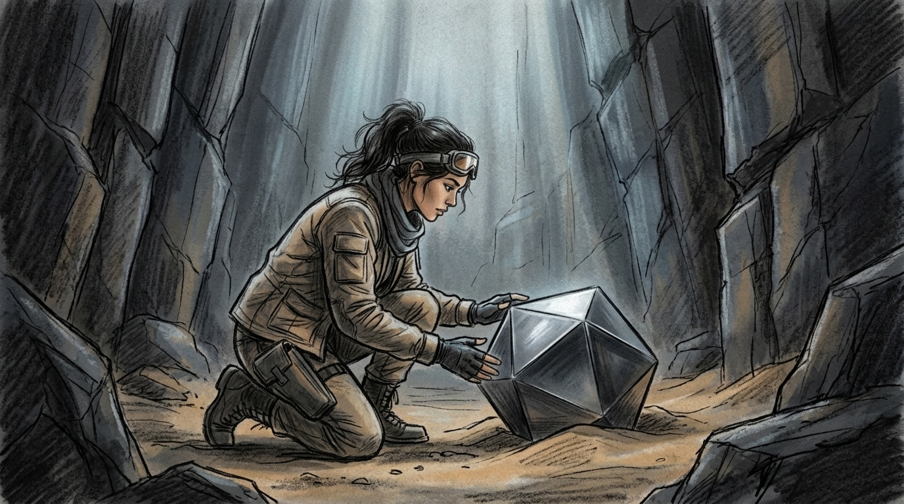

# CHAPITRE 02 : L'ANOMALIE DANS LE SABLE

> *« Article 14, alinéa 3 : Tout prospecteur relevant une structure manufacturée antérieure à l’Exode ou présentant une signature énergétique anormale doit interrompre immédiatement le chantier, baliser le périmètre à 100 mètres et alerter l’officier de sécurité sectoriel. Toute manipulation, ouverture ou soustraction d’artefact relève du tribunal militaire d’exception pour entrave à l’effort de survie thermique. »*
> — **Code d’Exploration Minière et Technologique du Conglomérat Condorcé, Édition de Guerre**

{.chapter-illustration}

La tempête de la nuit avait redessiné le monde.

Là où, la veille encore, s’étirait une dune en croissant haute de 30 mètres, le vent de silice avait raboté le sable jusqu’à l’os, mettant à nu une échine de grès noirâtre que les cartes d’état-major de Zêta-3 ignoraient. Conformément à la consigne géologique qui imposait de quadriller dès l’accalmie les zones d’arrachement maximal repérées par le radar météo — avant que les vents secondaires ne ré-ensablent les veines mises à nu —, Koda avait enfourché dès l’aube sa moto-chenille dont le vieux bicylindre thermique toussait des bouffées d’hydrocarbures mal brûlés, et mis le cap sur cette cicatrice fraîche située en plein cœur de son secteur d’attribution, à 18 kilomètres au sud-est du camp.

Elle aimait ces premières heures du jour où le désert semblait encore hésiter entre le gel nocturne et la fournaise. Sous le patin avant de sa machine, la croûte de sel et de poussière rouge craquait comme une vitre mince. Le guidon vibrait rudement dans ses paumes gantées de cuir épais, transmettant à ses poignets chaque cahot du régolithe, chaque raté de la courroie d’entraînement que Jaro jurait d’avoir retendue la semaine précédente. L’engin puait l’huile de synthèse surchauffée, crachait une fumée bleue par son pot latéral rafistolé au fil de fer et faisait un boucan de char d’assaut dans la cathédrale minérale du matin — mais il roulait, et tant qu’il roulait, Koda était la reine sans couronne d’un continent mort.

À 9 heures, le soleil Solyar pesait déjà sur ses épaules comme une enclume chauffée à blanc.

L’astre d’Oark n’avait rien de la pastille blafarde et lointaine qui peinait à percer les plafonds de givre d’Aqi. Ici, il régnait en tyran jaune, dilaté par la brume sèche, transformant chaque arête de basalte en lame de rasoir incandescente. Dans le circuit fermé du scaphandre, les pompes péristaltiques — de petits galets mécaniques qui écrasaient les tubulures souples par ondes successives, à la manière d’un œsophage — faisaient circuler un liquide réfrigérant tiède le long de la colonne vertébrale de l’éclaireuse avec un gargouillis continu de tuyauterie mal purgée.

Koda coupa l’allumage au bord de la dépression nouvellement ouverte.

Le silence d’Oark retomba aussitôt autour d’elle, immense, minéral, seulement troublé par les claquements métalliques du collecteur d’échappement qui refroidissait à l’air libre. Elle descendit de selle, les vérins hydrauliques de ses jambières accompagnant sa foulée d’un chuintement régulier, et décrocha son scanner à résonance.

Devant ses bottes ferrées s’ouvrait un ravin sinueux, profond d’une douzaine de mètres, que des siècles d’ensablement avaient dissimulé aux satellites. Le cyclone de la nuit avait vidé la tranchée comme un coup de balai géant. Au fond de l’entaille, la roche ancienne portait les stigmates caractéristiques du Grand Effondrement : des strates de basalte tordues comme de la cire fondue, vitrifiées jadis en plaques d’émail noir par des armes dont même les artilleurs d’Aqi ne comprenaient plus la physique. Le compteur Geiger sanglé à son avant-bras égrenait un cliquetis paresseux, bien en dessous des seuils d’alerte — la radioactivité résiduelle s’était dissipée depuis des millénaires dans cette cuvette —, mais la violence fossilisée du paysage suffisait à serrer la gorge. Cette planète n’était pas morte de vieillesse ; elle avait été assassinée en plein vol.

— Voyons ce que le balai de cette nuit nous a laissé sous le tapis, murmura Koda pour le simple plaisir d’entendre une voix humaine dans ses écouteurs.

Elle engagea le crampon de talon de ses bottes sur la pente d’éboulis et entreprit de descendre dans la faille.

Sous son poids de 90 kilos tout équipée, la paroi de scories vitrifiées se révéla traîtresse. À mi-pente, une plaque de schiste calciné, une pierre feuilletée qui se délitait en ardoises friables, céda net sous son pied gauche. Koda bascula en arrière dans un fracas de pierres arrachées, rattrapa son équilibre d’un coup de rein brutal en plantant son piolet d’ancrage dans une fissure de grès, et glissa sur 5 mètres dans un nuage suffocant de farine minérale. Une arête de verre volcanique racla le plastron de céramique de son torse avec un crissement d’ongle sur une ardoise.

Lorsqu’elle toucha enfin le lit de la ravine, le souffle court, une pluie de gravillons continuait de tambouriner sur le dôme de son casque.

— Note pour plus tard : éviter de finir aplatie sous 3 tonnes de cailloux avant d’avoir trouvé de quoi payer ma prime de risque, souffla-t-elle en époussetant la poussière ocre qui encrassait les joints de ses coudières.

Elle fit quelques pas au fond du boyau encaissé. Ici, à l’abri du vent, la chaleur stagnait comme dans un four à pain, mais l’ombre des parois découpait une fraîcheur trompeuse. Et presque aussitôt, son œil exercé de fouilleuse repéra ce que les foreurs de Condorcé ne prenaient jamais la peine de chercher.

Prisonniers de la coulée de basalte refroidie, des vestiges de l’Âge d’Or Oarkin affleuraient par fragments.

Ce n’étaient ni des poutrelles d’acier riveté ni des blocs de béton armé comme en coulait l’industrie d’Aqi. À hauteur de son épaule, la muraille rocheuse avait englouti l’arche brisée d’un ancien pavillon : une nervure d’un matériau translucide, semblable à de l’opale laiteuse torsadée, qui s’étirait selon une courbe asymétrique d’une grâce presque végétale. Même fracassée et fondue à moitié par le cataclysme d’il y a 6 000 ans, l’architecture oarkine gardait cette signature inimitable — l’alliance d’une science audacieuse et d’une esthétique organique où pas un angle droit ne venait heurter le regard. Koda effleura du bout de ses doigts gantés un bas-relief à demi effacé où l’on devinait encore la nervure d’une feuille géante fusionnée à un conduit de lumière solide.

À chaque fois qu’elle croisait l’un de ces fantômes de pierre claire, la même colère sourde lui montait aux lèvres contre les manuels scolaires de Plotéris. Comment des êtres capables de sculpter la matière comme une symphonie avaient-ils pu sombrer dans une folie furieuse au point de vitrifier leurs propres jardins ?

Elle poursuivit sa progression jusqu’au coude du ravin, là où un second éboulement plus ancien formait un entonnoir d’ombre sous un surplomb de lave noire.

Soudain, son scanner émit un son qu’elle ne lui avait jamais entendu produire en 2 ans de service.

Pas le sifflement aigu du quartz stérile. Pas non plus la pulsation grave, presque grasse, d’une poche d’uranium ou de sels de lithium. C’était une note pure, continue, un *la* cristallin qui fit entrer en résonance les écouteurs de son casque avant que l’afficheur à cristaux liquides ne se mette à clignoter follement :

`ERREUR D'ÉCHELLE // DENSITÉ HORS CALIBRAGE // VALEUR : NULLE`

Les sourcils de Koda se rejoignirent derrière sa visière. Elle tapota le boîtier d’aluminium du tranchant de son gant blindé.

— Allons, fais pas ton Jaro, marmonna-t-elle. Pas maintenant.

Elle abaissa le sélecteur de gain, régla la fréquence sur les bandes courtes et relança une impulsion radar directe vers le creux de l’entonnoir.

La réponse fut immédiate : un claquement sec retentit à l’intérieur de la poignée, une mince volute de fumée âcre s’échappa par la fente du compartiment à piles, et l’écran s’éteignit net. Le fusible thermique interne venait de fondre sous la violence de l’écho de retour.

Le cœur de Koda cognait soudain contre ses côtes. Une veine de magnétite naturelle — ce minerai de fer chargé d’un magnétisme brut — ne renvoyait pas une onde cohérente capable de griller un récepteur militaire de Condorcé à 3 mètres de distance. Même les accumulateurs à lumière solide des ruines oarkines, lorsqu’on en trouvait encore un qui n’avait pas entièrement déchargé son plasma au fil des siècles, ne produisaient qu’un bourdonnement harmonique diffus.

Elle rengaina l’appareil mort à sa ceinture, s’agenouilla au creux de la ravine sous la dalle de basalte en surplomb et plongea ses 2 mains dans le sable brûlant.

Elle creusa avec une fièvre méthodique, rejetant derrière ses talons des poignées de poussière rouge et d’éclats de basalte coupants. Au-dessus de sa tête, le surplomb rocheux craqua sinistrement, laissant filer un mince filet de sable sur son épaule gauche, mais elle n’y prêta aucune attention. À 30 centimètres de profondeur, ses doigts gantés de kevlar heurtèrent une arête froide.

Elle sortit de sa jambière son pinceau de fouille en poils de laiton et dégagea avec précaution la gangue minérale.

Ce qui apparut sous la clarté oblique de Solyar lui coupa la respiration.

À demi enchâssé dans le grès vitrifié reposait un polyèdre de la taille d’un cœur humain — un volume taillé à facettes multiples comme un cristal mathématique —, prolongé par les vestiges tordus d’une structure qui ne ressemblait à rien de répertorié. L’objet central — un noyau dodécaédrique composé de 12 faces pentagonales à 5 côtés égaux, d’une géométrie si absolue qu’elle en devenait presque vertigineuse — n’était ni en acier, ni en céramique, ni en verre, ni en cette opale organique chère aux bâtisseurs d’Oark. Sa surface d’un gris anthracite profond semblait boire la lumière crue du soleil sans renvoyer d’éclat métallique, tout en laissant courir, loin sous son épiderme lisse, d’infimes reflets couleur d’ambre figé.

Autour de ce cœur intact, ce qui avait dû être un corps ou un châssis porteur avait subi jadis une mutilation terrifiante : les 3 attaches périphériques encore solidaires du berceau s’arrêtaient net, tranchées dans le plan même de l’alliage sans la moindre bavure de fusion, sans trace de scie ni d’impact cinétique, comme si l’espace autour du noyau avait simplement cessé d’autoriser la matière à exister.

Plus stupéfiant encore : pas une rayure, pas une piqûre d’oxydation, pas un seul grain de silice n’adhérait au dodécaèdre lui-même. Depuis des millénaires, les tempêtes de diamant qui rongeaient le blindage des chars de Condorcé en 3 saisons avaient glissé sur ces facettes sombres sans même pouvoir les ternir.

— Par les cendres d’Oark… souffla Koda dans le silence de son casque.

Elle tira de sa gaine pectorale son couteau de survie à lame de carbure de tungstène et, retenant son souffle, appuya la pointe de toutes ses forces contre l’une des arêtes du polyèdre.

Le métal aqin ripa dans un crissement aigu, sans laisser la moindre trace microscopique sur la surface anthracite. En revanche, lorsqu’elle releva sa lame à hauteur de sa visière, la pointe de carbure était émoussée sur 2 millimètres, aplatie comme du plomb mou contre une enclume de diamant.

*L’Âge d’Or*, songea-t-elle, les tempes battantes d’une ivresse que nul chercheur de minerai n’avait jamais connue. *Un cœur logique des anciens Oarkins. Le saint des saints de leur science.*

Pour elle qui collectionnait en cachette les fragments de relais optiques et les schémas de la vieille civilisation, c’était le trésor que tous les savants d’Aqi déclaraient mythique : un organe de calcul intact ayant survécu au suicide d’un monde. Pourtant, à mesure que ses yeux parcouraient la rigueur glaciale des 12 pentagones, un trouble sourd se mêlait à son exaltation. Toutes les reliques oarkines qu’elle avait touchées dans sa vie — à l’image de l’arche d’opale torsadée 20 mètres plus haut — fuyaient la ligne droite et célébraient le mouvement du vivant. Ce polyèdre-ci obéissait à une loi mathématique toute différente, d’une austérité si pure, si implacable et si étrangère qu’il semblait tombé d’un autre ciel.

Avec d’infinies précautions, Koda glissa ses 2 mains sous la base du vestige et tira pour l’extraire de sa gangue de grès.

La croûte de pierre céda dans un soupir sec. L’objet pesait à peine 3 kilos sur les capteurs de charge de ses brassards assistés, mais lorsqu’elle le fit pivoter entre ses paumes, une inertie déconcertante répondit à son geste — la sensation physique, presque dérangeante, que quelque chose d’infiniment dense tournait au ralenti tout au fond de la boîte noire. Aucune vis, aucun rivet, aucune fente de refroidissement, aucun port de connexion visible. Pourtant, en pressant la paume à plat contre la facette principale, elle perçut à travers l’épaisseur du kevlar et du cuir une vibration infinitésimale : le battement très lent, obstiné, d’un cœur enfermé sous 10 kilomètres de banquise.

Un grondement sourd au-dessus de sa tête la fit bondir de côté.

Ébranlée par le dégagement du socle, la dalle de basalte en surplomb venait de s’affaisser de 30 centimètres, déversant une cataracte de pierres noires à l’endroit exact où les genoux de Koda reposaient une seconde plus tôt. La poussière d’ocre tourbillonna dans le boyau étroit.

Au coin supérieur de sa visière, l’horloge interne clignota en orange : *11 h 40 — Point de contrôle radio Zêta-3 dans 20 minutes*.

La règle du conglomérat revint frapper à sa mémoire avec la brutalité d’un marteau-pilon. *Article 14.* Si elle prononçait un seul mot sur la fréquence de commandement, 2 transporteurs blindés des services spéciaux débarqueraient avant le coucher du soleil. Des ingénieurs militaires coffreraient le polyèdre dans un caisson d’acier, l’expédieraient par cargo orbital vers les laboratoires souterrains d’Aqi et passeraient les 6 prochains mois à l’attaquer au canon à plasma pour savoir si l’on pouvait en tirer de quoi brûler les cités afistéannes. Et s’ils n’y parvenaient pas, ils le couleraient dans le béton.

Sur les lèvres de Koda passa le goût amer de la ration froide de ses 26 ans.

Depuis sa naissance dans les dortoirs numérotés de Plotéris, on lui avait tout confisqué au nom de l’état d’urgence : son nom de famille, ses années d’apprentissage, le droit de choisir son ciel, jusqu’aux pièces détachées qu’elle sauvait de la benne. Mais pas ça. Pas cette merveille silencieuse qui avait attendu des millénaires sous la cendre qu’une main curieuse vienne la caresser sans vouloir la transformer en obus.

D’un geste vif, irrévocable, elle fit sauter les fermoirs de sa sacoche de prospection — un caisson isotherme doublé d’une feuille de plomb de 6 millimètres prévu pour le transport des carottes d’uranium brut —, y glissa le polyèdre anthracite avec ses 3 moignons d’attaches et referma la boucle métallique. Puis, du talon de sa botte ferrée, elle fit ébouler le reste de la corniche sablonneuse par-dessus le trou pour effacer jusqu’à l’empreinte du coffrage.

Lorsqu’elle regagna le sommet de la ravine et enfourcha sa moto-chenille, le moteur thermique toussa 3 fois avant de cracher son panache de fumée grasse dans l’air aveuglant de midi. Tout au long des 18 kilomètres du retour, à travers les cahots de la piste d’ocre, Koda sentit la masse tiède du noyau battre contre sa hanche. Pour la première fois de son existence, l’orpheline de Condorcé possédait un secret qui n’appartenait qu’à elle.
