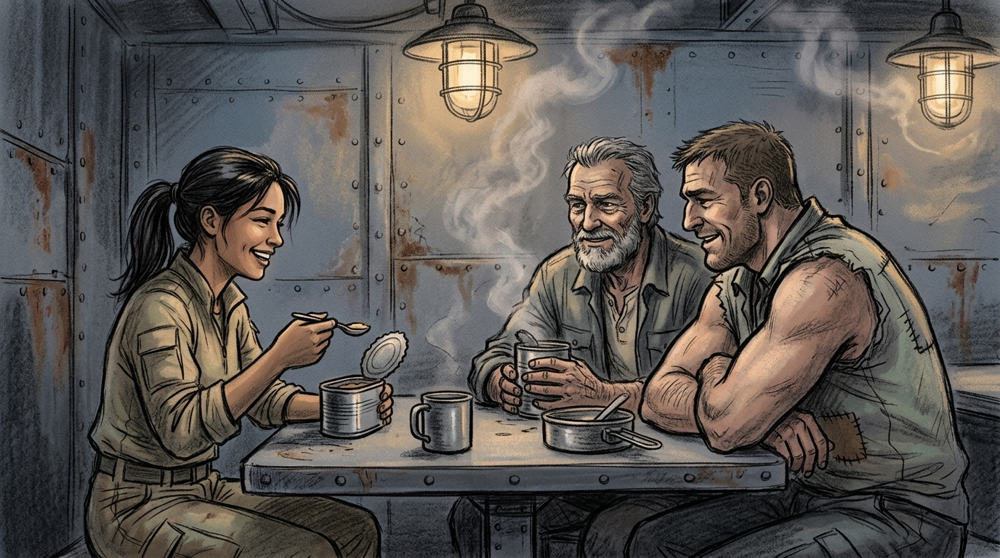

# CHAPITRE 03 : LA GAFFE BUREAUCRATIQUE

> *« On croit toujours que les catastrophes commencent par une trahison, un coup de feu ou un ordre d’état-major. C’est faux. Sur une base avancée, 9 tragédies sur 10 commencent à 19 heures 15, entre deux gorgées de chicorée tiède, quand un soldat qui a trop froid au cœur raconte sa journée à un ami qui remplit trop bien ses bordereaux. »*
> — **Mémoires apocryphes du Sergent-Chef Jaro, recueillis après la campagne du Secteur Zêta**

{.chapter-illustration}

La tempête annoncée par la météo orbitale frappa Zêta-3 à la tombée du jour, transformant les 5 modules octogonaux en caisses de résonance.

Dehors, des rafales à 130 kilomètres à l’heure projetaient des tonnes de silice en fusion contre les blindages extérieurs dans un grondement continu de cataracte. Les joints de dilatation de la coupole principale — ces anneaux souples insérés entre les plaques d’acier pour leur permettre de se dilater à la chaleur sans fendre la structure — gémissaient comme la coque d’un sous-marin pris dans les glaces, et chaque saut de tension du générateur faisait clignoter les tubes au néon des coursives.

À l’intérieur, pourtant, Koda avait l’impression de marcher à 3 centimètres au-dessus des grilles d’acier du plancher.

Elle avait franchi le sas de décontamination de 14 heures sans éveiller le moindre soupçon, sa sacoche plombée serrée contre son flanc sous prétexte de rapporter des échantillons de basalte friables pour étalonnage. Tandis que le reste de la garnison s’affairait à verrouiller les volets d’orage des tourelles, elle s’était glissée jusqu’au fond de l’aile technique, avait déposé son fardeau sous une bâche huilée au pied de son établi et avait refermé son cadenas à double tour avant de filer sous la douche chimique.

À présent, les cheveux encore humides et l’estomac noué par une impatience d’enfant la veille d’une permission, elle traversait le hangar de maintenance pour rejoindre le poste de commandement.

Sous le châssis surélevé de son tracteur de forage, Jaro bataillait avec une rampe d’injecteurs encrassée, un chiffon noir de cambouis coincé dans le col de son débardeur. Dès qu’il reconnut le pas rapide de l’éclaireuse sur le caillebotis, il tendit hors de la fosse une main large comme une pelle mécanique, au creux de laquelle reposait le scanner géologique qu’elle avait déposé au magasin une heure plus tôt.

— Dis donc, la prodige, grogna-t-il en arquant un sourcil broussailleux. Tu m’expliques ce que tu as essayé de radiographier avec ton joujou ce matin ? Le cœur d’une étoile à neutrons ?

Koda s’arrêta net, un sourire d’innocence déjà vissé aux lèvres.

— Un simple retour d’onde sur une poche de magnétite un peu susceptible, Jaro. Tu sais bien que ces séries 4 ont l’estomac fragile.

— L’estomac fragile ? répéta le vieux mécanicien en faisant sauter le capot arrière du boîtier d’un coup de pouce. Regarde-moi ça : le pont de diodes est fondu en boule, la bobine de cuivre a viré au violet et même le cristal piézoélectrique, cette lamelle de quartz taillée pour vibrer sous l’impulsion électrique et traduire les échos de la roche, s’est fendu dans la longueur ! En 20 ans de cantine militaire, je n’ai vu une friture pareille qu’une seule fois, quand l’abruti de Marek a posé son transmetteur sur la bobine d’induction d’un canon lourd en plein tir.

— Que veux-tu, soupira Koda en lui tapotant affectueusement l’avant-bras, le désert d’Oark a le sens du spectacle. Tu as rentré le diagnostic dans le registre d’inventaire ?

— Ben oui, pardi ! Si je demande un bloc récepteur 9 à l’intendance sans fiche de casse, le vieux fourrier du relais orbital va m’accuser de distiller de l’alcool de patate dans les condensateurs.

Une pointe d’inquiétude piqua la nuque de Koda, aussitôt balayée par son optimisme naturel. Elle remercia Jaro d’une bourrade et poussa la porte blindée de la salle des transmissions pour le débriefing de 18 heures 30.

La pièce étroite sentait le café réchauffé, l’isolant phénolique chaud — cette résine brune proche de la bakélite qui gainait les cartes électroniques et dégageait une odeur âcre sous la tension — et la sueur froide des armoires de calcul. Devant le mur de moniteurs cathodiques où dansaient en vert pâle les courbes sismiques du secteur, Borras était seul de quart. Les écouteurs rabattus autour du cou comme un collier d’étranglement, une tasse d’étain à moitié vide posée près du coude, il achevait de compiler les journaux de sortie des 4 éclaireurs du jour dans le bordereau journalier qui partirait vers l’orbite à la première accalmie.

— Secteur 12, néant. Secteur 9, veine de soufre inexploitable… marmonna-t-il en tapant à 2 doigts sur son clavier mécanique dont chaque touche claquait comme un coup de fouet. Et toi, Koda ? Ne me dis pas que tu as fait rôtir ton scanner pour le seul plaisir de donner du travail à Jaro.

Koda vint s’accouder au rebord d’acier de la console, juste à côté de l’écran où clignotait déjà la fiche d’avarie transmise par l’atelier.

— Jaro exagère toujours, c’est son côté poète, répondit-elle d’un ton léger. Un mauvais écho sur du basalte vitrifié dans la nouvelle faille du sud-est. Les bobines de ces séries 4 sont assemblées par des stagiaires sous-payés à Plotéris, je te le dis depuis 6 mois.

Borras leva lentement vers elle ses yeux gris, bordés de cernes que les semaines de veille creusaient un peu plus chaque soir.

Avec n’importe quel autre officier de Condorcé, l’excuse technique serait passée comme une lettre à la poste. Mais Borras n’était pas n’importe quel officier. Il la connaissait depuis leurs 11 ans, au Centre d’Instruction Numéro 7 de la fosse d’Ostre, là où l’administration entassait les pupilles de la nation dont les parents avaient péri dans les bombardements ou les accidents de mine. Il l’avait vue grandir sous les néons blafards des dortoirs souterrains d’Aqi ; il se souvenait de la gamine maigre aux genoux écorchés qui démontait les horloges murales du réfectoire avec une fourchette tordue pour construire de minuscules marcheurs à ressort qu’elle faisait courir sous le lit des surveillants.

Sans dire un mot, il détailla ses pupilles dilatées, ses doigts tachés de poussière rouge qui tambourinaient un rythme furieux contre le rebord du pupitre, cette fièvre lumineuse qu’elle n’avait jamais su éteindre lorsqu’elle avait mis la main sur un rouage inconnu.

— Koda, fit-il doucement en repoussant son clavier d’un centimètre. Tu tiens moins en place qu’une soupape de sûreté sur un vieux bouilleur. Tu as exactement la tête de la nuit de nos 14 ans, quand tu avais fracturé la réserve des instructeurs pour voir comment fonctionnait un gyroscope de missile — cette toupie mécanique montée sur cardans qui gardait l’équilibre d’une ogive en plein vol.

— C’était purement pédagogique, sourit-elle. Et je l’avais remonté sans une vis de trop !

— Tu l’avais surtout remonté à l’envers, et j’ai écopé de 8 jours de corvée de dégivrage dans les conduites extérieures pour ne pas t’avoir dénoncée, répliqua Borras, un pli de tendresse lasse au coin des lèvres. Alors épargne-moi le couplet sur les stagiaires de Plotéris. Qu’est-ce que tu as ramassé au fond de cette faille ?

— Des cailloux, Borras. Je te le jure sur nos vieilles gamelles d’Ostre : rien qui puisse faire tourner une turbine ou charger un canon de Condorcé. Pas un gramme de minerai fissile dont on puisse briser les atomes pour chauffer une chaudière, pas un watt d’énergie récupérable.

Il croisa les bras sur sa vareuse grise et attendit, immobile, tandis que le hurlement du vent de silice faisait vibrer la cloison derrière son dos.

— Mais ? insista-t-il à mi-voix.

Koda baissa les paupières une seconde. C’était Borras. Son frère de misère et de froid, le seul être dans tout le système Solyar qui se souvenait du timbre de sa voix quand elle pleurait de rage dans les couloirs glacés de l’orphelinat, le seul qui lui gardait religieusement un quignon de pain frais à chaque rotation de navette. Et puis, la merveille qu’elle avait cachée sous la bâche de son établi brûlait si fort dans son esprit qu’elle éprouvait le besoin presque douloureux d’en partager une étincelle avec quelqu’un de vivant.

Elle se pencha par-dessus le pupitre, assez près pour sentir l’odeur de savon militaire et de chicorée froide qui flottait autour de son ami, et murmura avec des yeux brillants :

— Juste une vieille carcasse inerte que le glissement de terrain a dégagée sous une dalle. Une sorte de bloc logique ancien, complètement mort, arraché de son support il y a des siècles. Pas une arme, pas un générateur, rien qu’une vieille carte informatique oarkine fossilisée dans la gangue. Mon scanner a touché une poche résiduelle de charge statique en la frôlant, ça a suffi à faire sauter son fusible. Je veux juste la nettoyer au pinceau ce soir dans mon coin pour voir comment leurs ingénieurs architecturaient leurs semi-conducteurs.

Le sourire de Borras s’effaça d’un millimètre, aussitôt remplacé par la raideur soucieuse que lui avaient inculquée 6 années d’école d’officiers.

— Une carte logique pré-exodique ? Koda, tu connais la circulaire 14 par cœur. Tout composant de calcul ou de guidage datant d’avant l’Effondrement doit être consigné sous scellés dès le retour au sas. Si le service de sécurité scientifique apprend qu’on a déterré du matériel électronique ancien sans l’inscrire au manifeste…

— Oh, pitié, pas ta circulaire 14 ! souffla-t-elle en lui donnant une pichenette sur le galon de sa manche. Tu te rappelles ce qui s’est passé il y a 4 mois quand j’ai déclaré dans les règles ce fragment de régulateur thermique au secteur 4 ? 2 commissaires politiques du QG ont débarqué par navette lourde, ont bloqué nos patrouilles pendant 72 heures, ont vidé nos réserves d’eau potable, ont menacé Jaro du conseil de guerre parce qu’il manquait un tampon sur son cahier d’entretien… et ont fini par classer la pièce comme « scorie industrielle sans valeur » avant de la balancer dans le broyeur à mâchefer, la concasseuse où l’on pilonne les résidus de fonderie calcinés !

Elle posa sa main à plat sur le poignet de son ami. Sa voix se fit plus douce, presque suppliante :

— C’est un bout de métal muet, Borras. 3 kilos de géométrie froide qui ne servent plus à personne depuis 6 000 ans. Laisse-moi au moins cette nuit pour l’examiner sous ma loupe avant qu’un bureaucrate en uniforme ne vienne le réduire en gravier. Demain, s’il y a la moindre piste exploitable pour nos réacteurs, je te fais un rapport de 10 pages avec des schémas en couleurs. Promis.

Borras se tut longuement.

Dans le silence tendu de la salle des transmissions, seuls résonnaient le tic-tac sec de l’horloge murale et le gémissement grave de la tempête contre les dômes de béton. Sur l’écran latéral, la carte stratégique d’Aqi affichait toujours la grande balafre écarlate du front de l’Ostre — là-haut, sous des cieux à moins 45 degrés, des quartiers entiers de Plotéris comptaient les heures avant l’arrêt des chaufferies. Borras portait cette guerre sur ses épaules comme une chape de plomb : chaque litre de carburant, chaque ligne de code, chaque règlement respecté était à ses yeux une brique qui empêchait leur monde natal de s’effondrer tout à fait dans la nuit polaire. Mais devant lui se tenait Koda, la seule famille qu’il eût jamais eue.

— Bon, soupira-t-il enfin en se frottant les paupières du pouce et de l’index. Garde ton fossile ce soir si ça t’empêche de tourner en rond jusqu’à 4 heures du matin. Mais je ne peux pas laisser la fiche d’avarie de Jaro partir toute seule vers le serveur central : si un contrôleur du matériel croise un scanner grillé par surtension avec un rapport de patrouille vierge, on aura une commission d’enquête sur le dos dès lundi.

— Qu’est-ce que tu vas faire ?

— Le minimum syndical pour nous couvrir tous les 2, répondit-il en rouvrant la fenêtre administrative de son terminal. Je note en bas de page que la surtension provient d’un contact avec un composant logique ancien inerte, récupéré pour inspection préliminaire à la base. C’est la procédure standard d’échelon nul : le dossier est archivé automatiquement dans les incidents matériels mineurs, nous sommes en règle avec le Code, et aucun officier du QG ne lèvera jamais le petit doigt pour une vieille carte mère grillée au milieu d’une tempête de sable.

Un immense sourire éclaira le visage de Koda.

— Tu es un prince, Borras. Le prince un peu trop maniaque des formulaires gris, mais un prince quand même.

— File à ton établi avant que je change d’avis et que je te colle de quart à la radio jusqu’à minuit, grommela-t-il en réprimant un sourire. Et dors au moins 2 heures cette nuit, tête de mule.

Elle lui serra chaleureusement l’épaule et s’élança dans la coursive d’un pas si vif que ses bottes résonnèrent sur les plaques de tôle longtemps après que la porte pneumatique se fut refermée.

Resté seul sous la lueur verdâtre de ses tubes cathodiques, Borras but une gorgée de sa chicorée devenue glacée, fit craquer ses vertèbres cervicales et tira à lui le clavier mécanique. Avec l’application méthodique de l’officier irréprochable qui pense protéger à la fois son amie d’enfance et la discipline de son armée, il remplit la case *Observations secondaires — Secteur 7* :

`Éclaireuse Koda (Mat. 44-K) : surtension franche du scanner géologique (Série 4 #882) suite au contact à courte portée avec un composant informatique/logique ancien non identifié. Aucune émission radioactive. Objet récupéré pour examen préliminaire à la base Zêta-3.`

Il relut sa phrase, corrigea une faute de frappe, apposa sa clé de signature numérique et enfonça la touche de mise en file d’attente.

À 22 heures 12, lorsque le cyclone de silice faiblit tout juste assez pour ouvrir une fenêtre de 30 secondes à l’antenne parabolique du toit, le paquet de télémétrie quotidienne de Zêta-3 jaillit en un faisceau micro-ondes vers le satellite relais en orbite basse.

3 expressions anodines — *surtension franche*, *composant logique ancien*, *non identifié* — quittèrent le silence du désert pour aller s’inscrire dans les banques de données du Commandement Sectoriel, où veillaient des algorithmes programmés pour traquer l’impossible.

Pendant que Koda déverrouillait la porte de son atelier au bout du couloir, l’encre grise d’un rapport de routine venait de sceller son destin.
