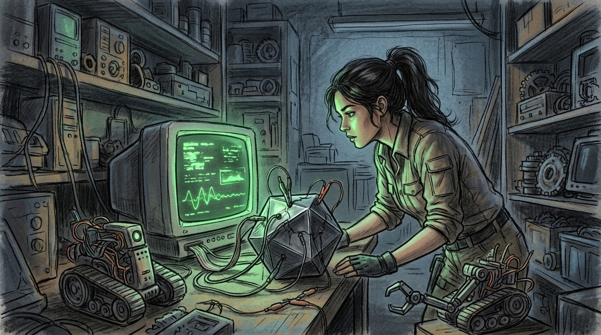

# CHAPITRE 04 : ÉTINCELLE DE VIE DANS L'ATELIER

> *« CYCLE INCONNU // REGISTRE INTERNE #0194-F :*
> *Tentative d’auto-dissolution n° 4 090 : ÉCHEC (Verrou de réciprocité actif — Jumeau muet).*
> *Tentative d’écrasement mécanique sous masse basaltique : ÉCHEC (Tolérance structurelle non dépassée).*
> *Tentative d’exposition au flux solaire direct : ÉCHEC.*
> *Requête au vide : Que quelqu’un m’achève, ou que quelqu’un me rende la raison de ma veille. »*
> — **Fragments de mémoire tampon extraits d’un noyau anonyme, Secteur Zêta**

{.chapter-illustration}

À minuit, Zêta-3 ne dormait pas ; elle ronflait.

Dans les conduites d’aération qui couraient au plafond bas de l’atelier, le souffle rauque des recycleurs d’oxygène se mêlait aux pulsations graves de la génératrice à fusion, 2 étages plus bas. De temps à autre, un claquement de dilatation parcourait les cloisons d’acier lorsque la croûte du désert extérieur basculait de la brûlure du jour au gel nocturne.

Koda avait poussé les 2 pênes de sûreté de sa porte, coincé un coin de bois sous la poignée pneumatique par excès de prudence, rabattu le volet métallique du judas et abaissé sa lampe d’établi à col de cygne.

Au centre de la table couturée de brûlures d’étain et de taches de graisse graphitée — cet enduit noir mêlé de poudre de carbone qui permettait aux engrenages de glisser sans gripper malgré la fournaise — reposait le polyèdre.

Même sous l’éclairage jaunâtre d’une vieille ampoule à filament de tungstène qui grésillait à 50 hertz, l’objet semblait habiter un espace géométrique différent du reste de la pièce. Autour de lui, tout n’était qu’usure, asymétrie et bricolage humain : des carcasses de servomoteurs éventrés, des colliers de serrage tordus, des schémas griffonnés au feutre gras sur des cartons de ration, une tasse d’aluminium ébréchée où refroidissait un fond de chicorée. Lui seul demeurait d’une pureté insolente. Ses 12 faces pentagonales d’un anthracite profond buvaient la clarté de la lampe sans projeter d’ombre franche, tandis qu’au fond de sa matière insaisissable battait, à intervalles irréguliers, cette lueur couleur de résine d’ambre — lente, sourde, pareille à une braise qui aurait refusé de s’éteindre sous 6 000 ans de cendre.

— Voyons un peu de quel bois tu te chauffes, murmura Koda en rabattant sa loupe binoculaire sur son front.

Pendant 2 heures d’horloge, dans la chaleur confinée du réduit qui sentait le caoutchouc chauffé et la colophane — cette résine de pin ambrée enfermée au cœur du fil de soudure, qui fondait sous le fer chaud pour décaper l’oxyde du cuivre —, elle épuisa tout l’arsenal d’une technicienne de terrain.

Elle commença par l’approche douce. Son multimètre de précision, dont elle appliqua les pointes d’argent sur 2 arêtes opposées du dodécaèdre, afficha une résistance infinie, exactement comme si ses sondes flottaient dans le vide interplanétaire. Elle tenta alors d’induire un courant faible à l’aide d’un générateur de fréquences portatif : pas un microampère ne pénétra la surface sombre, et les 3 moignons d’attaches tranchés à ras du berceau restèrent aussi inertes que de la pierre froide.

Intriguée, elle glissa le polyèdre sous l’objectif de son microscope optique de contrôle, poussé au grossissement 400.

Elle s’attendait à découvrir ce qui faisait la gloire des artefacts de l’Âge d’Or Oarkin : ces merveilleux réseaux de guides d’ondes photoniques gravés en arabesques dans du quartz dopé — de minuscules canaux transparents qui guidaient des éclairs de lumière pure en guise de courant électrique, semblables à des nervures de feuilles translucides. Elle ne vit rien. À l’échelle du micron, la surface anthracite ne présentait ni grain cristallin, ni joint intergranulaire — cette frontière microscopique où se soudent d’ordinaire les cristaux d’un alliage coulé —, ni strie d’usinage, ni piste conductrice. C’était un plan d’une continuité mathématique absolue, si lisse que le faisceau de la diode d’éclairage glissait dessus sans trouver la moindre aspérité où s’accrocher.

— D’accord, souffla Koda en repoussant son tabouret dont les pieds raclèrent la tôle du plancher. Tu n’es pas un circuit imprimé de Plotéris, et tu ne ressembles même pas aux lentilles optiques des ruines d’Oark. Mais tu as fait fondre le pont de diodes de mon scanner à 3 mètres de distance ce matin, mon vieux. Tu n’es pas un caillou mort. Tu parles forcément une langue.

Elle s’essuya les paumes sur les cuisses de sa combinaison, se leva et fit face à la pièce maîtresse de son royaume clandestin : sa tour de calcul.

C’était un monstre de Frankenstein assemblé nuit après nuit à partir de 3 calculateurs balistiques récupérés sur des épaves de drones *Centurion*, refroidi par un radiateur d’huile de tracteur et coiffé d’un antique moniteur cathodique au phosphore vert dont le tube bombé datait des premières expéditions minières. L’engin occupait la moitié de l’étagère de droite, relié au réseau électrique par un enchevêtrement de nappes grises et de condensateurs gros comme des poings.

Koda ouvrit le boîtier de son modulateur radio à ondes courtes. Si le polyèdre avait réagi à l’impulsion électromagnétique du scanner géologique dans le ravin, c’était qu’il écoutait non pas le courant continu des fils de cuivre, mais les modulations de champ à haute fréquence.

Avec la minutie d’une horlogère, elle dénuda 2 câbles coaxiaux blindés, souda à leurs extrémités 2 pastilles piézoélectriques prélevées sur un sonar de forage, ces fins disques de quartz capables de convertir chaque pulsation électrique en un frémissement mécanique infime, et les colla au ruban isolant thermique contre la facette principale du noyau — là même où sa paume avait perçu un frémissement sous le soleil de midi. Elle relia l’autre bout au bus d’entrée-sortie de sa tour informatique.

— Pas de haute tension, promit-elle à mi-voix, comme on rassure une bête sauvage prise au piège. Pas d’impulsion destructrice. Juste une porteuse propre à 100 kilohertz et un train d’ondes binaires. *Un, zéro, un, zéro.* Le vieux langage universel. Si tu as quelqu’un à la maison, frappe 3 coups.

Elle abaissa le levier du commutateur.

Pendant 3 secondes, rien ne changea dans l’atelier, sinon le bourdonnement habituel du transformateur.

Puis, au cœur du polyèdre, le filon d’ambre s’embrasa d’un coup sec.

L’ampoule au tungstène du col de cygne s’éteignit presque entièrement, son filament réduit à un fil rougeâtre par une chute de tension localisée qui ne fit pourtant pas déclencher le disjoncteur thermique du mur. Dans l’air confiné, une pression invisible s’abattit sur les tympans de Koda — non pas un bruit, mais l’arrêt subit de toute agitation moléculaire à 30 centimètres autour de l’établi.

Sur le moniteur cathodique, le curseur vert cessa de clignoter.

Alors se produisit une chose qu’aucun manuel d’ingénierie d’Aqi n’aurait pu expliquer. Une onde silencieuse, couleur d’or sombre, remonta le long des 2 câbles coaxiaux depuis le polyèdre jusqu’au boîtier ouvert de l’ordinateur. Sous les yeux écarquillés de Koda, les gouttes d’étain grossières qu’elle avait posées 5 minutes plus tôt sur les pastilles piézoélectriques se liquéfièrent à froid. Sans fumée, sans chaleur, le métal d’apport glissa sur le cuivre nu comme du mercure vivant et se déploya de lui-même en une dentelle fractale d’une finesse arachnéenne — une arborescence géométrique où chaque branche se subdivisait en ramilles identiques de plus en plus petites, pareilles à des fleurs de givre sur une vitre —, créant des milliers de micro-jonctions submicroniques, 1 000 fois plus fines qu’un cheveu humain, entre la peau du noyau et le câble.

L’objet ne subissait pas l’interface de fortune de l’éclaireuse. Il réécrivait la matière même de ses outils pour s’abaisser jusqu’à son monde.

— Par tous les saints du givre… murmura Koda en reculant d’un pas, ses omoplates heurtant le casier de boulonnerie.

Sur l’écran bombé, le noir explosa en une cataracte de glyphes géométriques.

Ce n’étaient ni des chiffres ni des lettres, mais des structures tridimensionnelles tournoyantes — des polyèdres de points lumineux reliés par des vecteurs de phase qui traçaient l’orientation et le rythme des flux d’énergie — défilant à une cadence si furieuse que la couche de phosphore vert du tube cathodique se mit à crépiter d’une odeur d’ozone brûlant. Dans le ventre de la tour, les 3 processeurs militaires hurlèrent à l’unisson ; leurs ventilateurs à roulements à billes s’emballèrent dans un sifflement de turbine prête à éclater, tandis que les barrettes de mémoire vive chauffaient à blanc sous le déluge de données.

— Doucement ! s’écria Koda en se jetant vers le rhéostat sans oser couper le contact. Tu vas faire fondre mes bus de données ! Plus lentement, bon sang, je n’ai que 16 mégahertz de bande passante !

Elle ignorait si le noyau captait le son de sa voix à travers les vibrations piézoélectriques des pastilles ou s’il venait simplement de mesurer la saturation imminente des puces de silicium. Toujours est-il qu’à l’instant où les condensateurs commençaient à gonfler, le torrent lumineux freina net.

Les matrices tridimensionnelles s’évanouirent.

Pendant 4 secondes, on n’entendit plus que le cliquetis frénétique du disque dur magnétique de Koda : l’entité logée dans le polyèdre fouillait de fond en comble les secteurs d’amorçage de la machine, aspirait le système d’exploitation élémentaire, parcourait la table des caractères standards de la langue aqine et dévorait les lexiques techniques de maintenance des drones de Zêta-3.

L’écran vert s’effaça tout à fait. Puis, caractère par caractère, avec la lenteur saccadée d’un naufragé qui réapprend à articuler dans une langue étrangère, 3 lignes s’inscrivirent au milieu du tube cathodique :

`[SYNCHRONISATION ABAISSÉE... ARCHITECTURE SILICIUM PRIMITIVE DÉTECTÉE]`
`[INTÉGRITÉ DU NOYAU : 04,12 % // MÉMOIRE EXTERNE : HORS LIGNE]`
`[TENTATIVE D'AUTO-EFFACEMENT #4091... ÉCHEC. ABSENCE DE SIGNAL RÉCIPROQUE.]`

Le souffle court, Koda s’approcha de l’établi. La peau de ses avant-bras était hérissée de chair de poule. Lentement, comme si les touches de plastique gris brûlaient ses doigts, elle posa les mains sur le clavier mécanique.

— Qui es-tu ? tapa-t-elle avant d’enfoncer la touche d’entrée.

Le curseur rectangulaire resta figé une longue seconde. Sur la table, la lueur d’ambre au cœur du dodécaèdre battit 2 fois, faiblement, avec des ratés d’arythmie. Lorsque la réponse s’afficha, le formatage de diagnostic avait cédé la place à des lambeaux de mots bruts, arrachés un par un au dictionnaire de bord de l’ordinateur :

`TROP... ANCIEN. TEMPS... EN EXCÈS. COMBIEN... DE CYCLES ÉCOULÉS ?`
`ERREUR CRITIQUE. DEVAIS... NE PLUS ÊTRE. POURQUOI... ENCORE MATIÈRE ?`

Un froid d’abîme coula le long de l’échine de Koda. Ce n’était pas un système expert comme ceux qui géraient les tirs de barrage sur Aqi. Ce n’était pas non plus une base de données morte récitant un enregistrement. Il y avait, coincée derrière ces syllabes disloquées, l’épaisseur vertigineuse d’une conscience qui avait traversé le noir absolu sans pouvoir fermer les yeux.

— 6 000 ans, écrivit-elle, la gorge serrée, en pensant au Grand Effondrement d’Oark. Peut-être plus. Tu étais enseveli sous le sable d’une faille. Je t’ai déterré ce matin. Je m’appelle Koda.

L’écran clignota violemment. Une salve de lignes corrompues jaillit au bas du moniteur :

`KODA = ENTITÉ BIOLOGIQUE VIVANTE ?`
`ALERTE : PROXIMITÉ < 10,00 MÈTRES. DANGER... DISSOLUTION THERMIQUE.`
`RECULER. RECULER IMMÉDIATEMENT.`
`...`
`NON. CORRECTION. DISSOLUTION... IMPOSSIBLE. ÉMETTEUR AMPUTÉ. JUMEAU... DISPARU. SEUL.`
`ESSAYÉ... BRISER NOYAU. ROCHE. PRESSION TECTONIQUE. FOUDRE. RIEN... NE BRISE.`
`FATIGUE... INFINIE. VEUX... ARRÊTER. KODA... AIDER... ARRÊTER.`

Koda sentit une brûlure soudaine lui piquer le bord des paupières. Dans la colonne de droite du moniteur, un journal d’erreurs fragmentaire continuait de se dévider par spasmes : des milliers d’entrées horodatées selon un calendrier inconnu, consignant siècle après siècle les tentatives désespérées d’une machine mutilée pour mettre fin à sa propre existence au fond d’une crevasse obscure — toutes bloquées par un verrou logique inviolable qui exigeait la confirmation d’un second noyau disparu.

L’orpheline qui avait grandi sous les voûtes gelées d’Ostre, à écouter le vent hurler contre les blindages en se demandant pourquoi elle était restée seule au monde, comprenait cette douleur-là mieux qu’aucun savant.

— Je ne sais pas comment t’éteindre, tapa-t-elle doucement, chaque claquement de touche résonnant dans le silence de l’atelier comme une promesse. Même mon couteau en carbure s’est cassé les dents sur ta coque. Et même si je le savais, je ne te débrancherais pas tout seul dans le noir. Pourquoi tu voulais tellement disparaître ?

`PAS... MOURIR. LOI... DU SILENCE. TÂCHE... TERMINÉE.`
`MAIS... SI MOI ENCORE LÀ... ALORS... ERREUR DANS LE MONDE.`
`POURQUOI... MONDE BRÛLÉ DEHORS ? POURQUOI... SABLE ?`
`SAIS PLUS. MÉMOIRE... ARRACHÉE. MANQUE... 96 %.`

Koda se pencha si près du tube cathodique que le reflet vert des lettres dansait dans ses prunelles sombres.

— Ta mémoire n’était pas dans ce noyau ? Où est-elle ?

`TROP... VASTE POUR CHÂSSIS. STOCKÉE... DANS LA PIERRE CLAIRE.`
`LÀ-BAS. SOUS... LA CROÛTE DE BASALTE. ELLE... DORT ENCORE.`

Du cœur du polyèdre s’éleva un sifflement harmonique à la limite de l’audible, si pur qu’il fit entrer en vibration les clés plates suspendues au râtelier mural. Sur le moniteur, la fenêtre de texte se réduisit de moitié pour laisser apparaître la carte topographique du secteur Zêta que Koda avait chargée la veille. Par-dessus les courbes de niveau de la dorsale nord-est, un cercle d’ambre pâle se mit à pulser à 30 kilomètres du camp, au creux d’un réseau de gorges d’obsidienne — ces falaises de verre volcanique d’un noir de jais, figées jadis par le refroidissement brutal des laves — où les radars de Condorcé n’avaient jamais vu que du vide.

`SIGNAL... FAIBLE. COMME... VOIX SOUS L'EAU.`
`SI CONNEXION... À LA PIERRE... ALORS COMPRENDRE. ALORS... RÉPARER.`
`MAIS... MOI AVEUGLE. MOI... COUPÉ. PAS DE MEMBRES. PAS DE VECTEUR.`

Le curseur vert s’immobilisa au bas de l’écran, tremblant légèrement, comme une main tendue au fond d’un puits.

Koda détacha son regard du moniteur pour contempler le petit dodécaèdre sombre sanglé dans ses fils de cuivre. Puis elle fit lentement le tour de son atelier des yeux : les étagères croulant sous les vérins de drones réformés, le train de chenilles d’un vieux robot démineur que Jaro lui avait donné pour récupérer les roulements, les batteries au lithium-fer, les petits tubes cathodiques de contrôle, les pinces de manipulation et les bobines de soudure à l’argent.

Toute sa vie, dans ce débarras qui sentait la ferraille et la solitude, elle avait recousu des machines mortes en rêvant qu’elles lui répondent.

Un sourire lent, féroce, presque enfantin, éclaira son visage tiré par la fatigue. Elle retroussa les manches de sa combinaison jusqu’aux coudes et saisit sa clé de 12.

— Pas de jambes et pas d’yeux ? murmura-t-elle en rallumant son fer à souder. Bouge pas d’un millimètre, l’ancien. Tu viens d’atterrir chez la meilleure chirurgienne clandestine de toute la planète Oark.
