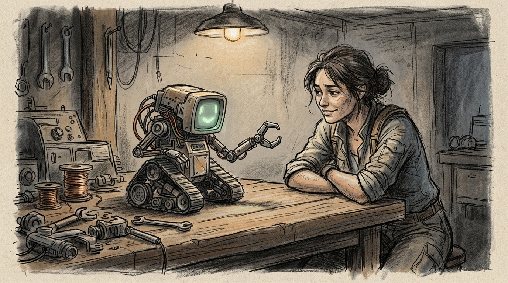

# CHAPITRE 05 : UN CORPS DE BRIC ET DE BROC

> *« Règle numéro un de la récupération en zone aride : il n’existe pas de pièce incompatible, il n’existe que des mécaniciens qui manquent d’imagination ou de ruban isolant. Si un réacteur de drone refuse de rentrer dans un carter de pompe à boue, prends un marteau plus lourd. S’il couine au démarrage, c’est la preuve qu’il est vivant. »*
> — **Carnet d’établi de l’Éclaireuse Koda (Mat. 44-K), note en marge d’un schéma d’assemblage illicite**

{.chapter-illustration}

Il fallut 48 heures de double vie, 3 bobines d’étain à l’argent, 2 brûlures du second degré au pouce gauche et une quantité déraisonnable de jurons étouffés pour accoucher du prodige le plus laid de toute l’histoire de la robotique.

Le jour, Koda assurait ses patrouilles réglementaires dans le désert d’ocre avec des yeux rougis par le manque de sommeil, mâchant des grains de café torréfié sous son casque pour ne pas s’endormir au guidon de sa moto-chenille. Mais dès que le couvre-feu de 22 heures éteignait les coursives de Zêta-3, elle se barricadait dans son réduit et reprenait son œuvre de démiurge ferrailleur.

La difficulté ne venait pas du châssis — Koda aurait pu assembler un tracteur les yeux bandés —, mais de l’abîme vertigineux qui séparait la physique du noyau de celle de ses pièces de rechange.

Lors de la première nuit de montage, alors qu’elle tentait de relier directement le polyèdre anthracite au contrôleur de puissance d’un servomoteur standard de 24 volts, la simple impulsion de test du noyau avait instantanément magnétisé l’acier du rotor et soudé sur place les charbons du collecteur, ces petits patins de graphite censés glisser en souplesse pour distribuer le courant. C’était comme essayer d’atteler la foudre en boule à une charrette à bras en bois vermoulu.

— Doucement, l’artiste ! avait soufflé Koda devant le moteur fumant, tandis que l’écran vert de sa tour informatique affichait un laconique : `RÉSISTANCE MATÉRIAU INSUFFISANTE // FRAGILITÉ EXTRÊME`.

Pour protéger ses pauvres composants aqins de la perfection trop brutale de leur passager, elle avait dû intercaler tout un labyrinthe de ponts abaisseurs qui divisaient la tension électrique étage par étage, d’optocoupleurs bricolés avec des diodes de visée laser — où l’ordre franchissait un vide isolant sous la forme d’un simple éclat lumineux afin d’éviter tout contact électrique direct — et de condensateurs tampons noyés dans de la pâte silicone.

À 4 heures du matin, au terme de la deuxième nuit blanche, elle posa enfin son fer à souder sur son support en fil de fer, s’essuya le front d’un revers de manche noir de suie et recula d’un pas, les poings sur les hanches.

Un rire silencieux secoua ses épaules.

— Si les ingénieurs de l’Académie de Plotéris voyaient ça, ils me feraient fusiller pour haute trahison esthétique.

Au milieu de l’établi trônait une créature haute de 60 centimètres qui semblait issue du croisement accidentel entre un char de déminage, un percolateur de cantine et un oscilloscope de bord des années héroïques — l’un de ces vieux cadrans de contrôle où les pulsations électriques dansaient en courbes vertes.

Pour la base motrice, Koda avait greffé le train roulant d’un vieux robot démineur réformé après avoir sauté sur une poche d’acide : la chenille gauche, issue d’un modèle lourd à patins d’acier, était 2 centimètres plus large que la chenille droite en caoutchouc cranté. Cette dissymétrie donnait à l’ensemble une gîte permanente de 5 degrés sur tribord, que Koda avait compensée tant bien que mal en boulonnant sur le flanc gauche un amortisseur à ressort hélicoïdal légèrement tordu, récupéré sur un siège de tracteur.

Au centre du torse — une caisse à munitions de 30 millimètres en tôle d’aluminium emboutie, percée à la chignole et rivetée à la main —, elle avait façonné un berceau antichoc en mousse néoprène haute densité. Le dodécaèdre anthracite y était maintenu par 4 colliers de serrage en acier inoxydable, pareil à un diamant royal serti dans une boîte de conserve.

En guise de tête, monté sur une rotule de projecteur qui lui permettait de pivoter dans tous les sens, un petit moniteur cathodique cubique de 6 pouces affichait sa vitre bombée. Koda avait fixé sur sa tempe gauche le bloc optique d’une caméra de drone *Centurion* aux lentilles multiples, et sur sa tempe droite un haut-parleur de radio de campagne dont la grille cabossée tenait avec 3 tours de ruban isolant noir. 2 bras articulés parfaitement dépareillés complétaient l’anatomie du monstre : à gauche, une pince de préhension industrielle à 3 doigts caoutchoutés ; à droite, une minuscule torche de soudure au plasma dont elle avait bridé l’injecteur pour en faire un doigt de précision.

— Allez, murmura Koda, le cœur battant un peu plus vite qu’elle n’aurait voulu l’avouer. Voyons si tu supportes ton nouveau costume du dimanche.

Elle débrancha le câble ombilical qui reliait le noyau à sa grosse tour informatique, le raccorda au bus central du châssis et rabattit le disjoncteur de la batterie dorsale au lithium-fer.

Un claquement sec de relais retentit dans la caisse à munitions.

La chenille large fit un quart de tour à vide sur la table, le ressort de suspension tordu poussa un *couic* aigu et indigné — une vibration métallique pure à 2 410 hertz —, et le petit écran cathodique cubique s’alluma d’une lueur verte tremblotante.

Sur la tempe du moniteur, le diaphragme en iris de la caméra de drone s’ouvrit et se ferma 3 fois avec un cliquetis sec d’insecte mécanique, cherchant la mise au point dans la pénombre de l’atelier avant de se verrouiller sur le visage barbouillé de cambouis de Koda.

Sous ses colliers de serrage, le polyèdre d’ambre pulsa d’un éclat profond.

Ce qui se passa durant les 4 secondes suivantes releva du prodige silencieux. L’intelligence logée dans le noyau prit possession de cette carcasse de rebut comme un virtuose s’assoit devant un piano désaccordé aux cordes rouillées. Koda entendit les micro-relais claquer en rafales : l’entité mesurait le jeu désastreux des pignons d’acier, calculait la latence pathétique des fils de cuivre, évaluait la friction de chaque maillon de chenille, soupirait électroniquement devant la grossièreté de l’architecture aqine… puis réécrivait à la volée ses propres lois d’asservissement pour dompter la ferraille.

Le petit robot leva lentement sa pince à 3 doigts devant son unique caméra, ouvrit et ferma les mâchoires caoutchoutées au dixième de millimètre près, puis abaissa son regard vers sa chenille bancale.

Le haut-parleur scotché cracha une salve de friture statique avant de lâcher, d’une voix métallique hachée qui recollait bout à bout des phonèmes découpés dans les enregistrements vocaux du journal de bord de Koda :

— Châssis… asymétrique. Rendement énergétique… 4,2 %. Masse… mal répartie. Ressort gauche… couinement… 2 410 hertz. Inutile.

Koda plaqua une main sur sa poitrine dans une parodie d’indignation.

— Eh ! Un peu de respect pour la main-d’œuvre, monsieur le difficile ! J’ai sacrifié mon meilleur transformateur torique — cette lourde couronne de fer doux bobinée de cuivre pur — et le train roulant de secours de Jaro pour te donner des jambes ! Et puis je te ferai dire que sur Oark, tout ce qui sort d’usine trop propre meurt en 20 minutes dans la silice. Toi, au moins, tu es du vrai bric et de broc. Indestructible par l’absurde. Tiens, voilà ton baptême : tu t’appelleras **Bricole**.

La rotule du cou pivota de 15 degrés sur le côté — une inclinaison d’une expressivité si comiquement perplexe que Koda ne put retenir un éclat de rire qu’elle étouffa aussitôt dans son coude en songeant aux dortoirs voisins.

Sur le petit écran vert de 6 pouces qui servait de visage à la machine, l’entrée du dictionnaire technique de Zêta-3 s’afficha en lettres capitales :

`BRICOLE (n. f.) : Réparation provisoire effectuée avec des moyens de fortune. Objet ou travail de peu d'importance.`

— Définition… péjorative, protesta le vocodeur grésillant tandis que le ressort poussait un nouveau *couic* d’approbation. Moi… pas provisoire. Moi… unité… haute priorité.

— Pour l’instant, tu es surtout une unité haute priorité qui tient avec du chatterton noir et 4 boulons de 12 chiés par une presse de Plotéris, répliqua Koda en tapotant affectueusement le capot du moniteur cubique. Alors tu vas t’appeler Bricole, ça nous évitera d’attirer la foudre des règlements, et tu vas me montrer si tu sais marcher droit avant de faire le fier.

Le petit robot engagea ses moteurs de traction pour avancer jusqu’au bord de l’établi.

Mais sa logique interne, habituée jadis à commander des membres d’une symétrie parfaite, envoya la même tension aux 2 trains roulants : la chenille large d’acier mordit le bois avec 2 fois plus de couple que la bande de caoutchouc droite, l’amortisseur poussa son *couic* lamentable, et Bricole vira brusquement à 45 degrés, manquant de plonger la tête la première dans la caisse à ferraille avant que Koda ne le rattrape au vol par sa poignée dorsale.

— Hop là ! Doucement, champion ! sourit-elle en le reposant à plat sur les dalles d’acier du plancher. Tes servomoteurs ont du retard à l’allumage, ce n’est pas ton cerveau de cristal. La chenille gauche tire comme un mulet borgne et le vieux ressort de Jaro rebondit à contretemps. Il faut que tu compenses à la main… enfin, à la bobine.

La lentille de drone se resserra sur le sol.

Pendant 3 secondes, Bricole procéda à une série de micro-impulsions presque imperceptibles, faisant frémir ses patins sur place. En moins de temps qu’il n’en fallait à Koda pour s’accroupir, le noyau recalibra la modulation de largeur d’impulsion envoyée à chaque bobinage électrique — hachant le courant en milliers de créneaux par seconde pour doser la poussée de chaque roue au microvolt près, avec une finesse qu’aucun automate de Condorcé n’aurait jamais pu calculer.

Puis il s’élança.

Le résultat tint de la prestidigitation pure. Malgré sa carcasse de travers, sa boîte à munitions cabossée et son moniteur trop lourd, le petit assemblage de rebut se mit à glisser entre les pieds de l’établi et les piles de caisses avec une fluidité presque féline. Il exécuta un 8 serré autour des bottes de Koda, freina à un demi-millimètre d’une burette d’huile sans même en faire trembler la goutte bombée qui affleurait au bout du bec verseur, repartit en marche arrière et s’immobilisa pile devant elle, ne laissant dans le silence de l’atelier que le petit *couic* rythmique et doux de son ressort apprivoisé.

— Eh ben mon vieux… souffla Koda, sincèrement admirative. Si Jaro voyait son démineur danser la valse comme ça, il arrêterait la bière de synthèse.

— Compensation… vectorielle… élémentaire, déclara Bricole. Mais châssis… toujours laid.

— On a le physique qu’on peut, mon grand. Regarde-moi : un mètre 65, une cicatrice d’étain dans le sourcil et une combinaison qui sent le vieux filtre à huile. On fait la paire.

Assise en tailleur sur le plancher froid, le dos appuyé contre le bâti de son tour à métaux, Koda contempla la petite machine qui la dévisageait de son œil unique.

Maintenant que le noyau n’était plus prisonnier de l’immobilité et du noir, son comportement changeait à vue d’œil. Privé des 96 % de sa mémoire externe, le processeur d’ambre cherchait voracement à remplir le vide de son esprit en absorbant tout ce qui se trouvait à portée de son unique caméra et de son microphone : les gestes de Koda, ses soupirs, ses jurons d’atelier, l’intonation chantante de ses moqueries, jusqu’à la façon dont elle penchait légèrement la tête sur la gauche lorsqu’elle doutait d’une soudure.

Au bout d’une heure, Bricole ne s’exprimait déjà plus comme un terminal de diagnostic. Il testait les mots de l’éclaireuse comme un enfant essaie des outils trop grands dans une forge.

Il fit rouler ses chenilles jusqu’à une étagère basse où s’alignaient une douzaine de carcasses de petits scarabées mécaniques que Koda avait fabriqués au fil des mois avec des relais grillés et des ressorts de montre. De sa pince à 3 doigts, il en souleva un sans le déformer d’un micron et le tourna vers la jeune femme.

— Quoi… fonction ? demanda le vocodeur. Pas… arme. Pas… outil de forage. Rendement… zéro.

Un léger pli d’embarras passa sur les lèvres de Koda. Personne à Zêta-3, pas même Borras, n’avait jamais eu le droit de toucher à cette étagère-là.

— Ça n’a pas de fonction, Bricole. C’est juste… des bestioles que je bricole quand la tempête dure trop longtemps et que je n’arrive pas à dormir. Quand j’étais petite, dans les dortoirs de la fosse d’Ostre sur Aqi, on n’avait droit à aucun objet personnel. Alors je volais des ressorts dans les ateliers de réparation des horloges et je fabriquais des petites choses qui bougeaient toutes seules sous ma couverture. Ça donnait l’impression d’avoir de la compagnie dans le froid.

L’iris de la caméra cliqueta doucement en passant du petit scarabée de cuivre au visage de la jeune femme. Sur le moniteur cathodique vert, une courbe sinusoïdale calme — une ondulation souple et régulière comme une respiration apaisée — remplaça les lignes de texte.

— Fabriquer… vie… avec déchets, murmura Bricole. Comme… moi.

— Sauf que toi, tu n’es pas un déchet, sourit Koda en tendant le doigt pour effleurer le rebord de sa pince. Tu es le plus beau casse-tête de toute cette planète.

Bricole reposa le scarabée sur l’étagère avec une délicatesse infinie, puis pivota vers la carte du secteur nord-est qui pendait au bord de l’établi. Sous ses colliers d’acier, la lueur d’ambre du dodécaèdre se remit à battre plus vite.

— Koda… aller… à la Pierre de mémoire ? demanda-t-il. Maintenant… jambes. Maintenant… prêt.

— Pas ce matin, mon vieux, répondit-elle en jetant un coup d’œil au réveil mécanique qui marquait déjà 5 heures 10. Dans 40 minutes, la relève de jour prend son service, et Jaro m’a inscrite d’office pour 3 jours de révision générale sur les tourelles et les compresseurs du camp pendant que le front de tempête finit de passer. Si je sors une moto-chenille en plein avis de coup de vent sans ordre de mission signé, Borras fera une syncope et Marek nous enverra une patrouille aux trousses.

Le petit robot inclina son moniteur cubique de 7 degrés sur la gauche — le calque exact de la moue contrariée de Koda.

— 3… cycles ? Attendre… sous bâche ?

— 3 jours et 3 nuits à jouer au clandestin dans mon atelier pendant que je prépare notre fausse mission de cartographie vers ta faille nord-est, confirma Koda en se relevant pour déplier la grande toile huilée au fond de la niche sous l’établi. Tu vas voir, la vie de fantôme à Zêta-3 ne manque pas de charme… à condition que tu apprennes à faire taire ton ressort quand quelqu’un passe dans le couloir !
