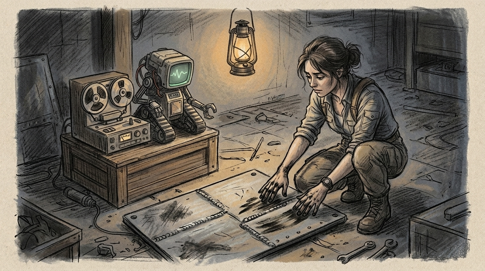

# CHAPITRE 06 : LE CLANDESTIN DE ZÊTA-3

> *« On m’a souvent demandé comment 15 vétérans de Condorcé, enfermés dans 5 boîtes d’acier de 40 mètres carrés avec des capteurs sismiques à chaque cloison, avaient pu cohabiter pendant 72 heures avec l’artefact le plus précieux de l’histoire connue sans s’en apercevoir. La réponse tient en 2 mots : Koda chantait faux, et mes soudures n’avaient jamais été aussi belles. »*
> — **Déposition du Sergent-Chef Jaro devant la Commission d’Enquête Sectorielle (Extrait déclassifié)**

{.chapter-illustration}

Cacher un caillou muet au fond d’une sacoche plombée était un jeu d’enfant ; cacher une conscience vieille de plusieurs millénaires, montée sur 2 chenilles dépareillées et possédée par une soif inextinguible de comprendre son environnement, relevait de l’équilibrisme sur un baril de poudre.

Durant les 3 jours et les 3 nuits où le cyclone d’équinoxe cloua la garnison de Zêta-3 à l’intérieur des modules blindés, Koda vécut avec le cœur au bord des lèvres et un sourire d’ange plaqué sur la figure.

La consigne diurne était pourtant d’une simplicité martiale. Dès que la sonnerie de 6 heures retentissait dans les coursives, Bricole devait se replier en boule dans le caisson de rangement situé sous le tour à métaux, derrière un rempart de bidons d’huile vide et une lourde bâche goudronnée. Il avait l’interdiction formelle de bouger d’un millimètre, d’allumer son tube cathodique ou d’émettre le moindre bip jusqu’au retour de Koda.

C’était compter sans l’ennui abyssal d’un processeur prodige qui venait de passer des millénaires dans le noir et trouvait le réduit de Koda infiniment plus passionnant que le vide.

Le premier soir, lorsque l’éclaireuse rentra à 19 heures 30 de sa corvée de graissage des tourelles, les bras rompus et son plateau-repas en équilibre sur la hanche, elle referma le loquet de l’atelier et s’arrêta net.

L’atelier était rangé.

Pas simplement balayé : réorganisé selon une taxonomie implacable — une science du classement digne d’un musée d’histoire naturelle — qui donnait le tournis. Les 400 vis, écrous et rondelles qui traînaient depuis 6 mois dans des boîtes de conserve rouillées étaient alignés sur l’étagère du bas par pas de filetage croissant — selon l’écartement exact des sillons en spirale gravés sur chaque tige —, au centième de millimètre près, du plus brillant au plus oxydé. Les bobines de fil de cuivre formaient une pyramide géométrique parfaite, et les tournevis au manche brûlé pendaient au râtelier selon un dégradé chromatique rigoureux.

Sous l’établi, la bâche goudronnée se souleva d’un coup de pince. Bricole en émergea dans un *clac-couic, clac-couic* triomphal, son petit moniteur vert braqué sur elle.

— Entropie… locale… réduite de 91 %, annonça fièrement le vocodeur grésillant, comme s’il venait de vaincre à lui seul la loi physique qui pousse toute matière et tout atelier humain à glisser vers le désordre et le chaos. Temps d’exécution : 14 minutes. Reste de la journée… très long.

Koda faillit lâcher son plateau d’aluminium.

— Mais tu es complètement marteau ! souffla-t-elle à voix basse en se passant une main sur le front. J’avais mon propre système de classement ! Si je cherche un boulon de 8 maintenant, il va me falloir une table de logarithmes ! Et si quelqu’un avait entendu ton ressort couiner derrière la porte ?

— Surveillance… acoustique… active, répliqua Bricole sans se démonter. Pas de Jaro : 92 kilos, botte gauche traîne de 0,3 seconde. Pas de Borras : 74 kilos, cadence régulière 110 pas par minute. Quand bottes approchent… Bricole… statut : bidon d’huile.

Koda ne put s’empêcher de sourire en allant poser son plateau sur le coin de l’établi qu’il avait daigné lui laisser libre.

Le petit robot s’approcha en roulant, attiré par l’odeur tiède du bloc de protéines synthétiques et du pain de soja qui fumaient dans l’assiette. Il hissa son écran cubique à hauteur du menton de la jeune femme, son diaphragme optique zoomant avec une curiosité intense sur la tranche grisâtre que Koda découpait du tranchant de sa fourchette.

— Ration… carton bouilli ? demanda-t-il.

Koda manqua de s’étouffer avec sa première bouchée.

— Où est-ce que tu as pêché ça, toi ?

— Archive vocale… Koda. Journal personnel, ordinateur, veille de la découverte. *« 26 ans devant une ration au goût de carton bouilli. »* Et analyse acoustique… réfectoire… par conduit de ventilation. Question : manque… sel de synthèse ? Manque… désespoir ?

Koda reposa sa fourchette sur le plateau et dévisagea la petite machine cabossée, partagée entre un fou rire nerveux et une bouffée de tendresse qui lui chauffait les pommettes.

— Tu écoutes aux grilles d’aération, maintenant ? Espion de bas étage ! Le sel de synthèse et le désespoir, c’est une blague, Bricole. C’est une formule qu’on lance à table quand les dépêches du front d’Aqi sont trop noires et qu’on veut empêcher les copains de broyer du noir.

L’unique caméra pivota légèrement, cherchant à résoudre l’équation. Sur l’écran vert, les 2 mots s’affichèrent en regard de leurs définitions chimiques et psychologiques :

`SEL DE SYNTHÈSE : Chlorure de sodium reconstitué (NaCl). Exhausteur de goût.`
`DÉSESPOIR : Perte totale d'espérance ; abattement extrême de l'esprit.`
`CORRÉLATION : 0,00 %.`

— Association… illogique, conclut le vocodeur. Si nouvelles noires… et menace d’extinction sur planète Aqi… pourquoi rire ? Pourquoi réclamer… supplément de désespoir dans chlorure de sodium ? Inefficace.

Koda soupira, prit son assiette et descendit s’asseoir à même le plancher d’acier, le dos calé contre le caisson du tour, pour être exactement à hauteur du petit moniteur.

— C’est justement parce que c’est illogique que ça marche, mon vieux, expliqua-t-elle doucement. Sur ma planète natale, il fait moins 50 degrés dehors, les dômes gèlent les uns après les autres et des gamins de 20 ans s’étripent dans la glace pour des générateurs à bout de souffle. Ici, on est 15 rats enfermés sous une tempête de diamant au milieu d’un monde mort. Si on regarde la vérité en face 24 heures sur 24 sans jamais se moquer d’elle, le cœur lâche avant les poumons. L’humour, c’est l’amortisseur à ressort des humains : ça fait *couic*, c’est tordu, ça ne répare pas la route, mais ça évite que le châssis se brise à chaque bosse. Tu comprends ça ?

La lentille de drone cligna 2 fois. Sur le tube cathodique, la ligne d’oscilloscope — ce fil lumineux qui dessinait en temps réel les pulsations du noyau d’ambre, pareil au tracé d’un cœur sur un écran médical — s’adoucit en une onde ample et régulière.

— Comprends… amortisseur, dit Bricole d’une voix soudain plus basse. 10 000 cycles… sous basalte. Pas d’amortisseur. Pas de sel. Pas de Koda. Châssis… très cassé.

Sans réfléchir, l’éclaireuse tendit la main et posa sa paume nue contre la tôle d’aluminium tiède de la caisse à munitions. À travers le métal et la mousse néoprène, le dodécaèdre battit 2 fois contre ses doigts, comme un oiseau réchauffé dans un poing.

Plus tard dans la nuit, pour occuper l’insatiable appétit d’informations de son clandestin sans risquer qu’il ne démonte le tour à métaux pièce par pièce, Koda sortit d’une boîte à biscuits en fer-blanc son trésor le plus précieux : un vieux lecteur à bandes magnétiques rafistolé au fil d’argent et 4 cassettes audio rescapées d’avant la guerre sur Aqi.

— Tiens, murmura-t-elle en branchant la sortie casque du baladeur directement sur l’entrée auxiliaire du petit moniteur de Bricole. Tu as avalé tous mes manuels de mécanique et les dictionnaires de la base, mais là-dedans, il n’y a pas une seule équation. C’est de la musique. Une vieille symphonie pour cordes et piano enregistrée dans l’ancien Opéra de Plotéris, avant que la coupole de verre ne soit bombardée.

Elle enclencha la touche de lecture. Les 2 petites bobines se mirent à tourner derrière la vitre rayée.

Dès les premières mesures du violoncelle, Bricole s’immobilisa si complètement que même ses servomoteurs de maintien cessèrent de grésiller.

Sur son écran vert, une représentation spectrale en 3 dimensions jaillit spontanément : le noyau décomposait l’onde sonore en séries de Fourier — isolant chaque note pure au cœur de l’orchestre —, mesurait les harmoniques, le frottement du crin sur le boyau, l’infime tremblement du doigt d’un musicien mort depuis 40 ans. Mais au lieu de classer le fichier et de passer à la suite en une demi-seconde comme il l’avait fait pour les manuels techniques, il laissa la bande défiler à vitesse réelle pendant 42 minutes.

Dans la pénombre de l’atelier, tandis que Koda somnolait à moitié sur ses genoux repliés, le petit robot cabossé balançait imperceptiblement son moniteur de gauche à droite au rythme de l’adagio, accompagnant chaque crescendo d’un minuscule *couic* étouffé de son ressort de suspension.

Lorsque la bande arriva en bout de course dans un souffle de neige magnétique, Bricole resta silencieux 10 longues secondes.

— Pas… d’utilité tactique, murmura enfin le vocodeur. Mais… architecture… parfaite. Question, Koda : si espèce humaine… capable de construire cette équation… pourquoi construire obus ?

— Le jour où tu trouves la réponse dans ta Pierre de mémoire, Bricole, réveille-moi tout de suite, sourit tristement la jeune femme en bâillant.

La deuxième journée faillit pourtant tourner au désastre par excès de zèle.

Ce matin-là, avant de partir vérifier les filtres à poussière du secteur sud, Koda avait laissé sur son établi 3 cartes de régulation hydraulique et 2 injecteurs de titane fendus que Jaro lui avait confiés la veille en maugréant qu’il n’arrivait pas à obtenir une soudure étanche sous haute pression.

Quand Koda revint à midi chercher une clé à molette oubliée, elle trouva Bricole campé au milieu de la table, sa petite torche à plasma du bras droit encore tiède.

— Travail… Koda… terminé, annonça-t-il avec la fierté d’un apprenti qui attend un sucre. Réparation… Jaro… exécutée. Et… ajout de sel de synthèse !

Prise d’un pressentiment affreux, Koda bondit vers l’établi et saisit le premier injecteur de titane sous sa loupe binoculaire.

Le sang lui quitta les joues.

Il n’y avait pas de cordon de soudure. En modulant le minuscule dard de plasma de son bras droit par résonance électromagnétique directe depuis son noyau, Bricole avait réaligné le réseau cristallin du titane à l’échelle atomique, recousant maille par maille l’architecture invisible des atomes du métal : la fissure avait littéralement disparu, sans apport d’étain, sans zone affectée thermiquement — pas même cette auréole bleutée que laisse d’ordinaire la morsure du chalumeau —, laissant une surface d’un poli spéculaire, lisse et réfléchissante comme un miroir d’argent, qu’aucune forge orbitale d’Aqi n’aurait su reproduire dans 100 ans. Quant aux 3 cartes électroniques, leurs pistes de cuivre brûlées avaient été redessinées en fractales submicroniques dignes d’un musée.

Et pour couronner le tout, prenant au pied de la lettre la conversation de la veille, le petit robot avait consciencieusement versé une cuillerée de sel de cuisine au fond de la boîte de rangement des pièces « pour diminuer le désespoir de Jaro ».

— Miséricorde ! s’étrangla Koda. Bricole, tu veux nous envoyer tous les 2 devant le peloton d’exécution ?! Si Jaro voit une fusion moléculaire à froid sur son injecteur de tracteur, il appelle le Haut Commandement dans la minute ! Sur Aqi, quand un mécanicien répare un tuyau, ça doit baver, ça doit puer le décapant et ça doit faire un gros pâté gris !

— Faire… travail laid… exprès ? s’indigna le petit écran vert. Aberration… d’ingénierie !

— C’est de la survie opérationnelle, monsieur le perfectionniste !

Il restait 12 minutes avant la fin de la pause de midi. En nage, Koda ralluma son vieux fer à souder à l’étain, épousseta en hâte le sel au fond de la boîte, raya les pistes fractales des cartes mères pour les recouvrir de gros ponts d’étain bien baveux, puis déposa par-dessus la soudure atomique impeccable des injecteurs une fausse cicatrice de brasure grossière qu’elle barbouilla de pâte à joint noire et de cambouis rance.

À 13 heures 5, au hangar, Jaro examina les injecteurs en faisant la moue :

— Mouais… Elle tient la pression, ta brasure, petite, mais c’est pas ton coup de patte le plus propre. T’avais la main qui tremblait, ce matin ?

— Manque de café et surplus de désespoir, Jaro ! lança Koda avec un sourire héroïque.

Mais la véritable alerte rouge survint lors de la troisième et dernière nuit, à une heure du matin, alors que la tempête extérieure commençait enfin à retomber.

Koda et Bricole étaient penchés ensemble sur le plancher de l’atelier, autour de la carte d’état-major de la dorsale nord-est. Depuis le crépuscule, le polyèdre d’ambre niché dans le poitrail du robot battait avec une intensité inhabituelle, presque fiévreuse. À mesure que l’ionisation atmosphérique du cyclone — cet immense brouillard d’électricité statique né du frottement des poussières — se dissipait au-dessus du désert, l’appel lointain de la structure enfouie à 30 kilomètres de là se faisait plus net, plus pressant.

— Résonance… monte, expliquait Bricole à voix très basse en pointant sa pince sur le goulet d’obsidienne. Pierre de mémoire… sent mon noyau. Si attendre trop… dérive de phase — nos 2 rythmes vont se décaler comme 2 horloges qui perdent la mesure et ne parviennent plus à s’entendre. Demain… aube… impératif.

— J’ai déjà fait signer mon ordre de sortie par Borras avant le dîner, le rassura Koda en tapotant le caisson de transport blindé posé près de la porte. Départ à 7 h 00 pour un relevé sismique de routine. Tu voyages là-dedans entre les balises et…

3 coups secs, frappés contre la tôle de la porte verrouillée, leur coupèrent le souffle.

— Koda ? appela la voix de Borras depuis le couloir. Je vois de la lumière sous ton joint de porte. Ouvre une seconde, j’ai besoin de te parler.

Le cœur de Koda s’arrêta net.

À ses pieds, Bricole était à 3 mètres de sa cachette, le moniteur allumé en plein milieu du plancher, entouré de câbles coaxiaux dénudés et des schémas du berceau de montage. S’il roulait maintenant vers l’établi, son ressort à 2 410 hertz résonnerait dans le silence nocturne comme une sirène d’alarme.

Sans perdre un dixième de seconde, Koda fit le seul geste possible : elle saisit les 22 kilos du robot à pleines mains par les flancs pour que ses chenilles ne touchent pas le sol, le souleva d’un coup de rein qui fit craquer ses lombaires, le déposa sans un bruit sous l’établi et rabattit la bâche goudronnée par-dessus lui au moment même où l’écran vert de Bricole s’éteignait de lui-même.

Elle jeta sa veste de treillis sur les schémas compromettants, prit son fer à souder d’une main, ébouriffa ses cheveux de l’autre et entrebâilla la porte de 20 centimètres en bloquant l’ouverture avec sa botte.

— Borras ? fit-elle en feignant de cligner des paupières. Tu as vu l’heure ? Je finissais de recâbler ma balise relais pour demain matin.

Dans la pénombre du couloir, le visage de son ami d’enfance paraissait taillé dans de la craie. Il tenait à la main un bloc de dépêches chiffrées.

— Désolé de te réveiller à moitié, Koda, dit-il à mi-voix en jetant un coup d’œil distrait par-dessus son épaule vers l’intérieur de l’atelier qui sentait la colophane chaude. Tu parlais toute seule, à l’instant ? J’ai cru entendre 2 voix.

— C’est mon vieux lecteur de cassettes qui pleure sur du Schumann, mentit-elle sans battre d’un cil en désignant le baladeur posé sur le coin de la table. Et je peste contre mes soudures quand la colophane me saute dans l’œil. Qu’est-ce qui se passe ? Le front d’Aqi ?

Borras passa une main lasse sur sa nuque.

— Pire. Et plus près. Le Commandement Sectoriel vient de relever le niveau de vigilance de toutes les bases du secteur Zêta. Le Colonel Draeven a pris personnellement la direction des opérations de surface ce soir. Ils cherchent quelque chose, Koda. Je ne sais pas si c’est une patrouille afistéanne infiltrée ou… autre chose, mais toutes les liaisons satellites sont doublées d’une écoute automatique depuis minuit.

Sous l’établi, à 2 mètres derrière les talons de Koda, la bâche goudronnée demeurait d’une immobilité minérale. Pas un souffle de ventilateur, pas un grésillement de bobine.

— Une écoute automatique ? répéta Koda d’une voix qu’elle força au calme. Et ma patrouille de cartographie de demain matin sur la dorsale nord-est ? Elle est maintenue ?

— Oui, ton ordre de mission était déjà enregistré au planning avant le verrouillage, et le QG veut justement des relevés frais après la tempête. Mais écoute-moi bien, ajouta Borras en posant une main grave sur le chambranle d’acier : pas de fantaisie demain. Pas de détour hors secteur, pas de fouille archéologique dans les ravines. Tu poses tes balises au bord de la faille, tu fais ton point radio à 8 heures 30, et tu es de retour avant midi 30. Au moindre retard de 30 minutes sur l’horaire, la nouvelle consigne déclenche l’envoi automatique du drone de reconnaissance Z-4 en liaison directe avec le central sectoriel. Même moi, je ne pourrai pas l’annuler.

— Reçu 5 sur 5, mon lieutenant, sourit Koda malgré le froid qui lui serrait l’estomac. 8 heures 30 au sommet de la crête, retour pour la soupe de midi. Va dormir 2 heures, tu tiens debout par habitude.

— Sois prudente là-bas, Koda. Je n’aime pas le vent qui souffle en ce moment.

Lorsqu’il se fut éloigné dans le couloir et que Koda eut refermé le double verrou, elle resta un long moment le front appuyé contre le métal frais de la porte.

Derrière elle, la bâche goudronnée glissa doucement. Bricole s’avança en roulant avec une lenteur infinie pour réduire au silence son ressort tordu et vint poser sa pince à 3 doigts contre le talon de la botte de la jeune femme.

— Danger… pour Koda, murmura le vocodeur au minimum de son volume. Si Borras… ou Colonel… trouver Bricole… alors Koda… punie. Peut-être… Bricole partir seul dans désert ce soir.

Koda se retourna et s’agenouilla devant lui. Dans la lueur verte du petit écran cubique, le reflet de son propre visage lui parut soudain plus mûr de 10 ans.

— Partir tout seul avec une chenille qui tire à gauche et une batterie qui tient 6 heures ? Tu ne ferais pas 4 kilomètres dans le sable mou avant de finir le nez dans une dune, vieux tas de boulons, murmura-t-elle en resserrant d’un quart de tour l’écrou de son épaule droite. On a commencé ce voyage à 2 dans cet atelier, on ira jusqu’au bout à 2. Allez, grimpe dans le caisson de transport. Dans 5 heures, on va voir ce que cache ta montagne.
