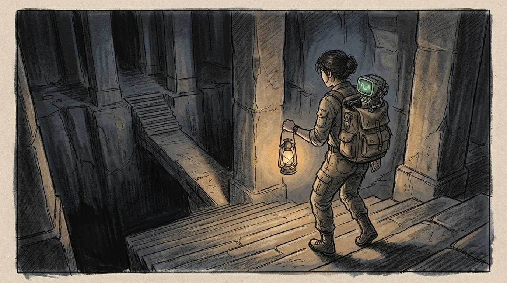

# CHAPITRE 07 : L'EXPÉDITION SOUTERRAINE

> *« Les cartes orbitales de Condorcé prétendent couvrir 98 % de la surface d’Oark. C’est l’orgueil ordinaire de ceux qui volent trop haut : ils photographient la peau ridée du désert et croient connaître le cadavre, sans se douter que le basalte profond arrête nos radars à 20 mètres et que l’essentiel de ce monde s’est toujours joué sous la pierre. »*
> — **Carnet d’établi de l’Éclaireuse Koda (Mat. 44-K), notes sur la dorsale nord-est**

{.chapter-illustration}

L’aube sur Oark avait la couleur du cuivre en fusion.

Lorsque les lourdes portes blindées du garage de Zêta-3 s’écartèrent dans un gémissement de vérins pneumatiques, le souffle glacé du petit matin s’engouffra sous la voûte de béton en soulevant des tourbillons de poussière rouge. Sanglée dans son armure d’exploration, le fusil magnétique en bandoulière et le casque verrouillé sur son collier cervical, Koda donna un coup de botte sur le démarreur de sa moto-chenille.

Le vieux moteur bicylindre toussa, cracha une gerbe d’escarbilles bleues par son pot latéral et bondit sur la rampe de régolithe.

À l’arrière de la selle, arrimé par 4 sangles à cliquet sur le porte-bagages renforcé, trônait le caisson de transport isotherme que Jaro avait aidé à charger 10 minutes plus tôt en maugréant contre « le poids d’âne mort de ces foutues carottes sismiques ». À l’intérieur, calé dans le noir entre deux pains de mousse et la trousse de secours, Bricole voyageait relié au système audio du casque de la jeune femme par un simple fil de cuivre torsadé glissé sous le joint d’épaule.

Dès que la moto eut franchi le périmètre des tourelles automatiques et mordu la tôle ondulée des premières dunes, une petite voix métallique, hachée par les cahots, grésilla dans l’oreillette gauche de Koda :

— Secousses… verticales… excessives. Accélération… 3,8 *g* sur crête — près de 4 fois le poids de la pesanteur normale à chaque cahot. Suspension mécanique… archaïque. Mon ressort… proteste vigoureusement.

Koda éclata de rire derrière sa visière teintée en négociant un dérapage contrôlé entre deux aiguilles de basalte noir.

— Accroche-toi à tes boulons, le clandestin ! Si je ralentis sur le plateau découvert, le contrôleur du satellite météo va se demander pourquoi l’éclaireuse la plus rapide de Zêta-3 roule comme un corbillard d’état-major ! Et puis tu voulais voir du pays, non ?

— Voir… pays = zéro, répliqua le vocodeur tandis qu’un *couic* indigné traversait la paroi d’aluminium du caisson à la faveur d’un nid-de-poule. Actuellement… voir… boîte de pansements et 3 fusées éclairantes. Obscurité… 99 %. Odeur… iode et vieille graisse.

— Je t’ouvrirai la fenêtre dès qu’on sera dans l’ombre des falaises, promis ! En attendant, dis-moi si ta boussole interne capte toujours ta Pierre de mémoire.

Pendant 2 secondes, seul le ronflement furieux du moteur thermique et le cliquetis de la chenille sur la rocaille emplirent le casque. Puis la voix de Bricole reprit, plus posée :

— Signal… constant. Azimut… 034 degrés nord-est. Distance… 24 kilomètres. Mais… anomalie géologique autour de la source. Masse rocheuse… saturée de magnétite et de silicates lourds, ces croûtes de quartz et de fer mêlés qui réfléchissent les ondes comme un miroir de plomb. Écran… naturel.

— Parfait. Ce qui gêne tes ondes gênera aussi les yeux du Colonel Draeven.

Durant 50 minutes, Koda poussa sa machine à travers le labyrinthe minéral qui bordait le bassin Zêta.

Le paysage se transformait à mesure qu’elle grimpait vers le bouclier volcanique du nord-est — cet immense dôme de lave antique aux pentes larges et bombées comme le bouclier d’un titan couché dans la poussière. Les dunes mobiles d’ocre cédaient la place à un chaos de tables basaltiques fracturées, de cheminées de lave refroidie hautes comme des tours de guet et de ravins d’obsidienne où la lumière rasante du matin découpait des ombres au couteau. L’air extérieur chauffait à vue d’œil : sur l’afficheur à cristaux liquides de son poignet, les chiffres grimpaient déjà vers 39 degrés, et le soleil Solyar faisait miroiter au sommet des crêtes des mirages d’argent liquide.

À 8 heures 28, fidèle au chronomètre à la minute près, Koda coupa les gaz au sommet d’un promontoire en surplomb qui dominait l’entrée du grand goulet nord-est.

Elle béquilla sa moto-chenille derrière un chaos de blocs vitrifiés, déploya l’antenne fouet de son pack dorsal et enfonça le commutateur de la fréquence longue portée.

— Base Zêta-3, ici Éclaireuse 44-K. Point de contrôle de 8 heures 30. Position : crête nord-est, cote 412. R.A.S. sur la piste d’approche.

Une salve de friture statique précéda la réponse du poste de commandement. Ce fut la voix enrouée de Marek qui lui revint :

— *Reçu 5 sur 5, Koda. Borras vient enfin d’aller s’allonger 2 heures, il tenait debout avec des allumettes sous les paupières après les alertes de cette nuit. J’ai ta télémétrie sur le tableau : tu es pile sur le rebord de la faille.*

— Exact, Marek. Je m’apprête à descendre au fond du couloir pour poser mes 3 capteurs sismiques. Comme prévu, les parois sont bourrées de magnétite pure : mon retour radio va sauter dès que je serai 10 mètres sous la lèvre du canyon. Ne m’envoyez pas la fanfare du régiment si mon icône clignote en orange pendant 3 heures.

— *Tu connais la nouvelle musique du central sectoriel depuis minuit, petite*, reprit Marek d’un ton plus grave. *Tant que ta balise relais de surface émet son bip en haut de la falaise, l’ordinateur te laisse un créneau d’autonomie jusqu’à midi 30. Mais à 12 heures 31, si tu n’as pas rebranché ton transmetteur personnel en haut de la crête, l’automate de sûreté catapulte le drone Z-4 sur tes coordonnées sans même me demander mon avis. Alors fais pas ta tête de mule et garde un œil sur ta montre.*

— À midi 20, je serai en haut en train de boire ma gourde tiède à ta santé. Koda, terminé.

Elle rabattit le clapet de l’émetteur longue portée, planta le trépied de la balise relais dans une fissure de grès afin qu’elle continue d’envoyer son signal rassurant vers le satellite, puis revint vers l’arrière de sa moto et fit sauter les 4 fermoirs du caisson.

Le couvercle ne fut pas plus tôt soulevé que le petit moniteur cubique de Bricole jaillit à la lumière comme un diable hors de sa boîte, son unique caméra de drone cliquetant à toute vitesse pour accommoder son diaphragme à l’éblouissement brutal de Solyar.

— Lumière… excessive ! protesta le vocodeur pendant que la petite pince à 3 doigts s’agrippait au rebord du coffre. Spectre solaire… non filtré. Mais… préférable à boîte de pansements.

— Respire un grand coup d’air sec, mon vieux, sourit Koda en le soulevant à 2 bras pour le déposer sur la corniche de basalte. Nous y voilà.

Côte à côte — la jeune femme dans sa lourde carapace de céramique rayée et le petit robot de 60 centimètres penché de 5 degrés sur sa chenille large —, ils s’avancèrent jusqu’au bord de l’abîme.

C’était une balafre titanesque.

Là où les cartes d’état-major ne figuraient qu’une simple ligne de fracture secondaire, un séisme antédiluvien avait fendu le bouclier d’obsidienne sur 30 mètres de large et ouvert une gorge verticale qui plongeait à pic dans l’écorce d’Oark. Aucun souffle du vent de surface ne pénétrait dans cette tranchée ; l’air y semblait immobile depuis le premier matin du monde, et l’ombre qui noyait le fond du gouffre possédait une densité presque liquide, d’un bleu nuit d’encre.

Sous ses colliers de serrage en acier, le polyèdre d’ambre de Bricole se mit à pulser avec une telle vigueur que sa lueur traversa la mousse néoprène en plein soleil. Le robot avança sa roue dentée jusqu’à un centimètre du vide et pointa sa pince vers les ténèbres.

— Résonance… maximale, annonça-t-il, une vibration nouvelle traversant sa voix hachée. 42 mètres… vertical. Puis… cavité sous roche. Pas de doute. Elle… m’attend.

Koda pencha le buste par-dessus la corniche et siffla entre ses dents en mesurant du regard le miroir vertical de verre volcanique noir.

— 42 mètres de paroi lisse avec un treuil à friction et 22 kilos de ferraille sur les reins… Dis-moi, Bricole, si tes ancêtres de l’Âge d’Or avaient eu la bonne idée d’inventer l’ascenseur ou au moins un escalier de service, je ne leur en aurais pas voulu.

— Escalier… illogique pour structure scellée, répliqua doctement la petite machine. Si escalier… alors Jaro descendre. Si Jaro descendre… mettre gros pâtés d’étain partout.

Un éclat de rire franc secoua le plastron de Koda.

— Un point pour toi, sale gosse. Allez, viens là qu’on s’attache.

Elle déroula le filin d’acier tressé de son treuil d’assaut, l’amarra solidement autour d’un bec de basalte massif qu’elle doubla d’un piton à expansion thermique — une cheville d’alliage dont le cœur chauffant se dilatait d’un coup sec pour mordre la pierre de l’intérieur et s’y souder à bloc —, puis sangla le châssis de Bricole à plat contre l’armature dorsale de son propre scaphandre. Lorsque tout fut verrouillé, le petit moniteur cathodique du robot reposait juste par-dessus l’épaule droite de la jeune femme, sa caméra braquée vers l’avant à côté de sa visière.

— Prêt pour le grand saut ? demanda-t-elle en reculant à reculons jusqu’à ce que les talons de ses bottes dépassent dans le vide. Et interdiction de gigoter pendant la descente, sinon on finit tous les 2 en pièces détachées pour le musée de Plotéris.

— Verrouillage… gyroscopique… engagé, murmura Bricole contre son oreille. Masse… solidaire de Koda. Confiance… 100 %.

Elle bascula en arrière dans le gouffre.

La descente en rappel le long de la muraille d’obsidienne dura 20 longues minutes d’effort physique soutenu.

À chaque impulsion des jambes contre la paroi vitrifiée, le frein magnétique du treuil gémissait en dévidant 2 mètres de câble, et les vérins d’épaule de l’armure de Koda sifflaient sous la double charge. À mesure qu’ils s’enfonçaient sous le niveau du plateau désertique, le monde de la surface semblait s’effacer couche par couche. La clarté aveuglante de Solyar se réduisit là-haut à un ruban de cuivre incandescent coincé entre deux lèvres de pierre noire. La température extérieure chuta brutalement sur l’afficheur du poignet : 44 degrés… 32… 24… 18 degrés.

Dans les écouteurs de Koda, le chuintement familier du bruit de fond atmosphérique et le bip régulier de la balise relais laissée au sommet commencèrent à se couvrir de hachures, étouffés par l’épaisseur anormale des strates de magnétite.

À 30 mètres de profondeur, Bricole émit un léger cliquetis d’iris :

— Regarder… paroi, Koda. Pas… cassure naturelle.

Koda freina sa course d’une pression du gant sur la gâchette du treuil et alluma le projecteur halogène de son épaule gauche.

Elle crut d’abord à un caprice de la lave refroidie. Mais en balayant la roche à bout portant, elle comprit : sur les 12 derniers mètres de la faille, le basalte n’avait pas été fendu par un soubresaut tectonique, ce lent froissement des plaques géantes de l’écorce planétaire. Il avait été découpé, jadis, avec une précision chirurgicale qui avait tranché net les cristaux d’olivine et de feldspath — ces grains minéraux d’un vert d’huile et d’un blanc nacré pris dans la pâte volcanique — sans même les ébrécher, avant que des millénaires d’érosion et de poussière ne maquillent l’entaille en ravin naturel.

Ses bottes ferrées touchèrent enfin le lit de gravier noir du fond dans un crissement sec.

Koda libéra le mousqueton de son harnais, s’accroupit pour déboucler les sangles dorsales et déposa Bricole sur le sol. Ses épaules lui brûlaient sous le rembourrage trempé de sueur de sa combinaison, et sa respiration résonnait fort dans le dôme de verre de son casque.

Elle se redressa et fit pivoter le faisceau blanc de son projecteur vers le fond du cul-de-sac rocheux.

Le souffle lui manqua.

Encastré sous 40 mètres de basalte massif, là où aucune tempête ni aucun regard n’avaient jamais pénétré, se dressait un mur qui n’appartenait ni à la géologie d’Oark, ni même à l’architecture organique et torsadée de l’Âge d’Or qu’elle avait admirée 3 jours plus tôt.

Il n’y avait ni arche d’opale, ni colonnade, ni bas-relief végétal, ni inscription. Seulement un plan vertical de 10 mètres de haut sur 8 de large, d’une rectitude mathématique si absolue que l’œil humain peinait à en évaluer la profondeur. La paroi était constituée de cette même substance anthracite indéfinissable que le noyau de Bricole — une matière sombre et douce qui buvait le faisceau halogène de 1 000 watts sans renvoyer le moindre halo d’éblouissement. La jonction entre le chaos déchiqueté de la roche volcanique et cette lame de géométrie pure donnait le vertige : on eût dit qu’un géant avait glissé un fragment d’éternité solide au milieu des entrailles froissées de la planète.

— Pas… ruine, murmura Bricole à ses pieds, le petit *couic* de son ressort résonnant comme une note de cristal dans le silence souterrain. Pas… cassé par le temps. Ça… intact. Ça… maison.

Le petit robot s’ébranla sur ses chenilles dépareillées et roula vers la muraille noire.

Lorsqu’il parvint à 2 mètres du pied de la paroi, le dodécaèdre sanglé dans sa poitrine de tôle émit 3 pulsations d’ambre rapides — un train d’ondes silencieuses dont Koda ne perçut que l’infime frémissement dans le plombage de ses molaires.

La muraille répondit.

Il n’y eut ni grondement de contrepoids, ni sifflement de vérin, ni poussière tombant du linteau. Au centre du monolithe, une ligne verticale d’une finesse subatomique s’illumina d’un filet d’or pâle ; puis la matière anthracite s’écarta d’elle-même vers la gauche et vers la droite, glissant sans le moindre frottement mécanique comme un rideau de fumée dense qui se replie, pour dévoiler une galerie rectiligne plongeant en pente douce sous la montagne.

 — Oh, maman… souffla Koda en reculant d’un demi-pas, la main sur la poignée de son fusil qu’elle lâcha aussitôt tant l’arme paraissait dérisoire.

Sur le moniteur vert de Bricole, la courbe sinusoïdale battait à tout rompre. Le petit robot pivota à demi vers elle, sa caméra unique brillant dans la pénombre :

— Venir, Koda. Pas de danger pour vivant. Seulement… vérité.

Elle franchit le seuil derrière lui.

À la seconde exacte où le talon de sa botte gauche dépassa le plan d’ouverture de la muraille, l’icône de liaison radio au coin supérieur de sa visière vira du jaune au rouge fixe, accompagnée d’un bandeau d’avertissement silencieux :

`PERTE PORTEUSE BALISE // ISOLATION ÉLECTROMAGNÉTIQUE : 100,00 %`

3 mètres d’alliage originel venaient de se refermer derrière leur dos sans laisser la moindre fente, coupant net tout lien avec la surface, avec Zêta-3 et avec le reste de l’univers.

Pourtant, l’obscurité ne tomba pas.

À mesure qu’ils avançaient, les parois lisses du couloir octogonal s’éveillaient d’elles-mêmes sur leur passage, diffusant une clarté ambrée, chaude et sans ombre portée, qui naissait au cœur même de la matière avant de s’éteindre progressivement 20 mètres derrière eux. Koda coupa son projecteur d’épaule devenu inutile.

L’air qu’analysait le capteur externe de son scaphandre défiait 6 millénaires de désert : filtré en permanence par les membranes moléculaires invisibles de la paroi, il affichait 21 % d’oxygène, 78 % d’azote, zéro particule de silice en suspension, zéro spore, zéro radiation. Une atmosphère maintenue dans un équilibre chimique invariable depuis 100 siècles.

Mais plus que tout, c’était le contraste sonore qui lui donnait envie de rire et de pleurer à la fois.

Dans ce sanctuaire d’une noblesse cosmique où tout avait été conçu pour le silence des sphères, l’intrusion de leur équipage faisait un vacarme d’atelier de chaudronnerie : les lourdes bottes ferrées de Koda claquaient sur le dallage sombre, ses genouillères hydrauliques chuintaient à chaque pas en laissant derrière elles une odeur d’huile chaude, et devant elle trottinait vaillamment son petit monstre de boîte à munitions et de chatterton, dont la chenille gauche scandait la marche d’un *clac-couic… clac-couic… clac-couic* imperturbable à 2 410 hertz.

Au milieu de la descente, Bricole immobilisa brusquement ses patins.

— Koda… arrêter moteur de jambe 2 secondes, demanda-t-il à voix très basse. Écouter.

Koda figea sa foulée et retint son souffle.

Dans ses oreilles, débarrassées du grondement perpétuel des tempêtes de sable, du ronflement des recycleurs de Zêta-3 et du crépitement de la radio militaire, il ne resta plus que le battement sourd de son propre sang.

— J’écoute quoi, Bricole ? Il n’y a absolument aucun bruit.

— Justement, murmura le petit robot en levant son écran vert vers la voûte lumineuse. Pas de vent qui racle. Pas d’obus sur la glace. Pas de peur. Silence… d’avant la faute.

Ils reprirent leur marche côte à côte sans ajouter un mot.

300 mètres plus bas, le couloir rectiligne s’ouvrit soudain comme la nef d’une cathédrale engloutie.

C’était une rotonde souterraine si prodigieusement vaste que ses parois courbes se perdaient dans une brume d’or sombre. Au centre du parvis s’ouvrait un puits circulaire sans fond, bordé d’une simple margelle biseautée ; et là, suspendu en lévitation absolue dans le vide, sans câble, sans pilier et sans champ de force bruyant, tournait lentement le cœur de la montagne.
