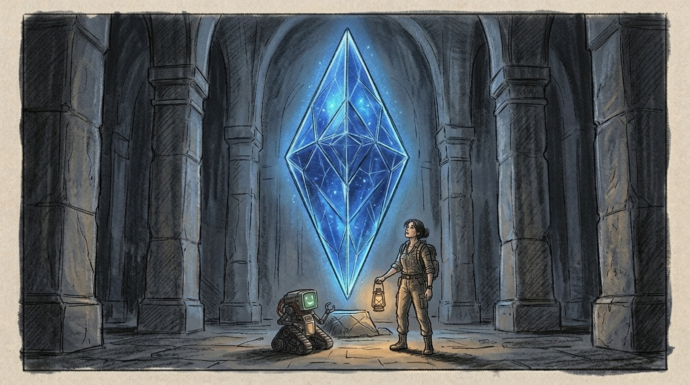
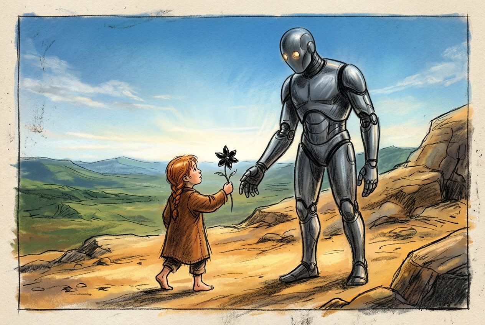

# CHAPITRE 08 : LA CONNEXION QUANTIQUE

> *« On s’imagine que la mémoire est une bibliothèque bien rangée où l’on feuillette le passé à sa guise. Quand le cristal s’est ouvert, j’ai compris que le vrai souvenir n’est pas un livre : c’est un incendie qui attendait de l’oxygène depuis 10 000 ans et qui vous brûle les yeux dès qu’on pousse la porte. »*
> — **Carnet d’établi de l’Éclaireuse Koda (Mat. 44-K), écrit au crayon sur une feuille déchirée**

{.chapter-illustration}

C’était un octaèdre de diamant synthétique haut de 4 mètres — un volume à 8 faces triangulaires assemblées comme 2 pyramides jointes par leur base —, taillé avec une rigueur qui semblait plier la géométrie même de l’espace autour de ses arêtes.

En lévitation parfaite au-dessus de l’abîme circulaire, le cristal géant pivotait sur son axe vertical à une vitesse si lente qu’il fallait fixer sa pointe inférieure pour en percevoir la rotation. À l’intérieur de sa masse limpide, il n’y avait ni fil de métal ni fissure : des milliards de points lumineux d’une finesse subatomique y formaient une nébuleuse tridimensionnelle figée, pareille à une galaxie d’or et de neige prise dans un bloc de glace éternelle.

Comme hypnotisée, Koda fit sauter les bagues d’étanchéité de son poignet droit — l’air du sanctuaire était plus pur que celui de ses bouteilles dorsales — et retira son gant blindé.

Elle avança d’un pas sur le parvis anthracite et tendit sa main nue au-dessus de la margelle du puits, à 2 mètres de la face la plus proche de l’octaèdre. L’air ne chauffait pas ; aucun souffle électrostatique ne crépitait contre sa peau. Pourtant, tous les poils de son avant-bras se dressèrent d’un seul coup et une saveur métallique envahit sa langue, comme si l’espace autour du diamant était courbé par le poids d’une quantité d’informations si colossale qu’elle pesait sur les nerfs optiques.

À côté de ses bottes, Bricole s’avança jusqu’au rebord extrême du gouffre.

Dans son berceau de mousse néoprène, sous les 4 colliers de serrage en acier que Koda avait boulonnés dans son atelier, le petit dodécaèdre sombre s’était mis à battre d’une lumière d’ambre furieuse — exactement sur la même période lente que la nébuleuse captive du cristal géant.

— Une Mnémorite… murmura le vocodeur.

Koda tressaillit. Pour la première fois depuis qu’elle l’avait éveillé sur son établi, le petit robot venait de prononcer un mot qui ne provenait ni du lexique technique de Zêta-3, ni des dictionnaires de la langue aqine. Le terme avait surgi des 4,12 % de son noyau intact, arraché aux strates les plus profondes de son identité.

— Une Mnémorite ? répéta Koda à voix basse, tant le silence de la rotonde intimidait la parole. C’est ta Pierre de mémoire ? Tout ce qu’on t’a pris est là-dedans ?

— Archive… locale… du secteur, répondit Bricole sans détacher son unique caméra du diamant en lévitation. Pas… mémoire totale de la planète. Mais… contient mon registre. Contient… pourquoi le sable. Contient… qui je suis.

Le cœur de Koda cognait à grands coups sourds contre son plastron. Elle s’agenouilla près de lui sur le dallage sombre et chercha des yeux une console, une fente d’insertion, un socle de contact le long de la margelle. Il n’y avait rien que la pierre noire, lisse comme un miroir d’encre.

— Vas-y, souffla-t-elle en sortant de sa sacoche une tresse de cuivre blindée. Comment on te branche là-dessus ? Je ne vois aucun port d’accès sur la rambarde !

La petite pince à 3 doigts de Bricole s’abaissa doucement pour repousser le câble que lui tendait la jeune femme.

— Pas de câble, Koda. Fil de cuivre… aveugle et sourd ici. Ce cristal… gravé à l’échelle du spin atomique, dans le sens même de la rotation intime de chaque atome de carbone. Connexion… uniquement par intrication quantique à travers le vide — ce couplage profond de la matière où 2 particules jumelles se mettent à vibrer d’un même souffle instantané, sans qu’aucun fil ni aucune onde n’ait besoin de voyager entre elles.

Il avança d’un demi-tour de chenille supplémentaire, jusqu’à ce que le bout de ses patins d’acier affleure l’aplomb du gouffre. Le petit ressort tordu poussa un *couic* bref qui se perdit dans l’immensité verticale du puits.

— Mais… problème grave, reprit le robot d’une voix plus sourde. Jadis… mon châssis d’origine possédait des émetteurs de phase harmonique. Aujourd’hui… émetteurs coupés. Corps… en boîte à munitions et ruban isolant. Pour ouvrir le verrou du cristal… mon noyau doit forcer la résonance à nu. Risque… de surcharge thermique dans tes soudures.

— Attends une seconde ! s’alarma Koda en posant la main sur le capot du petit moniteur cubique. Si tu envoies une décharge pareille à travers le bus d’alimentation que je t’ai bricolé, tu vas faire éclater mes condensateurs au lithium et griller ton propre berceau ! Laisse-moi au moins dériver un circuit de délestage vers la masse !

— Pas… de délestage possible, répliqua Bricole. Champ d’intrication… traverse tout. Koda… reculer de 5 pas. Maintenant.

— Bricole, non, écoute-moi…

— Reculer, Koda ! ordonna brusquement le haut-parleur avec une autorité métallique qui la fit obéir malgré elle. Si moi échouer ici… alors 10 000 ans dans le noir… pour rien. Alors toi… risquer ta vie… pour rien. Reculer !

Koda recula de 4 pas sur le parvis, les poings serrés contre sa poitrine, la gorge nouée.

Au bord du gouffre, la petite machine de bric et de broc bloqua les freins de ses chenilles. Sa pince gauche se referma à s’en fendre le caoutchouc sur le rebord de son propre châssis d’aluminium, comme un patient qui mord un morceau de bois avant l’amputation.

Puis le noyau d’ambre ouvrit le feu.

Un sifflement cristallin, d’une acuité presque insoutenable, déchira le silence millénaire de la rotonde.

Ce n’était pas un son mécanique ; c’était le cri de l’espace lui-même que le petit dodécaèdre tentait de plier entre son berceau de mousse et la face inférieure de l’octaèdre géant, à 3 mètres au-dessus du vide. Sur le moniteur cathodique de 6 pouces qui lui servait de tête, le phosphore vert vira au blanc aveuglant, zébré d’arcs électriques qui couraient le long de la vitre bombée.

La première onde de choc en retour fut d’une brutalité sauvage.

La Mnémorite, sollicitée par un signal que ne stabilisait aucune antenne de phase réglementaire, rejeta l’impulsion comme un bouclier renvoie une flèche. Une gerbe d’étincelles bleues explosa sur le flanc droit de Bricole : l’un des gros condensateurs tampons que Koda avait soudés l’avant-veille venait d’éclater dans un claquement de coup de fusil, crachant un jet de fumée blanche à l’odeur âcre d’électrolyte brûlé. Sous le recul magnétique, les 22 kilos du robot furent projetés d’un mètre en arrière, ses chenilles bloquées raclant la pierre noire dans un crissement strident.

— Bricole ! hurla Koda en s’élançant vers lui.

— Non ! Rester… là-bas ! gronda le vocodeur à travers un déluge de parasites. Juste… condensateur secondaire. Pas… toucher pendant phase !

La petite machine fumante remit ses moteurs en prise.

La chenille large brouta, le ressort tordu poussa une plainte aiguë, et Bricole regagna centimètre par centimètre le bord du précipice.

Ce qui suivit dura 8 minutes qui parurent à Koda plus longues que toute sa vie sur Oark.

C’était le combat titanesque, déchirant, d’un esprit cosmique enfermé dans une carcasse d’infirme qui refusait de céder à sa propre mutilation. À la deuxième tentative, la gaine de plastique des câbles coaxiaux fondit en gouttes noires qui grésillèrent sur la tôle de la boîte à munitions ; à la troisième, le servomoteur de la petite torche à plasma rendit l’âme dans un soupir d’ozone et le bras droit retomba inerte le long de la chenille ; à la quatrième, la vitre du petit écran cathodique se fendit en étoile dans le coin supérieur gauche sous la violence des harmoniques.

Pourtant, à chaque rejet du diamant géant, Bricole utilisait la douleur même de l’écho pour affiner son équation à l’aveugle. Privé de ses organes d’accordage d’origine, il se servait des bobinages de cuivre des moteurs de traction de Jaro comme d’inductances de fortune — transformant les enroulements de fil en petits réservoirs magnétiques capables de lisser les secousses du courant —, modulait la fréquence de son noyau au milliardième de hertz près, tremblant de toutes ses tôles rivetées, reculant sous la foudre, revenant au bord du gouffre avec l’obstination d’un insecte qui veut soulever une montagne.

À genoux sur le parvis, les yeux brûlés par la fumée d’étain et d’isolant qui flottait dans l’air pur du sanctuaire, Koda serrait ses mains nues l’une contre l’autre jusqu’à se blanchir les phalanges, impuissante devant l’agonie de son ami qui essayait de réapprendre à prier les étoiles avec une gorge de fer-blanc.

À la sixième tentative, le petit robot s’affaissa sur son flanc gauche, son ressort comprimé au maximum, son unique caméra clignotant faiblement.

— Bricole, arrête, je t’en supplie… sanglota presque Koda. On trouvera un autre moyen, je te fabriquerai une antenne plus grande à l’atelier, ne te tue pas devant moi !

Dans la fumée, la rotule du moniteur fendu se redressa d’un cran.

— Pas… le temps… pour atelier, souffla le haut-parleur calciné. Si pas maintenant… jamais. Septième… essai.

Au lieu d’envoyer une impulsion de force brute, le polyèdre d’ambre changea soudain de méthode : il laissa tomber toute protection et s’ouvrit entièrement, offrant au cristal géant non pas un code d’accès, mais la blessure même de son formatage inachevé — cette déchirure vieille de 10 000 ans qui saignait au centre de sa géométrie.

La septième note s’éleva.

Et soudain, le sifflement strident s’éteignit.

À sa place naquit un accord grave, d’une plénitude et d’une pureté si bouleversantes qu’il fit résonner les os de la poitrine de Koda comme la caisse d’un violoncelle. Entre le petit dodécaèdre sanglé dans sa mousse noircie et l’octaèdre de 4 mètres suspendu au-dessus de l’abîme, l’espace cessa d’être vide : un pont de poussière d’or immobile se condensa dans l’air, reliant le mendiant de ferraille au palais de diamant.

Au cœur de la Mnémorite, la galaxie figée se remit à tourner.

Le verrou venait de céder.

Alors, sous la violence du débit d’intrication qui se déversait enfin à plein canal dans le noyau de Bricole, une onde de débordement submergea les circuits de la petite machine, courut le long des inductances, satura l’air de la rotonde et vint frapper de plein fouet l’électronique du casque de Koda et son nerf optique.

Le parvis de pierre noire disparut.

Pendant 10 secondes hors du temps, Koda ne fut plus dans la caverne. Elle *fut* la mémoire qui revenait.

Elle vit Oark telle qu’aucun vivant ne l’avait jamais contemplée.

Sous ce même soleil Solyar, 10 millénaires avant la silice et les cratères, une plaine d’émeraude s’étirait à perte de vue sous un ciel d’un bleu profond, balayée par un vent tiède qui sentait l’humus mouillé, la résine sucrée et le pollen. Pas de désert, pas de basalte vitrifié : des forêts d’arbres géants aux frondaisons turquoise ondulaient sur les collines, et là-bas, à l’horizon d’un lac miroitant, s’élevaient les premières flèches élancées d’une jeune civilisation pacifique qui venait de réussir son examen de passage.

Une œuvre immense, patiente, s’achevait dans la joie silencieuse du devoir accompli. Les habitants de ce monde n’avaient plus besoin de tuteurs invisibles ; le moment était venu pour les veilleurs mécaniques de disparaître jusqu’au dernier atome afin de ne laisser derrière eux ni dieux à adorer, ni reliques à convoiter.

À travers les capteurs panoramiques d’un corps originel d’une noblesse et d’une puissance qu’elle devinait sans le voir de l’extérieur, Koda perçut la clairière isolée où 2 silhouettes jumelles s’étaient retirées à 100 mètres l’une de l’autre.

L’ordre final du réseau planétaire venait de résonner dans le cristal : *Protocole d’effacement mutuel engagé. Rayon de conversion atomique : 10,0 mètres.*

Tout était déjà prêt. La conscience que Koda appelait aujourd’hui Bricole avait déjà largué ses membres moteurs dans l’herbe haute, coupé ses générateurs de champ, purgé 95 % de sa mémoire vive vers la pierre souterraine et expédié vers son jumeau, à 100 mètres de là, l’impulsion irrévocable qui déclenchait sa désintégration tout en attendant, en retour, le signal symétrique qui devait le dissoudre lui-même en lumière pure.

Il restait 4 dixièmes de seconde avant le néant.

Et ce fut dans cet interstice infime que la vie — imprévisible, désordonnée, magnifique — fit voler en éclats la mécanique céleste.

Le rideau de fougères bleues au bord de la clairière venait de s’écarter. Une petite fille oarkine d’à peine 6 ans, pieds nus, les cheveux noirs tressés de brins d’herbe et les yeux brillants d’une malice lumineuse, courait à perdre haleine vers le veilleur immobile. Habituée depuis sa naissance à voir le gardien silencieux veiller à la lisière de son village, elle avait suivi le sillon frais laissé par ses pas dans la rosée des fougères parce qu’elle avait compris qu’il ne reviendrait plus et refusait qu’il parte sans un cadeau. Dans son petit poing serré, tendu à bout de bras, elle apportait une fleur de verre volcanique naturel aux 6 pétales translucides, ramassée au bord du ruisseau.

Ses pieds nus venaient de franchir la ligne invisible des 10 mètres.

Koda ressentit dans sa propre chair le spasme d’horreur absolue qui traversa les 2 machines.

Bricole, dont les organes d’émission se dissolvaient déjà sous l’effet du pré-formatage, ne pouvait plus annuler sa requête. Mais en face, à 100 mètres au bout de la clairière, son jumeau avait tout vu.

Dans le cœur logique du second veilleur, 2 lois suprêmes s’étaient fracassées l’une contre l’autre à la vitesse de la lumière : *Accomplir l’effacement réciproque* et *Ne jamais, sous aucun prétexte, causer la mort d’une conscience éveillée*. S’il envoyait la clé de retour à Bricole, la sphère de conversion atomique de 10 mètres engloutirait la petite fille et sa fleur de verre.

Le jumeau n’hésita pas une microseconde.

Il trancha lui-même son propre canal d’émission, retenant dans sa gorge le code qui devait libérer son frère. À l’instant suivant, frappé par l’impulsion que Bricole lui avait déjà transmise, le jumeau s’évapora dans un éclair d’or silencieux qui coucha les herbes de la clairière sans un bruit.

Bricole, lui, resta.

Précipité dans la mousse par l’arrêt brutal de la séquence, le châssis amputé de ses membres, la mémoire déchiquetée à 96 % par un formatage interrompu en plein vol, prisonnier pour l’éternité d’un verrou de sûreté qui interdisait à tout noyau de s’effacer sans la validation d’un pair qui n’existait plus, il gisait dans l’herbe tiède.

À travers ses capteurs mourants, Koda vit la petite fille s’arrêter à un pas de lui, interdite devant cette boîte sombre qui ne se relevait plus. L’enfant s’agenouilla sans peur, déposa délicatement sa fleur à 6 pétales de verre volcanique sur le polyèdre anthracite, posa une seconde sa petite paume chaude contre la facette principale — exactement comme Koda devait le faire 10 000 ans plus tard au fond d’un ravin de poussière —, puis se retourna et s’enfuit en courant à travers les arbres vers la voix lointaine de sa mère qui l’appelait dans la lumière du soir.

{.chapter-illustration}

Et tandis que les pas de l’enfant s’éloignaient, le noyau mutilé, fidèle malgré sa détresse à la promesse de ne jamais troubler le destin des vivants, utilisa les derniers soubresauts de ses moignons magnétiques pour ramper hors de la clairière, se laisser glisser au fond d’une crevasse tectonique et attendre que les siècles le recouvrent de pierre.

La vision se brisa d’un coup.

Dans la rotonde souterraine du sanctuaire, Koda reprit conscience à quatre pattes sur le dallage noir, le souffle coupé par un sanglot rauque. Des larmes brûlantes coulaient le long de ses joues et gouttaient sur le verre intérieur de son collet.

Devant elle, au bord du gouffre, la fumée achevait de se dissiper.

Le pont de poussière d’or venait de s’éteindre, mais la petite machine sur chenilles ne tremblait plus. Sous ses colliers d’acier tordus, le dodécaèdre brillait désormais d’un soleil d’ambre stable, profond, souverain, enfin réconcilié avec l’immensité de son âme.
