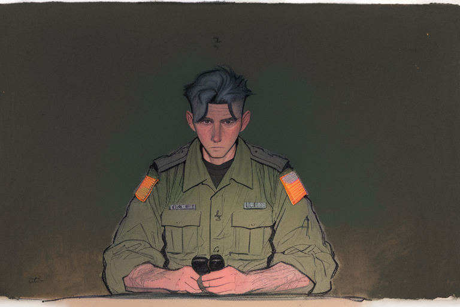

# CHAPITRE 11 : L'ANALYSE ASYMÉTRIQUE

> *« ALERTE STRATÉGIQUE — SYSTÈME EXPERT STRATÈGE-9 // SECTEUR ORIENTAL OARK :*
> *Anomalie détectée sur le flux télémétrique Z-4 (Cote 412, Dorsale Nord-Est).*
> *Signature infrarouge de la cible : 0,00 K au-dessus du fond cosmique (Violation du second principe de la thermodynamique industrielle).*
> *Rétrodiffusion radar millimétrique : 0,00 % (Absorption totale).*
> *Conclusion algorithmique : Entité hors référentiel connu. Saisie ou destruction immédiate requise avant capture par l’ennemi afistéaan. »*
> — **Journal d’alerte du Bunker de Commandement Sectoriel, 14 h 04 min 19 s**

{.chapter-illustration}

Dans la salle des transmissions de Zêta-3, Borras avait les 10 doigts si durement crispés sur le rebord d’acier de sa console que ses ongles en étaient devenus blancs.

10 minutes plus tôt, lorsqu’il avait surgi en sueur de sa couchette après 3 heures d’un sommeil agité et qu’il avait vu l’horloge murale marquer 14 heures sans la moindre trace du signal de Koda, une terreur froide lui avait broyé l’estomac. Il avait revu en un éclair toutes les morts absurdes du désert d’Oark : une corniche de basalte qui cède sous le poids de l’armure, un joint de casque fendu contre une arête d’obsidienne, son amie d’enfance étouffant seule au fond d’une crevasse noire à 30 kilomètres de tout secours.

Aussi, lorsque la caméra gyrostabilisée du drone Z-4 avait enfin percé la brume d’ocre de la dorsale nord-est et affiché sur le moniteur principal la silhouette familière de la moto-chenille et de l’éclaireuse debout sur ses 2 jambes, Borras avait laissé échapper un soupir rauque de gratitude, prêt à lui pardonner sur-le-champ tous ses retards de la terre.

Puis le téléobjectif avait fait la mise au point à 3 mètres à gauche de Koda.

Sous la clarté verdâtre des néons du poste de commandement, Marek, qui se tenait debout derrière le fauteuil de Borras avec sa tasse d’étain à la main, laissa échapper un juron étouffé.

Sur l’écran haute définition, la créature dressée au bord du précipice ne ressemblait à rien de ce que les usines de Plotéris ou les arsenaux afistéaans avaient jamais mis sur pied. Un exosquelette de combat aqin était un monstre trapu de 2 tonnes, hérissé de vérins hydrauliques externes, de tuyaux blindés, de plaques de céramique boulonnées et de radiateurs dorsaux crachant une brume de vapeur chaude. Ce qui se tenait là-bas, sous le soleil féroce de 14 heures, possédait la pureté de ligne d’un archange taillé dans un bloc d’albâtre sombre et d’anthracite sans couture, et ses 2 yeux d’or liquide fixaient l’objectif du drone à 150 mètres d’altitude avec une immobilité souveraine.

— Koda, réponds-moi immédiatement ! cria Borras dans le microphone sur col de cygne, la gorge sèche. Est-ce que c’est un prototype d’infiltration afistéaan ? Est-ce que tu es prise en otage ?! Dégage de la ligne de tir et jette-toi à plat ventre derrière les rochers !

Dans ses écouteurs, la voix de Koda lui revint à travers le grésillement de la porteuse, tendue, précipitée, presque suppliante :

— *Ce n’est pas afistéaan, Borras ! Et je ne suis pas en otage ! Il n’a pas d’arme, tu le vois bien, il m’a simplement aidée à remonter de la faille quand mon câble de treuil s’est coincé dans la paroi ! Je t’en supplie, Borras, coupe le relais satellite du drone Z-4 tout de suite ! Rappelle l’appareil en manuel et laisse-moi rentrer au camp, je t’expliquerai tout entre 4 yeux !*

— Couper le relais satellite ?! Mais tu es devenue folle ou quoi, je n’ai pas la main sur le canal primaire ! Depuis l’alerte de minuit, toute la télémétrie des drones de sûreté part en flux doublé vers le serveur du Commandement Sectoriel avant même d’arriver sur ma console !

Les yeux de Borras glissèrent du retour vidéo vers les 3 écrans secondaires où défilaient en temps réel les courbes des capteurs embarqués du drone Z-4.

Ce qu’il y lut fit perler une goutte de sueur glacée le long de sa tempe.

Le capteur thermique infrarouge du drone balayait la scène avec une précision au centième de degré. Sur l’image en fausses couleurs, le sable du plateau brillait d’un jaune orangé à 47 degrés ; le carter du moteur de la moto-chenille formait une tache blanche incandescente à 90 degrés ; le scaphandre de Koda dessinait un halo rougeâtre autour de ses évents de refroidissement.

Mais à l’emplacement exact où se tenait le grand humanoïde de 2 mètres, l’écran thermique affichait une silhouette d’un noir d’encre absolu : **zéro émission calorifique parasite**. Sous un soleil capable de faire cuire un œuf sur un blindage en 10 minutes, la surface de l’entité ne rayonnait pas un seul milliwatt d’infrarouge, comme si elle échappait aux lois mêmes de la thermodynamique qui condamnent toute machine active à laisser fuir de la chaleur dans l’air ambiant.

Plus bas, le graphique du radar millimétrique de conduite de tir — dont les ondes ultracourtes étaient pourtant capables de dessiner le moindre rivet d’un char à travers une tempête — clignotait en rouge d’erreur : le faisceau envoyé par l’antenne du drone frappait la poitrine de l’inconnu et ne revenait pas. Taux d’absorption électromagnétique : **100,0 %**. Quant au spectromètre laser, chargé d’identifier la composition métallurgique des cibles en analysant la couleur de l’infime étincelle réfléchie par leur surface, son programme tournait en boucle dans le vide en affichant une ligne absurde : `STRUCTURE ATOMIQUE NON RÉFÉRENCÉE // ABSENCE DE RÉSEAU CRISTALLIN STANDARD`.

— Borras… murmura Marek derrière son épaule, la voix blanche. Qu’est-ce que c’est que ce bordel ? Mon radar dit qu’il y a un trou vide dans l’air à l’endroit où cette chose est debout…

Borras ne répondit pas.

Au fond de sa mémoire, avec la lenteur implacable d’un train de marchandises qui déraille au ralenti, une phrase venait de remonter à la surface. 3 jours plus tôt. 19 heures. Koda accoudée à cette même console, les cheveux encore humides de la douche, ses yeux sombres brillants de cette fièvre d’enfant qu’il aimait tant, lui murmurant en confidence : *« Juste une vieille carcasse inerte sous une dalle… une sorte de bloc logique ancien… Laisse-moi au moins cette nuit pour l’examiner sous ma loupe avant de remplir 3 formulaires roses. »*

Et sa propre main, à 22 heures 12, tapant consciencieusement sur le clavier mécanique la note d’incident qui devait « les couvrir tous les 2 ».

Un froid mortel lui saisit les entrailles.

— Koda… souffla-t-il dans son micro en coupant le haut-parleur de la pièce pour que Marek n’entende pas le tremblement de sa voix. Dis-moi que ça n’a aucun rapport avec la carte logique que tu as ramenée de la faille 7 il y a 3 jours. Dis-le-moi, Koda !

Dans le casque, il n’y eut qu’un silence d’une seconde — un silence qui valait tous les aveux du monde — avant que la voix de son amie ne murmure :

— *Je croyais que ce n’était qu’un vieux fossile d’ordinateur, Borras, je te le jure sur nos années d’Ostre… Il n’a fait de mal à personne. Donne-moi juste une heure pour rentrer.*

Borras ne comprit pas tout ce qu’il avait sous les yeux.

En revanche, à 4 200 kilomètres à l’ouest, sous 300 mètres de granit au cœur du Bunker du Commandement Sectoriel d’Oark, l’intelligence artificielle d’analyse stratégique de Condorcé — un réseau de supercalculateurs refroidis à l’azote liquide baptisé *Stratège-9* — comprit en moins de 380 millisecondes.

Dans la grande salle d’opérations souterraine, plongée dans la pénombre bleutée des tables tactiques où 30 officiers d’état-major suivaient les convois de minerai, le timbre grave de l’alarme de Priorité 1 retentit soudain, coupant net le brouhaha des conversations.

Au centre du mur d’écrans principal, le système expert venait d’ouvrir d’autorité une fenêtre bordée d’écarlate, juxtaposant l’image vidéo tremblante filmée par le drone Z-4 et un extrait des archives logistiques de la semaine :

`CORRÉLATION CRITIQUE ÉTABLIE (PROBABILITÉ : 99,94 %) :`
`1. Archive Base Zêta-3 / J-3 / 22h12 (Officier déclarant : Lt. Borras) : Surtension et destruction thermique du scanner Série 4 #882 par l'Éclaireuse Koda (Mat. 44-K) suite au contact avec un « composant informatique/logique ancien non identifié » ramené à la base.`
`2. Télémétrie directe Drone Z-4 / J-0 / 14h04 : Apparition aux côtés du Mat. 44-K d'une unité bipède active présentant une signature d'absorption énergétique totale et une densité matérielle excédant tous les vestiges répertoriés de l'Antiquité oarkine.`
`CONCLUSION : Dissimulation et activation illicite d'un artefact stratégique majeur.`

Sur la passerelle de commandement en acier surplombant la fosse des analystes, le Colonel Draeven s’immobilisa, son gobelet de chicorée arrêté à 2 centimètres de ses lèvres minces. C’était un vétéran des campagnes polaires d’Aqi au crâne rasé, dont la joue gauche portait la cicatrice blanchâtre d’une brûlure par le gel ; il n’avait pas dormi plus de 4 heures par nuit depuis que le front du glacier d’Ostre avait commencé à craquer.

Il s’avança jusqu’à la rambarde et plissa ses yeux d’oiseau de proie devant l’agrandissement optique du visage d’albâtre et d’or d’ÉCHO-8471.

— Qu’est-ce que c’est que ce cirque, commandant ? gronda-t-il à l’adresse du chef de la cellule scientifique. Les Afistéaans ont réussi à débarquer un blindé furtif sur le secteur Zêta sans déclencher nos radars orbitaux ?

Au bas de la fosse, l’officier analyste principal avait ôté ses lunettes et les essuyait machinalement d’une main tremblante sans quitter des yeux les courbes spectrales.

— Ce… ce n’est pas afistéaan, mon colonel, répondit-il d’une voix qui déraillait légèrement. Les Afistéaans utilisent les mêmes alliages de titane-carbure et les mêmes piles à fusion au deutérium que nous. Regardez les relevés du drone : cette unité se déplace sous une gravité normale sans émettre un seul décibel acoustique, sa peau absorbe 100 % du faisceau radar à 30 gigahertz et son bilan entropique externe est nul, sans la moindre déperdition d’énergie désordonnée autour de sa coque. Même dans les dossiers les plus secrets sur l’Âge d’Or d’Oark, nous n’avons jamais vu un matériau capable d’annuler sa propre signature thermique en plein désert.

— Et la fille à côté ? L’éclaireuse 44-K ?

— D’après le recoupement de *Stratège-9*, elle a déterré le cœur logique de cette machine il y a 72 heures dans une faille du secteur 7. Au lieu de le remettre sous scellés conformément à l’article 14, elle l’a introduit clandestinement dans la base Zêta-3 grâce à la complaisance ou à la négligence de son officier des transmissions, et elle vient manifestement de l’utiliser pour ouvrir un dépôt souterrain non répertorié sur la dorsale nord-est.

Les mâchoires de Draeven se contractèrent jusqu’à faire saillir les muscles sous sa cicatrice.

3 heures plus tôt, il avait reçu sur sa ligne cryptée personnelle l’ultime directive du Général Vane en provenance du bunker de Plotéris : 2 dômes civils supplémentaires venaient de perdre leur chauffage sur Aqi, les divisions afistéannes préparaient l’assaut final sur la brèche d’Ostre, et Condorcé n’avait plus 6 semaines d’espérance de vie militaire à armes égales. Vane avait été d’une clarté glaciale : *Trouvez-moi sur Oark de quoi inverser les lois de cette guerre, Draeven, ou nous mourrons tous sous la glace avant l’équinoxe.*

Et voilà que le prodige technologique capable de vitrifier l’armée ennemie en une après-midi se tenait là, debout au bord d’un canyon du secteur Zêta, entre les mains d’une éclaireuse de 26 ans qui jouait aux rebelles.

— Coupez immédiatement toutes les liaisons sortantes et entrantes de la base Zêta-3, ordonna Draeven d’un ton tranchant comme un couperet. Révoquez les codes d’accès locaux de leur poste de commandement, verrouillez les portes blindées de la garnison à distance et placez les 15 membres du camp aux arrêts de rigueur en attendant l’arrivée de la sécurité militaire.

— À vos ordres, mon colonel !

À 4 200 kilomètres de là, dans la salle des transmissions de Zêta-3, l’image du désert et du visage angoissé de Koda s’effaça d’un coup sec sur le moniteur de Borras.

Les 3 écrans virèrent au noir absolu pendant une seconde, puis affichèrent en lettres d’or froid le sceau à l’aigle de fer du Haut Commandement :

`PRISE DE CONTRÔLE DISTANTE — DIRECTIVE PRIORITÉ 1`
`HABILITATION LOCALE ZÊTA-3 RÉVOQUÉE // VERROUILLAGE DES SAS EN COURS`
`CLASSIFICATION DU SECTEUR : SECRET SUPRÊME D'ÉTAT`

Dans les écouteurs de Borras, la voix de Koda fut tranchée net au milieu d’une syllabe, remplacée par la tonalité sourde d’une porteuse morte. Au bout du couloir, le grondement lourd des pênes électromagnétiques du garage et du sas extérieur résonna dans la structure de béton : la base venait de se transformer en prison.

— Non… Non, non, non ! s’écria Borras en frappant de ses 2 poings sur le clavier mécanique devenu sourd et muet. Koda ! Koda, ne reste pas là-bas, fuis !

Le microphone éteint ne renvoyait plus que l’écho de sa propre voix dans la pièce close.

Marek recula d’un pas jusqu’à la cloison, le visage livide :

— Borras… Qu’est-ce que le QG vient de faire ? Pourquoi ils nous ont enfermés ?

Borras s’affaissa à demi contre le rebord de la console, la tête entre les mains, tandis que sur le coin de son bureau, le double imprimé de son bordereau d’incidents d’avant-hier semblait le narguer de ses 3 lignes impeccables. Il avait voulu être un bon officier ; il avait voulu respecter la procédure tout en protégeant sa sœur d’armes. Et par sa propre main, avec la ponctualité d’un greffier modèle, il venait de la livrer aux chiens.

Dans le bunker du Commandement Sectoriel, le Colonel Draeven s’était déjà tourné vers la table de contrôle aérien :

— Officier de tir, qu’est-ce que nous avons en vol armé à moins de 15 minutes de la cote 412 ?

Le capitaine de permanence consulta ses vecteurs radar et redressa le menton :

— L’escadrille d’interception automatisée *Faucon-Lourd*, mon colonel. 5 drones d’assaut de classe *Centurion-IV*, que vous aviez fait maintenir en alerte haute dans le couloir oriental après le rapport de minuit et qui longent actuellement la ligne de démarcation sud, à 92 kilomètres au sud-sud-est de la dorsale. Dotation complète : canons rotatifs à impulsion magnétique de 30 millimètres et paniers de 12 roquettes perforantes à charge creuse — dont le cône de cuivre inversé concentre l’explosion en un dard de métal en fusion capable de percer 30 centimètres de blindage.

— Temps de vol à poussée maximale avec postcombustion, en injectant le carburant directement dans les tuyères ?

— 17 minutes et 40 secondes jusqu’au contact visuel.

Draeven posa ses 2 mains à plat sur le rebord d’acier de la galerie. Dans ses prunelles grises, le reflet de la petite silhouette d’albâtre filmée par le drone Z-4 brillait comme une proie au bout d’un fusil.

— Déroutez l’escadrille *Faucon-Lourd* immédiatement, ordonna-t-il sans un battement de cils. Programmez l’automate de combat en protocole d’engagement Alpha : interdiction formelle à l’éclaireuse 44-K de quitter le périmètre. Si elle obtempère et s’éloigne de l’artefact les mains levées, maintenez-la en joue jusqu’à l’arrivée de nos transporteurs lourds. Si elle tente de fuir avec l’objet ou de faire obstacle à la saisie, abattez-la sur place pour haute trahison en temps de guerre. Quant à la machine… testez ses défenses au canon de 30 millimètres pour la forcer à se mettre en sécurité, et ramenez-moi sa carcasse à Plotéris avant minuit.

Sur la grande carte holographique du secteur oriental, 5 triangles écarlates virèrent de bord simultanément dans un angle aigu et plongèrent vers le nord à 312 kilomètres à l’heure.
