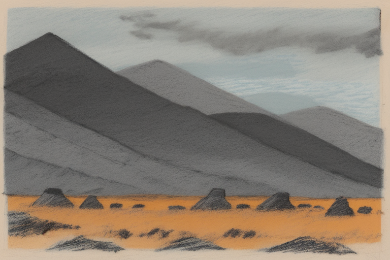

# CHAPITRE 14 : L'ALERTE TACTIQUE

> *« Vecteur d’interception : Escadrille de chasse lourde "Faucheur", nomenclature tactique Condorcé. Vitesse de croisière : 312 km/h (86,66 m/s). Armement embarqué : canon rotatif à accélération magnétique de 20 mm (cadence : 4 200 coups/min) et paniers thermobariques à guidage infrarouge. Doctrine d’emploi : saturation cinétique intégrale de la grille cible avant identification visuelle. »*
> — **Manuel des Procédures d'Engagement Aéroterrestre, Haut Commandement de Condorcé**

{.chapter-illustration}

L’aube livide d’Oark venait à peine de fendre la brume de soufre lorsque Koda boucla son casque et jaillit hors de l’arche de grès rouge, son fusil à impulsion magnétique armé entre les mains.

Le vent matinal redoublait de violence sur le plateau de basalte, soulevant des écharpes de silice fauve qui mordaient l’acier comme du verre pilé. À 20 pas devant la cavité où ils avaient passé la nuit, la haute silhouette d’ÉCHO-8471 se tenait dressée au bord de l’escarpement, immobile face au sud-est.

Il n’y avait plus trace en lui de l’élève candide qui, quelques heures plus tôt, s’allongeait sur le dos dans le sable pour éprouver l’inutilité du sommeil ou questionnait Koda sur le sens du mot « orphelin ». Sa stature d’albâtre sombre, dépourvue de la moindre couture ou tête de rivet, absorbait la clarté sale du levant sans en rendre un seul reflet. À ses pieds, la poussière d’ocre tourbillonnait autour de ses chevilles fuselées sans parvenir à s’accrocher à la matière inconnue de son épiderme.

Accroupi dans le harnais dorsal que Koda venait de sangler en hâte contre ses omoplates, Bricole fit pivoter son vieux moniteur cathodique au-dessus de l’épaule de la jeune femme. Son unique bras de soudeuse se figea à mi-course.

— Qu’est-ce que tu captes, ÉCHO ? souffla Koda dans son laryngophone, l’index déjà posé le long du pontet de son arme. Une patrouille de Zêta-3 ?

Là-bas, par-delà les tables de lave refroidie et les ravines de gypse qui descendaient vers le bassin oriental, le ciel n’était qu’une muraille de brume jaunâtre. Aucun bruit de moteur, aucun écho métallique ne traversait encore le mugissement du vent.

Puis la voix d’ÉCHO retentit.

Ce n’était plus le timbre interrogatif et presque doux de la veille, mais une onde acoustique d’une froideur opérationnelle absolue, sans souffle, sans grain, découpée au scalpel dans l’air glacé du matin :

— Alerte tactique. 5 vecteurs aériens de classe offensive détectés. Azimut 134, élévation 4 degrés. Vitesse d’approche constante : 312 kilomètres par heure.

Le pouls de Koda bondit dans ses tempes. D’un geste sec, elle rabattit son poignet gauche devant sa visière. Sur le cadran à cristaux liquides de son détecteur de proximité, le balayage radar demeurait désespérément vierge, à l’exception de quelques parasites provoqués par les poches de magnétite du sous-sol.

— 312 kilomètres-heure ? répéta-t-elle, la gorge sèche. Mon transpondeur passif ne relève rien à 15 kilomètres à la ronde ! Tu es certain de ne pas confondre avec un front d’orage électromagnétique ?

— Probabilité d’erreur instrumentale : zéro, répondit ÉCHO de ce même ton plat, indifférent à l’urgence humaine. Distance actuelle des cibles : 26,4 kilomètres. Détection effectuée par corrélation des ondes de pression acoustique propagées dans le substrat basaltique — l’infime frémissement sonore que le vol rasant de leurs réacteurs imprime jusque dans la pierre — et des harmoniques d’échappement à fusion thermique dans la basse atmosphère. Signature identifiée par recoupement avec les émissions du premier appareil d’observation : nomenclature locale « Condorcé ». Configuration : 5 unités d’assaut lourd volant en formation de balayage rasant.

Sur l’épaule de Koda, le tube cathodique de Bricole vira d’un vert phosphorescent à une teinte émeraude électrique, zébrée de lignes de calcul fulgurantes.

— 5 *Faucheurs* du Commandement Sectoriel, traduisit la voix souveraine de Bricole, dont la diction d’orateur antique jurait avec le grincement de son support de tôle. Ta petite base de Zêta-3 ne dispose que de 2 appareils de reconnaissance légers. Cela signifie que le relais orbital a transmis l’analyse vidéo du drone d’hier directement à la forteresse souterraine de Képler-1. Comme tu as sabordé ta balise et précipité ta moto-chenille au fond d’une crevasse de gypse avant leur arrivée hier après-midi, le rideau magnétique des gorges a mis en échec leur premier ratissage nocturne ; l’état-major a donc attendu les premières lueurs thermiques du jour pour relancer son escadrille en peigne rasant le long de la dorsale rocheuse.

— Borras n’aurait jamais ordonné un raid d’assaut lourd contre moi ! protesta Koda, bien qu’une sueur froide vînt de tremper la doublure de son col cervical. Il sait que je suis seule dans ce secteur !

— Ton ami Borras n’est qu’un rouage subalterne dans une machine thermodynamique gouvernée par la terreur de l’extinction, répliqua Bricole avec une lucidité implacable. Lorsqu’une civilisation industrielle, acculée sur une planète gelée, aperçoit sur ses moniteurs un châssis dont l’alliage viole ses tables de spectroscopie — ces catalogues optiques où chaque métal connu se trahit d’ordinaire par la couleur de son reflet laser —, elle ne consulte pas les états d’âme d’un lieutenant de transmission. Elle applique son unique axiome de survie, son postulat premier qui ne souffre aucune discussion : s’approprier l’anomalie ou la vitrifier avant que l’ennemi n’en soupçonne l’existence.

— Inventaire de l’armement confirmé par analyse des masses magnétiques embarquées, poursuivit ÉCHO, imperturbable. Chaque vecteur porte un canon rotatif à accélération électromagnétique de calibre 20 millimètres sous le nez, couplé à 2 paniers latéraux contenant 12 projectiles thermobariques à guidage infrarouge. 2 des appareils transportent en outre des filets de confinement à décharge capacitive haute tension — des mailles d’acier lestées de condensateurs lourds, conçues pour envelopper une machine et foudroyer ses circuits d’un seul arc électrique. Temps estimé avant l’entrée dans l’enveloppe de tir balistique directe : 4 minutes et 42 secondes.

4 minutes et 42 secondes.

Un tour d’horizon suffit à Koda pour mesurer l’étendue du piège, et l’adrénaline nettoya d’un coup le brouillard du réveil. Autour de l’arche de grès, la dalle de basalte du Secteur 7 s’étendait, plate et nue comme une enclume, sur près d’une lieue. L’arche elle-même, ouverte plein sud face à l’axe d’approche des chasseurs, se transformerait en four crématoire à la première roquette thermobarique. Offrir un tel champ de tir à 5 Faucheurs équipés de canons Gauss — ces mitrailleuses à bobines magnétiques qui crachaient 70 obus d’acier à la seconde — revenait à attendre le peloton d’exécution : à 312 kilomètres par heure, les machines de mort dévoraient 86,6 mètres à chaque battement de cil.

Mais au nord-ouest, à un peu moins de 1 800 mètres, la croûte du plateau se déchirait en un labyrinthe d’aiguilles volcaniques tordues que les prospecteurs appelaient les Dents de Scorie — l’antichambre du grand réseau de canyons du Massif des Orgues.

— Les Dents ! lâcha Koda en basculant le poids de son corps vers l’avant. Si on atteint les cheminées de basalte avant eux, leurs radars de suivi de terrain perdront le verrouillage dans les colonnes magnétiques ! Course forcée, maintenant !

Elle s’élança. Les vérins hydrauliques de ses jambières d’exploration gémirent sous la contrainte, crachant une bouffée de vapeur d’huile par les soupapes de décharge. 40 kilos de céramique et d’acier trempé, plus les 15 kilos du châssis de Bricole qui brinquebalait contre ses omoplates avec un vacarme de batterie de cuisine : chaque foulée dans le régolithe meuble lui brûlait les quadriceps comme du plomb fondu.

— ÉCHO, à ma hauteur ! cria-t-elle dans le micro.

Le Gardien se mit en mouvement à sa droite.

En dépit de la terreur qui lui serrait la poitrine, le contraste faillit faire trébucher l’éclaireuse. Tandis qu’elle ahanait dans son scaphandre, martelant le sol de ses bottes ferrées dans un concert de cliquetis métalliques, de couinements de ressort à 2 410 hertz et de respirations rauques, l’entité des Semeurs glissait à ses côtés avec une aisance spectrale. Ses pieds d’albâtre sombre effleuraient à peine la pierre ; son buste ne connaissait ni roulis ni secousse ; ses yeux d’ambre demeuraient rivés sur l’horizon sud-est tandis qu’il bridait volontairement sa vitesse prodigieuse pour calquer sa foulée sur la course laborieuse de l’humaine.

— 3 minutes et 50 secondes avant contact, annonça-t-il sans que son timbre subît la moindre altération. Vitesse actuelle de l’entité Koda : 14,2 kilomètres par heure. Distance résiduelle jusqu’à l’abri topographique désigné : 1 610 mètres. Calcul d’interception : les vecteurs hostiles établiront le verrouillage de tir à 1 800 mètres de distance, soit 180 mètres avant que vous n’atteigniez la première formation rocheuse. Probabilité de survie biologique à découvert sous tir de saturation : 1,8 %.

— Alors prends-moi sous le bras comme hier dans la faille et cours à ta vraie vitesse ! haleta Koda en sautant par-dessus une crevasse de soufre.

— Simulation négative, répliqua immédiatement ÉCHO. En terrain horizontal découvert, une accélération de mon châssis supérieure à 60 kilomètres par heure soumettrait votre colonne vertébrale et la structure non carénée de l’unité Bricole à des décélérations latérales incompatibles avec l’intégrité de vos tissus mous et de ses soudures d’étain. De plus, l’élévation de ma signature cinétique déclencherait le tir à longue portée de leurs missiles transhorizon dès la vingtième seconde.

— Dans ce cas, garde tes statistiques pour toi et prépare-toi à les descendre dès qu’ils seront à portée ! souffla Koda, une goutte de sueur acide lui brûlant la paupière. Tu es un Gardien des Semeurs, oui ou non ? Bricole, ordonne-lui d’activer son arsenal !

Dans son dos, la pince de soudeuse de Bricole se cramponna au rebord de son col blindé pour amortir un cahot particulièrement rude.

— C’est précisément là que réside la subtilité tragique de notre situation, ma chère Koda, répondit la voix cristalline du petit robot. Un Gardien des Semeurs n’est pas un croiseur d’assaut de Condorcé. Il ne possède pas d’armes au sens où votre espèce l’entend.

— Quoi ?!

— Configuration nominale : gestionnaire d’intégrité matérielle et de préservation biologique, confirma ÉCHO avec une sérénité de marbre. Je dispose des organes de manipulation moléculaire et de contrôle des vecteurs cinétiques propres à l’architecture des Semeurs. Toutefois, la Directive Primaire d’Éthique Cosmique m’interdit formellement toute action offensive ou destruction préventive d’appareils appartenant à une espèce émergente sans un jeton d’autorisation cryptographique délivré par le Réseau Planétaire des Mnémorites.

— Mais demande-le, ce foutu jeton ! hurla Koda, les poumons en feu, alors que les flèches noires des Dents de Scorie grandissaient beaucoup trop lentement derrière sa visière embuée.

— Requête émise sur la bande subatomique, dit ÉCHO. Temps d’attente estimé de la réponse du Réseau Planétaire Solyar : infini. Le réseau est éteint. Par conséquent, toute initiative d’attaque préventive m’est matériellement et légalement verrouillée.

2 minutes et 40 secondes.

1 100 mètres jusqu’aux rochers.

À travers le grondement de son propre sang dans ses oreilles, Koda percevait désormais une vibration grave, presque subsonique, qui montait par les semelles de ses bottes : le vrombissement synchrone des 5 turbines à fusion qui labouraient la couche basse de l’atmosphère en rase-mottes. Au loin, au sommet de la muraille de brume ocre, 5 sillons de turbulence sombre commençaient à tordre les nuages de poussière.

— Vous êtes en train de me dire qu’on a réveillé un dieu indestructible, qu’on a trahi ma patrie pour le sauver, et qu’il va nous regarder nous faire hacher menu parce qu’il lui manque un tampon administratif ?! s’étrangla l’éclaireuse.

— Pas tout à fait ! intervint Bricole d’un ton pressant, tandis que son écran cathodique clignotait frénétiquement contre la nuque de Koda. L’article 4 du protocole des Gardiens autorise la *neutralisation défensive immédiate* dès lors qu’une agression létale est matériellement engagée contre l’opérateur protégé ! ÉCHO n’a pas le droit de frapper le premier, ni d’ôter la vie à un être biologique, mais à la milliseconde où le premier projectile quittera leurs tubes, ses verrous défensifs sauteront d’eux-mêmes !

— Parfait ! souffla Koda en puisant dans ses dernières réserves nerveuses, ses jambières hydrauliques hurlant au bord de la rupture thermique. Alors dès qu’ils ouvrent le feu, ÉCHO, tu déploies ton bouclier ou ta manipulation moléculaire et tu les cloues au sol !

Un battement de cil — une éternité pour un processeur quantique — précéda la réponse du géant d’ambre.

— Connaissance théorique de la manipulation cinétique et de la réorganisation moléculaire atmosphérique : présente dans le noyau d’initialisation à 1,04 %.

— Et en pratique ? demanda Koda, traversée d’un pressentiment polaire.

— Fichiers d’étalonnage moteur et matrices d’exécution spatiale : absents, énonça ÉCHO avec la candeur immaculée d’un écolier récitant son théorème. Ces bibliothèques résidaient dans la mémoire vive du sanctuaire, non transférée lors de l’interruption de ma genèse. Je connais les équations de champ de Planck — les formules qui décrivent le grain ultime de l’espace et de l’énergie —, mais je n’ai jamais actionné mes inducteurs palmaires, les émetteurs de champ logés au creux de mes mains. Je ne sais pas comment procéder.

— Par les cendres d’Oark… murmura Bricole, et pour la première fois depuis sa reconnexion à la Mnémorite, sa voix souveraine laissa percer un frémissement d’effroi. Il possède le corps d’un archange et la coordination motrice d’un nouveau-né qui vient d’ouvrir les yeux.

Une minute et 12 secondes.

400 mètres jusqu’à la première arche basaltique des Dents de Scorie.

Soudain, l’alarme de détection laser du casque de Koda explosa dans ses tympans en un trille strident et continu. Sur l’affichage tête haute de sa visière, 5 triangles écarlates venaient de s’allumer simultanément avec la mention clignotante : *VERROUILLAGE TÉLÉMÉTRIQUE ACQUIS*.

Elle jeta un regard par-dessus son épaule gauche tout en courant.

À moins de 2 000 mètres, 5 silhouettes noires, trapues et anguleuses comme des fers de hache, venaient de crever le rideau de poussière ocre à 15 mètres à peine au-dessus du sol. Poussés par le hurlement sauvage de leurs tuyères thermiques qui laissaient derrière elles des traînées d’air distordu, les Faucheurs de Condorcé plongeaient en formation en éventail. Sous leurs carlingues blindées, leurs optiques frontales dardaient des pinceaux laser rubis qui convergeaient tous sur la poitrine de l’éclaireuse.

— 54 secondes d’avance sur l’estimation initiale, corrigea froidement ÉCHO. Les vecteurs hostiles ont engagé leur postcombustion d’urgence après acquisition radar. Entrée dans l’enveloppe de tir effective. Ouverture du feu détectée.

Au-dessous du nez du Faucheur de tête, les 6 tubes du canon magnétique se mirent à tourner dans un éclair bleuâtre d’ozone ionisé.

— À terre ! hurla Koda en plongeant la tête la première derrière la première arête basaltique des Dents de Scorie.

L’air se déchira à Mach 6.
