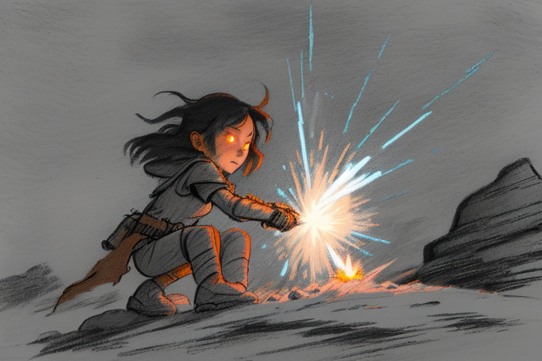

# CHAPITRE 15 : L'APPRENTISSAGE SOUS LE FEU

> *« L’erreur fondamentale des civilisations mécaniques consiste à concevoir la défense comme l’opposition d’une masse rigide à une autre masse rigide. Elles bâtissent des boucliers plus épais contre des obus plus lourds, jusqu’à ce que l’énergie dissipée au point d’impact détruise le défenseur autant que l’assaillant. La science des Semeurs ne combat pas le mouvement : elle l’épouse et le reconduit au silence. »*
> — **Archives du Noyau SOLYAR-0194 (Bricole), Précis de Mécanique Harmonique**

{.chapter-illustration}

Le monde explosa en une tempête d’éclats noirs et de tonnerre sec.

La première salve d’obus ferromagnétiques de 20 millimètres frappa l’éperon rocheux une fraction de seconde après que Koda eut basculé dans la ravine. Il n’y avait pas d’explosif chimique dans ces projectiles-là : seulement de l’énergie cinétique pure, propulsée à 6 fois la vitesse du son par les rails électromagnétiques des Faucheurs. La colonne de basalte sous laquelle la jeune femme venait de rouler se désintégra comme de la porcelaine sèche. Une grêle de shrapnels minéraux — des éclats de pierre coupants comme de la mitraille d’acier —, chauffés à blanc par la friction, s’abattit sur sa carapace dorsale et sur le châssis de Bricole dans un fracas de marteau-pilon.

L’odeur suffocante de la silice vaporisée et de l’ozone envahit l’habitacle de son casque malgré les filtres à charbon.

— Koda ! Ton intégrité structurelle ! cria Bricole, dont le vieux moniteur cathodique venait de se fendre d’une étoile dans l’angle supérieur gauche sous le choc d’un gravillon supersonique.

— Je suis entière ! toussa-t-elle en se redressant sur les coudes au fond de la tranchée naturelle, les oreilles sifflantes, la bouche pleine de poussière amère. Mais ce rocher ne tiendra pas une deuxième passe !

Au-dessus d’eux, les 5 Faucheurs virèrent sur l’aile dans un hurlement de turbines qui fit vibrer l’émail de ses dents. Lourds, bardés de plaques de blindage en titane riveté, noircis par la suie des tuyères, les appareils d’Aqi incarnaient toute la brutalité industrielle de Condorcé : des prédateurs sans grâce, conçus pour saturer une coordonnée géographique sous un déluge d’acier jusqu’à ce que plus rien ne respire.

Debout au milieu de la ravine, totalement à découvert dans le nuage d’ocre soulevé par l’impact, ÉCHO-8471 n’avait pas fléchi les genoux.

— Agression létale matériellement confirmée, déclara sa voix cristalline au milieu du tumulte. Verrouillage légal originel levé pour les protocoles de préservation. Autorisation de défense active accordée.

Le Faucheur numéro 2 piqua droit sur eux à moins de 100 mètres d’altitude. Sous son museau anguleux, ses canons rotatifs crachèrent une langue continue de lumière violette.

— ÉCHO, baisse-toi ! hurla Koda.

Le Gardien ne se baissa pas. Au contraire, il exécuta un pas latéral d’une vélocité inhumaine pour s’interposer exactement sur la ligne de tir entre le nez du drone et le corps allongé de l’éclaireuse.

30 projectiles en tungstène densifié le percutèrent de plein fouet, du sternum à l’épaule gauche, en moins d’une demi-seconde.

Le vacarme fut assourdissant — une série de claquements métalliques si violents qu’on eût dit qu’un forgeron titanique battait une enclume à coups de masse. Dans un jaillissement d’étincelles blanches, les obus de Condorcé s’aplatirent, fondirent et se volatilisèrent en pluie de gouttelettes incandescentes contre la poitrine d’albâtre sombre d’ÉCHO. Le Gardien ne recula pas d’un millimètre. Ses pieds demeurèrent soudés au gravier par couplage moléculaire. Lorsque la fumée se dissipa, son torse était intact : pas une brèche, pas une éraflure, pas même une trace de suie sur la géométrie immaculée de son épiderme.

Pourtant, Koda poussa un cri de douleur.

5 des projectiles avaient ricoché à angle aigu sur le flanc inviolable d’ÉCHO, pulvérisant la paroi rocheuse à 20 centimètres du visage de la jeune femme et projetant une lame d’air comprimé qui la plaqua contre le sol, le souffle coupé. Un éclat de basalte tranchant rebondit sur sa visière, y gravant une longue balafre blanche d’une tempe à l’autre.

— Imbécile géométrique ! s’égosilla Bricole depuis le harnais de Koda, sa pince de soudeuse s’agitant frénétiquement vers le géant tandis que son ressort tordu couinait d’indignation. Ta propre carapace est inaltérable, mais l’énergie cinétique que tu réfléchis par simple rebond balistique va réduire son organisme de carbone en bouillie avant la troisième salve !

ÉCHO abaissa ses prunelles d’ambre vers Koda, qui luttait pour reprendre son souffle dans son casque balafré.

— Constat validé, dit-il sans la moindre émotion. L’interposition passive génère une dispersion vectorielle secondaire — une gerbe de ricochets mortels dans toutes les directions — dangereuse pour l’entité protégée. Je dois déployer un écran d’absorption moléculaire à distance. Tentative d’initialisation de l’inducteur palmaire droit selon l’équation théorique numéro 7.

Dans le ciel d’ocre, les Faucheurs 3 et 4 s’alignaient déjà en tandem au bout de leur virage. Cette fois, les trappes de leurs paniers latéraux venaient de s’ouvrir avec un claquement sec. 4 roquettes thermobariques jaillirent des tubes dans un sifflement de vipère, laissant derrière elles des sillons de fumée grasse.

— Pas du thermobarique en milieu confiné ! s’étrangla Koda en essayant de s’enfoncer sous le surplomb. L’onde de surpression va nous vider les poumons !

ÉCHO leva la main droite vers les 4 traits de feu qui plongeaient sur la ravine. Entre ses doigts fuselés, l’air se troubla brusquement, strié de mirages géométriques comme au-dessus d’une plaque de fonte chauffée à blanc.

— Application d’un gradient de densité atmosphérique maximal, annonça le Gardien en comprimant d’un coup les couches d’air au-dessus d’eux jusqu’à les rendre aussi compactes qu’un blindage d’acier.

Mais le geste était raide, scolaire, calqué sur une formule abstraite que son esprit vierge appliquait comme un interrupteur binaire. Au lieu d’amortir progressivement l’onde, ÉCHO figea brutalement une dalle d’air solide à 15 mètres au-dessus de leurs têtes, à l’instant précis où la première roquette percutait la barrière invisible.

La détonation aérothermique illumina le canyon d’un soleil orange. Empêchée de se dissiper vers le ciel par le plafond moléculaire rigide et mal orienté d’ÉCHO, la moitié de l’onde de choc fut rabattue vers le sol comme par le couvercle d’une marmite.

Un marteau invisible d’air brûlant s’abattit sur la tranchée. Koda fut soulevée de terre et projetée contre le revers de la roche dans un fracas de céramique brisée. Le goût ferreux du sang lui emplit la bouche ; ses tympans bourdonnèrent jusqu’à la nausée tandis que les voyants d’étanchéité de son plastron viraient à l’écarlate.

— Échec de l’étalonnage, énonça la voix d’ÉCHO à travers le rideau de poussière ardente. Le vecteur de réflexion barométrique a convergé vers la zone de sécurité. Risque de traumatisme hémorragique interne pour l’entité Koda : 72 %. Suspension de la procédure pour recalcul intégral.

— Ne recalcule rien du tout, il n’y a plus le temps ! tonna Bricole.

Les 3 autres roquettes venaient d’exploser contre les aiguilles rocheuses environnantes, faisant pleuvoir des blocs de basalte d’une tonne autour de la crevasse, et déjà les 5 Faucheurs revenaient en cercle pour le coup de grâce, leurs canons magnétiques hurlant de concert.

À moitié sonnée, l’épaule gauche engourdie par le choc, Koda refusa de fermer les paupières. Elle roula sur le ventre dans le gravier brûlant, cala le fût de son lourd fusil magnétique sur une pierre fumante et visa le Faucheur numéro 5 qui descendait à moins de 60 mètres, trappes ventrales ouvertes, prêt à larguer son filet électromagnétique sur ÉCHO. Elle pressa la détente. Le recul brutal lui meurtrit la clavicule ; le barreau d’acier accéléré creva le bloc optique secondaire du drone dans une gerbe d’étincelles bleues, forçant l’appareil aveuglé d’un œil à cabrer en catastrophe pour ne pas percuter une cheminée de basalte.

— Bien tiré, petite éclaireuse ! s’écria Bricole avant de braquer son écran fendu vers le géant immobile. Maintenant, écoute-moi, 8471 ! Cesse d’interroger tes banques de données absentes ! Tu cherches une table de tir comme le ferait l’ordinateur borné de ces machines de ferraille qui nous bombardent, mais tu es un fils des Semeurs ! Tu n’as pas besoin de calculer la position de chaque atome d’azote un par un : *sens* la trame !

Les optiques d’ambre et d’or d’ÉCHO pivotèrent vers le petit robot borgne juché sur le dos de l’humaine.

— Je ne possède pas de capteurs sensoriels subjectifs, répondit le Gardien tandis qu’une rafale d’essai de 20 millimètres labourait le sable à un mètre de ses talons. Précisez la consigne opératoire en termes quantifiables.

— Regarde tes paumes ! ordonna Bricole, sa voix d’académicien millénaire dominant le rugissement des réacteurs et le grincement de ses propres tôles cabossées. Tes résonateurs subatomiques vibrent déjà à la fréquence fondamentale du substrat local ! Pourquoi crois-tu que tu as pu envoyer valser ce rocher de 300 kilos hier soir d’une simple pichenette du pied ? Parce que tu n’as pas poussé la pierre : tu as annulé son couplage avec le sol ! Fais la même chose avec l’air ! Ne dresse pas un mur rigide contre l’énergie cinétique : la force brute qui s’oppose à la force brute est une hérésie de mécanique primitive ! Saisis le mouvement lui-même ! Incline le spin des molécules gazeuses selon un angle tangentiel de 12 degrés — en biais, comme un galet plat qui ricoche à la surface de l’eau au lieu de la crever — et laisse la vitesse de l’agresseur devenir sa propre prison !

Dans le ciel déchiré de poussière, le Faucheur numéro 3 plongeait droit sur Koda à 312 kilomètres par heure, ses 6 tubes rotatifs crachant une pluie continue de métal hurlant. La batterie de condensateurs du fusil de Koda affichait zéro ; elle n’avait même plus le temps d’enclencher une cellule de rechange.

ÉCHO étendit les 2 bras au-dessus de la tranchée.

Cette fois, ses épaules d’albâtre sombre perdirent leur raideur d’automate. Ses 10 doigts s’ouvrirent avec une lenteur souveraine, presque fluide, comme ceux d’un chef d’orchestre prenant possession d’un silence. Au fond de ses prunelles d’ambre, les filaments d’or liquide cessèrent de clignoter en séquences binaires pour s’unifier en une couronne incandescente.

L’air devant la ravine ne durcit pas : il s’incurva.

À 30 mètres du visage de Koda, les 200 obus de tungstène qui fendaient l’espace à Mach 6 entrèrent dans une zone où la géométrie de l’inertie venait de changer de loi. Sans un claquement, sans une étincelle, sans la moindre onde de surpression, la trajectoire entière de la rafale plia dans le vide comme un faisceau lumineux traversant un prisme d’eau pure. Les projectiles glissèrent le long d’un toboggan moléculaire invisible et allèrent s’enfoncer en sifflant dans une dune déserte à 400 mètres sur la gauche, soulevant un geyser d’ocre inoffensif.

Le souffle de Koda se suspendit dans sa poitrine.

— Couplage harmonique établi, murmura ÉCHO. Compréhension du principe : acquise.

Ce qui suivit ne dura pas 11 secondes.

Ce ne fut pas un combat. Ce fut une leçon de physique fondamentale administrée par un dieu qui venait de découvrir l’usage de ses mains.

Le Faucheur numéro un et le Faucheur numéro 2 arrivaient à pleine vitesse — 312 kilomètres par heure — sur 2 vecteurs convergents à basse altitude, trappes ouvertes pour larguer leurs dernières bombes thermobariques. ÉCHO leva simplement l’index et le majeur de la main gauche, puis effectua une rotation du poignet d’un quart de tour.

À 200 mètres de hauteur, l’air entourant les 2 monstres d’acier de 4 tonnes se solidifia à l’échelle atomique tout en absorbant instantanément l’agitation thermique de leurs tuyères. Il n’y eut ni détonation ni boule de feu. Les 2 chasseurs automatisés passèrent de 312 kilomètres par heure à l’immobilité absolue en moins de 4 millisecondes, pareils à 2 insectes saisis dans un bloc d’ambre éternel. La décélération interne — plus de 800 fois la gravité terrestre — cisailla net les arbres de turbines, les boulons de titane et les bâtis moteurs à l’intérieur des carlingues sans même froisser leur peinture grise extérieure. Lorsque ÉCHO relâcha sa prise une demi-seconde plus tard, les 2 carcasses mortes tombèrent à la verticale comme des pierres et s’écrasèrent lourdement dans le sable.

— 2 ! compta Koda dans un souffle incrédule.

Là-haut, les algorithmes de combat des 3 appareils restants paniquèrent devant l’impossibilité mathématique des relevés télémétriques. Les Faucheurs 3 et 4 rompirent la formation en hurlant, leurs postcombustions poussées à la rupture pour reprendre de l’altitude, tout en arrosant la ravine à l’aveugle.

ÉCHO fit un pas hors de la tranchée. Sa haute silhouette sombre se découpait dans la poussière dorée avec une grâce terrifiante. D’un revers souple de la main droite, il balaya la salve de munitions en vol : privés de leur vecteur cinétique, les obus de 20 millimètres s’arrêtèrent net en l’air et tombèrent en pluie verticale avec le tintement dérisoire d’une poignée de graviers jetés par un enfant. Puis, levant la paume vers les 2 fuyards, ÉCHO pinça à distance les conduites d’alimentation de leurs réacteurs à fusion. Par une simple réorganisation moléculaire du titane des soupapes, l’injection de deutérium fut scellée à froid. Les 2 moteurs s’éteignirent simultanément avec un hoquet métallique. Fidèle à son interdiction de détruire inutilement, ÉCHO accompagna leur chute d’un geste ample du bras, densifiant des coussins d’air sous leurs ailes pour que les 2 machines viennent glisser sur le ventre le long du plateau basaltique sans faire détoner leurs soutes de munitions.

Ne restait que le cinquième Faucheur.

L’appareil — celui-là même dont Koda avait crevé l’optique secondaire d’un tir de fusil — cabrait à la verticale à près de 400 mètres, son antenne directionnelle grand ouverte pour transmettre en rafale ses dernières images au relais orbital de Condorcé.

— Vecteur 5 hors d’état de nuire, mais en cours d’émission télémétrique haute fréquence vers la stratosphère ! signala Bricole.

ÉCHO leva le menton vers le point noir qui fuyait dans la brume jaune. Ses yeux d’or brillèrent d’une intensité fixe.

À 400 mètres d’altitude, une colonne de dépression atmosphérique invisible saisit l’aéronef par l’empennage et le ramena vers le sol avec la fermeté tranquille d’une main cueillant un fruit mûr. Le drone hurla, ses turbines crachant des gerbes de flammes blanches pour lutter contre la main invisible qui le tirait en arrière, mais en moins de 3 secondes, il fut plaqué à plat contre le flanc d’une dune, à 30 mètres de la ravine. Ses rotors s’immobilisèrent dans un gémissement d’acier tordu.

Seule sa caméra frontale principale continuait de tourner, son petit iris de verre braqué sur le Gardien.

ÉCHO marcha jusqu’à la machine vaincue sans que ses pas fassent crisser un seul grain de silice. Il se pencha légèrement vers l’objectif, offrant aux récepteurs lointains de Condorcé la vision hypnotique de ses 2 soleils d’ambre, puis posa le bout de son index sur le blindage du nez. Une onde subatomique silencieuse traversa la carlingue : chaque jonction de silicium des circuits imprimés fondit à l’échelle nanométrique sans dégager un seul degré de chaleur.

Un calme de cimetière retomba sur les Dents de Scorie, seulement troublé par le crépitement des tôles qui refroidissaient et la plainte éternelle du vent d’Oark.

Appuyée contre le rocher, sa visière fendue maculée de suie, Koda abaissa lentement son fusil brûlant. Autour d’eux gisaient 5 des engins de guerre les plus redoutables de Condorcé, intacts en apparence, mais aussi morts que les pierres du désert.

ÉCHO se retourna vers elle.

— Menace cinétique intégralement neutralisée, annonça-t-il de sa voix pure. Durée totale de l’engagement : 28 secondes. Taux de létalité biologique : 0 %. Les paramètres d’exécution de la manipulation vectorielle sont désormais compilés et enregistrés dans ma mémoire active. Avez-vous subi des dommages nécessitant une suture, entité Koda ?

Koda essuya du revers de son gant la goutte de sang qui perlait à sa lèvre à travers la soupape interne de son casque, et laissa échapper un rire nerveux, presque tremblant.

— Non, 8471. Pour quelqu’un qui ne savait pas se servir de ses mains il y a 30 secondes… tu apprends vite. Beaucoup trop vite.
