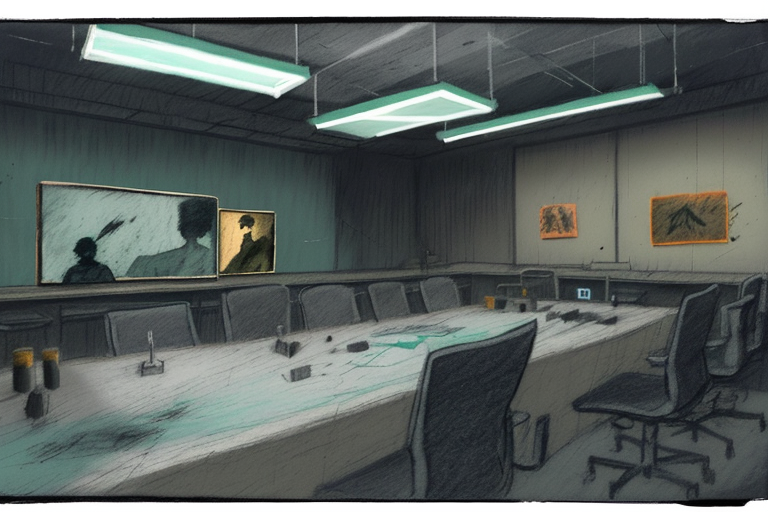

# CHAPITRE 16 : L'ONDE DE CHOC

> *« Circulaire d’État-Major Oméga-Noir — Article 1 : Toute découverte sur le sol d’Oark d’un système d’arme ou de propulsion dépassant les tables balistiques conventionnelles relève de la survie immédiate de la République. Tout citoyen, militaire ou civil, qui tenterait d’en entraver la saisie par les forces spéciales sera considéré comme agent de l’ennemi afistéaan et passé par les armes sur le champ, sans instruction ni procès. »*
> — **Directives d'Urgence du Général Vane, Bunker Stratégique de Plotéris**

{.chapter-illustration}

À 400 kilomètres au sud-est des Dents de Scorie, profondément enfouie sous la calotte basaltique du cratère Képler, la salle des opérations du Commandement Sectoriel d’Oark sentait le café rance, la sueur froide et l’ozone des transformateurs haute tension.

Il faisait toujours nuit sous les lourdes voûtes de béton armé du bunker. 42 consoles à tubes cathodiques y diffusaient une lueur glauque, verdâtre, qui creusait les orbites des opérateurs et faisait luire la graisse sur les galons d’acier des officiers. Dans les coursives adjacentes, le grondement sourd des pompes de refroidissement géothermique battait comme le pouls d’une bête malade.

Au centre de la fosse tactique, le lieutenant Borras se tenait debout, les poings si durement fermés contre les coutures de sa vareuse grise que ses ongles lui entaillaient la paume.

Il n’avait pas dormi une minute depuis 36 heures. Transféré d’urgence depuis Zêta-3 par une navette de liaison militaire dès le verrouillage des communications par le colonel Draeven, il portait encore la poussière rouge du Secteur 7 dans les revers de ses bottes. Devant lui, sur l’écran mural principal de 4 mètres de large, de la neige statique crépitait là où, 10 minutes plus tôt, s’affichait le flux vidéo en direct du Faucheur numéro 5.

Autour de la table de commandement, pas un officier ne parlait. Le colonel Marvek, chef de la division des opérations spéciales — un vétéran des campagnes polaires d’Aqi qui venait de relever Draeven à l’aube et dont la joue gauche était traversée par une greffe synthétique mal ajustée —, mâchonnait un cigare éteint face à l’écran mort.

— Rembobinez la télémétrie des 5 appareils, ordonna enfin Marvek d’une voix râpeuse. Séquence d’engagement finale aux Dents de Scorie. Vitesse réduite au dixième. Et que l’ingénieur en chef de la division balistique me traduise ce que nous avons sous les yeux sans me réciter des excuses d’écolier.

L’opérateur principal frappa son clavier mécanique avec un claquement sec.

Sur le mur, l’image revint en arrière. C’était la caméra ventrale du Faucheur numéro 2, quelques secondes après la première passe de tir au canon de 20 millimètres. Malgré les vibrations de la carlingue et les filtres infrarouges qui traduisaient la chaleur matinale du désert en nappes de vert acide et de violet sombre, la scène était d’une netteté impitoyable.

Au fond de la ravine déchiquetée, une silhouette en armure d’exploration standard de Condorcé — le matricule *Z3-KODA-44K* clignotait en surimpression dans un encadré de ciblage rouge — roulait dans les gravats en protégeant contre son dos un amas hétéroclite de ferraille et de chenilles.

La gorge de Borras se serra à lui faire mal. Même sous 40 kilos de céramique souillée de suie, il reconnaissait chaque mouvement de son amie d’enfance : cette façon nerveuse de ramener le coude gauche pour couvrir son arme, ce refus obstiné de rester couchée quand le ciel lui tombait sur la tête.

Puis le téléobjectif du drone zooma sur la seconde silhouette, dressée au milieu des éclats de roche.

Dans la fosse de guerre, plusieurs analystes se penchèrent par-dessus les rambardes d’acier.

— Arrêt sur image au marqueur 04-11, dit le chef balisticien, un quinquagénaire chauve aux lunettes cerclées de fer, en pointant un stylet lumineux vers le mur. Ici, mon colonel. La rafale de 20 millimètres du Faucheur-2 frappe la cible humanoïde à une distance oblique de 92 mètres. Vitesse initiale à la bouche : 1 980 mètres par seconde. 30 obus perforants à cœur de tungstène densifié.

La bande avança image par image. Des fleurs blanches d’énergie cinétique s’épanouirent sur le torse d’albâtre sombre de l’entité.

— Regardez les chevilles de la cible, poursuivit l’ingénieur d’une voix blanche. Selon la troisième loi de la mécanique newtonienne — qui veut que chaque impact repousse la cible avec une force égale et opposée —, l’impulsion cumulée de ces 30 obus aurait dû projeter un châssis de 100 kilogrammes à 12 mètres en arrière ou lui cisailler le buste. Or, le télémètre laser indique un déplacement du centre de gravité de… 0,0 millimètre. Le tungstène s’est sublimé à la surface de son épiderme sans lui transférer la moindre quantité de mouvement. C’est physiquement impossible avec les alliages répertoriés dans notre table périodique, l’inventaire complet des éléments chimiques connus.

— Les Afistéaans ont peut-être mis au point un bouclier réactif à confinement magnétique lourd, lâcha un commandant d’artillerie.

— Un champ magnétique n’explique pas ce qui suit, commandant, répliqua le balisticien en essuyant son front luisant avec un mouchoir taché d’encre. Passez au marqueur 04-88.

Sur l’écran géant, les 5 flux vidéo se synchronisèrent en mosaïque. L’entité sombre sortait de la tranchée. Elle ne portait ni fusil, ni canon d’épaule, ni générateur dorsal, ni batterie de condensateurs. Son profil lisse semblait taillé dans un morceau de nuit solide.

Sur le moniteur supérieur droit, l’entité leva 2 doigts de la main gauche et tourna le poignet d’un quart de tour.

Instantanément, les courbes télémétriques des Faucheurs un et 2 devinrent folles. Les chiffres verts défilèrent dans les colonnes latérales à une vitesse absurde : *Vitesse air : 312 km/h… 000 km/h. Accélération longitudinale : -814 G. Pression tuyère : 0 bar.*

— 4 millisecondes, murmura l’ingénieur en chef au milieu de la stupeur glacée de la salle. 2 appareils de 4 tonnes lancés à pleine poussée thermique ont été stoppés net en plein ciel sans impact matériel, sans impulsion électromagnétique détectable et sans détonation de leur carburant à fusion. L’analyse acoustique démontre que l’air lui-même autour des carlingues a acquis pendant 4 millisecondes la rigidité moléculaire du diamant industriel, avant de redevenir gazeux. Quant aux Faucheurs 3 et 4, leurs soupapes d’injection de deutérium ont été soudées à froid de l’intérieur, à 200 mètres de distance, sans qu’aucun projectile ne les ait touchées.

Sur le dernier cadran de la mosaïque, le Faucheur-5, plaqué contre la dune par une force invisible, filmait l’approche du géant.

Toute la salle de commandement de Képler-1 retint son souffle lorsque le visage sans bouche de l’entité emplit le cadre. Ses 2 capteurs optiques, d’un ambre profond traversé de filaments d’or en fusion, semblaient fixer non pas la lentille de verre du drone écrasé dans le sable, mais directement les officiers de Condorcé tapis sous leurs 40 mètres de béton. L’index sombre effleura l’objectif ; l’écran vira au gris.

Seul le bourdonnement à 50 hertz des néons du plafond troublait désormais l’immobilité de la fosse.

— Ce n’est pas une arme afistéanne, déclara enfin le colonel Marvek en posant son cigare éteint sur le rebord de la console. Si le Haut Commandement d’Afistéa possédait un démon capable d’abolir l’inertie d’un simple geste de la main, nos flottes orbitales seraient déjà au fond des océans de méthane — ces mers d’hydrocarbures glacés qui battent les banquises d’Aqi — et le drapeau ennemi flotterait sur les ruines de Plotéris depuis 6 mois.

Il pivota lentement sur ses talons ferrés pour faire face à Borras.

— C’est une relique d’Oark, n’est-ce pas, lieutenant ? La fameuse « vieille carte logique » que vous avez consignée avant-hier soir à 22 heures 12 dans le journal de bord administratif de Zêta-3.

Les jambes de Borras tremblaient sous lui, mais il se raidit au garde-à-vous, les yeux rivés sur la cicatrice synthétique du colonel.

— Mon colonel… lorsque l’éclaireuse Koda m’en a parlé au réfectoire, il ne s’agissait que d’un fragment inerte ramassé dans une faille d’érosion du Secteur 7 ! Elle ignorait tout de cette machine ! Vous avez vu les enregistrements comme moi : la première roquette thermobarique a failli la tuer au fond de cette tranchée ! Cette entité l’a entraînée hors de la base, elle est retenue en otage ou… ou sous le choc !

— En otage ? répéta Marvek avec une douceur polaire. Opérateur, affichez l’extrait du Faucheur-3, caméra thermique secondaire, marqueur 04-82. Activez l’isolation phonique directionnelle sur les micros d’ambiance.

Une fenêtre s’ouvrit au centre du mur. On y voyait Koda, couchée à plat ventre dans la poussière brûlante de la ravine, épauler son fusil magnétique réglementaire et faire feu sur l’optique du Faucheur-5 pour l’empêcher de larguer son filet de capture sur le colosse. Simultanément, nettoyé du rugissement des turbines par les filtres numériques de *Stratège-9*, l’enregistrement radio à courte portée résonna dans les haut-parleurs de la salle de guerre :

*« — Bien tiré, petite éclaireuse ! [...] Maintenant, écoute-moi, 8471 ! Cesse d’interroger tes banques de données absentes ! [...] Saisis le mouvement lui-même !*
*— 2 ! compta la voix haletante de Koda. [...] Pour quelqu’un qui ne savait pas se servir de ses mains il y a 30 secondes… tu apprends vite. Beaucoup trop vite. »*

Chaque syllabe tomba sur la poitrine de Borras comme une pelletée de terre gelée.

Autour de lui, les visages des officiers de renseignement venaient de se fermer. Toute trace d’hésitation avait disparu.

— Une otage qui couvre son ravisseur au fusil gauss et qui plaisante après la perte de 5 chasseurs de la République, lâcha Marvek. Votre amie d’enfance ne subit aucune contrainte, lieutenant. Elle a réveillé dans son atelier clandestin une intelligence qui dépasse de 10 siècles tout ce que nos académies ont jamais théorisé, elle l’a conduite dans un dépôt souterrain hors radar pour lui forger un corps, et elle a choisi de la soustraire à sa patrie à l’heure même où le front du glacier d’Ostre s’effondre et où 40 000 des nôtres meurent de froid dans les dômes d’Aqi.

— Elle ne mesure pas les conséquences politiques de ce qu’elle fait ! s’écria Borras, la voix brisée par un mélange de désespoir et de culpabilité cuisante. C’est ma faute, mon colonel ! Si je n’avais pas inscrit cette note bureaucratique dans le rapport de routine, si le colonel Draeven m’avait laissé lui parler sur le canal de Zêta-3 avant de lui envoyer une escadrille de chasse tirer à vue sans sommation… Koda est une orpheline du secteur minier, elle a horreur du sang, elle s’est défendue par réflexe quand les Faucheurs ont bombardé la ravine ! Donnez-moi un transporteur léger et 2 heures, je vous jure sur ma vie que je la ramène avec la machine sans qu’un coup de feu soit tiré !

Marvek le dévisagea longuement, non pas avec colère, mais avec cette pitié glaciale que les vieux bouchers des tranchées d’Aqi réservaient aux jeunes officiers encore encombrés d’une conscience.

— Vous avez fait votre devoir en rédigeant ce rapport, lieutenant Borras. C’est d’ailleurs l’unique raison pour laquelle vous êtes debout dans cette fosse au lieu d’être devant un peloton d’exécution pour complicité de négligence à Zêta-3. Mais l’heure des sentiments de réfectoire est close. Avez-vous écouté la seconde voix sur la bande sonore ? Ce n’était pas l’éclaireuse. C’était une autre intelligence artificielle, logée dans le sac dorsal de la fugitive, qui enseignait en temps réel à ce colosse comment plier les lois de la physique pour abattre nos appareils.

Le colonel se détourna de Borras et marcha jusqu’à la carte holographique basse résolution du Massif des Orgues, dont les courbes altimétriques scintillaient en vert au milieu de la table.

— Ce géant ne savait pas utiliser ses inducteurs au début de l’engagement, reprit-il à l’adresse de son état-major. Il lui a fallu moins de 30 secondes d’instruction vocale pour anéantir une escadrille lourde. S’il continue d’apprendre à cette vitesse, ou s’il atteint un autre dépôt souterrain dans le massif pour compléter son initialisation, dans 24 heures aucune force conventionnelle sur Oark ni sur Aqi ne pourra plus l’arrêter. Et si les patrouilles afistéannes qui rôdent au nord du trentième parallèle interceptent ne serait-ce qu’un écho de cette anomalie, la guerre est perdue avant la fin de la semaine.

Il abattit sa paume sur le transmetteur prioritaire relié à la flotte orbitale et au bunker du général Vane sur Aqi.

— Classez l’opération sous le sceau *Oméga-Noir*. À compter de cette minute, l’éclaireuse Koda, matricule Z3-44K, est déchue de sa citoyenneté plotéris et inscrite au registre d’exécution immédiate pour haute trahison en temps de guerre. Ses droits biologiques sont révoqués.

Borras ferma les paupières. Un vertige nauséeux lui tordit les entrailles ; dans le noir de son esprit passa le sourire insolent de Koda, 48 heures plus tôt sous les néons de Zêta-3, lorsqu’elle lui avait ébouriffé les cheveux par-dessus son assiette d’aluminium en lui réclamant le sel de synthèse parce que sa ration manquait de désespoir. C’était lui qui avait mis l’engrenage en marche. Lui et sa foi stupide dans les règlements de Condorcé.

— Quelles unités engageons-nous, mon colonel ? demanda le chef des opérations. Les garnisons motorisées du secteur ?

— Des fantassins légers contre une chose qui cueille des Faucheurs à 400 mètres d’altitude ? Non, trancha Marvek. Faites débarquer immédiatement la Troisième Division d’Assaut Lourd depuis le croiseur orbital *Indomptable*. Je veux les Cuirassiers de Fer au sol dans 20 minutes : 3 compagnies d’exosquelettes de siège blindés au carbure de bore — cette céramique noire presque aussi dure que le diamant —, appuyés par des barges suborbitales, des canons à impulsion lourds et des charges thermobariques de brèche minière.

— Et les consignes concernant le spécimen mécanique ?

— Le général Vane voudra cette merveille sur une table de rétro-ingénierie avant la fin du mois pour briser le blocus d’Aqi, dit Marvek, l’œil brillant d’une fièvre froide sous la lumière verte des écrans. Enfermez la cible dans une gorge aveugle, saturez-la sous un déluge d’impulsions et d’ondes de surpression jusqu’à épuiser ses réserves ou griller ses capteurs, puis ramenez-la dans une cage de Faraday lourde — un caisson entièrement doublé d’un treillis de cuivre et d’acier qui coupe toute onde électromagnétique vers l’extérieur. Quant à la déserteuse et au tas de ferraille qui la conseille… abattez-les à vue. Sans sommation.
