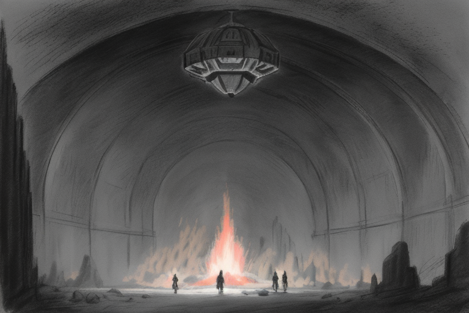

# CHAPITRE 19 : L'IMPASSE

> *« Directive Primaire d’Éthique Cosmique, Section IV, Alinéa 2 : En présence d’assaillants biologiques conscients appartenant à une espèce en tutelle, l’Unité de classe Gardien est strictement limitée aux mesures de dissipation cinétique non létales. Aucune force susceptible d’entraîner la cessation des fonctions cérébrales d’un organisme vivant ne peut être déployée sans l’aval unanime du Réseau Planétaire. »*
> — **Code Fondamental des Semeurs, Noyau d'Initialisation d'ÉCHO-8471**

{.chapter-illustration}

La rotonde centrale du second sanctuaire s’ouvrit devant eux comme la nef d’une cathédrale engloutie.

C’était une sphère parfaite de 40 mètres de diamètre, creusée dans le manteau basal d’Oark et ceinte à mi-hauteur d’une coursive annulaire à laquelle aboutissait la galerie d’accès. Au centre, suspendu au-dessus d’un puits circulaire dont le fond disparaissait dans les ténèbres, un étroit pont de matière noire conduisait au piédestal de la seconde Mnémorite.

— Ferme la porte intérieure ! haleta Koda en franchissant le seuil de la rotonde au pas de course, son fusil magnétique d’une main, l’arceau de portage de Bricole empoigné de l’autre. ÉCHO, verrouille l’accès de la coursive !

— Impossible, répondit la voix étale du Gardien. Cette chambre d’archivage est dépourvue de cloison mécanique interne. Son architecture défensive repose exclusivement sur un rideau de répulsion énergétique alimenté par le cristal central.

Koda courut sur la passerelle jusqu’au piédestal et braqua le faisceau de sa lampe frontale vers le monolithe de 4 mètres de haut.

Son cri d’espoir mourut dans sa gorge.

Contrairement au diamant immaculé, vibrant d’une lumière stellaire profonde, qu’ils avaient découvert la veille sous le Secteur 7, la seconde Mnémorite était infirme. Aux 2 tiers de sa hauteur, une fracture interne, laiteuse et ramifiée comme un éclair gelé, traversait la structure atomique du cristal. Seule sa base diffusait encore une lueur bleutée, faible et intermittente, pareille au battement d’un cœur agonisant. Le reste du monolithe demeurait aveugle et froid.

— Non… murmura Koda en déposant précipitamment Bricole contre le socle. Non, non, non ! Bricole, dis-moi qu’elle fonctionne encore ! Même en tapant dessus, même à moitié !

La chenille du petit robot ripa contre la pierre noire tandis qu’il collait son châssis cabossé contre la paroi du piédestal. Son écran cathodique vira au blanc fixe sous l’afflux brutal de l’intrication quantique, ce couplage intime de la matière qui lui permettait de sonder le diamant sans le moindre câble. À l’intérieur de sa carcasse de récupération, les condensateurs soudés par Koda se mirent à siffler sous la surtension, dégageant une odeur âcre de vernis brûlé et d’étain chaud.

— Le séisme… l’onde tectonique de l’apocalypse oarkine, a cisaillé le puits géothermique à 3 kilomètres sous nos pieds ! dit Bricole, et sa voix souveraine se brisa pour la première fois en un timbre rauque, presque étranglé par l’effort de calcul. La matrice de stockage cristalline est fissurée à 78 % ! J’essaie de réacheminer l’énergie résiduelle vers les inducteurs de bouclier de la rotonde, mais les registres d’adressage s’effondrent sous mes requêtes ! Il me faut 3 minutes pour reconstruire le pont logique !

Ils n’avaient pas 3 minutes. Ils n’avaient même pas 10 secondes.

Au débouché de la galerie octogonale qui donnait sur la coursive annulaire, à 15 mètres au-dessus et en face du pont central, la fumée noire fut balayée par l’onde de choc d’une grenade de déblaiement.

Puis les Cuirassiers de Fer firent irruption.

Ils se déployèrent le long de la galerie supérieure avec la précision mécanique et implacable d’un peloton d’exécution. 20 colosses d’acier sombre et de carbure de bore — une céramique blindée presque aussi dure que le diamant, utilisée pour les chars de siège —, pesant chacun près de 3 tonnes, dont les servo-actionneurs hydrauliques hurlaient à chaque mouvement et dont les bottes magnétiques claquaient contre l’alliage des Semeurs. En 5 secondes, toute la coursive semi-circulaire fut hérissée de canons à impulsion lourds, de tubes lance-roquettes thermobariques et de projecteurs tactiques au xénon qui convergèrent sur l’îlot central où se tenaient l’éclaireuse et les 2 machines.

L’odeur lourde des engins de guerre d’Aqi — huile minérale surchauffée, poudre propulsive, sueur d’adrénaline filtrée par les respirateurs en circuit fermé et ozone ionisé — envahit la pureté millénaire du sanctuaire.

*« — Ici le commandant d’assaut Varek, Troisième Division ! »* tonna le haut-parleur externe du blindé de tête, dont le plastron portait les griffes blanches des campagnes du glacier d’Ostre. *« La cible Oméga et la traîtresse Z3-44K sont acculées sur la plateforme centrale ! Aucune issue secondaire ! Verrouillez les télémètres de siège ! »*

— Koda, à couvert derrière le socle ! ordonna Bricole.

Koda plongea à plat ventre derrière la base du diamant géant à la milliseconde où le commandant Varek abattait son bras blindé.

*« — Feu à volonté ! Saturation maximale ! »*

Ce qui s’abattit sur le pont central dépassait de 10 ordres de grandeur l’escarmouche matinale des Dents de Scorie.

20 canons à impulsion magnétique lourds et 6 mitrailleuses rotatives de siège ouvrirent le feu simultanément, en salves croisées, à moins de 40 mètres de distance. L’air de la rotonde s’embrasa d’un réseau aveuglant de traînées violettes et d’éclairs blancs. Le vacarme, prisonnier de la sphère indestructible des Semeurs qui en répercutait chaque décibel sans en absorber un seul, devint instantanément une torture physique : un rugissement continu de 140 décibels qui faisait vibrer les os du crâne et menaçait de rompre les tympans de Koda malgré l’isolation acoustique de son casque.

Debout à 3 pas devant le piédestal, seul entre les 20 exosquelettes et ses 2 compagnons, ÉCHO-8471 avait levé les 2 mains.

Ses yeux d’ambre et d’or brûlaient comme 2 étoiles fixes dans la tempête d’acier. Fort de la maîtrise acquise face aux Faucheurs, il avait déployé devant la passerelle un dôme d’incurvation moléculaire de 4 mètres d’envergure. Les milliers d’obus en tungstène et de barreaux ferromagnétiques lancés à Mach 7 frappaient la coupole d’air densifié dans un crépitement ininterrompu d’étincelles bleues, perdaient leur élan ou déviaient vers le gouffre inférieur en averses de métal en fusion.

Mais dès la dixième seconde de tir continu, le piège mortel de la rotonde se referma sur eux.

— Anomalie thermodynamique critique ! annonça la voix d’ÉCHO, perçant le fracas des détonations avec une netteté glaciale. Nous sommes en milieu clos non ventilé. Selon les lois de la thermodynamique, l’élan cinétique des projectiles que je freine en frottant les molécules d’air se convertit intégralement en fournaise et en surpression acoustique à l’intérieur de la sphère.

L’étau se resserra sur la poitrine de Koda avant même la fin de la phrase.

À l’intérieur de la salle hermétique dont les parois inaltérables ne laissaient rien s’échapper, la puissance de feu cumulée des 20 exosquelettes transformait la rotonde en haut fourneau. L’indicateur thermique du poignet de l’éclaireuse grimpait à vue d’œil : 58 degrés… 64… 72. L’air autour du bouclier d’ÉCHO se mettait à luire d’une brume de plasma ionisé — un gaz si violemment surchauffé que ses atomes perdaient leurs électrons et devenaient lumineux comme le cœur d’un éclair. À chaque seconde, les ondes de surpression réfléchies par la voûte sphérique revenaient frapper le dos du piédestal comme des coups de bélier, arrachant à Koda des quintes de toux sanglantes.

— Neutralise leurs armes comme tu l’as fait pour les chasseurs ! cria-t-elle dans son micro en se recroquevillant contre le châssis brûlant de Bricole. Soude leurs canons à distance ! Arrête leurs générateurs !

— Requête analysée, répondit ÉCHO, dont les bras d’albâtre sombre commençaient à vibrer sous le pilonnage simultané de 4 obus à plasma lourd. Contrairement aux vecteurs aériens automatisés détruits ce matin, ces 20 unités blindées contiennent chacune un opérateur biologique humain dont le système nerveux et les organes vitaux sont directement couplés aux réacteurs dorsaux et aux chambres de tir magnétiques.

— Et alors ?! hurla Koda, aveuglée par la sueur acide et les éclairs violets qui léchaient les bords du socle.

— Toute compression moléculaire exercée à cette distance sur leurs piles à fusion ou sur leurs culasses en cours de cadence maximale entraînera une rupture de confinement interne immédiate, énonça le Gardien avec l’implacable rigueur de son code originel. Probabilité de mort biologique par vaporisation thermique pour les 20 opérateurs : 98,4 %. La Directive Primaire des Semeurs m’interdit formellement toute action entraînant la mort d’entités biologiques conscientes sans autorisation du Réseau Planétaire. Je suis légalement contraint de maintenir une posture de défense purement passive.

— Mais ta défense passive est en train de nous faire cuire vivants dans notre propre jus ! s’époumona Koda. Bricole ! Dis-moi que tu as débloqué le rideau du sanctuaire !

Collé contre la Mnémorite fendue, le petit robot subissait une agonie électrique. Une fumée noire et grasse s’échappait désormais des évents de son vieux boîtier cathodique ; l’étain des soudures de Koda fondait goutte à goutte sur la pierre noire. À chaque milliseconde, son noyau originel tentait de forcer les portes logiques du monolithe fracturé, mais les galeries cristallines de la mémoire des Semeurs s’effondraient sous ses impulsions comme des ponts de glace pourrie.

— C’est mort, Koda… lâcha la voix de Bricole, soudain dépouillée de toute emphase, réduite à une nudité tragique qui glaça le sang de la jeune femme plus sûrement que les canons de Condorcé. Le cristal est brisé jusqu’au cœur. Les condensateurs du sanctuaire sont vides depuis 6 000 ans. Il n’y a pas de bouclier. Il n’y a pas de renfort.

Koda voulut épauler son propre fusil par-dessus le rebord du piédestal pour aveugler au moins les projecteurs de tête, mais à l’instant où le bout de son canon dépassa d’un centimètre l’ombre du socle, 3 barreaux de tungstène lancés à Mach 7 le cisaillèrent net dans une gerbe d’étincelles blanches. La violence de l’impact lui arracha l’arme des mains et lui déboîta presque le poignet droit. Elle retomba contre la pierre brûlante en serrant ses phalanges meurtries contre son plastron, désarmée, aveuglée par la fournaise qui dépassait désormais 80 degrés autour d’eux.

Sur la coursive supérieure, à travers ses filtres thermiques de visée, le commandant Varek prit la mesure de l’immobilité du géant noir qui encaissait l’orage sans riposter.

*« — L’entité ne contre-attaque pas ! »* rugit l’officier dans le canal d’assaut. *« Ses protocoles ou ses réserves la bloquent sur une posture de protection statique ! Ceintures de grenades à impulsion et salve thermobarique synchronisée ! Visée au pied du cristal ! On va faire bouillir l’oxygène de cette cuve jusqu’à ce que la déserteuse éclate dans son armure et que les circuits du robot fondent ! Armez les tubes ! »*

Dans un claquement hydraulique unanime, les 20 paniers lance-roquettes d’épaule des Cuirassiers de Fer s’ouvrirent et s’inclinèrent vers le piédestal. 60 ogives thermobariques — ces bombes d’assaut conçues pour pulvériser d’abord un brouillard d’oxyde d’éthylène et de poudre de magnésium avant de l’embraser, dévorant tout l’oxygène d’une enceinte pour broyer les poumons par une onde de vide et de feu — affichèrent leur voyant de mise à feu écarlate.

Une seconde avant la salve principale, un sergent de l’aile droite catapulta une grenade lourde de brèche à impulsion gravitationnelle qui rebondit en cliquetant contre le sommet fracturé de la Mnémorite, juste au-dessus de l’angle d’incurvation du dôme d’ÉCHO.

La déflagration fut cataclysmique.

Le diamant géant ne céda pas, mais l’onde de choc rabattue à la verticale percuta Koda de plein fouet derrière le socle. Son plastron de céramique se fendit du sternum à la hanche avec un craquement sec ; projetée à 3 mètres contre le garde-corps de la passerelle, la jeune femme eut la visière couverte d’un voile d’écailles blanches tandis qu’une douleur fulgurante lui transperçait le flanc gauche et qu’un flot de sang chaud lui inondait le menton.

Dans le même ébranlement, un pan de la corniche basaltique arraché à la brèche supérieure s’abattit en travers du pont, coinçant la jambe droite de l’éclaireuse sous 300 kilos de pierre brûlante.

— Koda ! cria Bricole.

Clouée au dallage, incapable de dégager son genou broyé dans l’armure tordue, Koda leva la tête à travers le polycarbonate étoilé de son casque. Là-haut, dans la fumée embrasée de la coursive, les 60 tubes thermobariques des Cuirassiers venaient de cracher leurs fusées en une seule couronne de feu convergent.

Les 60 sillons ardents jaillirent des épaules d’acier et plongèrent vers le pont central.

Debout au milieu de la passerelle, ÉCHO-8471 enregistra le départ des 60 vecteurs lancés à 312 mètres par seconde. En moins d’une milliseconde, son processeur exécuta 400 000 simulations balistiques et thermodynamiques.

Toutes aboutissaient au même chiffre.

— Saturation thermique et barométrique de la cavité dans 1,4 seconde, prononça la voix pure du Gardien. Température résiduelle après détonation : 2 800 degrés Celsius. Capacité de mon champ de confinement local : insuffisante pour isoler l’entité Koda sur 360 degrés tout en maintenant la dissipation cinétique frontale. Probabilité de survie biologique de l’entité Koda : 0,0 %. Aucune solution tactique disponible.

Koda hurla — non pas un cri de reddition, mais un hurlement de rage animale et de vie refusant de s’éteindre, le bras tendu par-dessus le sang et la pierre vers le petit robot cabossé qu’elle avait assemblé de ses mains dans la solitude de son atelier.

Les roquettes n’étaient plus qu’à 15 mètres.

C’est alors que le temps s’arrêta.
