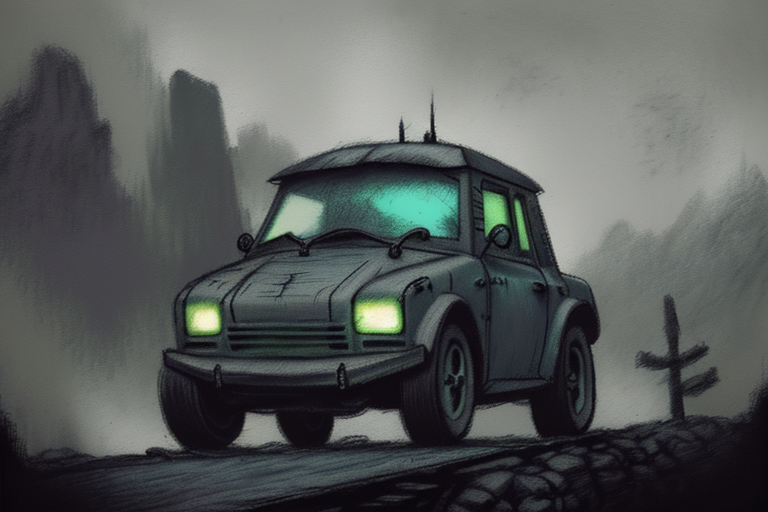
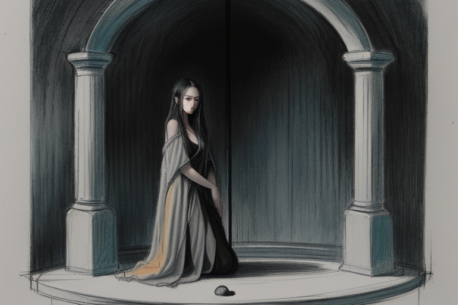

# CHAPITRE 21 : SUBLIMATION ET FUITE

> *« Anomalie d’exécution enregistrée à T-0,000001 seconde de la Sublimation de l’unité 0194 : Tout en maintenant le dôme d’exclusion autour de l’opératrice Koda, j’ai détourné 0,03 % de ma capacité d’induction pour soustraire à la conversion subatomique un ressort hélicoïdal en acier aqin oxydé (masse : 14,2 grammes ; fréquence de résonance : 2 410 Hz). Ce composant est mécaniquement dépourvu de valeur. J’ignore pourquoi j’ai refusé sa disparition. »*
> — **Répertoire des Variables Humaines Non Résolues d'ÉCHO-8471, Entrée n° 012**

{.chapter-illustration}

Le fracas du monde revint comme une digue qui rompt.

Mais dans le centième de seconde qui précéda la morsure du feu, tout avait déjà changé sur le pont central.

À l’instant même où le cri de Koda reprenait dans sa gorge, ÉCHO-8471 abandonna le front de la passerelle. Son mouvement fut si rapide que l’œil humain n’en perçut qu’un sillage d’ombre : en une fraction d’éclair, le Gardien bondit en arrière jusqu’à la jeune femme, glissa ses doigts d’albâtre sous le bloc de basalte de 300 kilos qui lui broyait la jambe droite et l’envoya valser dans le vide du puits inférieur comme un simple fétu de paille.

Au pied de la Mnémorite fendue, le petit châssis cabossé de Bricole fit exactement le mouvement inverse.

Sa chenille dépareillée — celle-là même que Koda avait récupérée sur une soudeuse de chantier au fond de son débarras de Zêta-3 — mordit la pierre noire avec un crissement aigu, accompagné de l’ultime *couic* à 2 410 hertz de son petit ressort de suspension tordu. Son unique bras articulé se redressa, et son vieux moniteur cathodique étoilé se tourna une dernière fois vers l’éclaireuse allongée dans la poussière.

Malgré la fumée noire qui s’échappait de ses condensateurs en fusion, les lignes de phosphore vert dessinèrent sur l’écran bombé une courbe lumineuse, maladroite et magnifique : le premier et le dernier sourire du robot.

— Ne fais pas cette tête d’enterrement, Koda ! lança la voix de Bricole dans le canal interne du casque de la jeune femme, vibrante d’une tendresse et d’un panache souverains au milieu de l’apocalypse. Ce châssis commençait sérieusement à manquer d’aérodynamisme, et mes roulements avaient horreur de l’humidité !

Lorsque ÉCHO s’agenouilla au-dessus d’elle pour lui faire un rempart de son corps tandis que le petit robot faisait volte-face vers la salve en approche, l’évidence déchira la poitrine de Koda.

— Bricole, non ! hurla-t-elle en tendant les 2 mains vers lui, griffant le dallage de ses gants éventrés pour essayer de ramper hors de l’abri d’ÉCHO. Reviens ici ! Je t’interdis de faire ça ! Je te referai un châssis 9, je te jure que j’ai des pièces de rechange cachées dans les canyons, reviens !

ÉCHO la maintint fermement contre le sol d’une paume posée sur son épaule intacte, sans lui infliger la moindre contusion, mais avec l’irrésistible douceur d’une montagne.

Au milieu de la passerelle, Bricole venait d’enclencher la surtension finale de sa batterie de récupération. Sous son capot de tôle gondolée, traversant la crasse d’huile et les fils d’étain fondus, une lueur d’un blanc stellaire — l’éclat pur de l’énergie du point zéro libérée de sa cage — commença à transparaître par chaque fente de sa carrosserie.

— Tu m’as déjà donné bien plus qu’un corps, petite éclaireuse, murmura la voix mélodieuse de l’Ancien dans ses écouteurs, si proche qu’on eût dit qu’il lui parlait au creux de l’oreille, la nuit, sous les néons de l’atelier. Tu m’as rendu la raison pour laquelle nous avions semé les étoiles. Et promets-moi une chose, quand tu mangeras ta prochaine ration froide là-haut sous les dunes…

Le vieux tube cathodique clignota d’un clin d’œil vert :

— … n’oublie pas de demander le sel de synthèse. Il paraît qu’elle manque toujours d’un sacré paquet de désespoir. Adieu, mon amie.

— BRICOLE !

Le petit robot lança son moteur électrique à plein régime.

Dans un couinement héroïque et dérisoire de ferraille rouillée, la boîte de conserve assemblée par une orpheline s’élança toute seule sur le pont de pierre noire, droit vers les 60 ogives thermobariques qui plongeaient à bout portant et vers les 20 colosses d’acier de la Troisième Division qui hurlaient sur la coursive.

Au même instant, ÉCHO-8471 étendit ses 2 bras au-dessus du corps de Koda.

— Fermeture du dôme d’exclusion moléculaire, prononça le Gardien.

L’air autour d’eux ne se contenta pas de durcir : à 2 mètres de rayon autour du buste d’ÉCHO et de l’éclaireuse recroquevillée contre lui, les molécules d’azote et d’oxygène alignèrent leurs réseaux cristallins en une coque d’impénétrabilité absolue, réflectrice à 100 % sur tout le spectre électromagnétique, thermique et barométrique.

À 6 mètres devant cette bulle, la chenille de Bricole quitta le sol dans un dernier cahot.

Et l’Unité SOLYAR-0194 entra en Sublimation.

Il n’y eut pas de détonation. C’était là toute la différence vertigineuse entre la fureur barbare des armes d’Aqi et la grâce finale des Semeurs. Au moment précis où le premier détonateur thermobarique crachait son étincelle, une sphère d’une blancheur immaculée, géométriquement parfaite et d’un calme absolu, s’épanouit depuis le noyau de Bricole jusqu’à une distance exacte de 38,4 mètres.

Mais dans le premier millionième de seconde où l’onde d’effacement atomique dissolvait la carcasse de fortune du petit robot, ÉCHO-8471 accomplit en secret un geste qu’aucun protocole des Semeurs n’avait jamais prévu.

Avant que la muraille blanche ne refermât l’horizon, l’inducteur palmaire gauche du Gardien projeta à 6 mètres de distance une micro-bulle de confinement subatomique — pas plus large qu’une noix — autour d’un unique fragment du châssis de Bricole qui venait de sauter hors de son axe : le petit ressort de suspension tordu qui grinçait à 2 410 hertz. Soustrait à la conversion nucléaire et rappelé par traction vectorielle en moins d’un millième de seconde à travers l’interstice du bouclier, le bout de fil d’acier oxydé vint se loger au creux de la paume gauche d’albâtre d’ÉCHO, qui referma ses doigts dessus sans que Koda, aveuglée par ses larmes et l’éclat stellaire, pût s’en apercevoir.

Au-dehors de la bulle, le bruit cessa d’exister.

Les 60 roquettes en plein vol ne détonèrent pas : leurs enveloppes de titane, leur carburant chimique et leurs têtes explosives perdirent instantanément leurs liaisons interatomiques et se fondirent dans le flux lumineux comme des flocons de neige tombant dans un océan. En un éclair muet, l’onde blanche atteignit la coursive annulaire et le plafond fracturé de la rotonde. Les 20 exosquelettes de siège des Cuirassiers de Fer, leurs canons à impulsion, la galerie d’accès supérieure et le grand monolithe blessé de la seconde Mnémorite furent saisis par la conversion subatomique avant même qu’un seul nerf optique humain eût le temps de transmettre l’image de la clarté au cerveau des soldats.

Il n’y eut ni souffrance, ni cri, ni cendre.

Toute la matière comprise dans le rayon de 38,4 mètres — l’acier des armes, le diamant des archives millénaires, le basalte de la montagne et la petite carrosserie à chenille de Bricole — fusionna à l’échelle nucléaire, puis se recondensa instantanément en une voûte hémisphérique de verre minéral noir, lisse comme un miroir d’obsidienne, qui scella pour l’éternité le puits central, la Mnémorite et la brèche par laquelle l’armée était entrée.

Seul un couloir oblique au nord-ouest, correspondant à une ancienne cheminée d’évacuation géothermique située à 38,5 mètres du point zéro, demeura intact, épargné au centimètre près par la dernière équation du robot sacrifié.

Puis la clarté s’éteignit.

Une obscurité totale, vierge de toute fumée et de toute poussière, enveloppa la cavité réduite.

Lorsque ÉCHO-8471 relâcha progressivement la tension de sa bulle-bouclier moléculaire, l’air de la salle était tiède, pur et immobile comme celui d’un temple fermé depuis le commencement du monde. Le vacarme assourdissant des canons avait fait place à une paix si dense que Koda n’entendait plus que le tintement aigu de ses propres tympans meurtris.

La lampe frontale de son casque, préservée de l’onde de choc par le dôme d’exclusion d’ÉCHO derrière son verre étoilé, projeta un pinceau blafard devant eux.

Là où, 3 secondes plus tôt, s’élevaient le piédestal de la Mnémorite, le gouffre et la galerie hérissée de 20 blindés de siège, se dressait désormais une paroi courbe d’obsidienne vitrifiée, d’une pureté géométrique irréelle, qui coupait la rotonde en 2 comme le mur lisse d’une sphère coulée d’un seul bloc.

Sur le sol, devant la limite exacte où s’était arrêtée la bulle d’ÉCHO, il ne restait rien.

Pas un boulon calciné. Pas un maillon de chenille. Pas une goutte d’étain. Pas un éclat du vieux tube cathodique vert.

— Non… souffla Koda.

Elle se dégagea des bras du Gardien et se traîna à genoux malgré la douleur fulgurante qui lui vrillait la cheville droite et les côtes. Ses gants tremblants vinrent se plaquer contre le dôme de verre noir, à l’endroit précis où Bricole lui avait adressé son dernier clin d’œil. La surface minérale n’était même pas brûlante ; elle avait la tiédeur douce d’une peau qui vient de s’endormir.

— Bricole… sanglota-t-elle en collant son front casqué contre la paroi muette. Bricole, réponds-moi… Tu n’avais pas le droit… C’était moi qui devais te protéger…

Ses épaules secouées de spasmes heurtèrent le calme du tombeau. Pour la première fois depuis les dortoirs glacés de l’orphelinat d’Aqi, Koda pleurait à corps perdu, la gorge déchirée par cette douleur brute que les machines des Semeurs avaient mis 10 000 ans à essayer de mettre en équation. En quelques heures, le désert d’Oark lui avait tout pris : sa base, ses camarades, son insouciance rieuse, et le premier être à qui elle avait redonné une voix de ses propres mains.

Debout derrière elle dans l’obscurité, ÉCHO-8471 ne bougea pas tout de suite.

Ses capteurs optiques d’ambre et d’or étaient fixés sur la silhouette prosternée de la jeune femme. À l’intérieur de son architecture cognitive, le torrent de données transféré par l’unité 0194 achevait de se décompresser, ouvrant des pans entiers de mémoire historique, de protocoles linguistiques et de cartes stellaires. Et dans le creux de son poing gauche fermé, dissimulé dans un compartiment dermique de son avant-bras d’albâtre, reposait le petit ressort tordu — la première relique sentimentale et inutile de son existence.

Lorsqu’il s’avança enfin et s’agenouilla à côté de Koda, son geste n’avait plus tout à fait la géométrie mécanique du matin. Il glissa un bras sous les épaules de l’éclaireuse et l’autre sous ses genoux blessés, puis la souleva de terre avec une précaution infinie.

{.chapter-illustration}

— Vos fonctions locomotrices sont altérées à 45 %, Koda, dit-il. Et les transporteurs aériens maintenus en réserve à la surface du canyon détecteront l’anomalie sismique de la vitrification d’ici moins de 6 minutes. Nous devons évacuer ce périmètre par la cheminée nord-ouest que Bricole a préservée pour nous.

Koda n’eut pas la force de lutter. La tête appuyée contre l’épaule sombre et inaltérable du Gardien, les yeux brouillés de larmes et de sang, elle traversa comme dans un songe l’ascension vertigineuse le long de la faille oblique. ÉCHO escaladait la paroi verticale de 300 mètres dans le noir absolu, ses phalanges s’ancrant dans les micro-reliefs du basalte sans faire tomber une seule pierre, amortissant chaque mouvement de son buste pour épargner les côtes fêlées de sa passagère.

Au bout de 4 minutes, l’air glacé de la nuit d’Oark leur fouetta le visage.

Ils émergèrent sur un haut plateau déchiqueté, à 2 kilomètres en amont de la Faille des Soupirs. Au loin, en contrebas, les faisceaux des projecteurs au xénon des 3 barges de débarquement balayaient frénétiquement le cirque effondré, cherchant en vain le contact radio avec une compagnie d’élite qui n’existait plus.

Au-dessus des dunes d’ocre devenues grises sous le clair d’étoiles, la voûte céleste du système Solyar déployait ses constellations glacées. Tout là-haut, un point d’un bleu pâle scintillait faiblement dans le vide : Aqi, la planète gelée où les hommes continuaient de s’entretuer dans la neige.

ÉCHO marcha encore une heure à travers les crêtes désertes, jusqu’à ce que les lumières de l’armée eussent totalement disparu derrière l’horizon, puis il déposa doucement Koda à l’abri d’une table de grès.

La jeune femme s’adossa à la pierre, grelottante dans son armure éventrée. Le vent nocturne s’engouffrait par la fente de sa visière, séchant la croûte de sel et de sang sur ses joues. Elle leva lentement ses yeux sombres, vidés de toute étincelle d’enfance, vers le géant immobile qui veillait devant elle contre le ciel étoilé.

Dans l’ombre du visage sans bouche, les 2 disques d’ambre et d’or brillaient d’une lueur nouvelle — plus profonde, presque habitée.

— L’unité 0194… Bricole… n’a pas disparu en totalité, dit soudain ÉCHO.

Sa voix fit tressaillir Koda. Ce timbre synthétique parfait, naguère aussi froid et coupant qu’une lame de scalpel, venait de se charger d’une résonance grave, d’une harmonique presque humaine où semblait vibrer l’écho d’une autre voix.

— Dans la quarante-huitième milliseconde précédant sa Sublimation, poursuivit le Gardien en inclinant la tête vers elle, il a transféré dans ma matrice l’intégralité de ses archives déchiffrées et de sa mémoire vécue. Mon taux d’initialisation opérationnelle est passé de 1,04 à 18,7 %.

Koda serra les poings sur le sable froid, la gorge nouée.

— Pourquoi l’as-tu laissé faire, ÉCHO ? murmura-t-elle d’une voix brisée. Tu avais le pouvoir de l’en empêcher… Pourquoi lui as-tu donné ce code ?

Le Gardien demeura immobile quelques secondes, tandis que le vent d’Oark raclait doucement la crête au-dessus de leurs têtes.

— Parce qu’il m’a soumis un postulat que mes algorithmes d’origine ne parvenaient pas à réfuter, répondit ÉCHO. Il m’a affirmé qu’un algorithme protège une espèce, mais qu’une conscience protège un visage. Il m’a ordonné de protéger le vôtre, Koda, et d’apprendre auprès de vous pourquoi votre espèce vaut la peine que nous brûlions nos théorèmes.

Il tendit la main et, d’un geste d’une délicatesse infinie, referma le col thermique disjoint de l’armure de la jeune femme pour la couper du vent glacial.

— Ses archives contiennent les coordonnées d’un sanctuaire majeur situé au-delà du bassin des Terres Mortes, reprit-il doucement. Mais avant de nous y rendre, vos dommages biologiques exigent de l’eau, du repos et des soins que je ne peux synthétiser ici. Pouvez-vous marcher si je soutiens votre masse ?

Devant elle, dans la nuit du désert, cette main d’alliage divin attendait la sienne.

Elle n’avait plus de camp. Son nom était inscrit sur les listes de mort de sa propre patrie, son ami d’enfance la croyait traîtresse, et son seul compagnon de route était un dieu mécanique nouveau-né qui veillait sur elle avec les souvenirs d’un mort de 10 000 ans.

Elle prit la main d’ÉCHO, se hissa debout en serrant les dents contre la douleur, et jeta un dernier regard vers la vallée obscure où dormait le tombeau de verre de Bricole.

— On marche, 8471, dit-elle dans un souffle rauque. Montre-moi le chemin.

Côte à côte, la fugitive blessée et le Gardien aux yeux d’ambre s’enfoncèrent dans l’immensité noire du désert.
