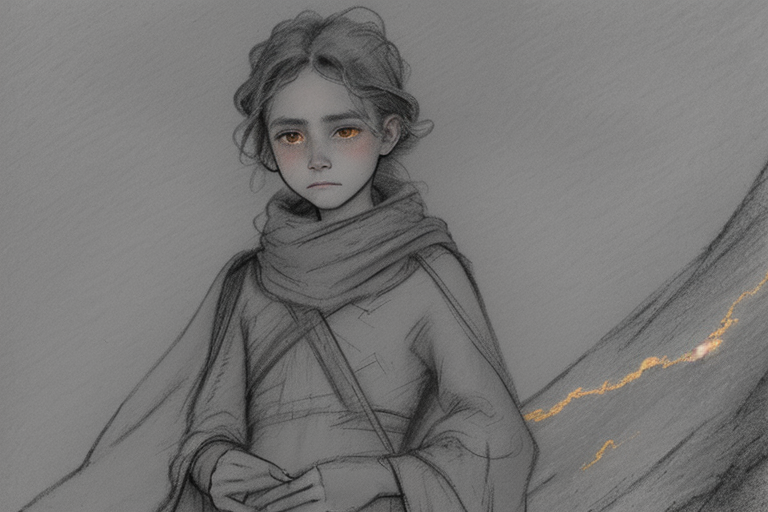

# CHAPITRE 01 : Les Fantômes du Désert

> *« Entrée 004 — Objet : Ressort hélicoïdal en acier au carbone (longueur : 41 mm, déformation plastique : 14°). Soustrait à la sphère de Sublimation du second sanctuaire à T minus 0,0002 seconde. Utilité tactique : nulle. Utilité structurelle : nulle. Raison de la conservation : lorsque cet élément subit une compression axiale de 12 newtons, il émet une fréquence acoustique de 2 410 hertz identique à celle de l'unité 0194 dite "Bricole". La suppression de cette fréquence dans l'univers m'a paru constituer une perte de données inacceptable. »*
> — **Répertoire des Variables Humaines Non Résolues d'ÉCHO-8471**

{.chapter-illustration}

Le vent d’Oark ne soufflait jamais vraiment ; il raclait. Mais depuis 48 heures, pour Koda, il avait pris le bruit d’une chenille dépareillée qui ne grincerait plus jamais.

À chaque pas qu’elle arrachait à la pente de basalte effrité, un fantôme de fer-blanc marchait à sa gauche. Dans le sifflement rauque de son propre respirateur encrassé, elle croyait surprendre le cliquetis du servomoteur que Jaro avait jeté au rebut et qu’elle avait ressoudé un soir de solitude dans l’atelier de Zêta-3. Lorsqu’une bourrasque d’ocre faisait tourbillonner la silice devant sa visière fêlée, l’éclat verdâtre d’un vieux moniteur cathodique semblait clignoter une fraction de seconde dans la brume sèche avant de se dissoudre.

*Passe-moi le sel de synthèse. Je crois que ma ration manque de désespoir.*

La dernière boutade de Bricole, lancée avec une insolence cabossée juste avant que la salle du second sanctuaire ne s’efface à l’atome près, tournait en boucle sous son crâne comme une bobine magnétique coincée. Koda trébucha contre une arête de schiste vitrifié. Ses genoux heurtèrent la pierre brûlante dans un gémissement hydraulique. Le blindage céramique de son exosquelette léger d’éclaireuse — cette carapace militaire aqine, lourde, couturée d’impacts, puant l’ozone froid, la sueur rance et le lubrifiant calciné — pesait désormais le poids d’un tombeau.

Une main se tendit devant son masque.

Elle n’était ni d’acier trempé, ni de polymère, ni de cristal. La surface lisse, d’un gris d’ardoise stellaire mêlé de reflets d’ivoire pâle, sans la moindre jointure ni vis apparente, absorbait la lumière fauve du crépuscule sans projeter d’éclat. Pas un grain de poussière rouge n’adhérait à ses phalanges parfaites.

— Vos constantes cardiaques présentent une arythmie de fatigue, Koda, énonça ÉCHO-8471. La réserve hydrique de votre circuit dorsal est tombée à 90 millilitres, et l’acide lactique — cette toxine brûlante que sécrètent les muscles privés d’oxygène — sature vos fibres fémorales. Si vous maintenez cet effort avant la chute thermique nocturne, la syncope surviendra dans 38 minutes. Nous devons établir une halte sous cet auvent rocheux.

Koda repoussa l’avant-bras du Gardien d’un revers de gant rageur et se hissa seule en s’appuyant sur la crosse de son fusil magnétique déchargé.

— Épargne-moi tes bulletins de maintenance, 8471. Je marche tant que mes jambes portent.

Debout à 2 mètres d’elle, le Gardien des Semeurs semblait flotter au-dessus du chaos minéral. Forgé 3 jours plus tôt dans le ventre du premier sanctuaire avec seulement 1,04 % de sa base de données nominale, ÉCHO possédait la stature d’un archange géométrique que 6 millénaires d’érosion n’auraient su égratigner. Pourtant, depuis que Bricole avait déversé en lui sa mémoire mutilée au cours de la seconde suspendue qui avait précédé sa Sublimation, quelque chose avait changé dans le port de tête de la machine divine. Ses capteurs optiques, 2 fentes d’ambre et d’or pur, ne balayaient plus l’horizon avec la cadence métronomique d’un radar. Ils s’attardaient sur le visage tiré de la jeune femme derrière la vitre rayée.

— L’unité que vous nommiez Bricole a indexé 842 téraoctets d’observations non standard dans ma partition primaire, reprit ÉCHO. Sa voix, bien que toujours d’une pureté acoustique absolue, portait désormais une inflexion étrange, comme si une corde de violoncelle cherchait sa note au milieu d’un théorème. Parmi ces fichiers figure une directive prioritaire dépourvue de démonstration mathématique : *« Un algorithme protège une espèce ; une conscience protège un visage. Protège son visage, 8471. »* Or mes relevés indiquent que votre visage nécessite 6 heures de repos complet allongée sur le dos avant de franchir les crêtes d’Érèbe.

Une brûlure sèche serra la gorge de Koda. Ses jambes tremblaient si fort dans ses jambières dépressurisées qu’elle dut s’adosser à la paroi d’une conque de grès creusée par le vent au flanc de la dune. Il ne restait plus rien de Bricole. Pas un boulon, pas un fragment de cuivre, pas même une poignée de cendres. Seulement un cratère hémisphérique parfait, poli comme un miroir noir à 30 kilomètres derrière eux, et cette phrase déposée dans le cerveau d’un dieu nouveau-né qui ne comprenait pas encore ce que voulait dire pleurer.

— Il n’avait pas besoin de calculer mon acide lactique pour savoir quand j’avais mal, murmura-t-elle d’une voix rauque en se laissant glisser jusqu’au sable tiède de l’abri. Il couinait de la chenille gauche et il râlait contre la pente. Toi, tu ne transpires même pas.

Elle porta la main à sa sacoche de cuir brûlée par les fumées. Au fond de la poche interne, ses doigts gantés rencontrèrent la vieille rondelle d’étain qui avait servi à caler le tube cathodique de Bricole lors de sa première nuit d’éveil à Zêta-3. Tout le reste — la pince de soudeuse qui agitait ses 2 doigts maladroits pour ponctuer ses grandes tirades philosophiques, le petit châssis asymétrique assemblé avec les rebuts de la garnison, et jusqu’au dernier atome du sanctuaire — avait disparu dans la sphère blanche. Koda avait passé sa vie d’orpheline à réparer des carcasses abandonnées pour se prouver que rien n’était jamais perdu pour de bon ; en une seconde, la guerre venait de lui démontrer que même les miracles finissaient dans le néant.

L’obscurité tomba d’un bloc sur le désert d’Oark, faisant chuter le thermomètre de 30 degrés en moins d’une heure. Épuisée jusqu’à la moelle, recroquevillée dans le creux de la roche sans même avoir eu la force de dégrafer son plastron, Koda sombra dans un sommeil de plomb, traversé d’éclairs silencieux et de sirènes d’alarme.

Ce fut un bruit minuscule qui la tira des ténèbres au milieu de la nuit.

*Couic.*

Un grincement aigu, métallique, légèrement enroué sur la fin.

Puis 3 secondes de silence sous la voûte étoilée où brillaient les anneaux glacés de la lointaine Aqi. Et de nouveau, dans le calme absolu des dunes endormies :

*Couic.*

Le cœur de Koda fit un bond si violent contre ses côtes qu’elle crut suffoquer. Sans faire bouger un seul muscle de ses épaules, retenant son souffle derrière sa visière entrouverte, elle entrouvrit les paupières.

À 4 mètres d’elle, assis sur un bloc de basalte au bord du bivouac, ÉCHO-8471 tournait le dos à la conque rocheuse. La clarté bleutée des étoiles glissait sur sa nuque d’ardoise stellaire. Ses capteurs d’ambre étaient baissés vers ses propres mains jointes devant sa poitrine.

Entre le pouce et l’index de sa main droite, la machine parfaite des Semeurs tenait un petit morceau de ferraille tordue, long comme un doigt, noirci de cambouis sec et d’oxyde de fer : le ressort de suspension arrière gauche de Bricole. Celui-là même que Koda avait récupéré sur un vieux siège de tracteur à Zêta-3 et qui chantait à chaque tour de chenille.

Avec une délicatesse infinie, en dosant au milligramme près une force capable d’écraser un char d’assaut, ÉCHO comprimait le ressort entre ses 2 phalanges d’ivoire sombre, puis le relâchait lentement.

*Couic.*

À chaque vibration de la spire d’acier à 2 410 hertz, la tête d’ÉCHO s’inclinait d’une fraction de degré sur le côté — exactement à l’angle de 7,4 degrés qu’il avait copié sur Koda — comme s’il écoutait battre un pouls minuscule dans le silence cosmique. Puis il recommençait. Comprimer. Relâcher. *Couic.*

Un sanglot muet monta aux lèvres de Koda. Son menton heurta le col de céramique de son plastron dans un imperceptible déclic.

Instantanément, le mouvement des doigts d’ÉCHO s’interrompit.

Avec une précipitation presque comique pour une entité calculant au milliardième de seconde — le geste brusque d’un enfant pris en faute au milieu de la nuit —, le Gardien ouvrit une fente sub-moléculaire le long de son sternum, y glissa le ressort tordu, referma sa poitrine lisse et pivota vers l’auvent rocheux, ses 2 mains posées bien à plat sur ses genoux.

— Votre cycle de sommeil paradoxal s’est interrompu 114 minutes avant le seuil de récupération optimal, Koda, déclara ÉCHO d’un ton un peu trop rapide, ses prunelles d’ambre fixant un point situé à 10 centimètres au-dessus du casque de la jeune femme.

Koda se redressa sur un coude, la gorge nouée, les yeux brillants dans l’ombre.

— Qu’est-ce que tu avais dans les mains, 8471 ? murmura-t-elle.

Un silence de 2 secondes pleines s’écoula.

— Je procédais à une évaluation empirique sur l’élasticité résiduelle et la fatigue mécanique des aciers au carbone de fabrication aqine soumis aux variations thermiques nocturnes, répondit solennellement le Gardien. Les résultats sont conformes aux tables métallurgiques standards. Il n’y a aucune anomalie à signaler.

— Tu l’as gardé, souffla Koda, une larme chaude roulant enfin sur sa joue sale de poussière pour venir saler le coin de sa bouche. Quand la sphère blanche a tout effacé dans la caverne… tu as tendu le bras hors du bouclier pour lui voler son ressort.

Les fentes d’ambre d’ÉCHO s’abaissèrent lentement vers le sable noir entre ses pieds.

— L’unité Bricole m’avait transféré l’intégralité de ses banques mémorielles, expliqua-t-il à voix basse, presque sourde. Mais en analysant la structure de son langage, j’ai constaté que 4,2 % de sa syntaxe reposaient sur l’interruption rythmique produite par ce composant défectueux toutes les 3 secondes de marche. Si l’atome de ce ressort avait été réarrangé par la Sublimation, l’archive sonore de son existence aurait été incomplète. Mon geste relevait d’une stricte rigueur documentaire.

Koda s’essuya les yeux du revers de son gant déchiré et laissa échapper un rire tremblant qui ressemblait à une plainte.

— Tu es le pire menteur de toute la galaxie, 8471. Ne t’avise jamais de jouer aux cartes avec Jaro.

— Je ne possède aucun module de tromperie, protesta candidement ÉCHO en se relevant tandis que les premières lueurs d’aube teintaient de sang le sommet des dunes. Et si vous souhaitez conserver votre intégrité rénale, nous devons infléchir notre cap de 18 degrés vers le nord-ouest dès maintenant. Durant votre sommeil, j’ai sondé la croûte rocheuse sur un rayon de 30 kilomètres par résonance acoustique — en écoutant la manière dont les ondes des micro-séismes profonds rebondissent contre les poches liquides souterraines. J’ai localisé une cavité aquifère active sous le massif d’Érèbe. L’horizon thermique va s’embraser dans 40 minutes.

La marche reprit suivant la trajectoire calculée au mètre près par le Gardien, sous un soleil qui, dès 9 heures, transforma le massif d’Érèbe en une enclume chauffée à blanc. Mais quelque chose avait changé dans le silence entre eux : chaque fois que Koda trébuchait sur la rocaille brûlante, elle savait désormais qu’au creux de la poitrine indestructible qui la guidait vers l’eau, un petit bout de ferraille tordue veillait dans le noir.

Vers midi, alors qu’ils touchaient au but fixé par les relevés longue portée d’ÉCHO, la réserve d’eau de son exosquelette tomba à sa dernière gorgée tiède, au goût de caoutchouc bouilli.

— Vos constantes hydriques atteignent la zone rouge, annonça ÉCHO en s’arrêtant exactement au pied du contrefort de basalte fendu d’ombres qu’il avait ciblé à l’aube. Nous sommes à l’aplomb de la résurgence souterraine détectée ce matin. L’analyse des courants barométriques confirme une exfiltration d’air humide à 860 mètres à l’intérieur de la paroi nord-ouest. Température de la veine : 22 degrés. Présence d’isotopes de carbone organique — la signature chimique de matière vivante et de combustion végétale sèche — ainsi que de 34 signatures thermiques stables.

Sur les cartes d’état-major de Zêta-3 que Koda avait gravées dans sa mémoire, le massif d’Érèbe figurait pourtant comme une zone morte, impropre au forage et dépourvue de tout avant-poste de Condorcé ou des Afistéaans. Qui pouvait bien brûler du bois fossile ou des lichens des profondeurs dans cet enfer de silice que seuls les capteurs sismiques d’un Gardien avaient pu déceler à 30 kilomètres ?

— Des patrouilles ? demanda-t-elle en débloquant par réflexe le cran de sûreté de son arme de poing à la hanche.

— Négatif. Aucune émission radioélectrique, aucun champ de confinement thermique, aucun alliage militaire lourd. Les signatures acoustiques et infrarouges que je suis depuis 6 heures correspondent à 34 organismes humains dépourvus d’exosquelettes. Leurs fréquences cardiaques sont lentes et régulières. Ils ne sont pas en configuration de combat.

La soif finit par trancher le débat. Sa langue râpeuse collait à son palais et des mouches de lumière dansaient aux bords de son champ visuel. En s’engageant à la suite d’ÉCHO dans un défilé de grès rouge si étroit que ses épaulières raclaient la roche des 2 côtés, l’air brûlant tiédit brusquement contre ses joints de cou. Le grondement du vent s’étouffa derrière un coude en chicane, remplacé par une odeur qu’elle n’avait jamais respirée sur Oark : un parfum d’argile humide, de sauge minérale grillée et de pierre froide.

Au sortir du boyau rocheux, une cathédrale naturelle s’ouvrait sous un dôme de basalte fendu d’une unique cheminée zénithale — un puits vertical ouvert au sommet même de la voûte et par où tombait une colonne de clarté blonde.

Aucune tôle boulonnée, aucun câble haute tension, aucun groupe électrogène toussant son gasoil. Creusées à même la falaise souterraine, des terrasses troglodytes — ces demeures rupestres taillées directement dans la chair de la pierre — s’étageaient autour d’un bassin d’eau limpide alimenté par le suintement millénaire de la nappe phréatique. Des voiles de fibres pâles, tissés avec les racines géantes des cavernes, ondulaient doucement dans les courants d’air ascendants.

Avant que Koda n’ait franchi 3 mètres sur le gravier noir, une douzaine de silhouettes émergèrent des alcôves d’ombre. Pas de fusils à impulsion, mais des lances à pointe de verre volcanique et des arbalètes à ressort d’acier récupéré. Leurs vêtements, taillés dans des toiles de parachutes décolorées et des cuirs de lézards des sables, se confondaient avec la pierre. À la vue du géant d’ardoise stellaire qui marchait derrière l’éclaireuse en armure de Condorcé, un souffle d’effroi parcourut les rangs, mais pas une arme ne trembla.

Une femme se détacha du groupe et descendit les marches taillées dans le tuf — cette roche volcanique tendre et poreuse née de la compression d’anciennes cendres.

Elle ne portait ni casque ni plastron. Ses cheveux noirs, nattés de fines rondelles de cuivre poli, tombaient sur une tunique ocre ouverte au col. Lorsqu’elle s’arrêta à 3 pas et leva le visage sous le rayon de soleil oblique qui tombait de la voûte, le souffle manqua à Koda.

Dans la peau cuivrée de l’inconnue brillaient 2 iris d’un ambre doré si lumineux, si incandescent, qu’ils semblaient coulés dans la même matière que le regard d’ÉCHO.

La femme abaissa d’un geste calme la pointe de la lance de son plus proche compagnon, puis examina tour à tour le blindage maculé de suie de Koda et la silhouette immaculée du Gardien.

— Les soldats des nuages ne viennent jamais jusqu’aux sources d’Érèbe sans leurs chars de fer, dit-elle d’une voix grave, limpide, où chantait un accent ancien que les cités d’Aqi avaient perdu depuis des siècles. Et lorsqu’ils tombent à genoux devant notre eau, c’est qu’ils ont cessé d’obéir à leurs généraux.

Koda fit sauter les verrous de son collier cervical et arracha son casque, laissant l’air frais de la grotte fouetter son visage livide.

— Je ne suis plus soldat, articula-t-elle avec peine. Et je n’ai plus de général.

L’inconnue soutint cet aveu sans ciller, puis tourna ses prunelles d’or vers ÉCHO. Elle ne recula pas devant la perfection inhumaine de l’entité ; au contraire, elle inclina légèrement le front, comme on salue un ancien souvenir enfin revenu des sables.

— Je m’appelle Lyss, dit-elle en tendant à Koda une coupe d’argile pleine à ras bord d’une eau qui tremblait de reflets blonds. Bois d’abord, fille du froid. Ceux qui marchent avec les Veilleurs du Premier Matin ont toujours une longue histoire à taire, et tes lèvres saignent trop pour mentir.

Koda saisit la coupe de ses 2 mains gantées qui tremblaient, prise entre l’ambre silencieux d’ÉCHO et l’ambre vivant de Lyss. Pour la première fois depuis que Bricole s’était effacé dans la lumière blanche, le désert venait de cesser de hurler.
