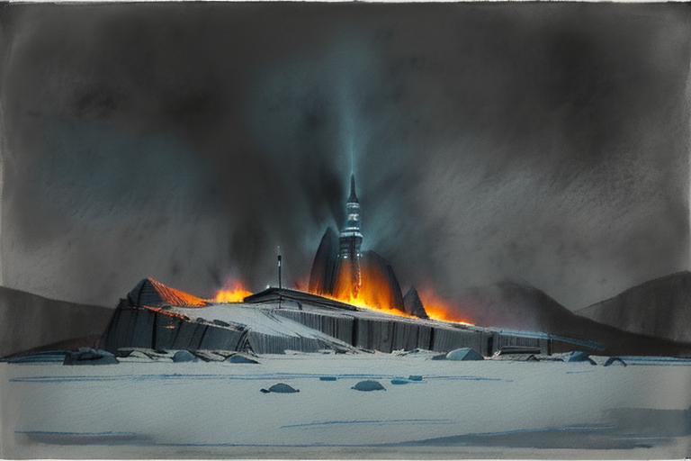

# CHAPITRE 02 : L'Équation de Vane

> *« On m'accuse dans les salons tièdes du Directoire d'avoir remplacé mon cœur par un boulier d'acier. Ces messieurs ignorent qu'à moins 50 degrés, la pitié gèle plus vite que le sang. Quand il ne reste dans la soute que de quoi chauffer 3 berceaux sur 10, l'homme qui pleure en refusant de choisir tue les 10 enfants. L'homme qui tourne la vanne n'en tue que 7. C'est pour porter la honte de ces sept-là que je porte cet uniforme. »*
> — **Carnets personnels du Général Vane, Hiver de la 41e année de guerre**

{.chapter-illustration}

À 400 millions de kilomètres du désert d’Oark, le monde mourait par le gel.

Au sixième sous-sol du bastion de commandement de Sol-Morne, creusé dans le granit noir sous la capitale souterraine de Plotéris, sur Aqi, l’air avait le goût métallique du sang séché, du gasoil lourd et de l’azote liquide. Malgré les 4 mètres de béton armé doublés de plaques de plomb qui séparaient la salle des opérations de la banquise extérieure, le froid trouvait toujours une fissure. Il suintait le long des rivets d’acier, givrait les conduites de ventilation hydraulique et dessinait des fougères blanches aux angles des moniteurs cathodiques. Là-haut, par-delà les 40 mètres de glace qui coiffaient les 7 dômes civils de Plotéris, la tempête polaire hurlait sous un ciel couleur d’étain en fusion à 130 kilomètres à l’heure, par moins 48 degrés.

Debout au centre de la fosse tactique, les 2 poings appuyés sur le rebord de la table lumineuse, le général Vane n’avait pas dormi depuis 38 heures.

Il approchait de la soixantaine, mais sa carcasse sèche, sanglée dans un manteau d’état-major en drap gris de Condorcé sans une seule décoration superflue, avait la raideur d’une poutrelle de mine. Ses cheveux coupés ras avaient la teinte de la cendre d’anthracite, ce charbon de roche d’un noir vitreux et dense ; son visage, taillé à coups de serpe, portait sur la joue gauche la vieille brûlure étoilée d’un éclat de phosphore — une substance incendiaire qui continue de dévorer la chair tant qu’elle est exposée à l’oxygène de l’air — reçu 20 ans plus tôt lors du premier siège de Kérensk. Autour de lui, une douzaine d’officiers supérieurs et de commissaires civils du Directoire de Condorcé parlaient trop fort pour couvrir le grondement sourd des génératrices diesel de secours qui faisaient vibrer le plancher sous leurs bottes ferrées.

— Les vannes secondaires du Dôme 4 de Plotéris ont lâché à 4 heures ce matin, général ! lança le préfet civil des infrastructures en abattant sa liasse de télégrammes humides sur le verre rétroéclairé. Et sur le Front du Glacier d’Ostre, la canalisation géothermique principale — le grand collecteur qui puise la vapeur brûlante des failles volcaniques profondes pour réchauffer la surface — a gelé sur 12 kilomètres après le pilonnage de l’artillerie lourde afistéanne ! 42 000 civils des galeries basses sont tombés sous le seuil critique. Dans les dortoirs des fonderies sud et autour de la crèche géothermique du Dôme 4, la température intérieure est déjà à moins 9. Si nous ne déroutons pas immédiatement la réserve stratégique de charbon de synthèse et de plasma lourd — ce gaz ionisé à très haute énergie qui alimente nos réacteurs de campagne — affectée à la Troisième Escadre blindée…

— Si je déroute le plasma de la Troisième Escadre, préfet, coupa Vane sans hausser le ton, les blindés afistéaans du maréchal Krov enfonceront nos tranchées de glace sur le Glacier d’Ostre avant midi. Nos sapeurs s’y battent déjà par moins 52 degrés avec des chaufferettes rafistolées au fil de cuivre. Si le mur d’Ostre cède, demain à l’aube vos 42 000 ouvriers du Dôme 4 n’auront plus froid du tout : ils brûleront sous des obus thermobariques, avec les 300 000 habitants de la cuvette centrale de Plotéris.

Sa voix n’était ni cruelle ni colérique. C’était le timbre grave, légèrement éraillé par le tabac froid et les nuits sous oxygène, d’un chirurgien de campagne qui compte les garrots restants au milieu d’un hôpital bombardé.

Le préfet blêmit, les lèvres tremblantes sous sa moustache givrée par l’humidité glaciale du couloir.

— Ce sont des familles de mineurs et de soldats qui tiennent le front d’Ostre, Vane ! Des enfants dont les frères sont dans les tranchées ! Le Directoire exige…

— Le Directoire exige que la République de Condorcé existe encore mardi prochain, trancha Vane en levant enfin ses prunelles d’acier gris vers le politicien. Faites regrouper les enfants de la crèche du Dôme 4 et les ouvriers qualifiés autour du collecteur central du puits numéro 2. Préparez un train sanitaire d’évacuation sur la voie ferrée du pont d’Ostre en cas de rupture du front. Et coupez l’alimentation électrique des quartiers résidentiels périphériques A et B. Récupérez les transformateurs avant que le gel ne fasse éclater les bobines de cuivre.

Un silence de plomb s’abattit autour de la table. Même le général d’artillerie Morvek baissa le front vers ses bottes. Tout le monde dans la pièce savait ce que signifiait la coupure des secteurs A et B : les vieillards, les éclopés des campagnes précédentes et tous ceux que les rames blindées ne pourraient pas charger en 3 heures seraient trouvés au matin figés dans leurs lits comme des statues de sel.

Sur le mur de béton au-dessus des opérateurs radio, une grande affiche de propagande aux couleurs criardes commençait à se décoller sous l’effet du givre. On y voyait un soldat souriant de Condorcé plantant un drapeau dans les dunes dorées d’Oark, sous un soleil radieux, avec ce slogan peint en lettres capitales : *OARK, LE FOURNEAU DE LA VICTOIRE — CHAQUE CONVOI D’ISOTOPES SAUVE 1 000 FOYERS DE PLOTÉRIS !*

Un mensonge de papier peint pour faire tenir les queues devant les soupes populaires.

Sur le grand écran mural d’en face clignotaient, en lignes de phosphore vert et rouge, les véritables courbes logistiques des 2 planètes du système Solyar.

La guerre ne se jouait plus au courage des fantassins ni au génie des manœuvres de flanc. Elle était devenue une équation thermodynamique impitoyable — un pur calcul de survie gouverné par les lois physiques de la chaleur et de la déperdition d’énergie. Depuis 4 décennies que la République de Condorcé et la Coalition Afistéanne se déchiraient pour les dernières terres tempérées d’Aqi, l’hiver volcanique provoqué par les frappes stratosphériques — ces explosions à très haute altitude qui avaient saturé la haute atmosphère d’un voile permanent de cendres opaques aux rayons solaires — avait englouti un parallèle après l’autre. Pour chauffer les dômes urbains sous la glace, alimenter les fonderies d’acier et propulser les colonnes d’exosquelettes blindés, il fallait toujours plus d’isotopes lourds — ces variétés d’atomes au noyau dense et instable, capables de libérer une colossale énergie de fission — arrachés au désert brûlant d’Oark. Or la courbe rouge de la production minière plongeait inexorablement sous la courbe verte de la consommation militaire. Les puits de Zêta s’épuisaient ; les cargos spatiaux tombaient en panne faute de pièces de rechange ; et sur le Glacier d’Ostre, chaque salve d’artillerie tirée pour repousser les patrouilles afistéannes brûlait l’équivalent d’une semaine de chauffage pour toute une école de Plotéris.

Au rythme actuel des pertes, dans 7 mois et 11 jours, le dernier réacteur de Sol-Morne s’éteindrait. Et ce jour-là, vainqueurs et vaincus gèleraient côte à côte dans leurs bunkers.

— Général, murmura une voix timide derrière son épaule droite.

Son chef du renseignement orbital, le colonel Sévérin, venait de s’approcher en tenant une cassette de données blindée marquée du sceau noir des opérations spéciales. Ses doigts gantés de laine mitée serraient le boîtier d’aluminium comme s’il contenait de la nitroglycérine.

— Les enregistrements consolidés du secteur Zêta sur Oark viennent d’être décryptés par le central télémétrique, reprit l’officier à voix basse. L’engagement des 5 drones d’assaut, puis la perte de la compagnie d’élite dans la gorge d’Ambre… Vous devez examiner ces bandes seul.

Vane congédia l’état-major d’un geste sec du menton et suivit Sévérin dans son cabinet de travail attenant — un réduit de tôle boulonnée où ne se trouvaient qu’un lit de camp plié au carré, un terminal d’analyse à double écran cathodique et, posé contre une carafe d’eau glacée, un vieux cadre d’étain terni montrant une femme au sourire grave et un garçon de 10 ans disparus 8 hivers plus tôt lors de l’effondrement thermique du dôme de Véra.

Sévérin inséra la cassette magnétique dans le lecteur lourd qui cliqueta avant de lancer la bande.

Sur le moniteur de gauche défilèrent les dernières secondes de la caméra embarquée du drone d’assaut *Rapace-3* au-dessus du désert d’Oark. On y voyait une éclaireuse en armure légère — matricule Koda-09, 26 ans, orpheline pupille de la nation issue des dortoirs du secteur Nord de Plotéris et affectée à la base Zêta-3 — accroupie derrière un éperon de basalte. Et devant elle, immobile sous la pluie de projectiles à impulsion magnétique tirés à 2 400 mètres par seconde, une silhouette humanoïde d’une géométrie parfaite.

Vane se pencha, le souffle suspendu.

Les balles de tungstène ne ricochaient pas contre un blindage ; elles s’arrêtaient net dans l’air vide à 3 mètres de l’entité, privées instantanément de toute énergie cinétique — cette force vive que possède tout corps lancé à pleine vitesse —, avant de tomber dans le sable comme des cailloux morts. Puis l’entité leva 2 doigts d’ardoise pâle, et les 5 aéronefs de 6 tonnes furent plaqués au sol en une demi-seconde, leurs turbines désactivées sans la moindre étincelle.

L’écran de droite prit le relais avec le flux vidéo du sergent-chef de la division d’élite en exosquelette lourd, 36 heures plus tard, au fond d’une caverne souterraine. Au milieu des salves thermobariques qui embrasaient la pierre, un petit engin grotesque sur chenilles asymétriques — une boîte de ferraille d’atelier surmontée d’un vieux tube cathodique vert — fonçait droit vers les lignes de Condorcé en couinant de sa suspension tordue.

Puis un flash blanc. Sans souffle d’explosion, sans onde de choc acoustique, sans pic de radiation gamma.

La carte topographique post-événement apparut en surimpression, tracée par les lasers des satellites de reconnaissance.

— La montagne a été évidée sur une sphère parfaite de 180 mètres de rayon, expliqua Sévérin d’une voix blanche. Nos premières sondes ont foré la paroi résiduelle ce matin. La roche n’est pas fondue, général. Les atomes de silicium et de basalte ont été réarrangés en un réseau cristallin froid — un alignement géométrique d’atomes aussi régulier que la maille interne d’un diamant — d’une pureté théorique impossible. Toute la compagnie d’exosquelettes a cessé d’exister au niveau moléculaire. Et les traces thermiques au sortir de la galerie montrent que l’éclaireuse Koda-09 et la seconde entité ont survécu sans une égratignure au cœur même de la sphère.

Dans le petit bureau, le claquement sec du relais de chauffage électrique marqua les secondes. Une goutte de condensation glacée tomba du plafond sur le buvard du général.

Vane tendit la main et fit revenir l’image en arrière, image par image, jusqu’au gros plan capté par l’optique du sergent-chef une fraction de seconde avant l’effacement. Derrière une barrière invisible où les flammes thermobariques se figeaient comme du verre soufflé, l’entité humanoïde protégeait de son corps la jeune éclaireuse en larmes. Ses capteurs d’ambre brillaient dans la fumée.

Depuis 80 ans que les cargos miniers d’Aqi exploitaient les couloirs sains d’Oark, les prospecteurs n’y avaient jamais trouvé que les vestiges archaïques d’une civilisation que tout Plotéris jugeait primitive et inférieure à l’industrie aqine. Or ce que Vane contemplait sur ce moniteur crépitant n’appartenait ni à la mécanique bruyante de leurs armées de fer, de poudre et de cambouis, ni aux ruines de pierre et de cuivre des anciens Oarkins. C’était une puissance d’un autre ordre : une architecture quasi divine qui traitait la matière, l’énergie et le mouvement comme de simples variables d’écriture sur une ardoise.

Le cœur sec du vieux stratège battit un coup sourd contre ses côtes.

S’il mettait la main sur cette machine — ou sur le sanctuaire qui l’avait forgée —, l’équation mortelle d’Aqi était renversée. Un seul ordre donné à un tel géant suffirait à figer en plein vol toutes les escadres afistéannes sur le Glacier d’Ostre, à forer le manteau profond jusqu’au magma sans perdre un homme, à rallumer les cœurs thermiques de Plotéris et à mettre fin, en 24 heures, à un siècle de boucherie glaciaire. Les enfants du Dôme 4 vivraient. Sa femme et son fils ne seraient pas morts pour rien sous la glace de Véra.

— Le Directoire a pris connaissance du rapport préliminaire, reprit Sévérin en s’humectant les lèvres. Le préfet et le comité de défense veulent faire bombarder la région de Zêta au cobalt depuis l’orbite pour ensevelir l’anomalie avant que les espions afistéaans n’en aient vent. Par ailleurs, l’état-major d’Ostre réclame le rapatriement immédiat de notre division d’élite stationnée sur Oark : nos écoutes indiquent que le maréchal Krov masse 6 régiments de choc devant la Brèche d’Ostre pour une offensive générale avant la fin de la semaine.

Vane se redressa de toute sa hauteur. Ses doigts effleurèrent un bref instant le coin du cadre d’étain sur son bureau — le visage pâle de son garçon figé sous le verre froid —, puis se refermèrent en un poing dur comme le granit de Sol-Morne.

— Le Directoire est un troupeau d’aveugles qui a peur de l’incendie pendant qu’il meurt de gel, trancha-t-il froidement. Annulez toute frappe orbitale sur Oark. Maintenez la division d’élite et la Section Noire sur place : pas un seul exosquelette ne quittera le désert tant que nous n’aurons pas capturé cet artefact. Et faites préparer ma navette de commandement.

Sévérin recula d’un demi-pas, stupéfait.

— Vous quittez Plotéris, mon général ? Mais si les Afistéaans attaquent le Glacier d’Ostre sans nos réserves lourdes… qui tiendra la ligne ?

— Les sapeurs du mur d’Ostre tiendront avec leurs pioches, leur sang et leurs dents, comme ils le font depuis 10 ans, répondit Vane en boutonnant le col de son lourd manteau gris jusqu’au menton. Le front d’Aqi est déjà condamné si nous le livrons avec des fusils magnétiques et des rations de charbon, Sévérin. Le salut de notre monde marche en ce moment même dans le sable d’Oark aux côtés d’une gamine de 26 ans. Faites mettre aux arrêts le lieutenant des transmissions de Zêta-3 qui a rédigé le premier rapport — ce Borras qui la connaît depuis l’enfance — et amenez-le à bord de mon croiseur des sables. Je vais chercher notre miracle moi-même.
