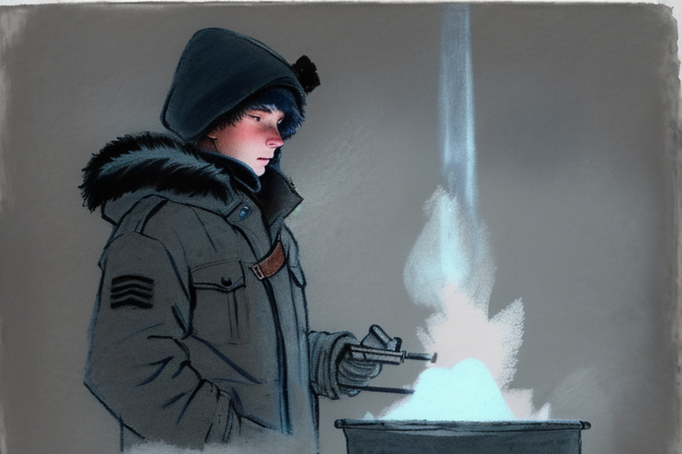

# CHAPITRE 03 : Les Tranchées du Givre

> *« Dis donc, Lina, devine ce que j'ai trouvé ce matin au fond de mon casque ? Non, pas un scorpion d'Oark, t'es bête, il fait moins 52 ici, même les microbes portent des moufles en laine ! Non, j'ai trouvé le biscuit de synthèse que tu m'avais glissé dans ma doublure avant mon départ de la gare du Dôme 4. Il était tellement gelé que le sergent Darnel s'est cassé une couronne dessus. Si tu tousses encore ce soir, je t'interdis de rire… enfin, juste un petit peu, sous ta couverture. »*
> — **Cassettes magnétiques du caporal Soren Valen, Bobine n° 14 (Archives du Dôme 4 de Plotéris)**

{.chapter-illustration}

Sur le Front du Glacier d’Ostre, on ne creusait pas la terre : on sculptait son propre cercueil dans de l’eau morte depuis 100 000 ans.

Accroupi au fond du boyau de première ligne de la Redoute Nord, par moins 52 degrés Celsius, le caporal-sapeur Soren Valen — 22 ans, matricule 408-S, surnommé « Demi-Volt » par toute la Troisième Compagnie de Génie de Condorcé — tenait entre ses dents sa lampe de poche dynamo tout en tortillant un brin de cuivre rouge au fond des entrailles éventrées d’une chaufferette hydraulique.

Autour de lui, les parois de la tranchée montaient à 3 mètres de haut, taillées au chalumeau à plasma dans la glace bleue millénaire de l’inlandsis — cet immense glacier continental qui ensevelissait les terres émergées d’Aqi sous une carapace gelée de plusieurs kilomètres d’épaisseur. À force d’encaisser le souffle des obus afistéaans et la vapeur des respirations humaines, les murs de gel s’étaient couverts d’une croûte de suie grasse, d’éclats d’acier figés et de stalactites couleur de rouille. Toutes les 40 secondes, à 2 kilomètres au sud-ouest par-delà le brouillard blanc du no-man’s-land, les batteries lourdes de la Coalition Afistéanne tiraient une salve de harcèlement. L’onde de choc ne se propageait pas seulement par l’air ; elle courait à travers la masse même du glacier, faisant gémir la banquise sous les semelles ferrées des soldats comme la coque d’un sous-marin prêt à imploser.

— Alors, Demi-Volt, elle repart ta bouilloire, ou bien on meurt tout de suite pour gagner du temps ? grogna le vieux sergent-chef Darnel en tapant ses moufles blindées l’une contre l’autre. J’ai le petit orteil gauche qui sonne comme du bois sec quand je le cogne contre ma botte.

À côté du sergent, recroquevillé sous une bâche thermique raidie par le givre, le jeune Milo — 18 ans, arrivé de la fonderie de Sol-Morne la semaine précédente avec un fusil magnétique plus grand que lui — claquetait des dents si fort qu’on l’entendait à travers son masque respiratoire.

Soren cracha sa lampe dans sa paume, rabattit son cache-nez de laine grise brûlé par l’acide des batteries et adressa aux 2 hommes un grand sourire qui fit craquer la pommade antigel sur ses pommettes maigres. Sous son casque cabossé où quelqu’un avait peint à la craie blanche un éclair de travers, ses yeux noisette pétillaient d’une malice indestructible.

— Doucement, sergent ! Vous parlez à un artiste diplômé des arrière-cours du Dôme 4, pas à un mécano d’état-major ! Le répartiteur de pression avait juste avalé un grumeau d’huile figée, alors je lui ai fait un pontage direct sur la bobine d’induction — cet enroulement de fil conducteur qui chauffe le métal par simple champ magnétique dès qu’le courant y circule — avec mon fil de cuivre fétiche. On appelle ça la chirurgie Valen : ça fume noir, ça sent le bouc grillé, ça viole 14 articles du règlement technique de Condorcé, mais ça chauffe !

Il donna un coup sec de clé plate sur le carter cabossé et tourna la vanne de purge.

Pendant une seconde, le petit générateur toussa un jet de vapeur soufrée, puis le serpentin de cuivre se mit à rougir derrière sa grille protectrice dans un ronronnement sourd de chaudière ressuscitée. Une bouffée d’air tiède, saturée d’odeur de graisse minérale et de métal chaud, se répandit sous la bâche de l’abri de tir.

Milo poussa un gémissement de gratitude pure et colla ses mains gantées contre la grille jusqu’à faire fumer le cuir de ses moufles.

— Par les ancêtres, Soren… t’es un magicien, souffla le gamin. Sans toi, toute la section aurait déjà les doigts coupés par le chirurgien du poste de secours. Pourquoi est-ce qu’ils t’ont appelé Demi-Volt, au fait ?

— Parce qu’à l’école des sapeurs de Plotéris, répondit gravement le sergent Darnel en approchant ses bottes du serpentin rougeoyant, ce crétin a voulu brancher le percolateur du réfectoire sur le rail d’alimentation d’un canon électromagnétique de siège pour faire chauffer son ersatz de café — ce breuvage d’imitation tiré d’orge brûlée et de racines de chicorée synthétique — un peu plus vite. Il a plongé 3 quartiers du Dôme 2 dans le noir et fait sauter les plombs du bureau du général Vane. Il ne restait plus qu’un demi-volt sur le réseau de la ville.

— Calomnie pure ! protesta Soren en riant tout en rangeant précieusement le reste de sa bobine de fil de cuivre dans la poche intérieure de sa capote, juste contre son cœur. Il restait au moins 3 volts 2, et le café était excellent ! Bon, il avait un petit goût de tungstène fondu, je vous l’accorde, mais par moins 40, ça vous tapisse l’estomac mieux que leur soupe d’algues grises.

Il se releva en prenant garde à ne pas heurter de son casque la poutrelle d’acier givrée du parapet et jeta un coup d’œil rapide par la fente d’observation du périscope de tranchée.

Dehors, le paysage n’était qu’un cauchemar monochrome de glace déchiquetée, de chevaux de frise — ces croisillons de poutrelles métalliques hérissés de pointes pour éventrer les chenilles et briser les charges d’infanterie — et de cratères noirs où fumaient encore les résidus huileux des obus thermobariques, ces munitions à souffle incendiaire qui aspiraient tout l’air des boyaux dans une boule de feu. À 800 mètres en face, à peine visible derrière les rideaux de poudreuse soulevés par la bise polaire, courait la ligne fortifiée des Afistéaans — exactement la même cicatrice creusée au chalumeau dans la banquise, hérissée des mêmes tubes de mortiers et des mêmes cheminées de poêles au fioul qui crachaient leur suie grise vers le ciel bas.

Parfois, quand le vent tombait entre deux duels d’artillerie, l’acoustique cristalline du glacier portait les sons d’une tranchée à l’autre avec une netteté irréelle : le claquement d’une culasse qu’on réarme, le juron d’une sentinelle qui glisse sur le verglas, ou la toux sèche d’un soldat ennemi qui avait les poumons brûlés par le même air gelé qu’eux.

Un obus de 120 millimètres siffla soudain dans la brume et alla percuter le rempart de glace à 50 mètres sur leur droite.

*BROUM.*

Une pluie d’éclats de banquise bleue, coupants comme des tessons de bouteille, s’abattit en crépitant sur les tôles ondulées du boyau. Soren rentra les épaules par réflexe, vérifia d’un coup d’œil que l’ébranlement n’avait pas disjoint le câble électrique principal qui courait le long de la paroi, puis essuya la poussière de givre tombée sur l’affiche placardée au fond de la niche de tir.

C’était la même affiche que dans les gares souterraines de Plotéris : le ciel orange flamboyant d’Oark, les dunes dorées et la promesse que les convois d’isotopes lourds allaient bientôt alimenter de nouveaux boucliers thermiques sur tout le front. Quelqu’un, parmi les sapeurs de la relève précédente, avait griffonné au charbon de bois sous le soleil peint : *« Envoyez-nous un seau de sable chaud, on vous rend les médailles ! »*

— Le vaguemestre a dit ce matin que le Haut Commandement avait refusé d’envoyer la brigade d’exosquelettes lourds en renfort sur Ostre, murmura le jeune Milo en resserrant ses genoux contre sa poitrine. Paraît que le général Vane les garde tous là-haut, sur Oark… Vous croyez que c’est vrai, sergent ? Si les Afistéaans lancent leur grande offensive d’hiver cette semaine, comment on va les arrêter avec 2 compagnies de génie et 3 canons de campagne dont le liquide de recul gèle toutes les heures ?

Le visage tanné du sergent Darnel se ferma derrière sa barbe blanche de givre. Il échangea un regard lourd avec Soren par-dessus le casque du gamin. Tous les vétérans de la ligne d’Ostre savaient ce que signifiaient les bruits de moteurs blindés qui montaient chaque nuit des arrières afistéaans depuis 4 jours : le maréchal Krov massait ses colonnes d’assaut en face de la Brèche, et Sol-Morne venait de leur couper 30 % de leurs rations de plasma pour économiser les stocks.

Mais Soren vit la lèvre inférieure de Milo qui tremblait. Il lui donna aussitôt une bourrade amicale sur l’épaulière de laine.

— Mais non, p’tit gars, écoute pas les rumeurs des cuisines ! Le vieux Vane a sûrement trouvé un filon d’isotopes géant sous un caillou d’Oark, et d’ici 15 jours on aura tellement de courant dans ce secteur qu’on fera pousser des tomates sur les barbelés ! En attendant, tant que Demi-Volt tient la clé de 12, personne ne gèle dans cette tranchée. Tiens, garde-moi la chaufferette à 110 degrés pendant que je descends vérifier le relais de la sape 4 avant la ronde de nuit.

3 heures plus tard, lorsque la relève de 22 heures prit son poste aux créneaux et que l’obscurité polaire acheva d’engloutir le Glacier d’Ostre sous une chape de moins 55 degrés, Soren se faufila à quatre pattes jusqu’au fond de l’abri souterrain numéro 2.

C’était une caverne de 3 mètres sur 4, creusée à 8 mètres sous la surface de la banquise et étayée par des traverses de chemin de fer récupérées. 6 sapeurs y dormaient déjà tout habillés sur des châlits de sangles superposés, leurs bottes fumantes alignées près d’un bidon de braises chimiques, leurs souffles rauques dessinant de petits nuages blancs dans la lueur rougeâtre d’une veilleuse à huile.

Soren s’installa dans le coin le plus reculé, entre deux caisses de détonateurs et le tableau de commutation téléphonique de la tranchée.

Avec des gestes lents, presque religieux, il retira ses lourdes moufles de cuir raidies par le gel, ne gardant que ses mitaines de laine trouées aux phalanges. Ses doigts étaient crevassés, noirs de cambouis et de brûlures d’étain, mais lorsqu’il ouvrit sa musette de toile cirée, il les posa avec une douceur infinie sur un petit appareil rectangulaire en bakélite grise — cette résine synthétique ancienne, dure et isolante, qui ne conduisait pas le froid — maintenu fermé par 2 tours de sparadrap médical : un enregistreur à cassettes magnétiques *Sonor-3* qu’il avait réparé 3 ans plus tôt dans une décharge du Dôme 4.

À côté du magnétophone, glissée dans une pochette de mica transparent — un minéral feuilleté clivé en lamelles souples comme du verre et résistant au gel — pour la protéger de l’humidité, se trouvait une photographie en noir et blanc aux coins cornés.

On y voyait une petite fille de 9 ans, assise sur un lit d’hôpital métallique sous les voûtes basses et suintantes du Dôme 4 de Plotéris. Elle était menue comme un oiseau d’hiver, emmitouflée dans 3 chandails superposés trop grands pour elle, un tuyau d’inhalateur d’oxygène passé sous le nez ; mais elle levait vers l’objectif 2 immenses yeux clairs et souriait de toutes ses dents de lait en brandissant un petit cheval mécanique fabriqué avec des écrous et du fil de cuivre.

*Lina.*

Depuis que leurs parents avaient péri lors du coup de grisou — l’explosion foudroyante d’une poche de gaz méthane enflammée par une étincelle — dans la mine d’anthracite numéro 7, 5 ans plus tôt, Soren était tout ce qui restait à la petite fille sur la planète Aqi — et Lina était la seule raison pour laquelle Soren continuait de réparer les chaufferettes du bout du monde sans devenir fou. À cause de la fibrose des bronches — ce durcissement irréversible des tissus pulmonaires transformés en cicatrices rigides — que la poussière de charbon et le froid chronique des galeries basses avaient infligée à l’enfant, chaque chute de température dans le Dôme 4 transformait sa respiration en un sifflement de verre pilé. Le vaguemestre de la compagnie — le sous-officier chargé du tri et de l’acheminement du courrier militaire entre le front et l’arrière —, un vieux cousin du quartier Nord, emportait chaque semaine dans le train de ravitaillement les petites bobines magnétiques que Soren enregistrait au front, et les déposait en cachette à la crèche géothermique du Dôme 4.

Soren vérifia que ses camarades dormaient profondément, tira le pan de sa capote par-dessus sa tête pour étouffer le grondement lointain des canons afistéaans, et pressa simultanément les touches *MARCHE* et *ENREGISTREMENT*.

À travers la fenêtre de plastique rayée, les 2 petites bobines noires se mirent à tourner dans un chuintement feutré.

— Salut, princesse, murmura Soren tout contre le microphone grésillant, sa voix grave et rieuse se faisant soudain aussi douce qu’une berceuse. C’est ton grand frère en direct du grand hôtel de villégiature du Glacier d’Ostre. 5 étoiles, vue imprenable sur la neige, glaçons gratuits à volonté ! Dis donc, Lina, devine ce que j’ai trouvé ce matin au fond de mon casque ? Non, pas un scorpion d’Oark, t’es bête, il fait moins 52 ici, même les microbes portent des moufles en laine ! Non, j’ai trouvé le biscuit de synthèse que tu m’avais glissé dans ma doublure avant mon départ de la gare du Dôme 4. Il était tellement gelé que le sergent Darnel s’est cassé une couronne dessus. Si tu tousses encore ce soir, je t’interdis de rire… enfin, juste un petit peu, sous ta couverture.

Un obus lourd explosa plus près en surface, faisant tomber une pincée de cristaux de glace du plafond de bois sur ses épaules. Sans perdre une seconde, Soren tapota le boîtier du magnétophone avec son ongle pour couvrir la vibration sourde.

— T’inquiète pas pour le boucan derrière, reprit-il sans que son sourire faiblisse dans le noir. C’est juste le gros Milo qui vient de faire tomber sa caisse à outils sur ses pieds, il est encore plus maladroit que moi quand je faisais la vaisselle à la maison. Ici, tout va très bien. Il fait bon dans notre abri, j’ai bricolé un radiateur qui chauffe tellement qu’on est obligés de dormir en bras de chemise ! Et surtout, écoute-moi bien, ma petite sœur…

Il ferma les paupières sous sa capote. Dans l’obscurité glaciale qui sentait le suif, la poudre humide et la peur des hommes, il essaya d’imaginer de toutes ses forces ce monde lointain qu’il n’avait jamais vu que sur les affiches du mur : un monde sans plafond de béton, sans stalactites d’azote, où l’air ne coupait pas les poumons des petites filles.

— … ce soir, je vais te raconter comment c’est, là-haut, sur Oark, murmura-t-il en frottant doucement la manche rugueuse de sa vareuse contre la grille du micro pour imiter le bruissement d’une brise d’été. Tu entends ça, Lina ? C’est pas le blizzard de Plotéris. C’est le vent du sable chaud. Sur Oark, il paraît que le sol est tout rouge et tout doré, comme la braise du fourneau quand le boulanger ouvre la porte. Et il fait si chaud, mais si chaud, qu’on peut marcher pieds nus dehors sans chaussures, sans chaussettes et sans inhalateur ! Tu poses ta main par terre, et la pierre te chauffe les doigts toute seule jusqu’au cœur. Quand la guerre sera finie au printemps et que les convois auront ramené les grands générateurs pour le Dôme 4, je te promets qu’on montera tout en haut de la tour d’observation à la fonte des glaces, et je te fabriquerai un cerf-volant en toile rouge qui montera si haut qu’on verra briller Oark dans le ciel. En attendant, prends bien tes gouttes d’eucalyptus quand l’infirmière passe, garde mon cheval de cuivre sous ton oreiller, et dors bien au chaud. À demain, princesse. Terminé pour Demi-Volt.

Le déclic du bouton *ARRÊT* tinta dans la pénombre.

Soren resta un long moment immobile sous le pan de sa capote, le front appuyé contre le plastique froid du vieux magnétophone. Son sourire s’était effacé. Dans le silence revenu de la sape, sa propre haleine se figeait déjà en givre blanc sur la grille du microphone, et tout au bout du couloir de glace, le téléphone de campagne du poste de commandement venait de se mettre à sonner par saccades nerveuses.
