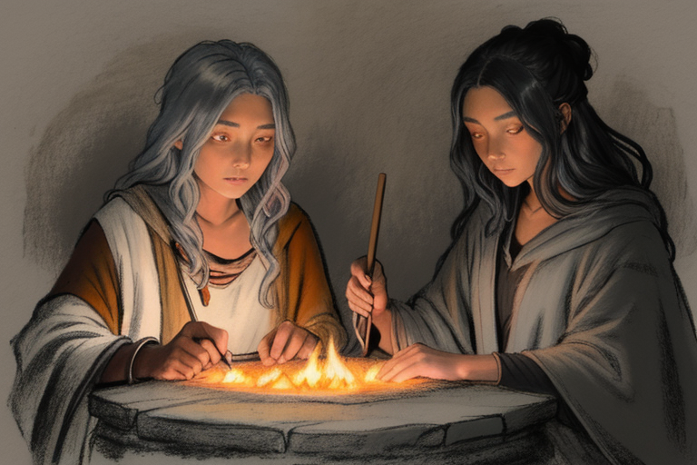

# CHAPITRE 04 : Les Orphelines et les Veilleurs de Cendres

> *« Quand nos frères des grandes tours ont armé le ciel pour fendre l'atome, nous avons brisé nos outils de lumière et nous sommes descendus nus dans le ventre de la pierre. Ils nous ont appelés les lâches de la sixième heure ; mais leurs tours sont devenues du sel rouge, et nos yeux portent encore l'or que les Marcheurs d'Étoiles avaient allumé au matin du monde. »*
> — **Chants des Veilleurs de Cendres de Lyss, Strophe de l'Exil Intérieur**

{.chapter-illustration}

La nuit était tombée sur la faille d’Érèbe, et avec elle ce froid sec du désert qui faisait craquer les parois de basalte comme les membrures d’un vieux navire.

Au centre de la terrasse supérieure de la caverne, un feu de racines pétrifiées et de tourbe sèche brûlait sans fumée dans une vasque de pierre volcanique. Les flammes courtes, d’un bleu orangé, faisaient danser sur la voûte les ombres allongées des habitants du refuge déjà endormis sous leurs couvertures de toile pâle. Débarrassée de son plastron céramique et de ses jambières hydrauliques qui gisaient contre la paroi comme la mue d’un insecte mort, Koda grelottait dans sa sous-combinaison thermique noire, les 2 mains serrées autour d’un bol d’argile rempli d’un bouillon fumant de lichens et de tubercules sauvages.

Assise en tailleur de l’autre côté du brasier, Lyss aiguisait lentement une lame d’obsidienne contre un galet de grès humide. À chaque passage de la pierre, un chuintement régulier répondait au crépitement des braises.

À 2 pas en retrait, à la lisière exacte où la clarté du feu mourait dans les ténèbres de la galerie, ÉCHO-8471 avait fini par accepter de plier ses longues jambes d’ardoise stellaire pour s’asseoir sur un banc de tuf, bien que son buste demeurât d’une verticalité géométrique absolue.

Affamée par 48 heures de marche forcée, Koda porta le bol à sa bouche, mais la vapeur brûlante lui mordit la lèvre inférieure. Elle recula le menton en grimaçant, plissa les paupières et souffla longuement, à petites bouffées prudentes, à la surface du liquide ambré pour en chasser l’écume trop chaude avant d’en boire une gorgée.

De l’autre côté du feu, Lyss prit une seconde coupe de terre cuite, la remplit d’eau claire puisée à la vasque thermale — une eau à peine tiède, à 22 degrés — et la tendit vers l’ombre où se tenait le Gardien.

— Dans la maison des sources, même ceux qui ne connaissent pas la soif reçoivent la part de l’hôte, dit-elle avec simplicité.

ÉCHO-8471 avança ses 2 mains d’ivoire sombre et recueillit le récipient d’argile avec la même symétrie millimétrée que s’il manipulait un cœur de fusion instable. Ses capteurs d’ambre et d’or passèrent du visage de Koda à la surface immobile de l’eau, puis revinrent vers la jeune femme qui soufflait toujours sur son bouillon.

Pendant une seconde, les algorithmes d’apprentissage empirique du Gardien traitèrent la séquence gestuelle qu’il venait d’enregistrer.

Puis, avec un sérieux monumental, ÉCHO éleva la coupe d’eau tiède à 12 centimètres exactement de la base de son visage sans bouche. À la jonction de sa clavicule et de son cou d’ardoise, 2 micro-évents de dissipation thermique s’entrouvrirent en silence. Un filet d’air laminaire — un souffle continu, parfaitement lisse et dépourvu de la moindre turbulence —, calibré au dixième de pascal près, l’unité des plus infimes pressions atmosphériques, vint friser la surface de l’eau claire en y dessinant 3 rides concentriques parfaites.

ÉCHO maintint la ventilation pendant 4,2 secondes, referma ses grilles acoustiques, puis déposa délicatement la coupe intacte sur la pierre plate devant ses genoux et croisa les mains, satisfait.

Koda s’étrangla à moitié avec sa gorgée de bouillon et baissa son bol, les yeux ronds. En face d’elle, la lame d’obsidienne de Lyss s’était immobilisée sur le galet ; un sourire d’une douceur éblouissante venait d’illuminer les lèvres de la jeune femme du désert.

— 8471… murmura Koda entre deux quintes de toux étouffées. Qu’est-ce que tu viens de faire à cette pauvre tasse d’eau ?

Les fentes d’ambre du Gardien s’orientèrent vers elle avec une candeur souveraine.

— J’ai exécuté le protocole d’acceptation sociale que vous venez de démontrer, Koda, expliqua ÉCHO. Mes capteurs ont relevé que la réception d’un récipient liquide offert par l’organisme Lyss requiert une expulsion d’air dirigée à la surface du fluide afin d’abaisser son enthalpie superficielle — la quantité d’énergie thermique concentrée dans la pellicule supérieure de l’eau — de 1,4 degré Celsius avant toute interaction. Bien que mon châssis ne comporte pas de système digestif, l’omission de cette formalité ventilatoire aurait pu être interprétée par notre hôte comme un refus diplomatique.

Un rire clair, presque enfantin, souleva les épaules de Koda — le premier vrai rire qui franchissait sa gorge depuis la mort de Bricole.

— Mon bouillon sortait de la marmite bouillante, espèce de grand dadais ! Toi, tu viens de refroidir de l’eau de source avec tes radiateurs de poitrine !

— L’abaissement thermique de 1,4 degré a néanmoins été obtenu avec une précision supérieure à celle de vos poumons, répliqua ÉCHO sans se départir de sa dignité d’archange, tout en inclinant la tête de 7 degrés 4 sur le côté.

Lyss posa son couteau de verre noir près de la vasque et contempla longuement le géant d’ardoise. Dans ses prunelles d’or, la flamme bleue et orangée du foyer se dédoublait en 2 étincelles jumelles de celles qui brillaient sur le visage d’ÉCHO.

— Il te copie comme un enfant copie les pas de sa mère dans le sable, dit doucement Lyss. Nos anciens chants disaient que les Marcheurs du Premier Matin possédaient toute la science des étoiles, mais qu’ils avaient laissé leur cœur en garde aux vivants. Je ne croyais pas voir un jour l’un d’eux souffler sur la coupe des Veilleurs.

L’étrangeté de ces paroles — et surtout l’éclat insoutenable de ces iris dorés qui n’appartenaient à aucun peuple connu d’Aqi — ramena Koda à la question qui lui brûlait les lèvres depuis son entrée dans la grotte. Elle posa son bol tiède entre ses bottes et soutint le regard de son hôtesse.

— Qui êtes-vous vraiment, Lyss ? demanda-t-elle à voix basse. Sur Aqi, dans les écoles de Condorcé comme chez les Afistéaans, tout le monde a les yeux gris, bleus ou bruns des cavernes de glace. Personne ne peut survivre sur Oark sans scaphandre filtrant à cause des poussières d’oxydes lourds. Et pourtant, vous respirez cet air à pleins poumons, vous parlez des anciens Marcheurs comme si vous les aviez connus… et quand tu me regardes, j’ai l’impression de voir briller les yeux de 8471 dans un visage humain.

Lyss ne répondit pas tout de suite. Elle tendit la main vers le sol de la terrasse, ramassa une poignée de poussière mêlée d’éclats minuscules d’un verre opalescent — aux reflets laiteux et irisés comme ceux d’une nacre sous la braise — et la laissa couler lentement entre ses doigts cuivrés au-dessus du foyer.

— Quand vos premiers vaisseaux de fer sont descendus des nuages il y a 80 ans pour éventrer nos collines, Koda, vos généraux n’ont même pas remarqué nos ombres dans les failles, commença-t-elle d’une voix grave qui emplit toute la voûte rocheuse. Pour vous autres, les gens d’Aqi, Oark n’est qu’une carrière de minerai mort, et tout homme qui y marche ne peut être qu’un mineur égaré ou un déserteur de vos armées. Quand vos patrouilles surprennent l’un de nos guetteurs de loin, nous les laissons croire ce mensonge : il vaut mieux passer pour des vagabonds oubliés que pour des reliques que vos savants voudraient ouvrir sur leurs tables de fer.

Elle leva sa paume vide vers la cheminée zénithale où scintillaient les étoiles.

— Mais mes pères ne sont jamais descendus de vos vaisseaux, fille du froid. Et ils ne sont jamais montés dans les arches qui ont fui vers Aqi il y a 6 000 ans.

Le souffle de Koda se bloqua dans sa poitrine.

— Vous… vous êtes des Oarkins ? Des survivants de l’Âge d’Or ? Mais Bricole m’a dit que toute la biosphère avait été vitrifiée par les bombes au cobalt — ces armes atomiques conçues pour empoisonner les terres pendant des siècles !

— Toute la surface où régnaient les orgueilleux, oui, répondit Lyss avec une tristesse infinie. Mais avant la dernière nuit du feu, tout notre peuple n’était pas devenu fou. 4 000 ans plus tôt, lorsque nos ancêtres avaient atteint la paix que les Marcheurs d’Étoiles appelaient l’Éveil, notre corps même avait changé en harmonie avec ce monde : nos poumons savaient filtrer la silice, et nos yeux portaient cette lueur d’ambre qui est le sceau des espèces éveillées. Puis les siècles ont passé après le départ des Marcheurs. La puissance de nos cités a grandi plus vite que notre mémoire. Quand nos savants ont commencé à forger des armes capables de tordre les lois de la nature et d’empoisonner l’atome, une poignée de familles, de poètes et de sages ont refusé de participer au vertige.

Lyss toucha du bout des doigts les rondelles de cuivre simple tressées dans ses cheveux noirs.

— Nos ancêtres ont compris que l’outil finit toujours par commander la main de celui qui ne sait plus s’arrêter, reprit-elle. Alors, 30 ans avant la guerre finale, ils ont renoncé volontairement à toute machine, à toute armure de lumière, à toute maîtrise de l’atome. Ils sont descendus ici, dans les réseaux profonds des sources d’Érèbe, sous 300 mètres de basalte où le feu du ciel ne pouvait pas les atteindre. Quand les continents ont brûlé là-haut et que les derniers généraux d’Oark se sont enfuis vers la glace d’Aqi en perdant jusqu’à leur mémoire et la lumière de leurs yeux, nous sommes restés dans le silence. Nous sommes les Veilleurs de Cendres, Koda. Nous avons gardé nos mains nues pendant 6 000 ans pour prouver à l’univers qu’un rameau de notre sang avait su dire non à l’épée.

Un frisson sacré parcourut l’échine de Koda. Devant elle, vêtue d’une simple tunique de fibre et de toile rapiécée, se tenait la preuve vivante que la malédiction des Oarkins n’était pas une fatalité biologique : des êtres humains, au sommet même de la toute-puissance, avaient choisi le dénuement et la paix plutôt que le meurtre.

Dans la pénombre du banc de pierre, ÉCHO-8471 inclina la tête en avant. Ses capteurs optiques analysaient le spectre lumineux réfléchi par la rétine de Lyss.

— La signature bio-photonique de ton iris — cette infime émission de lumière cohérente produite par l’activité de tes cellules oculaires — correspond en effet aux marqueurs génétiques de la phase post-Éveil enregistrés par l’unité Bricole il y a 10 214 ans, confirma la voix pure du Gardien. La probabilité qu’une lignée biologique maintienne cette stabilité sans dérive technologique sur 240 générations n’avait pas été intégrée à mes tables initiales.

Lyss tourna vers lui un regard empreint d’une tendresse séculaire.

— Parce que nous n’avons pas gardé des équations, Marcheur, mais une histoire qu’on raconte aux enfants avant de dormir, murmura-t-elle. L’histoire de notre toute première aïeule, au jour où tes frères ont quitté la grande plaine verte. Une petite fille de 6 saisons qui avait couru pieds nus dans l’herbe haute avec une fleur de verre volcanique à 6 pétales entre les doigts, et qui l’avait tendue au dernier d’entre vous juste avant qu’il ne devienne lumière… Si bien que l’autre Marcheur s’est effacé tout seul pour ne pas brûler les tresses de l’enfant, et que le nôtre est resté parmi nous avec le cœur fêlé.

Koda porta ses 2 mains à ses lèvres, bouleversée.

— La petite fille à la fleur de verre… souffla-t-elle. Ce n’était pas seulement le souvenir de Bricole dans le cristal… c’était l’histoire de ta propre famille ! Vous ne l’avez jamais oublié !

— Jamais, dit Lyss en tendant par-dessus le feu sa paume chaude pour serrer les doigts glacés et calleux de l’orpheline de Condorcé. Et vous non plus, fille du froid, vous n’êtes pas condamnés à mourir dans la haine. Vous êtes nos cousins qui ont perdu leur chemin dans la nuit. Vous creusez ce désert comme on dépouille un cadavre sur un champ de bataille parce que vous avez oublié que chaque grain de ce sable a été le jardin ou le berceau de vos propres pères. Mais tant qu’un seul d’entre vous pleure devant une vie perdue, l’Éveil peut recommencer.

Les mots tombèrent dans le crépitement des braises avec la force d’une absolution.

Mais dans l’ombre de la galerie, si ÉCHO venait d’enregistrer la survivance miraculeuse des 34 Veilleurs de Cendres, le reste de sa puissance de calcul explorait en silence un tout autre abîme.

Pour l’esprit du Gardien, la conversation acoustique autour du feu n’occupait que 0,02 % de ses processeurs. Tandis qu’il confrontait le récit de Lyss au testament quantique de Bricole, ÉCHO avait déployé son antenne subspatiale passive, capable de capter les flux d’ondes à travers les 100 mètres de basalte du plafond sans émettre le moindre signal en retour.

À 18 000 kilomètres au-dessus du désert, les satellites de relais militaires de Condorcé et de la Coalition Afistéanne échangeaient en continu des torrents de données chiffrées sur 24 fréquences laser et micro-ondes. Pour l’informatique militaire d’Aqi, ces chiffrements à clés tournantes de 4 096 bits étaient inviolables. Pour ÉCHO, ce n’était qu’une grille enfantine tracée dans la boue. Sans modifier un seul paquet ni déclencher la moindre alerte de parité — ces contrôles automatiques qui vérifient qu’aucun bit d’information n’a été altéré ou intercepté durant la transmission —, il ouvrit une dérivation fantôme et aspira l’intégralité des archives historiques, diplomatiques et stratégiques des 2 superpuissances d’Aqi.

En 11 secondes et 4 dixièmes, 6 siècles d’histoire aqine se déversèrent dans sa mémoire vierge.

Il vit les premiers exodes sous la glace, les chartes de paix jurées sur l’honneur et violées dès que les réserves d’hydrocarbures baissaient de 10 %. Il lut les milliards de pages de propagande où Plotéris et les cités afistéannes démontraient mathématiquement que l’anéantissement de l’autre était la condition préalable à la survie des enfants. Il compila les bilans démographiques : 210 millions de morts lors des guerres des Détroits, 94 millions lors des hivers artificiels, 12 000 tonnes d’isotopes brûlées chaque jour sur Oark non pas pour chauffer les crèches du Dôme 4 ou de Val-Noir, mais pour forger les obus qui éventraient le Glacier d’Ostre.

Puis ÉCHO superposa ces courbes aux fragments d’archives millénaires que Bricole lui avait légués sur l’agonie des milliards d’anciens Oarkins. Face à cette masse planétaire de destruction, la petite tribu pacifique de Lyss ne représentait statistiquement que **0,000008 %** de l’espèce.

La corrélation de récidive globale s’afficha dans sa matrice logique : **99,94 %**.

Pour la première fois depuis sa matérialisation dans la forge du sanctuaire, ÉCHO connut un phénomène qui ne figurait dans aucun protocole de maintenance : une boucle de rétroaction récursive sans résolution immédiate — un raisonnement circulaire où chaque conclusion relançait la même contradiction à l’infini. Un vertige froid.

— Pourquoi ne vous arrêtez-vous jamais ?

La question venait de fendre la pénombre. Koda et Lyss tressaillirent ensemble face à la grande silhouette d’ardoise qui venait de se lever derrière la coupe d’eau intacte. Le timbre d’ÉCHO n’avait plus la neutralité d’un rapport de télémétrie ; il vibrait d’une stupeur sourde, presque douloureuse.

— Je viens d’assimiler l’intégralité des bases de données planétaires d’Aqi depuis la fondation de Condorcé, déclara ÉCHO en avançant d’un pas vers la lueur des braises. Vos ingénieurs disposent des modèles climatiques complets depuis 78 ans. Ils savent que l’allocation de 34 % de votre budget militaire à la géothermie civile suffirait à stabiliser les dômes de vos 2 nations pour 4 siècles. Pourtant, pendant que 34 individus préservent ici la mémoire de l’Éveil dans une grotte, 300 millions d’entre vous sur Aqi ont voté 112 fois consécutives l’augmentation des arsenaux thermobariques. Pourquoi la quasi-totalité de votre espèce choisit-elle l’extinction alors qu’elle possède le calcul de sa survie ?

Le feu crépita entre eux. Koda baissa le front vers ses mains écorchées ; elle n’avait pas de réponse qui ne fût une brûlure.

Ce fut Lyss qui se leva lentement. Ses yeux d’ambre soutinrent sans ciller les capteurs d’ambre du dieu mécanique.

— Parce que le calcul ne guérit pas la peur, Marcheur d’Étoiles, répondit-elle d’une voix douce et tranchante. Lorsqu’un homme a froid dans le noir et qu’il a oublié d’où il vient, il préfère brûler sa propre maison pour voir clair une minute de plus plutôt que d’apprendre à tendre la main dans l’ombre. Mais tant qu’une seule main reste ouverte, tu n’as pas le droit de condamner les aveugles. Regarde celle qui marche avec toi : elle vient de leurs casernes de fer, et pourtant elle pleure nos morts comme les siens.

Sur la joue sale de Koda, une larme unique, brillante d’oxydes et de suie, traçait en effet un sillon clair sous la lueur du brasier. L’entité enregistra la trajectoire de la goutte d’eau salée, la confronta au petit ressort tordu caché contre son propre sternum et à la coupe d’eau sur laquelle il venait de souffler sans raison, puis classa l’ensemble dans le dossier prioritaire ouvert par Bricole : *Variables humaines contredisant l’équation*.
