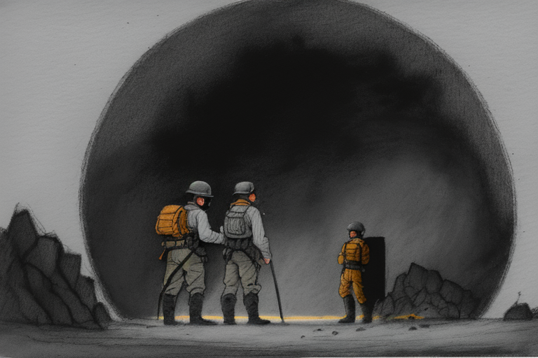

# CHAPITRE 05 : Le Cratère

> *« La guerre industrielle nous a habitués à mesurer la puissance au bruit qu'elle fait : le tonnerre d'un barrage d'artillerie, le hurlement d'une turbine, la fumée grasse d'une ville qui brûle. Aujourd'hui, dans la gorge d'Ambre, j'ai posé la main sur une mort qui ne fait aucun bruit et ne laisse aucune cendre. Nous sommes des enfants armés de bâtons qui viennent de frapper à la porte des dieux. »*
> — **Carnets personnels du Général Vane, Notes d'inspection sur Oark**

{.chapter-illustration}

L’air de la gorge d’Ambre ne sentait ni la poudre, ni l’essence brûlée, ni la chair calcinée. Il ne sentait rien. C’était le vide olfactif d’une salle d’opération stérilisée au rayonnement pur, posé à ciel ouvert au milieu du désert d’Oark.

Dans le hurlement strident de ses 4 turbines orientables qui soulevaient des geysers de poussière ocre, la canonnière de commandement du général Vane acheva de se poser sur le plateau rocheux en surplomb de la faille. Avant même que les vérins du train d’atterrissage n’aient fini de s’écraser dans un long sifflement d’azote, la rampe arrière s’abattit dans un fracas de chaînes.

Sanglé dans un lourd scaphandre d’inspection militaire — 45 kilos d’alliage de titane peint en gris mat, de conduites annelées et de filtres dorsaux qui ronflaient comme une forge —, Vane descendit le premier sur le basalte brûlant. Juste derrière lui, encadré par 2 gardes prétoriens en exosquelettes lourds, marchait le lieutenant Borras. On avait retiré au jeune officier des transmissions ses insignes de grade de Zêta-3 et son arme de service ; à travers la visière bombée de son casque réglementaire, son visage amaigri avait la pâleur d’un noyé. Tout autour d’eux, 30 blindés de la garde personnelle du général déployaient déjà un périmètre défensif, leurs canons magnétiques à répétition balayant les crêtes avec le cliquetis nerveux des servomoteurs surchauffés.

Vane ne daigna même pas tourner la tête vers ses arrières. Si la chose qui avait effacé une compagnie entière 60 heures plus tôt s’était encore trouvée dans ce canyon, ses 30 exosquelettes n’auraient pas pesé plus lourd que des figurines d’étain devant un chalumeau à plasma.

Il marcha droit jusqu’au bord de la coupure et fit signe à Borras d’avancer à sa hauteur.

Là où les cartes géologiques de Condorcé indiquaient une falaise de grès rouge de 200 mètres de haut et l’entrée dynamitée d’une galerie antique, la montagne avait été tranchée comme une pomme par une cuillère chauffée à blanc. Une hémisphère parfaite de 360 mètres de diamètre s’enfonçait dans le socle rocheux.

À l’intérieur de la vasque, la paroi n’avait ni la rugosité d’un cratère d’obus ni la croûte boursouflée et verdâtre des vitrifications atomiques que Vane avait vues sur Aqi. La surface était d’un noir d’obsidienne absolu, si lisse, si géométriquement exacte que le soleil d’Oark s’y reflétait en un point unique d’une blancheur aveuglante, sans la moindre aberration optique, sans ce flou ni cette déformation des lignes que produisent toujours les lentilles ou les miroirs imparfaits.

Au bord du gouffre, Borras chancela dans ses bottes ferrées. Ses mains gantées cherchèrent un appui dans le vide. C’était là, au fond de cette sphère de néant noir, que ses 5 mots tapés au bas d’un rapport administratif avaient acculé Koda sous le feu des canons thermobariques.

— Descendez avec moi, lieutenant, ordonna froidement Vane sur le canal local. Je veux que vous regardiez de près le résultat de vos cachotteries de garnison.

Ils enclenchèrent les freins magnétiques de leurs harnais et descendirent la pente inclinée le long du câble de rappel que les sapeurs avaient dû ancrer 200 mètres plus haut, faute de pouvoir planter le moindre piton dans la paroi noire. À chaque pas, leurs semelles d’acier glissaient sur la surface vitrifiée sans laisser une rayure, sans soulever un grain de poussière.

Au fond de la cuvette, 3 ingénieurs en combinaison argentée s’affairaient autour d’un trépied de carottage laser dont la mèche au diamant industriel venait d’exploser en gerbes d’étincelles inutiles.

— Rapport, docteur Arkan, lança Vane en rejoignant le chef des physiciens du Directoire, qui contemplait avec hébétude les débris fumants de sa foreuse.

Arkan se tourna vers le général et le jeune lieutenant. Derrière sa visière embuée de sueur, les yeux du vieux savant avaient l’éclat hagard d’un prêtre qui vient de voir son temple s’effondrer.

— Nous avons poussé le faisceau laser à 80 mégawatts par centimètre carré, mon général, bredouilla-t-il. La température de surface de ce matériau n’a pas varié d’un centième de degré Kelvin, l’échelle absolue des mesures thermiques. Toute l’énergie de chaleur et de choc est réfléchie ou dissipée instantanément dans la maille atomique, ce treillis invisible qui lie les atomes entre eux. Ce n’est pas de la roche fondue, Vane. Les atomes du grès, l’acier trempé de nos 18 exosquelettes, les ogives thermobariques non explosées, le carbone même du sang et des os de vos hommes… tout a été démonté au niveau subatomique et réassemblé en une couche monomoléculaire — un film continu d’une seule molécule d’épaisseur — de blindage neutre d’une pureté théorique impossible.

Un haut-le-cœur secoua Borras dans son scaphandre. Sous leurs pieds, la glace noire qu’ils foulaient était faite de la chair transmutée des 18 soldats de la division d’élite.

Vane, lui, s’agenouilla lentement au centre de la vasque. Ses genoux articulés grincèrent dans le silence sépulcral du cratère. Il déverrouilla le gantelet blindé de sa main droite, ne gardant que le sous-gant pressurisé en néoprène fin, et posa la paume à plat sur le miroir noir.

Malgré les 49 degrés qui régnaient dans l’air du canyon, la pierre était d’une tiédeur parfaitement neutre, immobile, indifférente. Sous cette croûte impénétrable reposait sans doute encore le cristal du sanctuaire que le petit engin sur chenilles avait voulu sceller par son sacrifice. Inaccessible pour l’éternité à leurs pioches, à leurs bombes et à leur science de charbonniers.

— Et la déflagration ? demanda Vane sans relever la tête. Quelle puissance en mégatonnes pour obtenir un tel rayon d’effacement ?

— Vous ne m’avez pas compris, général, murmura Arkan en essuyant son front contre l’épaule interne de son casque. Il n’y a pas eu de déflagration. Les sismographes de Zêta-3 n’ont enregistré aucune onde de compression, cette secousse mécanique qui se propage dans l’écorce rocheuse après un tir. Les barographes situés à 400 mètres en aval n’ont pas relevé une variation d’un demi-pascal. L’engin qui s’est sacrifié ici n’a pas libéré d’énergie sauvage : il a simplement… réécrit les lois de liaison de la matière dans un rayon programmé de 180 mètres, puis il a refermé l’équation.

Le physicien ouvrit sa tablette à cristaux liquides et projeta un diagramme spectral — la carte lumineuse décomposant la signature chimique de chaque élément présent dans la paroi — devant le masque de Vane.

— Sur Aqi, nous avons toujours considéré les anciens Oarkins comme des sauvages primitifs parce que nos équipes de forage, cantonnées aux couloirs sains, n’ont jamais croisé que les ruines grossières de leurs premiers âges, reprit Arkan à voix basse. Mais dans quelques inscriptions fragmentaires exhumées des strates profondes, leurs vieux chroniqueurs parlaient avec terreur et vénération d’une puissance supérieure qu’ils nommaient les Semeurs, ou les Architectes d’avant l’Aube. Ceux qui avaient façonné Solyar avant le début de leur histoire. Nous pensions que c’était une fable religieuse née de leur ignorance. Vous avez les pieds dessus, général.

Vane se remit debout. Il se tourna alors vers Borras, qui restait figé à 3 pas, le regard rivé aux traces de pas qui commençaient juste au bord extérieur de la coupole noire : les bottes ferrées d’une éclaireuse de Condorcé et les empreintes à peine marquées d’un marcheur de 100 kilos qui semblait ne pas peser sur la silice.

— Lieutenant Borras, dit Vane d’une voix tranchante. Sur les bandes vidéo du sergent-chef, juste avant cet effacement, on voit un petit châssis asymétrique assemblé avec des pièces de rebut de votre garnison foncer vers nos lignes. La fouille de l’atelier de l’éclaireuse Koda-09 à Zêta-3 a révélé qu’elle a construit cet engin en secret pendant 4 nuits autour du noyau logique que vous aviez signalé. Comment l’appelait-elle ?

Borras déglutit avec effort dans l’air sec de son respirateur.

— Je… je ne l’ai jamais vu terminé, mon général. Quand je suis descendu à son atelier l’avant-dernière nuit, elle l’avait caché sous son établi. Mais sur les carnets de croquis que vos hommes ont saisis… elle l’avait baptisé « Bricole ».

— *Bricole*, répéta Vane, et le mot sonna de façon presque obscène au milieu de ce tombeau cosmique. Une pupille de la nation issue des orphelinats du Nord déterre un artefact capable d’éditer la structure atomique d’une montagne, le monte sur une chenille de tracteur avec un vieux moniteur cathodique, et l’appelle *Bricole*. Dites-moi, lieutenant, vous qui la connaissez depuis l’âge de 12 ans : pourquoi cette machine a-t-elle accepté de s’anéantir pour sauver la vie de cette fille ? Et pourquoi la seconde entité — le géant intact qui l’accompagne désormais — ne nous a-t-elle pas tous exterminés dès l’engagement des 5 drones ?

Borras leva les yeux vers le masque d’acier du vieux général. Au fond de sa détresse, une étincelle de fierté douloureuse passa dans sa voix :

— Parce que Koda ne les a pas traités comme des armes, mon général. Quand elle trouve une machine brisée, elle ne cherche pas à savoir combien d’hommes elle peut tuer avec. Elle lui parle, elle la répare et elle lui donne un nom. Si la première unité s’est sacrifiée ici, ce n’est pas en exécutant un programme de combat… c’est parce qu’elle aimait Koda. Et si vous continuez à la chasser avec vos canons, vous finirez par forcer la seconde machine à…

— À quoi, lieutenant ? coupa Vane en avançant d’un pas jusqu’à heurter presque le plastron du jeune officier. À nous punir ? Épargnez-moi vos contes de fées sentimentaux ! Des machines n’aiment pas. Des machines obéissent à des directives d’opérateur et à des verrous de sécurité.

Le docteur Arkan hocha vivement le casque en ajustant ses sangles dorsales.

— Le général a raison sur le plan fonctionnel, lieutenant. D’après la télémétrie de la gorge d’Ambre et du combat des drones, la grande entité bipède n’a utilisé que des champs de répulsion non létaux à très courte portée autour de l’éclaireuse. Tout indique qu’elle est bridée par un protocole de défense strict et qu’elle dépend des instructions vocales de Koda-09 pour agir.

*Une directive d’opérateur humain.*

Sous son casque, les mâchoires de Vane se serrèrent jusqu’à faire saillir le muscle sous sa cicatrice de Kérensk. Une orpheline de 26 ans, élevée dans les dortoirs chauffés par la République, nourrie du pain de synthèse de l’armée, tenait au bout de sa voix le seul miracle capable d’empêcher Aqi de devenir un bloc de glace funéraire… et elle s’enfuyait dans les dunes pour protéger les états d’âme d’un automate !

Il fit 3 pas le long de la courbe vitrifiée et contempla son propre reflet déformé dans l’obsidienne atomique. 40 ans de commandement lui avaient appris que l’histoire ne pardonnait jamais aux cœurs tendres. Lors du siège de Kérensk, quand il avait fait dynamiter les ponts de glace devant les blindés afistéaans alors que 2 régiments d’arrière-garde plotéris se trouvaient encore sur l’autre rive, les tribunaux civils avaient voulu le faire fusiller ; 6 mois plus tard, ces mêmes juges lui avaient décerné la Croix de Fer parce que son ordre avait sauvé Plotéris. La morale individuelle n’était qu’un luxe d’été, une fleur de serre qui mourait dès que le thermomètre descendait sous zéro. Si cette éclaireuse Koda s’imaginait pouvoir dérober l’avenir de 300 millions d’êtres humains au nom de sa petite conscience solitaire, il lui enseignerait lui-même le poids réel d’un monde qui gèle.

Une bourrasque brûlante descendit de la crête, faisant claquer les fanions des exosquelettes postés sur le rebord supérieur. Dans la radio de commandement de Vane, le grésillement du relais orbital de Sol-Morne apporta un nouveau télégramme chiffré du Front d’Ostre : une tempête d’ammoniac venait de s’abattre par moins 55 degrés sur les tranchées de la Redoute Nord, et les patrouilles de reconnaissance afistéannes commençaient à cisailler les barbelés avancés.

Vane coupa le canal d’un coup sec du pouce et remonta son gantelet blindé en faisant claquer les joints d’étanchéité.

— Docteur Arkan, dit-il d’une voix glaciale, vous allez faire couler une chape de béton de régolithe sur tout ce cratère d’ici demain soir. Si un seul satellite afistéaan photographie la réflectance de cette paroi — son pouvoir de renvoyer la lumière et les ondes radar comme un miroir absolu — et comprend ce qui s’est éveillé dans notre secteur, la Coalition lancera la totalité de sa flotte orbitale sur Oark avant la fin de la semaine.

— Et les fuyards, mon général ? Ils ont 48 heures d’avance dans le massif d’Érèbe, et le sable a déjà effacé leurs traces au bout d’un kilomètre.

Vane leva la tête vers l’horizon couleur de rouille et de sang séché qui s’étendait au sud-est, là où commençaient les plateaux fracturés, les avant-postes ennemis et les lointaines zones irradiées des Terres Mortes.

— Les machines qui cherchent d’autres sanctuaires suivent un réseau géologique précis, Arkan. Et les gamines en fuite finissent toujours par manquer d’eau, de filtres antiradiation ou de pièces de rechange. Quant à vous, lieutenant Borras… vous allez vous asseoir devant la console d’écoute spectrale de *Bastion-Un* et vous n’en bougerez plus. Vous connaissez ses habitudes, ses codes radio et sa façon de bricoler les fréquences. Vous allez me trouver où elle va, ou je fais couper le chauffage du bloc résidentiel où logent vos anciens camarades de Zêta-3.

Il rappela son escorte d’un signe de la main et gravit la pente vers sa canonnière, laissant Borras suivre au bout de son câble de rappel, le regard hanté par le miroir noir où dormait l’ombre de Bricole.
