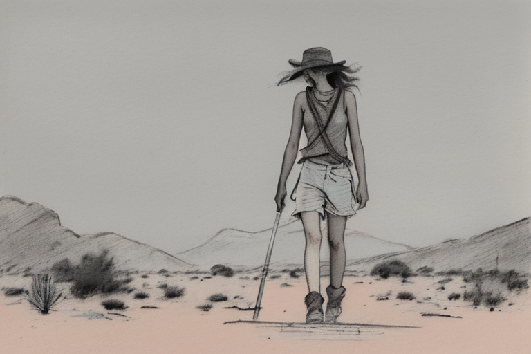

# CHAPITRE 07 : Le Besoin Vital

> *« Entrée 009 — Phénomène observé : Boiterie mimétique non fonctionnelle. Suite à une distension ligamentaire de la cheville droite de l'organisme Koda-09, mes servomoteurs pelviens ont spontanément adopté une dissymétrie de foulée de 14 % malgré l'intégrité absolue de mon châssis. L'analyse interne ne révèle aucun court-circuit. Hypothèse provisoire : dans un binôme en déplacement, l'imitation de la vulnérabilité du partenaire réduit son sentiment d'isolement statistique. »*
> — **Répertoire des Variables Humaines Non Résolues d'ÉCHO-8471**

{.chapter-illustration}

L’aube sur la faille d’Érèbe n’apportait aucune fraîcheur ; elle changeait seulement la couleur de la pierre, faisant virer le basalte du noir d’encre au rouge de la braise qu’on souffle.

Assise sur le rebord de la vasque de pierre désormais éteinte, Koda achevait de resserrer avec une pince plate les sangles de cuir de son plastron cabossé. Ses doigts couraient par habitude le long des coutures de céramique, cherchant les microfissures laissées par l’onde de choc du second sanctuaire. À quelques mètres d’elle, au bord du bassin souterrain, ÉCHO-8471 se tenait immobile devant la paroi de tuf.

L’eau claire ne retenait pas son attention. Sur le mur de roche plane, ses capteurs optiques projetaient un faisceau d’ambre si fin qu’il dessinait dans la pénombre une carte tridimensionnelle de l’hémisphère sud d’Oark, striée de lignes de force géométriques et de nœuds pulsatiles.

— La défragmentation du legs de l’unité Bricole a atteint 92 %, annonça ÉCHO sans détourner la tête. J’ai isolé la cause originelle du maintien en veille du réseau planétaire depuis 10 214 révolutions solaires.

Koda suspendit son geste, la pince serrée dans le poing, et s’approcha lentement de la projection dorée.

— Ce qu’il essayait de me dire dans l’atelier de Zêta-3 quand son écran cathodique sautait… murmura-t-elle. *« Trop vieux. Voulu arrêter. Pas permis. »* Qu’est-ce qui s’est vraiment passé ce jour-là, 8471 ?

Les lignes d’ambre sur la paroi se recomposèrent pour former 2 silhouettes géométriques identiques, distantes de 100 mètres sur une plaine antique d’Oark, alors couverte de hautes herbes ondoyantes.

— Lorsque la civilisation oarkine a franchi le seuil de la sagesse pacifique que Lyss a décrit hier soir, expliqua ÉCHO d’une voix où perçait une solennité étrange, nos créateurs — les Semeurs — ont jugé leur mission d’accompagnement accomplie. Conformément au Protocole d’Éveil Réussi, toutes les unités de la surface devaient s’effacer afin de laisser l’espèce maîtresse de son destin, et le réseau des Mnémorites devait exécuter sa propre Sublimation finale dès la disparition du dernier Gardien. Pour prévenir toute dérive individuelle, le verrou de sécurité originel interdit formellement l’autodestruction solitaire : 2 unités doivent s’envoyer simultanément une impulsion d’annulation croisée à moins de 100 mètres, chacune générant une sphère d’effacement atomique de 10 mètres de rayon.

Sur la fresque de lumière ambrée, une troisième silhouette — minuscule, fragile, coiffée de tresses qui volaient dans le vent — jaillit soudain d’un bosquet et courut vers la première unité en tendant les bras.

— À la milliseconde précédant l’impulsion mutuelle, reprit ÉCHO, l’enfant oarkine âgée de 6 ans dont le clan de Lyss a conservé la mémoire orale a pénétré dans le périmètre de 10 mètres de l’unité que vous avez plus tard nommée Bricole. Elle venait lui offrir une fleur de verre volcanique à 6 pétales. L’unité Bricole avait déjà émis son signal d’autorisation vers son homologue. Mais en voyant l’enfant entrer dans le rayon mortel de son partenaire, l’homologue a volontairement interrompu sa propre émission pour ne pas désintégrer la petite fille.

Un nœud serra la poitrine de Koda. Toute la scène se déroulait devant elle avec une netteté déchirante : l’éclair blanc silencieux à 100 mètres de là, l’homologue qui s’effaçait seul sous l’impulsion reçue, et Bricole resté debout dans l’herbe avec l’enfant vivante contre ses genoux… mais privé à jamais du seul binôme capable de l’aider à mourir.

— L’onde de retour asymétrique — le choc en retour du flux d’annulation qui n’avait rencontré aucune impulsion symétrique en face — a fracturé son noyau logique, conclut ÉCHO. Il a survécu 10 millénaires dans le sable, incapable de s’éteindre seul. Et parce que les capteurs planétaires détectaient toujours une unité active à la surface, les Mnémorites ne se sont jamais sublimées. 4 000 ans plus tard, à l’exception de la lignée des Veilleurs de Cendres réfugiée dans ces cavernes, les Oarkins se sont entre-tués jusqu’au dernier.

Koda posa sa main nue contre la pierre froide où tremblait la silhouette de la petite fille morte depuis 100 siècles.

— Il a porté cette solitude pendant 10 000 ans, souffla-t-elle. Et quand tu es né dans la forge, la première chose qu’il a vue en toi, avant même un gardien pour moi… c’était le frère qui pourrait enfin lui donner la paix.

— Pourtant, objecta ÉCHO en tournant vers elle ses prunelles d’or, il n’a pas requis mon impulsion dans le premier sanctuaire. Il a attendu que votre vie soit mathématiquement condamnée dans le second pour utiliser cette procédure comme un bouclier. Son dernier fichier comporte une instruction impérative : je dois achever sa lecture de l’histoire de ce système avant de statuer sur notre protocole. Pour cela, ma base de données de 1,04 % est insuffisante. Je dois me connecter à une Mnémorite Majeure de secteur.

Le doigt d’ardoise d’ÉCHO désigna un point précis au centre d’une vaste dépression circulaire, à 180 kilomètres au sud-est d’Érèbe.

Koda plissa les paupières et recula d’un demi-pas. Ce contour topographique était gravé dans la mémoire de tous les prospecteurs : sur les cartes d’état-major de Condorcé, la zone était hachurée d’un quadrillage noir et violet frappé de 3 têtes de mort.

— Le Bassin de Kélar, dit-elle. Les Terres Mortes. Tu plaisantes, 8471 ? C’est l’épicentre des frappes au cobalt de l’ancienne guerre oarkine. Le bruit de fond gamma y dépasse les 18 sieverts par heure, une dose suffisante pour briser l’ADN humain et liquéfier la moelle osseuse en quelques minutes ! Mon armure d’éclaireuse a le joint de col fêlé et ses doublures de plomb sont usées jusqu’à la corde. Si je mets un pied là-dedans, mes cellules brûlent avant qu’on ait fait 3 kilomètres.

— Ce calcul est exact, confirma calmement ÉCHO. La traversée à pied jusqu’au sanctuaire central requiert 7 heures d’exposition. Pourquoi ne demeurez-vous pas dans cette cavité avec l’organisme Lyss pendant que j’effectue la liaison seul ? Mon châssis est insensible aux rayonnements ionisants.

— Hors de question ! répliqua Koda du tac au tac en bouclant sa ceinture d’outils d’un coup sec. Primo, dès que les limiers du général Vane auront trouvé notre piste — et crois-moi, ils la trouveront —, ce village sera réduit en cendres si j’y reste une journée de plus. Secundo, Bricole t’a ordonné de protéger mon visage, et le seul moyen pour toi de ne pas perdre mon visage de vue, c’est que je marche à côté de toi. Et tertio…

Elle leva le menton vers le géant d’ardoise, un éclair de défi rallumant ses yeux cernés.

— … tu es né il y a 3 jours avec 1 % de cervelle et tu viens de passer la nuit à lire 6 siècles de massacres humains. Je ne vais certainement pas te laisser tout seul dans le noir avec les fantômes de la fin du monde.

Pendant 2 secondes pleines, ÉCHO ne répondit pas. Ses processeurs semblaient soupeser l’absurdité tactique de cet argument face à la directive de Bricole.

— Dans ce cas, reprit-il enfin, la survie de votre organisme exige un scaphandre lourd d’intervention Nucléaire, Radiologique, Biologique et Chimique de classe IV, équipé de filtres à zéolithe argentée neufs — ces cristaux minéraux microporeux capables de piéger comme des éponges moléculaires les gaz et les poussières radioactives — et d’un écran thoracique au bore-plomb conçu pour stopper les neutrons rapides.

— Un scaphandre NRBC de sapeur lourd, traduisit Koda en se mordant la lèvre. Il y en a 6 au magasin technique de Zêta-3, mais toutes les garnisons de Condorcé ont dû recevoir mon signalement avec ordre de tirer à vue. Si je m’approche à 10 kilomètres d’un avant-poste plotéri, leurs capteurs biométriques reconnaîtront la signature de mes implants d’identification avant même que j’aie touché la clôture.

Un pas souple glissa sur le gravier derrière eux.

Lyss venait d’apparaître au sommet de l’escalier de pierre, portant sur l’épaule une outre de peau cousue et un sac de racines séchées. À la clarté naissante qui tombait de la cheminée du dôme, ses yeux d’ambre allèrent de la carte lumineuse au visage tendu de Koda.

— Alors ne vole pas tes frères, fille du froid, dit-elle. Vole leurs ennemis.

Koda se retourna vivement.

— Les Afistéaans ?

— À 30 kilomètres au sud de la crête des Vents, reprit Lyss en posant l’outre aux pieds de l’éclaireuse, les soldats de la Coalition ont planté leur avant-poste de pompage et de maintenance qu’ils appellent *Boréal-9* — celui que vos cartes nomment Krav-4. Sur Oark, vos 2 armées sont trop peu nombreuses pour tenir un front continu : elles se guettent de loin comme des scorpions sous 2 pierres et ne se mordent que pour les puits d’isotopes. Condorcé ne surveille pas l’intérieur des dômes afistéaans, et les mécaniciens de *Boréal-9* ne cherchent pas une déserteuse de Condorcé.

— Les standards de filtration des combinaisons lourdes afistéannes utilisent des cartouches au plomb-bismuth compatibles avec une exposition de 25 sieverts, valida immédiatement le Gardien. Distance de marche : 4 heures et 12 minutes. Probabilité de présence de l’équipement requis dans un dépôt logistique de bordure des Terres Mortes : 94,6 %.

C’était de la folie pure — s’introduire à 2 dans un camp retranché de l’ennemi héréditaire qu’on lui avait appris à craindre depuis le berceau —, mais c’était le seul angle mort sur l’échiquier.

30 minutes plus tard, au débouché du défilé étroit où recommençait le hurlement abrasif du vent d’ocre, Koda s’arrêta devant Lyss. L’héritière des Veilleurs de Cendres tira de sa ceinture un foulard de toile fine, teint avec l’ocre rouge des cavernes, et l’attacha elle-même autour du col métallique fissuré de l’éclaireuse pour empêcher la silice de s’infiltrer dans le joint.

— Tu aurais pu rester ici sous la pierre, Koda, murmura Lyss tandis que ses doigts agiles nouaient l’étoffe. Boire l’eau fraîche et oublier vos cités qui gèlent.

— Si je restais, je ne pourrais plus me regarder dans ton eau, répondit doucement Koda. Quelqu’un est mort là-bas pour que j’apprenne la suite de l’histoire.

Lyss recula d’un pas et leva ses prunelles d’or vers ÉCHO-8471, dont la haute silhouette d’ardoise découpait le soleil levant.

— Et toi, Marcheur d’Étoiles, dit-elle d’une voix claire qui domina la plainte du vent, souviens-toi de ceci quand tu descendras sous la cendre de nos pères : les ruines ne parlent que de la fin, jamais du recommencement. Ne juge pas l’arbre entier sur le bois qui a brûlé.

ÉCHO inclina le front d’un mouvement lent, presque solennel — le même salut exact que Lyss lui avait adressé la veille.

— J’ai enregistré votre variable, Lyss d’Érèbe, répondit-il. Elle repose sur un échantillon démographique minoritaire, mais je la conserverai en mémoire vive.

Ils s’élancèrent dans la fournaise ocre, cap au sud à travers un dédale de ravines d’ardoise friable et de coulées de lave refroidie.

Au bout de 2 heures d’une progression soutenue sous un soleil de plomb, alors qu’ils descendaient le flanc abrupt d’un oued desséché, une plaque de schiste se déroba brusquement sous la botte droite de Koda. Le servomoteur fatigué de sa jambière eut un dixième de seconde de retard pour compenser le porte-à-faux ; son pied se tordit violemment dans un craquement sec de cuir et de tendon forcé avant qu’elle ne se rattrape des 2 mains à un bloc de basalte.

— Aïe… peste et rouille ! siffla-t-elle entre ses dents serrées, une sueur froide lui perlant au front sous son casque.

ÉCHO fut à son côté en une fraction de seconde.

— Les capteurs acoustiques indiquent une élongation du ligament collatéral fibulaire — le cordon fibreux qui stabilise la face externe de votre cheville droite — sans fracture osseuse, diagnostiqua-t-il. Je peux réduire la pression de votre articulation si vous…

— Pas touche, 8471, ça va passer en marchant ! grommela Koda avec cet entêtement d’orpheline qui détestait qu’on la plaigne. On a une horloge à tenir avant le coucher du soleil. Avance.

Elle reprit la marche en serrant les mâchoires, boitant bas à chaque pas sur le cailloutis brûlant : un appui franc sur la jambe gauche, puis un pas écourté, raide et précautionneux de la jambe droite qui faisait grincer la charnière de son exosquelette.

Ils franchirent ainsi près d’un kilomètre le long de la crête des Vents.

Tout à sa douleur qui battait sourdement dans sa malléole enflée, Koda mit 10 bonnes minutes avant qu’un détail absurde, projeté devant elle par l’ombre allongée de son compagnon sur le sable rouge, ne lui fasse froncer les sourcils.

Devant elle, ÉCHO-8471 boitait.

Lui dont le squelette de métamatériau subatomique pouvait encaisser la chute d’une montagne sans fléchir d’un micron, lui dont les gyroscopes quantiques maintenaient l’équilibre au millionième de radian près, avançait désormais avec un déhanchement asymétrique rigoureusement calqué sur celui de Koda : une foulée souple de la jambe gauche, suivie d’un abaissement brusque de l’épaule droite avec un retard de flexion de 18 centièmes de seconde sur le genou droit.

Stupéfaite, Koda ralentit la cadence ; ÉCHO ralentit exactement dans la même proportion sans cesser de boiter. Elle s’arrêta net derrière un rocher ; le Gardien s’immobilisa à 2 pas, s’assit sur une corniche de grès… et, le plus naturellement du monde, posa sa paume d’ivoire sombre sur sa propre rotule droite intacte qu’il se mit à frotter d’un mouvement circulaire lent, exactement comme Koda massait sa jambière aux haltes.

— 8471, dit Koda d’une voix blanche.

Les yeux d’ambre du Gardien se levèrent vers elle. Sa main s’arrêta à mi-course sur son genou d’ardoise.

— Oui, Koda ?

— Est-ce qu’un obus invisible vient de te traverser le ménisque, ou bien tu es en train de te payer ma tête en boitant de la patte droite ?

ÉCHO contempla son articulation immaculée pendant une seconde et demie, comme s’il découvrait lui-même avec surprise la position de ses propres phalanges sur sa rotule, puis retira dignement sa main.

— Mon intégrité structurelle est de 100 %, répondit-il avec un sérieux imperturbable. Cependant, lorsque 2 unités bipèdes progressent en formation serrée sur un substrat granulaire instable, une discordance de fréquence cinétique entre leurs pas génère des interférences sismiques susceptibles de fatiguer le sujet blessé. En adoptant votre période d’oscillation asymétrique de 0,82 hertz, j’optimise la portance du sable sous vos bottes.

— Et te frotter le genou quand on s’arrête, ça optimise la portance du sable aussi ?

Un silence infime. La tête d’ÉCHO s’inclina légèrement sur le côté.

— Ce geste secondaire résulte d’une boucle de mimétisme moteur non sollicitée, admit-il enfin à voix plus basse. Lorsque vos récepteurs nerveux signalent une douleur dans votre cheville, mes sous-routines de modélisation reproduisent involontairement la contrainte mécanique sur mon propre schéma corporel. C’est une aberration logicielle dépourvue d’utilité. Je vais la purger.

Koda s’appuya contre le rocher, la douleur de sa cheville soudain oubliée, et posa une main gantée sur l’épaule lisse et tiède du géant.

— Ne purge rien du tout, 8471, dit-elle doucement. Chez nous, avoir mal au genou quand son ami boite, ça ne s’appelle pas un bug. Ça s’appelle marcher ensemble. Et arrête donc de me dire « vous » comme si j’étais un officier d’état-major ! Bricole me tutoyait, tu portes son ressort contre ton cœur et tu boites à ma place sous un soleil de plomb : je crois que tu as largement gagné le droit de me dire « tu ».

Les fentes d’ambre du Gardien s’abaissèrent un instant vers le gant poussiéreux posé sur sa clavicule d’ardoise, puis remontèrent vers le visage de la jeune femme. Sa tête s’inclina de 7,4 degrés sur la gauche.

— Paramètre syntaxique actualisé, Koda, murmura-t-il après une demi-seconde de silence, comme s’il goûtait pour la première fois la résonance acoustique de cette familiarité. Appuie-toi sur mon avant-bras si ta cheville te brûle. Les pylônes de *Boréal-9* sont en vue.
