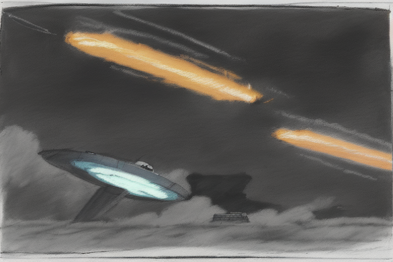

# CHAPITRE 09 : La Traque Numérique

> *« Le commandement du Front d'Ostre m'a envoyé 3 dépêches chiffrées cette nuit pour réclamer le retour des exosquelettes de la Section Noire. Ils me disent que la glace craque sous les chenilles du maréchal Krov et que la Brèche ne tiendra pas 48 heures sans réserve lourde. Ils ont raison. Mais si je leur renvoie 12 blindés, la Brèche tombera dans 72 heures au lieu de 48. Si je prends ce qui se cache sous Kélar, il n'y aura plus jamais de front. »*
> — **Carnets personnels du Général Vane, Journal de bord du croiseur Bastion-Un**

{.chapter-illustration}

À l’intérieur du croiseur des sables *Bastion-Un*, qui avançait toutes chenilles hurlantes à travers le plateau de Zêta, la salle d’écoute électromagnétique baignait dans une pénombre verdâtre saturée d’ozone et de fumée de tabac froid.

24 opérateurs casqués, penchés sur leurs oscilloscopes à balayage continu, scrutaient le bruit de fond électromagnétique de tout l’hémisphère sud d’Oark. À chaque secousse du blindé de 800 tonnes qui écrasait des bancs de schiste sous ses patins d’acier, les gobelets d’aluminium vibraient sur les consoles et les ventilateurs du plafond crachaient une poussière fine qui sentait le gasoil brûlé et la graisse surchauffée.

Assis au bout de la troisième rangée, le lieutenant Borras n’avait pas touché à sa ration depuis 24 heures.

Ses yeux injectés de sang ne quittaient pas l’écran de corrélation spectrale — le moniteur chargé de croiser des milliers de fréquences pour y déceler une signature artificielle — où le général Vane l’avait fait consigner sous garde armée depuis leur retour du cratère d’Ambre. La vareuse grise de Borras, jadis si impeccablement boutonnée au réfectoire de Zêta-3, pendait sur ses épaules amaigries. Chaque fois qu’il fermait les paupières, le sourire insolent de Koda surgissait devant lui par-dessus son assiette de pâte protéinée, sa main lui ébouriffait les cheveux en l’appelant « Monsieur le Règlement », et les 5 mots maudits qu’il avait tapés lui-même au bas du rapport hebdomadaire lui brûlaient la rétine : *« Découverte signalée par l’éclaireuse Koda-09 d’un composant logique ancien non répertorié. »*

5 mots sur un formulaire administratif. 5 mots qui avaient vitrifié une montagne, tué 18 hommes dans la gorge d’Ambre et transformé sa seule amie d’enfance en bête traquée à travers 2 mondes.

Soudain, sur son moniteur secondaire, une ligne d’alerte jaune clignota.

— Général ! appela l’analyste en chef posté derrière Borras. Un retour du réseau d’écoute passif sur la bordure sud. L’avant-poste afistéaan *Boréal-9* — notre cible Krav-4 — a subi une coupure totale de son radar de conduite de tir et de sa balise haute fréquence cette nuit à 2 heures 14.

Le rideau de toile blindée du fond s’écarta. Le général Vane entra dans la travée, les mains croisées dans le dos de son manteau gris, suivi du docteur Arkan et du colonel Sévérin qui tenait une liasse de télégrammes urgents arrivés d’Aqi. Le souffle des climatiseurs faisait frémir les mèches couleur de cendre sur les tempes du vieux stratège.

— Une panne mécanique ? demanda Vane en s’arrêtant derrière le fauteuil de Borras.

— Les Afistéaans l’ont cru pendant 4 heures, mon général, répondit Borras d’une voix rauque en faisant défiler la bande d’enregistrement sur l’oscilloscope. Mais notre satellite zénithal — maintenu en orbite stationnaire à la verticale exacte du secteur — a capté la fin de l’onde porteuse au moment exact où leur émetteur de *Boréal-9* s’est éteint. Voici la courbe de coupure étalée sur 3 millisecondes.

Sur l’écran cathodique vert, au lieu de la chute en cloche irrégulière d’un condensateur ou d’un câble coupé à la pince, l’onde radio tombait à zéro selon une verticale géométrique absolue, accompagnée d’une harmonique à très haute fréquence, une vibration pure superposée à l’onde principale.

Le docteur Arkan se pencha par-dessus l’épaule du lieutenant, ses lunettes glissant sur son nez humide de sueur.

— C’est la même signature subatomique que lors de la neutralisation des 5 drones *Rapace* au-dessus de Zêta-3 ! s’exclama le physicien. L’entité a réécrit la conductivité atomique de l’antenne — la faculté même des atomes du métal à laisser circuler les électrons — à distance pour bloquer l’alerte générale !

— Et nous venons de décrypter le message logistique que le commandant de *Boréal-9* a envoyé par courrier optique ce matin à sa base arrière, ajouta l’analyste en chef en tendant un feuillet imprimé à Vane. Il n’y a eu aucun mort chez eux. Un seul jeune mécanicien de 19 ans assommé sans la moindre lésion interne… et le vol d’un unique scaphandre lourd NRBC modèle *Korsak-9* avec 4 cartouches de filtration au plomb-bismuth.

Un silence tendu tomba sur la travée d’écoute, troublé seulement par le cliquetis mécanique des téléscripteurs.

Vane posa lentement sa main gantée sur le dossier métallique du siège de Borras. Le lieutenant sentit les doigts d’acier du général peser près de sa nuque comme le tranchant d’une hache.

— Vous avez grandi avec l’éclaireuse Koda-09 dans les écoles techniques du secteur Nord de Plotéris, lieutenant Borras, dit Vane d’un ton presque courtois qui glaça le sang du jeune officier. Vous avez partagé son poste pendant 18 mois. Pourquoi une déserteuse accompagnée d’une machine invulnérable risquerait-elle sa vie pour voler un seul scaphandre antiradiation de 70 kilos chez les Afistéaans, sans prendre ni vivres, ni armes, ni véhicule ?

Borras déglutit péniblement. Chaque syllabe qui sortirait de sa bouche resserrerait le collet autour du cou de Koda. Mais le regard gris de Vane, fixé sur son profil, et la connaissance technique qu’avait déjà Arkan ne laissaient aucune place à une fausse piste.

— Parce que la machine n’a pas besoin de scaphandre, mon général, murmura Borras. Le scaphandre est pour Koda seule. Et les cartouches au plomb-bismuth des *Korsak-9* ne servent que dans les zones de contamination gamma supérieure à 15 sieverts.

Vane marcha jusqu’à la grande table cartographique centrale et fit projeter le secteur sud-est de *Boréal-9*. À moins de 30 kilomètres au sud de l’avant-poste afistéaan s’ouvrait l’immense plaie violacée du Bassin de Kélar : les Terres Mortes.

— Personne n’entre dans le Bassin de Kélar, intervint le colonel Sévérin. Même nos sondes blindées y grillent leurs circuits en 2 heures. Il n’y a aucun gisement d’isotopes exploitable, aucune eau, aucune garnison. Pourquoi s’enfonceraient-ils dans un fourneau atomique ?

— Parce qu’elle ne fuit pas, répondit Borras malgré lui, la gorge serrée par le souvenir de l’enthousiasme brûlant de son amie lorsqu’elle lui montrait ses relevés géologiques le soir à Zêta-3. Koda n’a jamais su fuir devant une énigme, général. Depuis le premier jour où elle a posé le pied sur cette planète, elle cherche à comprendre qui étaient les anciens habitants d’Oark et pourquoi ils ont disparu. Si la machine la guide vers Kélar, c’est qu’il y a un grand sanctuaire là-dessous.

Vane inclina la tête et zooma sur l’épicentre même du cratère irradié.

Là, sous une croûte de basalte vitrifié que 6 millénaires de tempêtes n’avaient pas réussi à recouvrir, les relevés gravimétriques anciens — ces mesures des infimes variations de la pesanteur qui trahissent les vides ou les masses denses cachés dans l’écorce rocheuse — indiquaient une anomalie de densité souterraine à 400 mètres de profondeur : une cavité cyclopéenne que toutes les expéditions de Condorcé avaient contournée à cause du mur de radiations mortelles.

L’équation venait de se résoudre d’elle-même, avec la netteté implacable d’un théorème d’algèbre.

La première fois, Koda était descendue dans un sanctuaire au nord de Zêta-3, et le Gardien en était sorti. La deuxième fois, acculée dans la gorge d’Ambre, la petite unité *Bricole* s’était fait sauter pour sceller le cristal central et empêcher Condorcé de s’en emparer. Aujourd’hui, l’entité restante traversait un désert gamma pour rejoindre un troisième nœud majeur.

— Ils vont chercher des données ou une liaison réseau dans un complexe souterrain, trancha Vane. Et tant qu’ils seront à 400 mètres sous la roche pour effectuer leur opération, ils seront dans une souricière à issue unique.

À cet instant, la porte du poste de transmission subspatiale s’ouvrit à la volée. Un officier chiffreur entra au pas de course, le visage livide, et tendit une dépêche bordée de rouge au colonel Sévérin.

— Flash Priorité Zéro en provenance de Sol-Morne, mon général ! dit Sévérin d’une voix qui tremblait légèrement après avoir parcouru les lignes. Les reconnaissances aériennes sur Aqi confirment que les 6 divisions blindées du maréchal Krov ont achevé leur concentration devant le Glacier d’Ostre. L’offensive générale afistéanne contre la Brèche d’Ostre et le pont ferroviaire du Dôme 4 va commencer d’une heure à l’autre ! Le Directoire vous donne l’ordre formel d’embarquer immédiatement la Section Noire et les réserves lourdes dans les cargos orbitaux pour défendre Plotéris !

Dans la travée d’écoute, tous les opérateurs — dont la moitié avaient une mère, une femme ou une petite sœur dans les galeries sous la glace de Plotéris — tournèrent leurs visages angoissés vers le général Vane.

Vane prit le télégramme entre ses doigts gantés, le lut une seule fois, puis le plia en 4 et le glissa dans la poche de son manteau sans qu’un seul muscle de sa joue couturée ne tressaille.

— Accusez réception avec un délai de transmission dû aux tempêtes ionosphériques d’Oark — ces violents orages magnétiques de la haute atmosphère qui brouillent les liaisons spatiales —, Sévérin, dit-il d’un calme glacial. Les cargos orbitaux resteront au sol. Les sapeurs et la garnison du Glacier d’Ostre tiendront la Brèche avec les moyens dont ils disposent.

— Mais mon général ! s’écria Sévérin, oubliant toute prudence hiérarchique. Sans nos exosquelettes lourds, les lignes de glace de la Redoute Nord vont être pulvérisées sous les obus thermobariques ! Les trains d’évacuation des enfants du Dôme 4 ne sont même pas encore tous partis !

— Et si je renvoie 12 exosquelettes sur Aqi dans un cargo qui mettra 14 heures de transit, colonel, ils arriveront juste à temps pour brûler dans les ruines de la gare ! répliqua Vane d’une voix qui claqua comme un coup de fouet dans le blindé. Alors que si la Section Noire me rapporte l’entité de Kélar cet après-midi, demain soir il n’y aura plus une seule division afistéanne en état de marcher sur toute la banquise d’Aqi !

Borras se leva brusquement de son siège, faisant grincer les rails au sol.

— Mon général ! Si vous envoyez la Section Noire les attaquer là-dedans, vous allez provoquer un second massacre ! Koda n’est pas votre ennemie, elle a même épargné ce gamin afistéaan à *Boréal-9* ! Laissez-moi descendre avec un émetteur radio dans le puits de Kélar, laissez-moi lui parler sur notre ancienne fréquence privée de Zêta-3… Si je lui dis que le Dôme 4 et les enfants d’Ostre sont sur le point de tomber, elle vous écoutera ! Elle viendra nous aider de son plein gré !

Vane se tourna lentement vers le jeune lieutenant. Sur son visage ravagé par la cicatrice de Kérensk, il n’y avait ni mépris ni colère — seulement l’immense et terrible fatigue d’un homme qui avait cessé de croire à la bonne volonté humaine depuis 30 ans.

— Cette nuit, lieutenant Borras, pendant que votre amie d’enfance faisait du tourisme moral chez nos ennemis avant d’aller visiter des ruines, la maternité du secteur Sud d’Ostre a perdu son groupe électrogène de secours, dit Vane d’une voix basse qui s’entendit jusqu’au fond du blindé. 19 nouveau-nés sont morts de froid dans leurs couveuses avant l’aube. Et dans quelques heures, des milliers de nos garçons vont mourir dans les tranchées de glace du Glacier d’Ostre pour nous acheter le temps d’agir ici. Je ne jouerai pas le salut de notre espèce sur la sensibilité d’une déserteuse de 26 ans.

Il se détourna vers son chef des opérations spéciales.

— Faites décoller la Section Noire du commandant Varek. 12 hommes en exosquelettes d’assaut lourds *Titan-IV* doublés au plomb, armement magnétique perforant et pylônes à impulsion de confinement. Qu’ils volent en rase-mottes sous la couverture radar et prennent position à l’entrée du gouffre de Kélar dès que les cibles seront descendues au fond.

— Ordre d’engagement concernant l’opératrice humaine, mon général ? demanda l’officier.

Les poings de Borras blanchirent sur le bord de sa console.

Vane contempla le point lumineux qui pulsait au cœur de la zone morte. Le diagnostic d’Arkan dans le cratère d’Ambre était formel : *l’entité semble dépendre de l’opérateur humain ou le protéger en priorité*. Si la fille donnait les ordres, l’abattre dès la première seconde priverait la machine de son commandement tactique avant qu’elle ne puisse ordonner une nouvelle Sublimation.

— La machine doit être capturée intacte à tout prix, ordonna Vane. Quant à l’éclaireuse Koda-09… abattez-la sans sommation dès le premier contact visuel.

Les jambes de Borras se dérobèrent sous lui ; il retomba lourdement sur son tabouret d’acier, le souffle coupé.

— Vous m’aviez promis qu’on la ramènerait vivante pour l’interroger, mon général… souffla-t-il d’une voix éteinte, les yeux rivés à ses propres mains qui tremblaient au-dessus du clavier.

Vane s’arrêta sur le seuil de la travée d’écoute et tourna à demi la tête vers le jeune officier des transmissions. Dans la lueur verdâtre des oscilloscopes, la vieille brûlure de phosphore sur sa joue ressemblait à une crevasse de glace.

— Une arme qui obéit à 2 maîtres n’obéit à personne, lieutenant, dit-il sans la moindre inflexion de haine. Tant que cette jeune femme respirera à côté de l’entité, l’artefact défendra ses ordres contre les nôtres. Lorsque vous avez rédigé votre rapport de routine à Zêta-3, vous avez fait votre devoir de soldat de Condorcé. Aujourd’hui, j’achève le mien. Vous resterez assis à cette console jusqu’à la fin de l’assaut : c’est à ce prix que Plotéris verra le printemps.

Le rideau blindé retomba derrière le général, tandis qu’à 400 millions de kilomètres de là, sous le ciel d’étain d’Aqi, le tonnerre de la grande offensive commençait à déchirer le Glacier d’Ostre.
