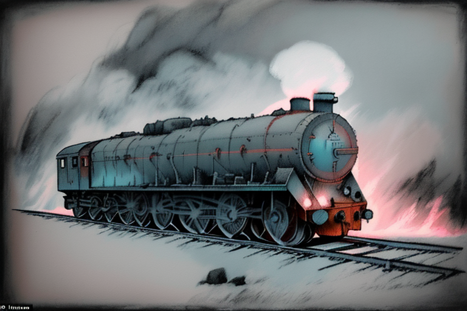

# CHAPITRE 10 : Le Dernier Convoi d'Ostre

> *« … T'as vu comme il roule bien, ton train, princesse ? C'est moi qui ai graissé l'aiguillage du pont, alors t'as rien à craindre, ça va filer tout droit jusqu'aux grandes cavernes du Sud. Moi ? Oh, je prends juste le wagon suivant, le sergent Darnel m'a demandé de resserrer un dernier gros boulon sur la chaudière avant de fermer la boutique… Dis, Lina… tu me croiras jamais : la neige qui tombe par le toit, elle est toute tiède ce matin. On dirait presque du sable doré… »*
> — **Transmission radio d'urgence de la vanne B-12 (Fréquence opérationnelle du secteur d'Ostre — Archive des boîtes noires orbitales de Sol-Morne, durée : 47 secondes)**

{.chapter-illustration}

Lorsque les 300 canons thermobariques du maréchal Krov ouvrirent le feu simultanément à 5 heures 12 du matin, le Glacier d’Ostre ne fondit pas : il prit feu.

Sur 12 kilomètres de front, de la Redoute Nord jusqu’aux falaises d’Anthracite, la nuit polaire bascula d’un coup dans un jour chimique couleur de soufre et de sang. Les ogives à aérosol carburant éclataient à 10 mètres au-dessus des tranchées de Condorcé, dispersant un brouillard volatil qui aspirait tout l’oxygène des boyaux avant de transformer l’air lui-même en un mur de flammes à 2 000 degrés et en une onde de surpression qui pulvérisait la banquise millénaire en geysers de vapeur hurlante.

Projeté contre la paroi d’étaiement par le troisième impact, le caporal Soren « Demi-Volt » Valen s’arracha d’un amas de poutres brisées et de neige noire en crachant de la poussière de charbon dans son masque fêlé.

— Debout là-dedans ! hurla-t-il en empoignant par le col de sa capote le jeune Milo qui gisait à demi assommé près de la chaufferette renversée, les mains plaquées sur ses oreilles qui saignaient sous son casque. Reste pas couché, p’tit gars, le plafond de glace va s’effondrer ! Attrape ton fusil !

Dans l’étroit couloir de la sape qui tremblait comme un tambour crevé, l’air brûlant des explosions de surface se mêlait par bouffées folles au gel de moins 50 degrés qui s’engouffrait par les brèches. Là-haut, à travers la fumée grasse et les rideaux d’eau bouillante qui retombaient aussitôt en verglas sur les épaulières des survivants, un grondement sourd, mécanique, monstrueux, couvrait désormais les sifflements d’obus : le roulement de 60 chars d’assaut lourds afistéaans qui venaient de franchir les barbelés pulvérisés et fonçaient à pleins gaz vers la Brèche d’Ostre.

Et derrière les tranchées de la Troisième Compagnie, là où auraient dû se dresser les tourelles des exosquelettes lourds de la réserve stratégique retenus sur Oark par le général Vane, il n’y avait rien. Rien que 200 sapeurs épuisés, des fusils magnétiques encrassés par le givre, et le grand pont ferroviaire à treillis d’acier — cette charpente aérienne de poutrelles entrecroisées en triangles rigides — qui enjambait le canyon d’Ostre à 800 mètres en contrebas.

Lorsque Soren émergea dans la tranchée principale en soutenant Milo d’un bras, le spectacle lui coupa le souffle.

La moitié du parapet de glace bleue avait disparu. Au poste de tir central, le vieux sergent-chef Darnel, le bras gauche fracassé ballant dans sa manche déchirée, tirait d’une seule main avec la mitrailleuse lourde sur les silhouettes couleur de rouille qui jaillissaient déjà du brouillard. Parmi ces ombres qui couraient sous le barrage d’acier se trouvait peut-être Kael Drov, le garçon de Val-Noir aux yeux clairs dont l’attelle d’aluminium serrait encore le poignet gauche de Soren sous sa manche, emporté malgré lui dans la même tempête de fer qui broyait tout.

— Repli général vers la tête de pont ! rugit Darnel en voyant Soren surgir de la fumée. La ligne est percée au nord et au sud ! Les blindés de Krov tournent la redoute ! Tout le monde en arrière vers la voie ferrée !

Un hurlement de sirène à vapeur monta soudain du fond de la vallée glacée, long, déchirant, familier.

Le cœur de Soren cessa de battre une seconde.

En contrebas de la crête ravagée, sortant tout juste du tunnel souterrain qui arrivait du Dôme 4 de Plotéris, une longue chenille d’acier sombre marquée de grandes croix rouges peintes à la chaux sur les toits des wagons s’engageait à pleine vapeur sur la rampe d’approche du pont d’Ostre : le dernier train sanitaire d’évacuation. Le train de la crèche géothermique et de l’hôpital des enfants.

Le train de Lina.

— Le convoi d’évacuation n’a pas encore franchi le canyon ! cria Soren d’une voix qui se brisa d’épouvante. Sergent, ils arrivent seulement à l’aiguillage de la culée nord — le massif de béton qui ancre l’entrée du pont dans la falaise !

Au même instant, une salve de roquettes lourdes s’abattit sur les conduites géothermiques aériennes qui longeaient la paroi à 100 mètres au-dessus de la voie ferrée.

Dans un fracas de tonnerre, le collecteur principal de vapeur haute pression explosa. Un geyser titanesque de gaz brûlant jaillit vers le ciel gris, et sur le cadran lumineux du château d’eau qui commandait les vérins hydrauliques du pont ferroviaire, l’aiguille de pression plongea dans le rouge. 500 mètres plus bas, dans un crissement d’acier audible malgré la bataille, les freins de sécurité automatiques de la lourde barrière de glace et le verrouillage de l’aiguillage d’entrée du pont se bloquèrent à mi-course devant la locomotive du train sanitaire qui freinait dans une gerbe d’étincelles.

Si le convoi s’immobilisait 3 minutes devant l’aiguillage bloqué, les chars de pointe afistéaans qui dévalaient déjà le glacis nord arriveraient à portée de tir direct du pont. Et pire encore : la surpression en retour dans la chambre des vannes secondaires B-12, logée sous le pilier d’entrée, allait faire éclater la chaudière de compensation et emporter le tablier du pont avec les 12 wagons d’enfants.

— La station de dérivation manuelle B-12 ! hurla Darnel, le visage livide sous la suie. Le boîtier électrique et le téléphone filaire ont sauté ! Il faut quelqu’un dans la casemate des vannes B-12 — le bunker bétonné encastré sous la culée — pour fermer le by-pass, le conduit de délestage secondaire, à la main et maintenir le levier d’ouverture des vérins pendant que le train passe !

Mais la casemate des vannes, bâtie à flanc de falaise juste devant l’entrée du pont, se trouvait désormais à découvert sous le feu croisé des canons d’assaut ennemis qui avançaient à 400 mètres. Y entrer pendant le passage d’un convoi de 12 wagons lourds, c’était renoncer à toute chance de monter dans le dernier fourgon.

Soren ne réfléchit même pas une demi-seconde.

Il poussa rudement le jeune Milo dans les bras valides d’un caporal qui dévalait le boyau d’évacuation, arracha sa lourde sacoche de sapeur et saisit le vieux Darnel par le revers de son manteau ensanglanté.

— Embarquez les gars dans le fourgon de queue quand le train passera, sergent ! lança Soren, ses yeux noisette brûlant d’une clarté terrible au milieu de son visage noirci. Et si vous passez par le wagon 4… dites à la petite fille au cheval de cuivre que son frère lui envoie du vent chaud !

— Soren, non ! Pas tout seul, gamin ! cria Darnel en essayant de le retenir de son bras valide. Le régulateur de pression est fendu, la chambre va se remplir de vapeur bouillante dès que tu fermeras la purge !

Mais Soren avait déjà dégagé son épaule d’une torsion souple et dévalait la pente de verglas à tombeau ouvert sous les balles traçantes — ces projectiles enduits de sels pyrotechniques qui laissaient derrière eux un sillage lumineux vert pour permettre aux tireurs de corriger leur visée dans le brouillard.

Il glissa sur 10 mètres au fond d’une rigole de glace fondue, sauta par-dessus un entonnoir fumant, entendit 2 projectiles magnétiques claquer à un pouce de son casque, et se jeta tête la première contre la porte blindée de la station des vannes B-12, juste sous l’arche cyclopéenne du pont d’Ostre.

Le loquet extérieur était tordu par un éclat. Soren le fit sauter d’un coup de talon, s’engouffra dans la casemate de béton et referma le vantail d’acier derrière lui au moment même où la locomotive blindée du train sanitaire s’arrêtait en hurlant de tous ses patins à 30 mètres de l’aiguillage verrouillé.

À l’intérieur de la chambre des vannes, c’était l’enfer d’une salle des machines en train de couler.

Les manomètres de fonte avaient éclaté ; des jets de vapeur à 140 degrés fusaient des joints rivetés dans un sifflement assourdissant qui transformait l’air glacial en un brouillard brûlant et aveuglant. Tout au fond, contre le mur de soutènement du pont, le grand volant d’acier de la vanne de dérivation — une roue dentée d’un mètre de diamètre dont le servomoteur électrique pendait, calciné — refusait de tourner, tandis que le levier de maintien hydraulique de l’aiguillage vibrait sous la contre-pression, prêt à retomber au cran de fermeture dès qu’on le lâcherait.

Soren se jeta sur le grand volant d’acier.

À travers le cuir mouillé de ses moufles, le métal chauffé à blanc par la conduite rompue lui mordit les paumes comme un fer rouge. Il hurla dans son masque, arc-bouta ses bottes ferrées contre le socle de fonte et tira de toutes les forces de ses 22 ans.

Les dents d’engrenage grincèrent. Un cran. 2 crans.

Dehors, un obus de char de 90 millimètres percuta de plein fouet l’angle supérieur de la casemate.

L’explosion éventra le tiers de la dalle de béton du plafond. Une averse de gravats, de poutrelles tordues et d’éclats d’acier s’abattit dans la chambre saturée de vapeur. Une lame de fonte déchira la capote de Soren au niveau du flanc droit et s’enfonça profondément sous ses côtes, le projetant à genoux contre le collecteur.

Pendant 3 secondes, le monde chavira dans un voile noir piqué d’étoiles rouges. Un sang chaud, épais, emplit sa bouche et coula le long de son menton dans son respirateur arraché.

Puis, à travers la brèche fumante du mur qui donnait sur la voie ferrée à 10 mètres en surplomb, un son traversa le fracas des explosions : le pleur étouffé d’un enfant derrière les volets d’acier du troisième wagon immobilisé.

Soren rouvrit les yeux. Il cracha le sang qui l’étouffait, arracha ses moufles en lambeaux qui fumaient et, de ses 2 mains nues déjà cloquées par les brûlures, empoigna de nouveau le volant d’acier brûlant et le levier de maintien.

Avec un cri rauque qui venait du fond de son enfance dans les mines du Dôme 4, il pesa de tout son poids sur la barre jusqu’à l’abattre en butée.

*CLAC.*

Sur la voie extérieure, les lourds vérins d’aiguillage s’ouvrirent en chasse-neige dans un rugissement de pistons libérés. Pourtant, aveuglé par les geysers de vapeur qui masquaient le sémaphore mécanique et voyant le câble du téléphone filaire pendre dans le vide, le mécanicien de la locomotive blindée hésitait encore à engager son convoi sur le tablier.

Et dès que Soren relâchait sa prise d’un millimètre sur le levier dont le cliquet de retenue avait été brisé par l’obus, la pression furieuse de la vapeur repoussait la barre vers la fermeture : si le levier remontait avant que le dernier wagon n’ait franchi l’aiguille, le train déraillerait au milieu du pont, au-dessus de 300 mètres de vide.

Le sang coulait à flots de son flanc ouvert sur le plancher de tôle verglacé. Ses bras commençaient à trembler ; ses genoux se dérobaient sous lui.

Alors, de sa main gauche soutenue par l’attelle d’aluminium de Kael et dont la peau brûlée collait à l’acier du levier, Soren maintint la barre abaissée en y appuyant tout son torse, tandis que sa main droite plongeait dans la poche intérieure de sa vareuse déchirée.

Ses doigts ensanglantés rencontrèrent la bobine. Sa vieille bobine de fil de cuivre rouge de 2 millimètres, celle avec laquelle il réparait les chaufferettes de ses camarades, les grille-pain de l’orphelinat et les petits chevaux mécaniques de sa sœur.

Tour après tour, en serrant les dents jusqu’à se briser l’émail, Soren enroula le fil de cuivre autour de la poignée du levier et de l’étrier fixe du bâti de fonte. 5 tours. 10 tours. 15 tours. Il prit sa pince plate tombée à ses pieds, saisit les 2 brins libres et les torsada de toutes ses forces restantes jusqu’à ce que le cuivre morde dans le fer et bloque définitivement le mécanisme en position ouverte.

Puis, voyant que la locomotive restait immobile derrière le rideau de vapeur, Soren tendit le bras vers le coffret mural du transmetteur radio d’urgence à ondes courtes de la casemate B-12 — l’émetteur blindé alimenté par batterie au plomb qui diffusait en direct sur la fréquence opérationnelle générale du secteur d’Ostre et vers les relais orbitaux de Plotéris.

Le combiné pendait au bout de son cordon. Avec le dernier brin de son fil de cuivre, Soren ligatura à bloc la pédale latérale d’émission du microphone pour la verrouiller en ouverture continue, rabattit le bras articulé du micro à hauteur de son visage et cria de toutes les forces qui lui restaient dans ses poumons brûlés :

— Ici le caporal Valen dans la casemate des vannes B-12 ! Le by-pass est fermé, j’ai ligaturé l’aiguillage en ouverture, la pression tient ! Mécanicien du convoi sanitaire du Dôme 4, poussez les feux ! Passez le pont à pleine vapeur, ne freinez pas !

2 secondes plus tard, la sirène de la locomotive lui répondit par un coup bref à travers la brume, et le convoi s’ébranla dans un tonnerre de bielles.

Au-dessus de sa tête, le pont d’Ostre tout entier se mit à trembler sous le roulement sourd des wagons qui prenaient de la vitesse.

Wagon 2. Wagon 3. Wagon 4.

Incapable de se relever, Soren se laissa glisser le long du pilier de fonte et s’assit dans la neige et la vapeur qui tourbillonnaient par le toit crevé, le dos appuyé contre la vanne ligaturée, le visage tourné vers la brèche du mur et le microphone du transmetteur radio d’urgence toujours ouvert à 10 centimètres de ses lèvres.

À 10 mètres devant ses yeux qui se voilaient déjà, les grandes croix rouges défilaient dans le blizzard. Au passage du quatrième wagon, juste derrière une étroite lucarne blindée dont quelqu’un venait d’essuyer la buée de l’intérieur avec une manche de laine trop grande, Soren crut distinguer 2 immenses yeux clairs et l’éclat minuscule d’un jouet de cuivre pressé contre la vitre.

Puis le wagon 5 passa. Le wagon 8. Le fourgon de queue, d’où le vieux sergent Darnel et une poignée de sapeurs noircis de poudre tiraient encore par les meurtrières sur les chars afistéaans qui débouchaient sur la crête.

Le train entier était sur le pont. Encore 30 secondes, et il s’engouffrerait dans le tunnel blindé de la rive sud, hors d’atteinte des canons de Krov.

Mais au pied de la falaise nord, 2 chars d’assaut ennemis venaient de s’arrêter à 150 mètres de la casemate éventrée. Leurs tourelles pivotèrent lentement vers le panache de vapeur qui s’échappait du réduit.

Soren ne sentait plus la douleur dans son flanc. Il ne sentait même plus la morsure des moins 50 degrés sur ses mains brûlées. Une torpeur étrange, cotonneuse, incroyablement douce, montait de ses bottes vers son cœur qui battait de plus en plus lentement.

Avec des gestes infiniment lents, il fouilla une dernière fois sous le pan de sa capote trempée de sang rouge : son petit magnétophone à cassettes *Sonor-3* avait eu le moteur broyé par l’éclat de fonte qui lui avait ouvert les côtes, ses bobines figées à jamais. Mais juste au-dessus de sa tête, le voyant rouge du transmetteur radio d’urgence de la casemate B-12 brillait toujours dans la vapeur, diffusant sur toute la fréquence d’Ostre et de Plotéris. Peut-être qu’un opérateur du train sanitaire ou une écouteuse de Sol-Morne entendrait sa voix et transmettrait ses mots au Dôme 4.

Soren serra le vieux magnétophone mort et la photographie de Lina contre sa poitrine, et approcha ses lèvres pâles du microphone radio ouvert où les flocons de neige fondaient sans bruit.

— Central radio… si quelqu’un m’entend au Dôme 4, passez ça à ma petite sœur Lina Valen, à la crèche géothermique… murmura-t-il, et sa voix, bien que réduite à un souffle rauque entrecoupé de pauses, gardait ce sourire lumineux qui n’avait jamais su céder à la nuit. Salut, princesse… T’as vu comme il roule bien, ton train ? C’est… c’est moi qui ai graissé l’aiguillage du pont avec mon fil de cuivre, alors t’as rien à craindre, ça va filer tout droit jusqu’aux grandes cavernes du Sud…

Au loin, le sifflet de la locomotive retentit une dernière fois en entrant sous le tunnel de la rive opposée : le convoi était passé. Lina était sauvée.

Un sourire d’une paix absolue éclaira le visage de 22 ans du caporal-sapeur.

— Moi ? reprit-il tout bas devant le micro d’urgence tandis qu’un jet de vapeur blanche l’enveloppait comme un drap chaud. Oh, je prends juste le wagon suivant, t’inquiète pas… Le sergent Darnel m’a demandé de resserrer un dernier gros boulon sur la chaudière avant de fermer la boutique… Et tu sais, Lina, faut détester personne… Cette nuit, au fond d’une crevasse dans la glace, je suis tombé sur un éclaireur d’en face qui avait mon âge et une petite sœur comme toi à Val-Noir… Il m’a donné son attelle pour mon poignet, et je lui ai laissé ma chaufferette…

Il souleva péniblement son bras gauche bandé par l’attelle de Kael et frotta 2 fois la manche rugueuse de sa vareuse contre la grille métallique du microphone radio pour imiter, comme sur ses vieilles cassettes, le bruissement d’une brise d’été sur les dunes.

— Tu l’entends à la radio, princesse ? C’est le vent du sable chaud… Dehors, à 100 mètres dans la brume, la culasse du premier char d’assaut venait de claquer. À travers le toit éventré de la casemate, les nuages de vapeur illuminés par les incendies lointains avaient pris une teinte dorée, profonde, flamboyante — exactement la couleur des dunes peintes sur les vieilles affiches de la gare du Dôme 4.

— Dis, Lina… souffla-t-il dans un dernier murmure tandis que sa tête s’inclinait lentement contre le volant d’acier ligaturé de cuivre. Tu me croiras jamais… La neige qui tombe par le toit, elle est toute tiède ce matin. On dirait presque du sable doré… J’ai plus froid du tout, p’tite sœur. Je crois… je crois que je vois enfin le soleil d’Oark. Dors bien au chaud… Terminé pour…

Le fracas de l’obus couvrit la dernière syllabe dans un rugissement de tonnerre blanc qui coupa net la porteuse ; mais à 18 000 kilomètres au-dessus des décombres fumants de la Brèche d’Ostre, dans les boîtes noires des satellites de commandement d’Aqi et dans la mémoire silencieuse d’ÉCHO-8471, les 47 secondes radio de la vanne B-12 venaient d’entrer dans l’éternité.
