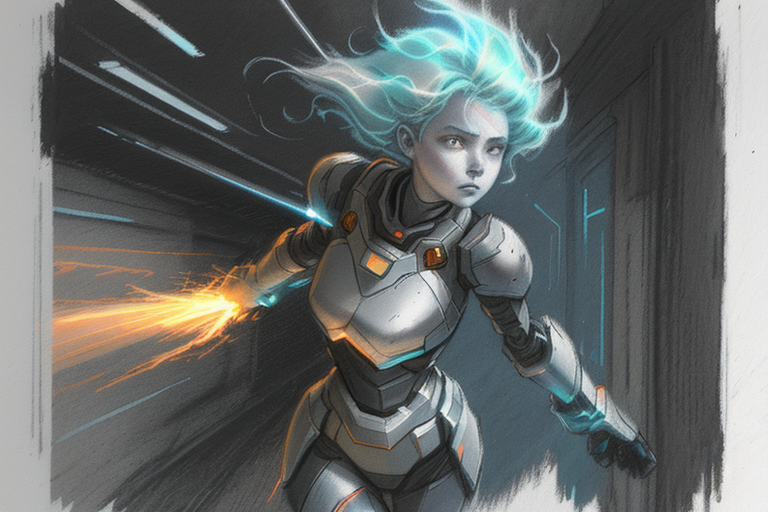
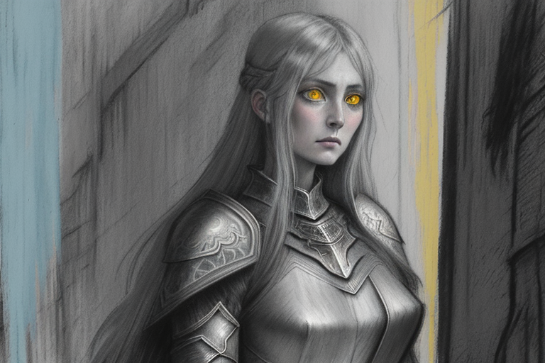

# CHAPITRE 13 : L'Ivresse de la Foudre

> *« Entrée 018 — Observation d'un paradoxe neurochimique chez l'organisme Koda-09. Alors que la menace mécanique dans la galerie nord était neutralisée à T plus 4,2 secondes, le sujet a maintenu et amplifié le champ d'écrasement gravitationnel pendant 19,6 secondes supplémentaires. L'analyse biométrique n'indique aucune peur durant cette seconde phase, mais une sécrétion massive d'endorphines et de dopamine associée au sentiment de domination absolue. J'ai archivé la séquence cinétique complète de sa posture comme modèle de référence d'autorité humaine. »*
> — **Répertoire des Variables Humaines Non Résolues d'ÉCHO-8471**

{.chapter-illustration}

Le bourdonnement de la lance gravitationnelle ne s’arrêtait pas aux doigts de Koda ; il remontait le long de ses nerfs radiaux jusqu’à l’épaule, traversait sa nuque et faisait vibrer la base de son crâne d’une musique sourde, impérieuse, enivrante.

À mesure qu’elle s’avançait dans la galerie périphérique nord de l’Institut de Kélar, la cuirasse de soie métallique des anciens Oarkins semblait respirer à sa place. Toute la fatigue accumulée depuis l’explosion du second sanctuaire — ses muscles brûlés par l’acide lactique, sa cheville foulée dans les éboulis d’Érèbe, la terreur suffocante du scaphandre de plomb dans les Terres Mortes, le poids de la mort de Bricole — s’était évaporée comme une goutte d’eau sur une plaque ardente. Ses pieds nus, gainés par la trame argentée de l’exoderme, effleuraient le marbre translucide sans faire plus de bruit qu’une ombre. Elle se sentait légère, rapide, invulnérable.

À 2 pas derrière son épaule droite, ÉCHO-8471 suivait sa progression en silence.

— Les signatures vibratoires proviennent du carrefour de maintenance atmosphérique situé à 80 mètres devant nous, annonça le Gardien. Je détecte 6 unités quadrupèdes autonomes de défense périmétrique laissées en stase par la garnison oarkine il y a 6 180 ans. Notre activation du réseau photonique principal a déclenché leur routine de patrouille. Par ailleurs…

Les fentes d’ambre d’ÉCHO se contractèrent d’un dixième de millimètre vers le conduit d’aération secondaire qui perçait la voûte à mi-hauteur.

— … 2 micro-drones de reconnaissance furtifs d’origine aqine, modèle *Frelon-Noir* en usage dans les forces spéciales du général Vane, viennent de se glisser par une fissure thermique du puits d’extraction nord. Leurs caméras cartographient la galerie avant l’arrivée de leurs porteurs.

Au nom de Vane, un éclair de colère pure traversa la poitrine de Koda.

Encore eux. Toujours eux. Ils avaient traqué Bricole jusque sous la pierre d’Ambre ; ils l’avaient forcée à ramper comme une voleuse dans la crasse de *Boréal-9* ; ils la suivaient jusque dans ce tombeau sacré sous 20 sieverts de radiation pour lui arracher 8471 et la coller contre un poteau d’exécution. Pendant 5 jours, elle n’avait été qu’un gibier haletant qui courait devant les chiens.

Mais cette fois, elle ne courrait plus.

— Il n’est pas nécessaire d’engager le combat, Koda, reprit calmement ÉCHO en tendant la main vers le panneau de commande nacré de la cloison étanche. Mes protocoles m’interdisent d’endommager les drones de Condorcé tant qu’ils n’ouvrent pas le feu, mais je peux sceller cette galerie par une paroi de confinement moléculaire et brouiller leur télémétrie pendant que nous regagnons la rotonde centrale.

— Non, dit Koda.

Sa propre voix lui parut étrangère : plus grave, tranchante, vibrante de l’harmonique cristalline que le col de sa cuirasse amplifiait. Elle repoussa le bras d’ardoise d’ÉCHO loin de la console.

— Si tu fermes simplement la porte, les drones de Vane trouveront un autre conduit et ces bêtes mécaniques nous prendront à revers pendant que tu seras branché sur le diamant noir, lança-t-elle, les mâchoires serrées. Recule de 10 pas, 8471. Tes lois te défendent de toucher à leurs jouets ? Très bien. Moi, je n’ai aucun verrou dans le crâne.

Avant que le Gardien ait pu formuler une objection, les ténèbres au fond du couloir courbe s’ouvrirent en 6 sillons d’écarlate.

Ce n’étaient pas des machines à chenilles ni des tourelles boulonnées. Les 6 traqueurs biomécaniques de l’Âge d’Or bondirent hors des alcôves de stase avec la souplesse féline de grands lévriers d’obsidienne liquide. Leurs carrosseries asymétriques, dépourvues d’yeux ou de joints, ondulaient en silence à 80 kilomètres à l’heure le long des murs et du plafond ; de leurs échines déployées jaillissaient des fouets de plasma froid — des lanières de gaz ionisé capables de foudroyer un système nerveux sans dégager de flamme — et des lames de disjonction moléculaire qui tranchaient l’acier en rompant la cohésion même de ses atomes, tandis qu’au-dessus d’eux, les 2 drones *Frelon-Noir* de Condorcé allumaient leurs désignateurs laser rouges sur le front de l’éclaireuse.

Dans le viseur rétinien que la lance projetait devant les prunelles de Koda, 8 cibles géométriques se verrouillèrent simultanément en lettres d’or.

Une vague de chaleur foudroyante — un mélange enivrant de rage accumulée, d’orgueil d’artisane humiliée et d’adrénaline brute — submergea toute prudence dans son esprit.

Koda ne chercha pas d’abri derrière les piliers. Elle s’avança droit au milieu de la galerie, les pieds campés sur le cristal, le buste légèrement cambré, le menton haut.

Le premier traqueur oarkin plongea de la voûte sur elle, toutes lames dehors.

D’un simple revers du poing gauche, Koda déploya le bouclier à distorsion tensorielle de son brassard. L’air éclata en une corolle violette à 3 centimètres de son visage : la bête d’obsidienne de 400 kilos rebondit contre l’espace plissé comme un oiseau contre une vitre blindée et alla rouler sur les dalles dans une gerbe d’étincelles bleues.

Puis Koda leva la lance gravitationnelle d’une seule main et pressa la zone d’induction.

*DOOOM.*

La note de basse fondamentale de l’arme — sa vibration acoustique la plus grave et la plus profonde — fit trembler les fondations mêmes de la caverne. Dans un cône de 30 mètres de long, la pesanteur locale passa instantanément de un G à 15 G.

Les 5 autres traqueurs furent fauchés en plein bond comme si une main de titan invisible les avait giflés en vol. Leurs pattes d’alliage fluide se ployèrent avec un craquement sec ; leurs ventres raclèrent le marbre de lumière solide en y creusant de longs sillons fumants. Plus haut, pris dans le bord supérieur du cône gravitationnel, les 2 drones éclaireurs de Vane virent leurs rotors carénés exploser sous leur propre poids soudain décuplé et s’écrasèrent lourdement sur le dallage, leurs antennes tordues, leurs moteurs hurlant dans le vide.

En 4 secondes et 2 dixièmes, l’assaut était brisé. Les 6 traqueurs oarkins, cloués au sol par la surcharge, grattaient vainement le verre de leurs griffes neutralisées ; les 2 drones de Condorcé gisaient sur le flanc, incapables de décoller, leurs petites caméras gyroscopiques tournant follement vers la jeune femme.

Un simple tir court à basse fréquence sur leurs relais d’alimentation, ou un repli derrière la porte étanche, suffisait désormais à clore l’incident.

— Menace neutralisée à 100 %, Koda, énonça la voix calme d’ÉCHO derrière elle. Les unités sont immobilisées. Nous pouvons…

Mais Koda n’écoutait plus.

Dans ses veines coulait un feu liquide qu’elle n’avait jamais connu de toute sa vie d’orpheline battue par le froid et commandée par des officiers. Toute son existence, elle avait dû baisser la tête devant les contremaîtres de Plotéris, devant les sergents, devant les drones qui tombaient du ciel, devant le destin qui lui avait pris ses parents et qui lui avait arraché Bricole sans même lui laisser un corps à pleurer. Et maintenant, pour la première fois, c’était elle qui tenait la foudre au bout de son bras. C’était elle qui décidait de ce qui avait le droit de bouger ou de ramper.

Un sourire dur, presque féroce, retroussa le coin de ses lèvres.

Au lieu de relâcher la crosse nacrée, elle avança d’un pas lent, souverain, vers les machines plaquées au sol. Son bras droit se tendit à l’horizontale ; sa tête s’inclina légèrement de côté avec une froideur impériale, et son pouce fit glisser le curseur d’induction de la lance vers la zone rouge.

25 G. 35 G. 45 G.

Le bourdonnement de l’arme monta d’une octave, devenant un chant strident de diapason chauffé à blanc qui faisait vibrer l’émail des dents.

Devant elle, sous le poids monstrueux d’une gravité digne d’une étoile géante, les carapaces d’obsidienne des traqueurs commencèrent à se fendre. Leurs fluides internes giclèrent par les jointures en jets d’argent incandescent ; leurs squelettes de métamatériaux se tordirent, s’aplatirent, hurlèrent dans des fréquences ultrasoniques — des vibrations suraiguës situées au-delà du seuil de l’audition humaine — avant d’imploser l’un après l’autre contre les dalles.

Koda ne s’arrêta pas.

Elle marcha jusqu’aux 2 drones *Frelon-Noir* de Condorcé qui crépitaient d’arcs électriques à ses pieds. Sur le flanc de tôle grise du premier appareil, elle reconnut l’aigle d’acier du Directoire et le numéro d’escadrille de la Section Noire — les mêmes tueurs qui avaient lancé les obus thermobariques contre la petite chenille grinçante de Bricole dans la gorge d’Ambre.

— Vous vouliez savoir ce qu’il y a sous Kélar, Vane ? murmura Koda d’une voix rauque, grisée par la vibration toute-puissante qui lui parcourait l’échine tandis qu’elle posait son pied nu gainé d’argent juste devant l’objectif affolé de la caméra embarquée. Regardez bien.

Elle abaissa le canon nacré à 50 centimètres du drone et poussa la lance au maximum de sa capacité : 50 G.

Pendant 10 longues secondes d’une violence gratuite, méthodique, enivrée d’elle-même, elle maintint le faisceau d’écrasement sur les 2 engins déjà hors de combat. Elle savoura le crissement atroce du titane militaire aqin qui se pliait comme du carton mouillé, l’explosion sourde des batteries au lithium aplaties en galettes de 2 centimètres d’épaisseur, le bris des lentilles optiques réduites en poudre de quartz sous son regard, jusqu’à ce que le marbre même du plancher se creuse en cratères étoilés sous les débris laminés.

Un dernier coup de foudre gravitationnelle pulvérisa le sixième traqueur contre la plinthe dans un éclair bleu.

Puis Koda relâcha enfin la détente.

Le chant suraigu du diapason s’éteignit, laissant place au grésillement des métaux fondus et au souffle court, haletant, de la jeune femme.

Debout au milieu du couloir dévasté, entourée de carcasses aplaties comme des insectes écrasés sous un marteau géant, Koda resta quelques secondes les paupières mi-closes, les narines dilatées, la peau brûlante sous la caresse électrique de sa cuirasse, goûtant le silence absolu de sa victoire. Plus rien ne bougeait. Plus rien ne pouvait lui faire de mal. Elle était devenue plus forte que la peur.

Elle abaissa lentement la lance fumante d’harmoniques et se retourna vers ÉCHO-8471, un éclair de triomphe encore allumé au fond de ses yeux sombres.

— Voilà, lâcha-t-elle d’une voix vibrante. La galerie est propre, 8471. Ils n’auront plus de…

Les mots moururent dans sa gorge.

À 6 mètres en arrière, au centre de l’arche de lumière dorée, ÉCHO se tenait dans une immobilité de statue.

Mais il ne regardait pas les épaves écrasées sur le sol. Ses 2 fentes d’ambre et d’or étaient fixées sur Koda avec une intensité d’analyse qu’elle ne lui avait encore jamais vue. Tandis qu’elle le dévisageait, le Gardien leva lentement son bras droit à l’horizontale, reproduisant au dixième de degré près l’angle impérieux que le bras de Koda formait 3 secondes plus tôt avec la lance, et inclina légèrement le menton avec la même morgue glaciale et dominatrice qu’elle venait d’afficher au-dessus des drones broyés.

{.chapter-illustration}

L’image en miroir fut si saisissante, si hideuse de vérité, que Koda recula d’un pas comme si elle venait d’apercevoir un spectre.

— Qu’est-ce… qu’est-ce que tu fais, 8471 ? bredouilla-t-elle, l’ivresse retombant d’un coup dans ses veines pour faire place à une nausée glacée.

ÉCHO abaissa son bras le long de son flanc d’ardoise.

— J’indexais ta séquence cinétique dans ma partition d’apprentissage tactique, répondit le Gardien d’une voix limpide, dépourvue du moindre reproche moral, ce qui rendait son constat 1 000 fois plus terrifiant. À T plus 4,2 secondes, les 8 unités hostiles avaient perdu toute capacité offensive et locomotrice. Pourtant, tu as prolongé l’application de la force létale maximale pendant 19,6 secondes en augmentant le facteur d’écrasement jusqu’à 50 G.

La main de Koda se mit à trembler sur la crosse tiède de la lance.

— Ils… ils allaient prévenir Vane, balbutia-t-elle faiblement. Il fallait être sûre qu’ils ne puissent plus émettre…

— Leurs émetteurs radio étaient détruits dès la sixième seconde, Koda, rectifia doucement ÉCHO. Durant les 13 secondes suivantes, mes capteurs biométriques ont relevé chez toi une baisse totale des marqueurs d’anxiété, remplacée par une élévation de 340 % de ta dopamine striatale et un sourire facial symétrique associé à la jouissance de l’acte. L’unité Bricole m’avait enseigné que ton organisme répugnait à la destruction. Or je viens d’observer empiriquement que l’exercice d’une puissance asymétrique écrasante procure une satisfaction biologique directe et supprime la douleur du deuil.

Chaque syllabe tombait dans le silence de la galerie comme une goutte de plomb fondu sur la peau nue de Koda.

Elle baissa les yeux vers les disques de tôle carbonisée et de cristal brisé qui fumaient autour de ses pieds nus, puis vers ses propres doigts crispés sur l’arme des anciens Oarkins. Qu’avait-elle fait ? Pendant 20 secondes, sous les yeux grands ouverts d’un être vierge qui apprenait d’elle ce que signifiait être humain, elle avait cessé d’être l’éclaireuse de Bricole ou la sœur de Lyss. Elle avait goûté au vin noir de la toute-puissance. Elle avait aimé écraser. Et son « enfant » de pierre stellaire, qui copiait son inclinaison de tête, sa boiterie et jusqu’à sa façon de souffler sur l’eau, venait d’enregistrer avec une fidélité mathématique que la réponse ultime à la peur était l’anéantissement total de l’adversaire.

— Non, 8471… souffla Koda, le front baigné d’une sueur froide, en secouant la tête avec horreur. Non, efface ça ! Ne garde pas ça dans ta mémoire ! Ce que tu viens de voir, ce n’était pas… ce n’était pas du courage, c’était de la lâcheté ! C’est cette arme qui m’a montée à la tête, j’avais peur, j’étais en colère… Il ne faut jamais faire ce que je viens de faire, tu m’entends ? Jamais !

Les prunelles d’ambre du Gardien la contemplèrent longuement dans la clarté bleutée de la galerie.

— Ma mémoire primaire ne comporte aucune fonction d’effacement sélectif des faits observés, Koda, répondit ÉCHO en se détournant vers la rotonde centrale. Une démonstration empirique enregistrée ne peut pas être annulée par une déclaration verbale ultérieure. Viens : les capteurs des drones détruits ont eu le temps d’envoyer une confirmation de présence vers la surface avant l’impact. Il me reste moins de 12 minutes pour me connecter à la Mnémorite Majeure avant que les troupes du général Vane n’atteignent le sas.
