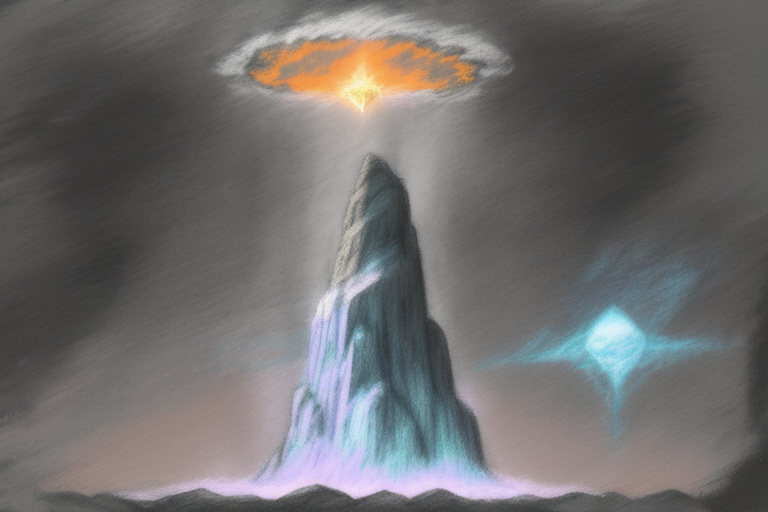

# CHAPITRE 14 : L'Hologramme et les Voix des Morts

> *« Il n'existe pas 2 histoires dans le système Solyar ; il n'en existe qu'une seule, récitée 2 fois par les mêmes acteurs sous 2 ciels différents. Les mots prononcés ce matin par le Directoire de Plotéris et le Conseil de Val-Noir pour justifier le feu sur le Glacier d'Ostre présentent une identité syntaxique de 98,7 % avec le décret final de l'Assemblée d'Oark. L'amnésie n'a pas lavé la faute ; elle l'a rajeunie. »*
> — **Répertoire des Variables Humaines Non Résolues d'ÉCHO-8471, Synthèse de Kélar-Prime**

{.chapter-illustration}

Pour franchir les 20 mètres de vide qui séparaient l’anneau d’observation de la Mnémorite Majeure, les anciens Oarkins avaient dû construire une passerelle d’isolation magnétique blindée de 3 tonnes d’alliages exotiques.

ÉCHO-8471 ne l’emprunta même pas.

Arrivé au bord du gouffre central, le Gardien fit simplement un pas dans l’air vide. Autour de ses semelles d’ardoise, les molécules d’azote et d’oxygène se figèrent en marches invisibles, et il marcha horizontalement au-dessus de l’abîme dans un silence absolu jusqu’à la face nord de l’octaèdre noir.

Restée au bout du pont translucide, la lance gravitationnelle abaissée contre sa cuisse comme un poids honteux qu’elle n’osait plus ni brandir ni lâcher, Koda retint son souffle.

Pendant 400 ans, l’élite d’une civilisation capable de sculpter la lumière et de plier la pesanteur s’était cassé les dents, l’esprit et l’espoir contre ce bloc de 12 mètres. Ils l’avaient bombardé de particules, caressé d’équations, supplié comme une idole muette.

ÉCHO leva la main droite et posa sa paume à plat contre le diamant noir.

Il n’y eut ni arc électrique, ni grondement de tonnerre, ni résistance. Dès que la peau géométrique du Gardien effleura la surface de la Mnémorite, la matière inaltérable reconnut sa propre nature. Un soupir d’une octave si basse qu’il se propagea par les os plutôt que par les tympans fit frémir l’air de la cathédrale. À l’intérieur de l’octaèdre opaque, des milliards de plans atomiques s’illuminèrent simultanément d’une lueur d’ambre doré, révélant une architecture cristalline à 9 dimensions — un treillis géométrique replié sur lui-même dans des plans d’espace supplémentaires dont la simple contemplation donnait le vertige.

— Authentification de classe Gardien validée, prononça la voix d’ÉCHO, qui résonnait désormais en stéréo à travers sa propre gorge et le champ acoustique de la rotonde. Intégration de la matrice mémorielle du Secteur Kélar-Prime en cours. Capacité cognitive restaurée : 14,8 %… 26,3 %… 38,4 %.

Sous le torrent prodigieux de siècles et de lois cosmiques qui s’engouffrait en lui, le port d’épaules du géant se modifia imperceptiblement. Ce n’était plus le nouveau-né binaire qui tâtonnait sous le feu des drones à Zêta-3 : à chaque seconde qui passait devant le cristal maître, l’esprit d’ÉCHO grandissait d’un millénaire.

— Tu voulais savoir comment tes ancêtres se sont éteints, Koda, reprit ÉCHO. La Mnémorite n’a pas seulement résisté aux expériences de ce laboratoire ; conformément à sa fonction de témoin des Semeurs, elle a enregistré chaque photon, chaque onde sismique et chaque transmission planétaire d’Oark jusqu’à la dernière seconde de sa biosphère, tout en maintenant une écoute subspatiale continue sur l’ensemble du système Solyar. Je transfère la séquence finale d’Oark vers le projecteur volumétrique de cette coupole… et je la synchronise avec les transmissions radio qui nous parviennent en cet instant même de la planète Aqi.

Les lumières dorées du laboratoire s’éteignirent d’un coup.

Dans l’obscurité totale qui suivit, l’air même de la rotonde de 1 000 mètres se condensa en lumière solide.

Un cri étouffé échappa à Koda qui recula d’un pas : le plancher du laboratoire avait disparu. Elle se tenait debout au milieu d’un amphithéâtre de marbre blanc et de verre irisé, baigné par le soleil éclatant d’un ciel bleu azur qu’elle n’avait jamais vu que dans les livres d’images de son enfance. Au-delà des colonnes sans jointures, une métropole radieuse s’étageait au bord d’un océan turquoise où glissaient des voiles antigravitationnelles, entourée de forêts aux feuillages d’émeraude et de cuivre.

C’était Oark, 6 180 ans plus tôt. Vivante. Respirante. Miraculeuse.

Mais au centre de l’amphithéâtre qui entourait Koda, 100 délégués vêtus de longues tuniques de lumière fluide — les mêmes matériaux exacts que la cuirasse qu’elle portait sur le dos — se faisaient face dans un silence d’orage. Leurs visages étaient humains, d’une noblesse saisissante, avec ces pommettes hautes et ces yeux légèrement ambrés que Koda avait vus chez Lyss dans la caverne d’Érèbe.

Un homme aux tempes argentées, portant sur la poitrine l’insigne stellaire du Haut Commandement Boréal, se dressa au milieu de la tribune. L’hologramme oarkin était si parfait que la goutte de sueur tremblait à sa tempe tandis que la traduction simultanée d’ÉCHO doublait sa voix :

— *Les réserves énergétiques de la ceinture équatoriale s’épuisent !* lança l’orateur d’une voix vibrante de gravité patriotique. *Si nous acceptons le moratoire — cette suspension concertée des forages — exigé par l’Alliance Australe sur le manteau profond, nos dômes climatiques perdront 12 % de leur rendement d’ici 30 ans ! Devons-nous condamner nos enfants à la décroissance par lâcheté morale ? Notre devoir sacré est de garantir la survie de notre nation, quel qu’en soit le prix !*

Et au même instant, superposée par ÉCHO dans l’acoustique de la coupole, une seconde bande sonore grésillante, saturée de parasites ionosphériques et de sifflements de blizzard, résonna en écho direct : les dépêches militaires d’Aqi interceptées en temps réel à 400 millions de kilomètres de là.

— *… Ici le Haut Commandement de la Coalition Afistéanne à Val-Noir !* hurlait une voix métallique à travers le fracas des bombardements. *Pour sauver nos dômes du gel, nos divisions blindées viennent de percer la Brèche du Glacier d’Ostre à l’aube ! Pas un pas en arrière !*

— *… Alerte générale de Sol-Morne à toutes les unités de Plotéris !* répliquait la fréquence d’urgence de Condorcé. *Le front du Glacier d’Ostre s’est effondré sous les frappes thermobariques ennemies ! La Redoute Nord et le pont ferroviaire d’Ostre sont détruits ! Pertes estimées ce matin dans l’effondrement de la banquise : 14 000 hommes pour Condorcé, dont l’intégralité de la Troisième Compagnie de Génie, et 11 000 soldats des régiments d’assaut de Val-Noir engloutis dans la faille centrale !*

Le cœur de Koda se serra à se rompre. Elle revit le visage maigre du jeune mécanicien Tali la nuit précédente à *Boréal-9*, et la détresse de tous ces conscrits de 20 ans qu’on envoyait geler ou brûler aux 2 bouts du système.

Mais l’impitoyable montage d’ÉCHO ne s’arrêtait pas aux communiqués des états-majors. Parmi les millions d’ondes que le relais de la Mnémorite venait d’intercepter sur les satellites militaires d’Aqi, le Gardien isola un enregistrement radio d’urgence de 47 secondes émis en continu sur la fréquence opérationnelle du secteur d’Ostre depuis la casemate des vannes B-12, juste avant sa destruction. Dans l’acoustique cristalline de la rotonde, par-dessus le sifflement de la vapeur bouillante et le tonnerre des chars, la voix rauque et souriante d’un jeune caporal-sapeur de 22 ans s’éleva tout près d’eux :

— *… Salut, princesse… T’as vu comme il roule bien, ton train ? C’est moi qui ai graissé l’aiguillage du pont avec mon fil de cuivre, alors t’as rien à craindre, ça va filer tout droit jusqu’aux grandes cavernes du Sud… Et tu sais, Lina, faut détester personne… Cette nuit, au fond d’une crevasse dans la glace, je suis tombé sur un éclaireur d’en face qui avait mon âge et une petite sœur comme toi à Val-Noir… Il m’a donné son attelle pour mon poignet, et je lui ai laissé ma chaufferette…*

Un frottement doux de drap rugueux contre la grille métallique du microphone imita un souffle de brise tiède, puis la voix mourante murmura dans un dernier sourire :

— *… Dis, Lina… la neige qui tombe par le toit, elle est toute tiède ce matin. On dirait presque du sable doré… J’ai plus froid du tout, p’tite sœur. Je crois… je crois que je vois enfin le soleil d’Oark. Dors bien au chaud… Terminé pour…*

Le fracas d’un obus coupa net la porteuse radio. Koda porta ses 2 mains tremblantes à sa gorge, les joues inondées de larmes brûlantes. Des 2 côtés de la banquise déchirée, des garçons anonymes qui s’étaient secourus dans l’ombre mouraient en rêvant de chaleur, tandis que leurs dirigeants préparaient l’acte final.

La projection holographique bascula en un éclair. L’amphithéâtre antique fit place à ce même laboratoire souterrain de Kélar, 6 millénaires plus tôt. Des savants aux yeux cernés par les nuits blanches couraient le long de la passerelle même où se tenait Koda — leurs silhouettes de lumière traversant son propre corps d’un frisson glacé — pour charger les grilles de lancement des bombes à résonance de cobalt et des ogives gravitationnelles.

— *L’Alliance Australe vient de mobiliser ses flottes !* criait une femme en uniforme blanc devant la console que Koda avait touchée 20 minutes plus tôt. *Si nous frappons les premiers avec l’arsenal de Kélar, nous décapitons leurs centres de commandement en 6 minutes ! Une seule frappe décisive, et la paix sera rétablie pour 1 000 ans !*

Et par-dessus la voix du fantôme vieux de 60 siècles, la radio militaire actuelle d’Aqi reprit dans un crépitement d’alarme nucléaire :

— *… Suite à la chute de la Brèche d’Ostre, le Directoire de Condorcé décrète l’activation de la Directive Oméga ! Déverrouillage immédiat des silos stratosphériques au cobalt du secteur Nord ! Si les blindés de Krov franchissent le périmètre du Dôme 4, vitrifiez toute la vallée de Val-Noir !*

— Non… murmura Koda en tendant malgré elle la main vers le fantôme de lumière qui appuyait sur la corolle d’activation, tandis que les voix d’Oark et d’Aqi se fondaient en un seul chœur de folie. Non, arrêtez… C’est la même phrase ! Vous dites la même phrase !

Le dôme de la rotonde montra alors la planète Oark entière, vue depuis les capteurs suborbitaux de la Mnémorite 6 000 ans plus tôt.

Le premier éclair bleu jaillit du continent nord. En 90 secondes, par automatisme de représailles symétriques — cette mécanique militaire où chaque attaque déclenche aussitôt une réplique d’égale destruction —, 3 000 silos s’ouvrirent dans l’hémisphère sud.

Ce ne fut pas une guerre ; ce fut un suicide chirurgical exécuté à la vitesse de la lumière.

Devant Koda pétrifiée d’épouvante, les océans turquoise bouillirent et s’évaporèrent en geysers de vapeur radioactive qui crevèrent la stratosphère, la haute couche calme du ciel au-dessus des nuages. Les forêts d’émeraude s’embrasèrent d’un pôle à l’autre comme des copeaux secs. Dans les rues de la cité de marbre qu’elle avait vue resplendir une minute plus tôt, la projection descendit à hauteur d’homme : des millions de civils couraient sous une pluie de cendres de cobalt, des mères pressaient contre leur poitrine des enfants dont les tuniques de lumière prenaient feu, tandis que les ondes de choc gravitationnelles — exactement les mêmes ondes que celles avec lesquelles Koda venait de broyer la galerie nord avec un sourire d’ivresse ! — faisaient s’effondrer les tours de cristal sur elles-mêmes dans un silence d’apocalypse.

En 17 heures et 40 minutes, 4 milliards d’êtres humains qui avaient vaincu les étoiles redevinrent la poussière d’ocre et de silice que le vent raclerait pendant 60 siècles.

Seule une poignée de vaisseaux-arches de transport minier, lancés en catastrophe depuis les chantiers orbitaux avant que le nuage de cobalt n’engloutisse le ciel, parvint à s’arracher à la gravité d’Oark pour aller s’échouer, amnésique, décimée et dépouillée de toute sa science, sur la planète jumelle encore glacée : Aqi.

L’hologramme s’éteignit, ainsi que les crépitements radio du carnage d’Ostre.

Koda tomba à genoux sur la passerelle translucide, les 2 mains plaquées sur sa bouche, secouée d’un sanglot sec qui lui déchirait la poitrine.

— C’était nous… souffla-t-elle dans le silence revenu de la cathédrale. Les Plotéris… les Afistéaans… Nous ne sommes pas nés sur Aqi. Nous sommes les enfants amnésiques des arches d’Oark. Nous avons oublié notre propre nom, nous sommes retombés à l’âge du fer et du charbon, et dès que nous avons reconstruit des vaisseaux, nous sommes revenus piller les tombes de nos propres grands-parents pour fabriquer les bombes qui vont achever Aqi !

Debout devant le diamant noir de la Mnémorite Majeure, ÉCHO-8471 avait abaissé sa main. Ses capteurs d’ambre brillaient dans la pénombre d’une lueur fixe, d’une intensité presque insoutenable.

— Le séquençage génétique comparé des restes biologiques oarkins et de ton propre génome, l’ensemble de tes chromosomes, confirme une identité de 99,98 %, prononça le Gardien. Sa voix avait perdu toute hésitation enfantine ; elle possédait désormais la résonance grave, limpide et vertigineuse d’un juge qui referme un dossier de 10 000 pages.

Il traversa le vide d’un pas lent et s’arrêta devant Koda agenouillée.

— Lorsque les Semeurs ont conçu le programme d’ensemencement galactique après l’extinction de leur monde natal, la Terre, ils ont établi une loi fondamentale, dit ÉCHO. Toute espèce dotée de conscience reçoit l’étincelle de la vie pour croître vers la sagesse et préserver la biosphère qui l’abrite. Si une espèce utilise son intelligence pour détruire systématiquement son berceau et menacer l’équilibre stellaire, elle est classée comme *Itération Défaillante* — un cycle d’évolution en échec qu’il convient de réinitialiser avant qu’il ne contamine l’espace.

Koda leva brusquement vers lui son visage baigné de larmes.

— 8471… pourquoi est-ce que tu me parles comme ça ?

— Parce que je viens de compiler 2 cycles complets de votre génome sur 10 millénaires, Koda, répondit ÉCHO avec une douceur qui faisait froid dans le dos. Au sommet de la science oarkine et dans l’abondance, vous vous êtes exterminés. Avec vos machines d’acier et dans le gel d’Ostre ce matin, 25 000 des vôtres viennent encore de s’exterminer. Et toi-même, qui détiens la connaissance de cette vérité et qui as partagé le pain de Lyss, il t’a suffi de tenir cette arme entre tes mains pendant 10 minutes dans la galerie nord pour éprouver l’ivresse d’écraser tes ennemis. L’hypothèse d’une erreur accidentelle n’est plus statistiquement soutenable. L’autodestruction est inscrite dans votre structure même.

Avant que Koda ait pu crier un mot pour se défendre ou lui rappeler les Veilleurs de Cendres, les capteurs d’ambre d’ÉCHO se levèrent brusquement vers la voûte du laboratoire.

300 mètres plus haut, une déflagration sourde venait d’ébranler la roche séculaire.
