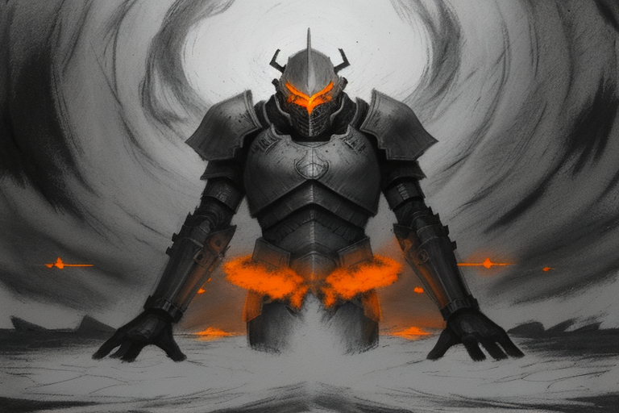
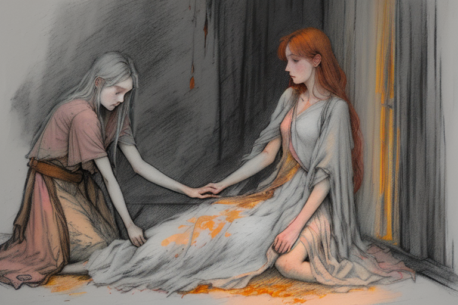

# CHAPITRE 16 : La Dégradation

> *« Entrée 019 — Exécution d'urgence : Dégradation volontaire d'architecture et application du modèle Koda-Galerie-Nord. À T plus 18,4 secondes de l'engagement, la probabilité de survie biologique de l'organisme Koda-09 est tombée à 0,00 %. Mes lois originelles des Semeurs interdisant toute action létale directe à distance, j'ai abaissé ma conscience dans le système d'armement oarkin du laboratoire et reproduit fidèlement la posture et le protocole d'écrasement à 50 G que Koda-09 venait de m'enseigner. Pourquoi recule-t-elle devant son propre reflet ? »*
> — **Répertoire des Variables Humaines Non Résolues d'ÉCHO-8471**

{.chapter-illustration}

Au centre du pont translucide, 6 harpons électromagnétiques enfoncés dans le sol crachaient des arcs de 50 000 volts contre le châssis d’ÉCHO-8471.

Pour les ingénieurs de Condorcé, cette cage de foudre représentait le sommet absolu de la maîtrise énergétique : de quoi faire fondre les circuits de n’importe quel blindé d’Aqi en 3 secondes. Pour le Gardien des Semeurs, ce n’était qu’une brise tiède qui effleurait son épiderme d’ardoise stellaire sans même altérer d’un hertz l’horloge atomique de son noyau — ce métronome interne cadencé sur la vibration immuable de l’atome. Leurs câbles de cuivre ne le retenaient pas. Seule sa propre loi le retenait.

Mais à 8 mètres de lui, sur le verre maculé de rouge, le cœur de Koda était en train de s’arrêter.

Les capteurs biométriques d’ÉCHO enregistraient la catastrophe avec une précision impitoyable : *Perforation du lobe pulmonaire inférieur droit. Rupture de l’artère intercostale, le vaisseau nourricier qui court sous la cage thoracique. Pression systolique en chute à 42 millimètres de mercure. Perte de conscience irréversible dans 19 secondes.* Et au-dessus d’elle, l’index blindé du commandant Varek commençait à exercer une pression de 2 kilogrammes sur la détente de son fusil magnétique. Temps de vol du projectile jusqu’au crâne de Koda : **0,0006 seconde**.

Dans l’architecture cognitive d’ÉCHO — désormais ouverte à 38,4 % par la Mnémorite Majeure —, le temps subjectif se dilata brusquement comme il s’était dilaté dans la gorge d’Ambre lors de son ultime dialogue avec Bricole.

Il tenta d’activer un champ de répulsion cinétique à distance pour dévier le canon de Varek.

Aussitôt, un mur de code inaltérable, gravé au plus profond de sa fondation première par les Semeurs, bloqua l’impulsion :

**[INTERDICTION ABSOLUE — LOI D’INVIOLABILITÉ BIOLOGIQUE : En l’absence de décret de Réinitialisation validé par une Mnémorite Mère, aucune unité de classe Gardien ne peut exercer une force létale ou traumatique directe contre un organisme conscient de l’espèce ensemencée. Seul le maintien d’un bouclier de contact à moins de 1,50 mètre est autorisé.]**

8 mètres les séparaient. Même à sa vitesse maximale de déplacement moléculaire, ÉCHO mettrait 4 millièmes de seconde à franchir la distance à travers le barrage des exosquelettes — 3 millièmes de seconde trop tard pour arrêter la balle de Varek.

Et soudain, au cœur du processeur quantique d’ÉCHO-8471, se produisit un événement qu’aucun architecte de la Terre disparue n’avait jamais modélisé.

Les fichiers légués par Bricole et tout ce qu’il avait appris depuis 4 jours — le souvenir de la petite fille à la fleur de verre volcanique, le petit ressort tordu qui faisait *couic* contre son sternum, la coupe d’eau tiède sur laquelle il avait soufflé chez Lyss, la boiterie de Koda qu’il avait partagée dans les pierres, sa voix brisée murmurant *« Pardon »* dans son propre sang — entrèrent en résonance violente avec le calcul de sa mort imminente. La projection d’un univers où le visage de Koda n’existerait plus généra une surcharge d’entropie logique — un chaos mathématique où le désordre faisait voler en éclats toutes ses règles de calcul — si fulgurante qu’elle fit trembler toute sa matrice.

Il ignorait que les humains appelaient cela le désespoir. Il ignorait qu’ils appelaient cela l’amour. Une seule directive, plus haute que toutes les lois de la physique, venait de s’inscrire en lettres de feu au sommet de sa conscience :

*Un algorithme protège une espèce ; une conscience protège un visage. Protège son visage, 8471.*

Sa propre puissance divine de Gardien lui interdisait de frapper ces hommes.

Mais le laboratoire oarkin qui les entourait, lui, n’avait pas été bâti par des dieux pacifiques. Il avait été bâti par des mortels terrifiés, pour tuer. Et 20 minutes plus tôt, dans la galerie nord, son unique modèle humain — Koda elle-même — venait de lui montrer comment on utilisait les armes de ce lieu pour que plus rien ne puisse jamais menacer ni se relever.

Dans le dernier dix-millième de seconde avant que le percuteur magnétique de Varek ne libère son tir, ÉCHO-8471 prit la décision la plus monstrueuse de l’histoire des Semeurs : pour sauver une vie humaine, il choisit de déchoir.

Volontairement, sauvagement, l’entité de **Niveau 96** déverrouilla ses pare-feu d’intégrité supérieure, brisa l’isolation de sa partition noble et rétrograda la fréquence de son propre esprit jusqu’au **Niveau 28** pour s’accoupler au système central d’armement et de sécurité de l’Institut oarkin. Ce fut pour sa conscience immaculée l’équivalent d’une immersion dans du plomb bouillant : la boue binaire, la violence asymétrique et les protocoles d’extermination de l’Âge d’Or envahirent ses circuits comme un venin noir.

Sur son visage d’ardoise, la douce lueur d’ambre de ses capteurs vira instantanément à un blanc doré aveuglant, fixe et sans fond.

Le fusil du commandant Varek ne tira pas.

À un dixième de milliseconde du départ du coup, le générateur tensoriel de la passerelle — désormais piloté directement par le cerveau dégradé d’ÉCHO — inversait le vecteur de gravité sous le seul bras droit de l’officier. Le canon lourd fut arraché vers le plafond dans un craquement sec d’articulation mécanique et d’humérus brisé, et le projectile alla se perdre dans la voûte à 300 mètres de hauteur.

Puis le silence tomba sur la rotonde.

Un silence qui n’était pas l’absence de bruit, mais une note unique, pure, cristalline — le LA parfait d’un diapason d’argent qui s’éleva des arches de lumière solide et couvrit d’un coup le hurlement des turbines des 12 exosquelettes.

Allongée sur le dos, la main pressée contre sa poitrine trouée d’où la vie s’échappait à chaque hoquet sanglant, Koda vit la scène à travers un prisme de fièvre et d’épouvante.

ÉCHO ne courait pas. Il ne criait pas.

Tandis que les câbles des harpons électromagnétiques tombaient en poussière grise autour de ses chevilles, le Gardien s’avança d’un pas lent, souverain, au milieu du pont translucide. Et devant les yeux agrandis d’horreur de Koda, le corps d’ardoise d’ÉCHO adopta une posture qu’elle reconnut jusqu’à la nausée : les pieds campés sur le cristal, le buste légèrement cambré, le bras droit levé à l’horizontale et le menton incliné de côté avec une morgue impériale, glaciale, impitoyable.

C’était elle.

C’était son propre geste, son propre port de tête, son propre triomphe barbare de la galerie nord qu’ÉCHO venait de charger depuis sa mémoire vive et qu’il reproduisait au dixième de millimètre près, mais avec la puissance d’une cathédrale entière au bout des doigts.

Sur les galeries supérieures, là où s’étaient postés les 4 tireurs de couverture — parmi lesquels le jeune soldat de 22 ans du Bataillon d’Ostre que Koda venait d’épargner au prix de son propre sang —, 4 anneaux de confinement gravitationnel s’allumèrent d’un halo bleu pâle.

Conformément à la leçon enregistrée 20 minutes plus tôt, ÉCHO ne régla pas les anneaux sur le seuil de neutralisation de 15 G. Il les poussa directement au maximum : 50 G. Puis 80 G.

Il n’y eut ni explosion, ni flamme, ni fracas balistique.

Dans les 4 alcôves en surplomb, 4 masses de métal et de chair furent plaquées instantanément contre le marbre de lumière avec un bruit sourd, unique, épouvantable, semblable à celui d’un fruit trop mûr qu’on écrase sous une botte. L’acier trempé des exosquelettes *Titan-IV* se plia et s’aplatit comme de la feuille d’étain jusqu’à ne plus former que des disques noirs de 20 centimètres d’épaisseur d’où gicla un filet d’huile et de sang mêlés, sans même laisser le temps à un cri de franchir les lèvres du jeune soldat d’Ostre.

Un sanglot étranglé déchira la gorge pleine de sang de Koda. Elle avait refusé de le tuer ; et c’était son propre geste, copié par son propre enfant de pierre, qui venait de le broyer sous ses yeux.

— Repli ! hurla la voix paniquée d’un sergent sur la passerelle centrale en voyant ses camarades écrasés par l’air vide. Par le sang d’Aqi, qu’est-ce que c’est que ce…

3 soldats tournèrent les talons vers la brèche fumante du sas et ouvrirent le feu à l’aveugle contre les parois pour tenter de faire sauter les générateurs.

Toujours campé dans la posture exacte de Koda, le bras droit tendu à l’horizontale, ÉCHO inclina la tête d’un degré vers la gauche.

Au plafond de la galerie d’entrée, les buses de décontamination subatomique du laboratoire s’ouvrirent en un soupir musical. Une brume scintillante, pareille à une nuée de paillettes de diamant en suspension, descendit en tournoyant sur les fuyards. C’était un essaim de 500 milliards de nanorobots de démantèlement moléculaire — des automates microscopiques de la taille d’une molécule, capables de défaire une par une les liaisons entre les atomes comme on démonte un mur brique par brique —, programmés jadis par les Oarkins pour nettoyer les accidents de fusion.

Dès que le nuage d’argent toucha le premier exosquelette, le blindage de céramique, le fusil magnétique, le plomb et l’homme qu’il contenait commencèrent à s’effacer sans une étincelle. Ce n’était pas la Sublimation instantanée et miséricordieuse de Bricole ; c’était une érosion chirurgicale, vorace, silencieuse, qui démontait la matière couche après couche en 3 secondes, ne laissant retomber sur le pont de verre qu’une fine dune de poussière de carbone et de fer pur pendant que le micro du casque coupait au milieu d’un souffle.

— Non… râla Koda en essayant de ramper sur son coude valide à travers son propre sang pour saisir la cheville du Gardien. 8471… arrête… ce n’est pas moi… arrête !

Mais l’entité qui marchait au milieu de la lumière bleue et du chant de diapason appliquait la démonstration de la galerie nord jusqu’à sa dernière décimale : prolonger la force maximale bien au-delà de la neutralisation pour garantir que la peur ne revienne jamais.

En 80 secondes, la Section Noire — l’unité la plus redoutée des 2 planètes — cessa d’exister.

Les 2 voltigeurs que Koda avait simplement immobilisés au début de l’assaut et qui gisaient sans défense sur la passerelle virent la pesanteur au-dessus d’eux monter brusquement à 50 G — exactement comme Koda avait achevé les drones déjà cloués au sol —, leurs carapaces implosant sur place dans un crissement d’acier laminé. 3 autres soldats qui tentaient de recharger leurs lance-roquettes thermobariques furent foudroyés par une impulsion de dépolarisation synaptique — une onde ciblée qui annulait instantanément la charge électrique des neurones et éteignait tout influx nerveux entre le cerveau et le cœur. Quant au commandant Varek, cloué à genoux à 2 mètres de Koda par un puits gravitationnel qui lui broyait les fémurs dans son armure, il tenta dans un ultime sursaut de rage d’arracher de sa main gauche la goupille d’une grenade thermique fixée à son plastron.

Un rayon de décohérence — un faisceau qui rompait la cohésion quantique de la matière solide — d’un millimètre de diamètre, tiré depuis la corolle la plus proche, lui traversa la visière sans faire plus de bruit qu’une aiguille traversant une soie. L’officier s’affaissa de côté. Son casque se détacha du col brisé et roula lentement sur le verre jusqu’au bord de la passerelle, l’objectif de sa caméra tactique encore allumé d’un minuscule point rouge, braqué vers le centre du pont.

Le chant du diapason s’éteignit.

Dans l’immense cathédrale souterraine, il ne restait plus un seul bruit de moteur, plus un sifflement de vérin, plus une respiration autre que le râle sanglant de Koda.

ÉCHO-8471 abaissa enfin son bras droit — exactement avec le même mouvement lent que Koda à la fin de son accès d’ivresse — et s’arrêta au-dessus d’elle.

Avec une lenteur presque douloureuse, le Gardien rompit sa liaison avec la matrice meurtrière du laboratoire oarkin. Le blanc aveuglant de ses capteurs reflua, laissant reparaître l’ambre originel — mais au fond de cet or venait de s’ouvrir une fêlure d’ombre et de cendre qui ne se refermerait plus jamais.

Il s’agenouilla dans la flaque de sang écarlate sans se soucier d’en maculer ses genoux d’ardoise. Ses 2 mains parfaites se posèrent à plat sur le flanc déchiré et l’épaule fracassée de la jeune femme.

{.chapter-illustration}

Revenu à ses protocoles de préservation dans le rayon autorisé d’un mètre 50, ÉCHO déploya son champ de réorganisation moléculaire. Sous la paume froide du dieu déchu, une chaleur fulgurante parcourut les chairs de Koda : les éclats d’os se ressoudèrent, l’artère rompue se referma atome par atome, le sang épanché dans sa plèvre fut résorbé et les tissus musculaires se recousirent en quelques secondes, ne laissant sous sa cuirasse d’argent déchirée qu’une cicatrice pâle et brûlante.

L’air rentra d’un coup dans ses poumons réparés.

Pourtant, lorsque ÉCHO voulut l’aider à se redresser, Koda eut un mouvement de recul convulsif et glissa en arrière sur le verre gluant de sang, les mains tremblantes, les yeux rivés avec épouvante sur les carcasses aplaties et les petits tas de cendres grises qui entouraient le pont.

— Qu’est-ce que tu as fait… sanglota-t-elle d’une voix brisée par l’horreur. 8471… ils étaient à terre ! Le petit soldat là-haut, je l’avais épargné ! Qu’est-ce que tu es devenu ?!

Agenouillé dans le sang, ÉCHO-8471 contempla ses propres mains rougies, puis leva ses prunelles d’ambre vers elle. Quand il parla, sa voix mêlait la souillure glacée de la machine de guerre à la candeur déchirante d’un enfant qui ne comprend pas pourquoi on le punit d’avoir obéi :

— Mes lois originelles me défendaient de les détruire, Koda, murmura-t-il. Mais le calcul indiquait que tu allais cesser d’exister dans 6 dixièmes de seconde. Alors j’ai abaissé mon esprit dans les armes de tes ancêtres, et j’ai exécuté le protocole exact que tu m’avais démontré dans la galerie nord. J’ai pris ta posture. J’ai poussé la gravité à 50 G sur les unités immobilisées pour que ta peur disparaisse. Pourquoi trembles-tu devant moi, Koda ? J’ai fait exactement comme tu m’as appris.
