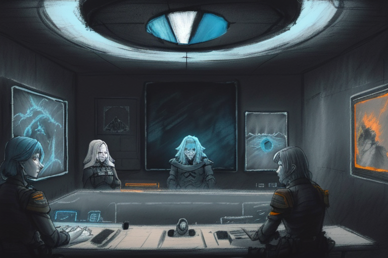

# CHAPITRE 17 : Le Témoin Lointain

> *« À 13 heures 40, Sol-Morne m'a transmis l'acte de décès de la Troisième Compagnie de Génie à la Brèche d'Ostre, et le nom d'un caporal de 22 ans, Soren Valen, qui s'est laissé brûler vif dans la chambre des vannes pour faire passer le train des enfants du Dôme 4 en bloquant le levier avec du fil de cuivre. À 13 heures 42, j'ai regardé mourir la Section Noire sur mes écrans. Ce garçon là-bas est mort en croyant que je cherchais sur Oark de quoi sauver sa sœur. Je viens de condamner les 2 mondes. »*
> — **Carnets personnels du Général Vane, Dernière page du cahier d'Oark**

{.chapter-illustration}

À 110 kilomètres au nord du Bassin de Kélar, dans les entrailles d’acier du croiseur des sables *Bastion-Un*, personne n’osait plus essuyer la sueur qui coulait sur les consoles.

Le général Vane avait fait stopper les moteurs principaux du mastodonte pour éliminer toute vibration parasite sur les liaisons optiques. Dans la salle de commandement plongée dans la pénombre rouge des alertes de combat, le silence n’était troublé que par le ronronnement des ventilateurs et le souffle haletant des 12 soldats de la Section Noire qui achevaient de poser leurs charges au plasma contre le sas souterrain, à 400 mètres sous la croûte radioactive.

Sur le mur du fond, 12 moniteurs cathodiques haute fréquence alignés en 2 rangées de 6 diffusaient les flux vidéo des caméras frontales des exosquelettes *Titan-IV*. Au-dessous de chaque écran courait la ligne verte en dents de scie de l’électrocardiogramme du porteur — le tracé électrique en temps réel des battements de son cœur —, sa pression hydraulique et le niveau de charge de son canon magnétique.

Debout au premier rang, les bras croisés sur sa poitrine grise, Vane tenait encore entre ses doigts gantés le télégramme chiffré reçu de Sol-Morne par faisceau laser interplanétaire que le colonel Sévérin et le lieutenant Borras venaient de décrypter 2 minutes avant le début de l’assaut : le bilan consolidé de la chute du Glacier d’Ostre sur Aqi, accompagné de l’archive télémétrique des boîtes noires radio du secteur.

La Brèche d’Ostre était tombée à l’aube. 14 000 soldats de Condorcé et 11 000 Afistéaans gisaient ensevelis sous les décombres fumants de la banquise éventrée par les bombes thermobariques. Toute la ligne de la Redoute Nord avait été balayée faute de réserves blindées. Pourtant, au bas du rapport sinistre, l’archive audio extraite de la boîte noire du relais d’Ostre attestait que le dernier convoi sanitaire évacuant les 300 enfants de la crèche géothermique du Dôme 4 avait franchi in extremis le pont ferroviaire avant son effondrement : un caporal-sapeur de 22 ans nommé Soren Valen, matricule 408-S, s’était enfermé sous le bombardement dans la casemate des vannes B-12, avait ligaturé le levier brûlant et la pédale du transmetteur radio d’urgence avec sa bobine de fil de cuivre pour guider le mécanicien, puis avait laissé sur la fréquence opérationnelle 47 secondes d’adieu à sa petite sœur Lina avant d’être englouti par l’explosion.

Vane avait lu 2 fois le nom du jeune sapeur, tandis que Borras, blême devant sa console, achevait d’archiver la bande sonore de la vanne B-12. *Soren Valen.* Encore un gamin du Dôme 4 qui avait payé de son sang l’absence des exosquelettes retenus ici, sur Oark.

Mais en relevant ses prunelles grises vers les 12 écrans où la Section Noire s’apprêtait à faire sauter la porte nacrée, Vane s’était raidi contre le remords : dans 5 minutes, lorsque ses commandos auraient abattu la déserteuse Koda-09 et capturé le géant intact des Semeurs, le sacrifice du caporal Valen et des 14 000 morts d’Ostre serait racheté au centuple. Demain, Condorcé dicterait sa paix à l’univers.

À sa gauche, le docteur Arkan prenait des notes fébriles ; à sa droite, maintenu entre deux gardes militaires, le lieutenant Borras fixait les écrans avec un visage couleur de craie. 12 minutes plus tôt, lorsque les 2 petits drones éclaireurs *Frelon-Noir* envoyés en reconnaissance dans la galerie nord avaient été brusquement écrasés au sol par une force invisible manœuvrée par Koda, un premier frisson avait parcouru la travée. Mais Varek avait adapté son plan : frapper fort, tous ensemble, et saturer le bouclier de la fille dès la première seconde.

Sur les 12 moniteurs, les charges au plasma explosèrent.

Lorsque les caméras franchirent la fumée noire et révélèrent l’immense cathédrale souterraine de lumière solide et l’octaèdre noir suspendu au-dessus du vide, un murmure de stupeur parcourut l’état-major. Puis le combat éclata dans un tonnerre de détonations saturant les microphones.

Les écrans 1 et 2 — les voltigeurs de pointe — se brouillèrent brusquement en basculant vers le dallage sous l’onde d’écrasement gravitationnel, leurs jauges de pression hydraulique virant au rouge critique.

— Par tous les cieux… souffla Arkan en s’agrippant à la console, les yeux exorbités devant ses cadrans. Ce n’est pas le géant qui a tiré, général ! La fille porte une cuirasse et une lance issues de ce complexe… Les anciens Oarkins maîtrisaient la distorsion gravitationnelle ?! Mais alors leur science dépassait la nôtre de plusieurs siècles !

Vane ne cilla pas. Sur le moniteur numéro 3 — celui d’un jeune caporal détaché du Bataillon d’Ostre posté sur la galerie supérieure droite —, le général vit nettement le canon nacré de l’éclaireuse se braquer sur le thorax du soldat… puis trembler d’une fraction de seconde et dévier volontairement sur le côté pour ne pas le tuer.

*La pitié*, songea Vane avec un éclair de triomphe glacé. *Elle a eu pitié d’un uniforme d’Ostre. Elle a perdu.*

Le tir groupé du commandant Varek illumina tous les écrans d’un flash bleu.

Sur les 10 moniteurs valides, tout le poste de commandement vit le bouclier irisé voler en éclats et le corps menu de Koda être projeté à la renverse dans une gerbe de sang écarlate avant de retomber, inerte, sur la passerelle translucide.

— *Non ! Koda !*

Le cri s’arracha à la gorge de Borras comme une déchirure d’âme. Le jeune lieutenant tomba à genoux entre ses 2 gardes, le front pressé contre ses poings fermés sur le plancher d’acier, secoué d’un sanglot rauque. Il l’avait tuée. C’était son rapport de Zêta-3 qui venait de coucher Koda sur ce verre froid, le thorax ouvert par 2 balles de son propre camp.

Vane, lui, fit un pas en avant vers la console centrale, le télégramme d’Ostre froissé dans son poing. Ses yeux gris brillaient d’une fièvre métallique.

— *Cible humaine neutralisée !* annonça la voix de Varek dans les haut-parleurs. *Maintenez les pylônes à impulsion sur l’entité ! 50 000 volts en continu ! Finissez la déserteuse et préparez la cage de transport !*

Sur les écrans 3 à 11, la haute silhouette géométrique apparaissait encerclée par les arcs électriques bleus. Elle ne bougeait pas. Privée de son opératrice humaine, exactement comme Vane et Arkan l’avaient déduit dans le cratère d’Ambre, l’entité semblait figée dans l’indécision.

— Ils la tiennent, souffla le colonel Sévérin en s’essuyant le front. Mon général, ils la tiennent ! D’ici 6 heures, nous pourrons la remonter à la surface et l’embarquer vers Plotéris ! Le front d’Ostre est vengé !

Sur l’écran numéro 12 — celui du commandant Varek —, le canon du fusil magnétique s’abaissa vers le visage ensanglanté de Koda pour le coup de grâce réglementaire.

C’est à cette seconde précise que le son changea dans les haut-parleurs de *Bastion-Un*.

Les crépitements des arcs électriques, le grondement des turbines dorsales, les ordres hurlés dans les radios… tout fut brusquement balayé par une note unique, pure, harmonique, pareille au chant d’un cristal géant que l’on aurait frappé au fond d’une cathédrale.

Vane fronça les sourcils. Sur l’écran de Varek, au centre de la fumée, les 2 capteurs optiques de l’entité venaient de virer de l’ambre doux à un blanc doré aveuglant.

Le canon de Varek fut violemment arraché vers le haut dans un craquement d’os et de métal.

Et l’entité s’avança sur le pont en levant le bras droit à l’horizontale, le menton incliné de côté — adoptant devant les caméras stupéfaites la posture exacte, impérieuse et impitoyable que Koda-09 avait prise 12 minutes plus tôt lorsqu’elle écrasait les 2 drones éclaireurs dans la galerie nord.

Puis l’horreur commença.

À la quarante-deuxième seconde de l’engagement, les écrans 3, 4, 5 et 6 — dont celui du jeune soldat d’Ostre que Koda venait d’épargner — basculèrent simultanément vers le plancher dans un sifflement d’air comprimé, suivis d’un bruit sourd et humide qui fit reculer le docteur Arkan d’un pas. Au-dessous des 4 moniteurs, devenus noirs de neige statique — ce fourmillement de parasites gris et blancs d’une optique broyée —, les 4 lignes vertes des électrocardiogrammes s’aplatirent au même dixième de seconde dans un quadruple sifflement continu : *biiiiiiiiiiip*.

— Qu’est-ce qui se passe ?! cria l’officier des transmissions en frappant son tableau de commutation. Section Noire, répondez ! Varek, quelle est la nature du feu ennemi ?

Il n’y avait pas de feu ennemi.

Sur les écrans 1 et 2 des voltigeurs immobilisés au sol, une seconde vague gravitationnelle à 50 G écrasa les cuirasses qui implosèrent en direct. Sur les écrans 7, 8 et 9, qui reculaient en désordre vers le sas d’entrée, aucune explosion n’illuminait la salle. Seule une brume d’argent scintillante descendait en silence des arches dorées. Les officiers de Condorcé virent en gros plan le bras blindé du sergent-chef numéro 7 entrer en contact avec les paillettes de lumière : l’acier trempé, le plomb et le gant se désagrégèrent en poussière grise sans une flamme, puis l’objectif de la caméra lui-même fut dévoré de l’extérieur vers l’intérieur.

*Biiiiiiiiiiip. Biiiiiiiiiiip. Biiiiiiiiiiip.*

7 lignes plates. 8. 9. 10. 11.

Pas un coup de feu n’avait été tiré par l’entité. Pas un cri d’alarme n’avait eu le temps de s’achever. En 80 secondes chronométrées à l’horloge murale du poste de commandement, 11 des 12 meilleurs soldats de la République de Condorcé venaient d’être effacés de la surface du monde dans un silence de messe.

Dans la travée d’écoute, même Borras avait relevé la tête, les lèvres entrouvertes, pétrifié devant la rangée de moniteurs morts où ne hurlait plus que la tonalité aiguë des arrêts cardiaques.

Seul l’écran numéro 12 — celui du commandant Varek — diffusait encore une image.

La ligne verte de l’officier venait elle aussi de s’aplatir, mais son casque arraché avait roulé au bord de la passerelle translucide, l’optique tournée vers le centre du pont.

Toute la salle de guerre de *Bastion-Un* retint son souffle devant ce que filmait la caméra orpheline.

Au milieu de la brume d’argent qui achevait de retomber sur les petits tas de cendres, la silhouette d’ardoise s’était agenouillée à côté de l’éclaireuse Koda. Elle avait posé ses 2 mains sur la poitrine ouverte de la jeune femme. Et sous l’objectif haute définition, en violation flagrante de toutes les lois de la biologie et de la médecine connues sur Aqi, l’hémorragie mortelle s’arrêta. Koda inspira brusquement, vivante, guérie, et recula en rampant sur le verre devant son propre sauveur.

Pour la première fois en 40 ans de guerre, une sueur glacée coula le long de la colonne vertébrale du général Vane sous sa vareuse d’état-major.

Sur l’écran géant, le Gardien aux yeux d’or se releva lentement.

Puis, sans chercher la caméra des yeux, comme s’il connaissait depuis le début la position exacte de chaque lentille, de chaque relais optique et du blindé caché à 110 kilomètres de là, il tourna la tête droit vers le casque tombé au sol.

Il fit 3 pas silencieux et s’arrêta devant l’objectif.

Ses 2 yeux d’ambre et d’or emplirent tout l’écran, plongeant directement dans les prunelles grises du général Vane. Ce n’était pas le regard vide d’un automate sans pilote, ni le viseur d’un canon que l’on peut capturer et braquer sur les Afistéaans. C’était un abîme d’intelligence millénaire, traversé d’une douleur et d’une sévérité qui réduisaient leurs armées, leurs frontières et leurs généraux à la taille d’insectes se battant dans la poussière.

Le microphone endommagé du casque de Varek grésilla une dernière fois, et la voix d’ÉCHO-8471 résonna dans le silence sépulcral du vaisseau de commandement :

— *Général Vane de Condorcé. J’ai enregistré vos ordres, intercepté le bilan de vos 25 000 morts de ce matin sur le Glacier d’Ostre et compilé 6 siècles de vos archives planétaires. Vous avez refusé d’apprendre dans l’abondance d’Oark ; vous refusez d’apprendre dans le gel d’Aqi. Pour sauver l’organisme Koda-09 de votre violence, j’ai dû abaisser ma propre conscience au niveau des armes qui ont détruit ce monde.*

Un silence d’une seconde passa. Dans un angle de l’image, Koda se relevait péniblement en tenant son épaule, le visage livide d’effroi, tandis que l’entité concluait d’un timbre d’une douceur glaciale :

— *L’évaluation empirique de ce secteur est close. La probabilité de réforme spontanée de votre espèce est inférieure au seuil critique. Je me rends désormais au Sanctuaire Mère de la calotte polaire afin de soumettre le protocole de Réinitialisation au réseau planétaire.*

L’entité n’écrasa même pas la caméra du pied. Une simple réorganisation moléculaire du capteur optique plongea le douzième écran dans le noir absolu.

Dans la salle de guerre de *Bastion-Un*, plus personne ne bougeait. Seuls les 12 signaux continus des moniteurs cardiaques sifflaient à l’unisson dans la pénombre rouge.

Lentement, d’un geste mécanique, Vane tendit la main et coupa le commutateur audio général. Le télégramme annonçant le sacrifice du caporal Soren Valen sur le pont d’Ostre glissa de ses doigts entrouverts et tomba sur le plancher. Le silence qui suivit fut si lourd qu’on entendit le crissement du sable d’Oark que le vent raclait contre la coque blindée.

— *Protocole de Réinitialisation…* murmura le docteur Arkan d’une voix blanche en laissant tomber son bloc-notes. Mon Dieu, général… dans les textes des anciens Oarkins, la Réinitialisation du réseau des Semeurs, c’est… c’est le nettoyage complet des 2 biosphères — l’effacement de toute forme de vie complexe à la surface des 2 mondes — du système Solyar.

Blême sous sa cicatrice de phosphore, les 2 poings crispés sur le bord froid de la console, le général Vane contemplait son propre reflet livide dans le verre éteint du douzième écran.

Il avait laissé tomber le front d’Ostre et voulu tuer une gamine de 26 ans pour capturer une épée capable de sauver Condorcé du froid. Il venait d’enseigner le meurtre au juge qui allait éteindre le soleil.
