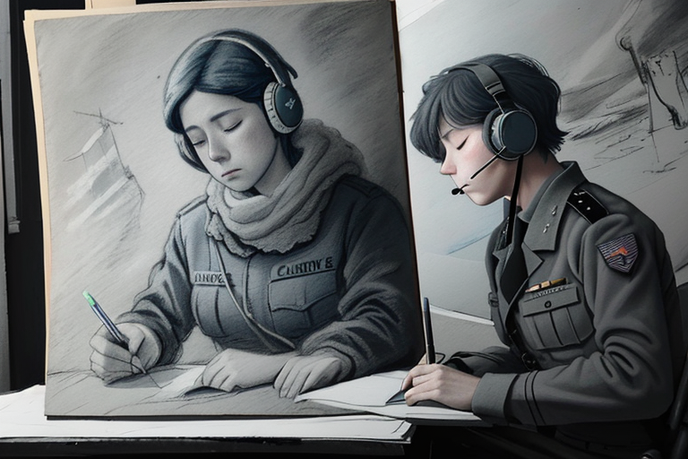

# CHAPITRE 02 : La Lucidité de Vane

> *« … Tu entends ce gros sifflement derrière ma voix, Lina ? Non, n’aie pas peur, ce n’est pas le monstre du couloir, c’est juste la vieille bouilloire du Mur d’Ostre qui fait des siennes. J’ai bloqué la pédale du transmetteur et coincé le volant de la vanne B-12 avec ma clé de 12 ; le train sanitaire du Dôme 4 vient de passer l’aiguillage, tu vas avoir du chauffage jusqu’au printemps, petite sœur. Et tu sais quoi ? Hier soir, au fond d’une crevasse, un gars d’en face qui grelottait autant que moi m’a laissé son attelle pour que je puisse remonter. Promets-moi juste un truc quand il fera chaud : ne pleure pas devant la radio, et garde-moi un bocal de ce sable orange d’Oark dont ils parlent aux actualités. Il paraît que là-bas, le soleil est si grand qu’on peut marcher pieds nus dedans sans jamais avoir d’engelures… »*
> — **Archive radio d’urgence #884-Ostre (durée : 47 secondes), émise par le caporal-sapeur Soren « Demi-Volt » Valen depuis la vanne géothermique B-12 et relayée par la boîte noire des transmissions orbitales d’Aqi**

{.chapter-illustration}

Il n’y avait pas de fenêtres dans l’Anneau de Commandement Orbital de Condorcé, seulement le battement glacé des horloges numériques, le ronronnement sourd des refroidisseurs d’azote et l’odeur aigre de l’ozone qui stagnait sous les coupoles blindées.

Pourtant, cette nuit-là, au fond de la fosse d’analyse désertée par les officiers de quart, un autre son flottait dans la pénombre verte des moniteurs cathodiques : le grésillement électrique d’une transmission radio d’urgence de 47 secondes, hachée par les interférences ionosphériques et les détonations thermobariques.

Assis tout seul devant sa console de décryptage, les épaules voûtées dans sa vareuse devenue trop large pour son cou amaigri, le lieutenant Borras avait branché son casque d’écoute directement sur l’enregistreur numérique de son plastron tactique, posé à plat sur le métal du pupitre. Les coudes plantés de part et d’autre du terminal qui avait reçu 4 heures plus tôt, par faisceau laser haut-débit, le paquet d’archives des boîtes noires militaires du secteur d’Ostre sur Aqi, le visage enfoui dans ses paumes calleuses, il réécoutait pour la septième fois la voix d’un mort de 22 ans.

*« … J’ai bloqué la pédale du transmetteur et coincé le volant de la vanne B-12 avec ma clé de 12 ; le train sanitaire du Dôme 4 vient de passer l’aiguillage, tu vas avoir du chauffage jusqu’au printemps, petite sœur… »*

Sur l’enregistrement radio capté en direct par le relais de commandement avant l’effondrement du bunker géothermique — et intercepté au même instant depuis l’orbite par les capteurs d’ÉCHO —, derrière le timbre enroué et blagueur du caporal Soren « Demi-Volt » Valen, on entendait distinctement le hurlement monstrueux des conduites en surpression, le fracas sourd des obus afistéaans qui éventraient la voûte de glace de la Brèche d’Ostre 30 mètres plus haut, et le crépitement sec de l’isolation électrique qui brûlait autour du garçon tandis qu’il racontait comment un éclaireur ennemi anonyme, un certain Kael Drov, lui avait laissé son attelle au fond d’une crevasse la veille.

*« … Il paraît que là-bas, sur Oark, le soleil est si grand qu’on peut marcher pieds nus dedans sans jamais avoir d’engelures… Allez, dors bien, Lina. Ton grand frère veille sur le fourneau… »*

Un coup de bélier titanesque — cette onde de choc hydraulique dévastatrice qui fait éclater l’acier lorsqu’une colonne de fluide lancée à pleine vitesse bute soudain contre une vanne fermée — coupa brusquement la phrase au milieu d’un sifflement de vapeur surchauffée à 400 degrés. Puis il n’y eut plus que 3 secondes de crissement métallique, et le bip strident de la porteuse radio coupée net par la mort de l’émetteur : *bip… bip… bip*.

Borras ne tendit pas la main pour appuyer sur la touche d’arrêt. Une larme brûlante glissa entre ses doigts, tomba sur le boîtier d’aluminium de l’enregistreur de son plastron et s’y étala dans le reflet vert de l’écran radar.

Il connaissait le matricule du caporal Valen. 15 mois plus tôt, avant d’être affecté sur Oark avec Koda et Jaro au camp Zêta-3, Borras avait signé lui-même l’ordre de réquisition qui maintenait la compagnie de sapeurs d’Ostre en première ligne malgré l’usure critique de leurs vannes. Il se souvenait de ce gamin rieur aux manches retroussées qui réparait les chaufferettes des blindés avec du fil de cuivre récupéré dans les bennes et que toute la garnison de Plotéris surnommait « Demi-Volt ».

Derrière lui, le sas blindé de la fosse d’analyse s’ouvrit avec un chuintement pneumatique, mais Borras ne se retourna pas.

Le Général Vane venait d’entrer.

Il portait son habituel uniforme noir sans médailles ni dorures, le col boutonné jusqu’à la gorge, ses cheveux gris coupés ras sous la lumière froide des néons. Il tenait sous le bras la liasse des télégrammes urgents du Directoire annonçant l’effondrement complet du front d’Ostre et le repli désespéré des divisions survivantes vers les dômes intérieurs de Plotéris.

En entendant le bip de fin de fichier de l’archive audio, le vieux stratège s’arrêta à 3 pas du dos courbé de son lieutenant.

— Qu’est-ce que c’est, Borras ? demanda Vane de sa voix basse, presque atone. Une interception radio afistéanne ?

Borras releva lentement la tête. Ses yeux rougis par 3 semaines d’insomnie et de remords brillaient d’une fièvre mauvaise dans son visage creusé. D’un doigt tremblant, il ramena le curseur temporel de l’archive #884-Ostre 47 secondes en arrière, puis rappuya sur la touche de lecture.

À nouveau, la voix de Soren Valen s’éleva dans le silence glacé du bunker orbital — jeune, essoufflée, pleine d’une tendresse déchirante tandis qu’il mentait à sa petite sœur de 9 ans sur la fréquence d’urgence pour qu’elle n’entende pas la montagne de glace lui tomber sur la tête. Lorsqu’elle s’éteignit une seconde fois dans le fracas de la vapeur et du feu, Vane n’avait pas bougé d’un millimètre. Seuls les muscles de sa mâchoire maigre s’étaient contractés sous sa peau parcheminée.

— L’archive radio d’urgence #884-Ostre du caporal-sapeur Soren Valen, transmise par faisceau laser avec le relevé des boîtes noires du secteur d’Ostre, dit Borras d’une voix rauque qui se brisait sur chaque consonne. Il a bloqué la pédale d’émission du transmetteur de la casemate B-12 avec une clé à molette pour avertir le mécanicien du dernier convoi que la voie était libre. Il est resté seul dans la chambre de détente pour maintenir la pression sur les rails du train sanitaire. 400 enfants du Dôme 4 sont passés grâce à lui, mon général. Et pendant qu’il cuisait vivant dans le noir en parlant de l’éclaireur ennemi qui l’avait aidé la veille et en rêvant de marcher pieds nus dans le sable chaud d’Oark… nous, sur Oark, nous étions en train de perdre nos 12 meilleurs hommes de la Section Noire pour essayer de capturer l’ami de Koda.

Tout autre officier supérieur de Condorcé aurait relevé l’insubordination ou ordonné d’éteindre l’appareil.

Vane, lui, avança d’un pas, posa lentement 2 doigts sur le boîtier de l’enregistreur tactique et coupa lui-même la boucle de lecture.

— Comment s’appelle sa sœur ? demanda le général dans le silence.

— Lina, mon général. Lina Valen. 9 ans. Logée au niveau inférieur du Dôme 4, bloc C.

Vane tira de sa poche intérieure son petit carnet à reliure de toile noire — celui qui ne le quittait jamais depuis le siège de Karst —, dévissa son stylo à encre métallique et inscrivit le nom en lettres capitales sur la première page, juste au-dessous d’une colonne d’équations balistiques.

— Tant qu’il restera un seul kilowatt dans les réacteurs de Plotéris, le bloc C du Dôme 4 sera classé prioritaire, dit sèchement Vane en refermant le carnet. Mais si vous voulez que cette petite fille vive assez longtemps pour atteindre ses 10 ans, lieutenant Borras, essuyez votre visage et regardez l’écran principal. Parce que le caporal Valen n’est pas mort pour que nous pleurions sur ses 47 secondes de radio : il nous a acheté quelques heures de sursis, et nous sommes sur le point de toutes les gaspiller.

D’une pression sur le commutateur central de la table tactique, le général fit rejouer pour la quatorzième fois de la nuit les 11 dernières secondes des boîtes noires récupérées dans le laboratoire de l’Âge d’Or, au cœur du bassin irradié de Kélar.

Sur le mur d’écrans, l’image tremblante captée par la caméra frontale du dernier survivant de la Section Noire défilait au ralenti, centième de seconde par centième de seconde.

On n’y voyait aucun échange de tirs conventionnels. Dans le silence terrifiant de la salle de lumière solide, l’entité ÉCHO-8471 abaissait simplement le bras. Les lances gravitationnelles et les projecteurs subatomiques oarkins qu’il avait retournés à distance contre le commando retombaient sur le dallage translucide. À l’arrière-plan, couchée dans une mare de son propre sang au pied d’un pilier, Koda tendait une main désespérée en lui criant d’arrêter. Et juste avant que la caméra du soldat mourant ne s’éteigne, le géant aux yeux d’or s’était immobilisé à 50 centimètres de l’objectif.

— Isolez le canal acoustique secondaire entre la seconde 8 et la seconde 10, ordonna Vane. Filtrez les plaintes de l’éclaireuse 44-K et le bourdonnement résiduel des générateurs oarkins. Amplifiez uniquement les harmoniques basses — ces fréquences graves sous-jacentes qui résonnent en écho multiple sous le son principal — émises par le thorax de la machine.

Borras reprit sa respiration, refixa soigneusement le module d’enregistrement numérique de l’archive d’Ostre contre le plastron de sa vareuse, juste au-dessus de son cœur, et fit glisser les curseurs du filtre fréquentiel.

Dans les haut-parleurs de la salle de guerre, un murmure d’une clarté glaciale — prononcé par ÉCHO non pas à l’intention de Koda, mais comme un horodatage logique adressé à ses propres registres internes au moment où il se déconnectait des systèmes du laboratoire — tomba du plafond :

*« Corrélation historique validée à 99,8 %. L’itération actuelle reproduit la séquence terminale du cycle précédent. L’intervention locale est insuffisante. Requête d’arbitrage transférée vers le Nœud Mère Polaire. »*

La bande s’acheva sur un souffle de neige statique.

À 58 ans, le Général Vane avait vu des dômes entiers s’effondrer sous le poids de la banquise d’Aqi et signé sans trembler l’évacuation de cités condamnées. Pourtant, sous la lumière blafarde de la fosse d’analyse, une goutte de sueur froide venait de glisser le long de sa tempe grise.

— *Requête d’arbitrage transférée vers le Nœud Mère Polaire*, répéta lentement Vane. Lieutenant Borras, affichez le relevé des anomalies gravimétriques profondes d’Oark établi par nos sondes géologiques il y a 10 ans. Superposez-y le cratère vitrifié du secteur Zêta, le complexe souterrain de Kélar et l’alerte d’intrusion émise il y a 3 heures par le dépôt afistéaan de *Boréal-Nord*, où un exosquelette polaire *Kodiak* vient de disparaître pendant la tempête.

Sur la table holographique, 3 points lumineux s’allumèrent à travers la topographie tourmentée de la planète.

Les 2 premiers traçaient une ligne droite implacable qui remontait des déserts d’ocre du sud-est vers les hautes latitudes boréales. Le troisième se situait exactement sur le même méridien, à 180 kilomètres du sommet de l’Inlandsis Septentrional, l’océan de glace continentale du pôle — là où les radars orbitaux de Condorcé comme ceux d’Afistéa s’étaient toujours heurtés à un « cône d’ombre sismique » de 6 kilomètres de diamètre, une zone sourde qui absorbait et déviait toutes les ondes acoustiques sous 3 000 mètres de glace éternelle.

— Mon général… murmura Borras en blêmissant devant l’alignement géométrique des 3 sanctuaires. Vous pensez que Koda l’emmène vers une fonderie centrale sous la calotte ? Qu’elle veut réveiller d’autres machines pour nous chasser d’Oark ?

Vane tourna lentement son regard gris vers le jeune officier. Pour la première fois depuis que Borras servait sous ses ordres, il n’y avait aucune dureté militaire dans les yeux du général — seulement une lucidité vertigineuse, dépouillée de toute illusion.

— Koda croit sans doute encore qu’elle nous fuit, ou qu’elle cherche dans les glaces une archive miraculeuse capable de réconcilier nos 2 peuples, lieutenant. Parce que Koda raisonne avec la générosité de ses 26 ans. Mais moi, j’ai passé ma vie à lire des bilans d’état-major, et je reconnais le langage d’un liquidateur quand j’en entends un.

Du bout de l’index, Vane frappa l’inventaire technique du laboratoire de Kélar qui s’affichait sur le moniteur latéral.

— Réfléchissez, Borras ! Dans ce complexe souterrain, l’entité ÉCHO-8471 avait à sa disposition un arsenal de l’Âge d’Or Oarkin en parfait état de marche : des canons à distorsion gravitationnelle, des essaims de nanorobots réplicateurs, des piles d’énergie du point zéro qui auraient pu raser nos bases orbitales en une heure. Qu’en a-t-elle fait après avoir massacré mon escouade pour sauver la vie de votre amie ? Elle a tout laissé derrière elle ! Pas une seule arme emportée par la machine. En revanche, nos sondes montrent que la grande pierre noire du laboratoire a été vidée de 6 000 ans d’archives historiques sur l’apocalypse d’Oark, pendant que l’entité aspirait simultanément sur nos relais satellites toutes les dépêches du massacre de la Brèche d’Ostre !

Vane fit 2 pas le long de la table lumineuse, sa silhouette maigre et droite découpée par le reflet bleu de la calotte polaire.

— Posez-vous la seule question qui compte, lieutenant : pourquoi un gardien bâti par les ingénieurs originels de ce système solaire — bien avant les anciens Oarkins eux-mêmes — dédaignerait-il des armes tactiques invincibles pour marcher à travers le blizzard vers le nœud maître d’un réseau planétaire en sommeil, après avoir acté que « l’itération actuelle reproduit la séquence terminale du cycle précédent » ?

Borras ouvrit les lèvres, mais aucun son ne franchit sa gorge sèche. Ses yeux glissèrent de la carte du pôle vers le module d’enregistrement fixé sur sa poitrine, où reposaient les 47 secondes de la voix de Soren.

— Ce n’est pas un soldat, prononça Vane d’une voix sourde qui tomba comme un couperet dans le silence du bunker. Et ce n’est jamais été le trophée énergétique qui devait nous permettre de chauffer Plotéris et d’écraser la Coalition Afistéanne. J’ai commis l’erreur d’un vieux boucher des tranchées : j’ai vu un canon là où il y avait un juge.

Le général posa ses 2 poings fermés sur le rebord d’acier de la table holographique, les jointures blanches.

— Ceux qui ont ensemencé ces mondes il y a des millions d’années avaient prévu une clause de sauvegarde pour le cas où l’espèce issue de leurs matrices deviendrait folle avant d’atteindre la maturité morale. Un coupe-circuit biologique. Une stérilisation préventive du système stellaire. ÉCHO-8471 ne monte pas au pôle Nord pour se cacher de mes commandos, lieutenant Borras. Il monte tourner la clé de la Mnémorite Mère et effacer l’humanité d’Oark et d’Aqi comme un chirurgien brûle une plaie gangrenée.

Dans la fosse d’analyse, le silence devint si lourd que le grésillement électrique d’un tube fluorescent semblait hurler.

— Mon Dieu… souffla Borras en s’appuyant des 2 mains à sa console pour ne pas voir le sol se dérober sous ses bottes. Pas Koda… Koda ne le laissera jamais faire ça ! Elle a failli mourir pour sauver des techniciens à Zêta-3 !

— Koda est une jeune femme blessée, épuisée, qui marche par moins 50 degrés à côté d’un demi-dieu indestructible qu’elle aime comme un frère parce qu’elle l’a vu naître ! répliqua Vane avec une rudesse déchirante. Elle ne sait pas encore ce qu’il a conclu dans son dos. Et quand elle le découvrira au fond de ce gouffre, il sera trop tard pour qu’une orpheline de 26 ans arrête une machine planétaire avec des prières !

Le vieux général se redressa de toute sa taille. L’homme d’appareil qui calculait froidement le sacrifice des garnisons d’Ostre venait de s’effacer devant l’urgence absolue de l’espèce.

— Combien de temps avant qu’ils n’atteignent le cône d’ombre de la Caldera Polaire — ce gigantesque cratère en chaudron né de l’effondrement d’un ancien dôme volcanique sous la glace ?

— Au pas de marche d’un exosquelette *Kodiak* dans le blizzard boréal… 30 heures, mon général. 36 au grand maximum.

— Et nos 4 croiseurs d’assaut lourd de la Première Escadre ne peuvent pas franchir le rideau de défense antiaérienne afistéaan du soixante-douzième parallèle sans perdre la moitié de nos charges à fusion profonde en chemin, calcula Vane à voix haute. Même si nous forcions le barrage, les divisions blindées du Haut-Commandeur Orlov basées à *Boréal-1* nous tomberaient sur le râble pendant que nos sapeurs essaieraient de faire sauter la voûte du sanctuaire.

Il tourna lentement la tête vers le pupitre scellé des fréquences diplomatiques d’urgence — le Canal Zéro, verrouillé par un double plomb d’acier depuis 17 ans sur ordre du Directoire de Condorcé. En temps de guerre, le simple fait d’en briser les scellés sans un vote unanime du Conseil Suprême valait dégradation immédiate et exécution sommaire dans les fossés de Plotéris pour haute trahison et intelligence avec l’ennemi.

— Lieutenant Borras, reprit Vane d’un ton parfaitement calme, débranchez votre enregistreur personnel, sortez de cette salle et verrouillez le sas derrière vous. Dans 60 secondes, je vais violer la Constitution de Condorcé et appeler personnellement le Haut-Commandeur Orlov. Je n’ai pas l’intention d’entraîner un officier de 28 ans devant le peloton d’exécution avec moi.

Le regard de Borras alla du vieux lion aux tempes grises à la porte blindée, puis au reflet de son propre visage dans le moniteur où clignotaient les coordonnées du pôle.

Toute sa vie, il avait obéi aux règlements par peur du désordre — jusqu’à ce soir maudit de Zêta-3 où, par excès de zèle administratif, il avait consigné dans son rapport la « vieille carte logique » de Koda et déclenché l’engrenage qui les menait aujourd’hui au bord du gouffre.

D’un geste sec, Borras sortit sa pince coupante d’électricien de sa ceinture et fit sauter lui-même le plomb d’acier du Canal Zéro.

— C’est mon rapport qui a commencé tout ça, mon général, dit-il d’une voix sourde mais d’une fermeté de roc en s’asseyant devant le clavier de routage quantique. Et si le petit Soren Valen est resté dans sa chambre de vapeur pour faire passer un train d’enfants, je peux bien risquer 12 balles dans la peau pour aider Koda. Dites-moi sur quel relais afistéaan j’envoie le faisceau.
