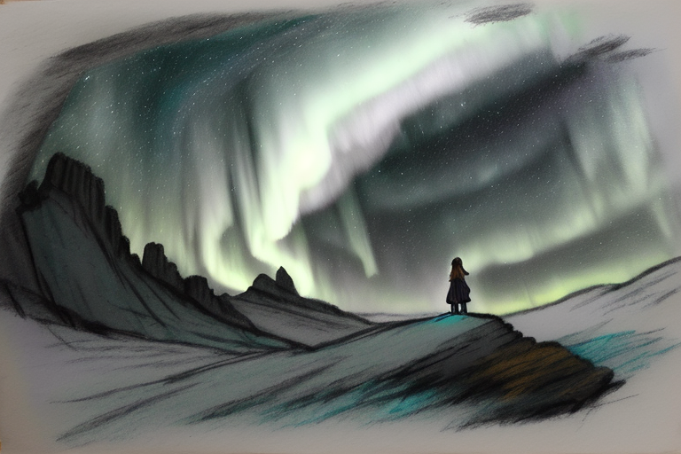

# CHAPITRE 05 : Le Dernier Bivouac du Monde

> *« Entrée 489 — Dernière annotation avant liaison au Nœud Mère. J’ai conservé dans ma cavité thoracique secondaire, à l’insu de l’opératrice Koda, un ressort hélicoïdal — enroulé en spirale cylindrique — en acier au carbone de 42 millimètres provenant du châssis détruit de l’unité Bricole. L’objet présente une déformation plastique de 11 degrés — une torsion irréversible du métal poussé au-delà de son seuil d’élasticité — et émet une friction parasite à 2 410 hertz. Sa valeur fonctionnelle est nulle. Pourtant, la perspective de sa dissolution lors de la Sublimation finale génère dans mes circuits d’évaluation une résistance supérieure à la perte d’un continent. Je n’ai pas encore résolu pourquoi ce qui est tordu pèse plus lourd que ce qui est parfait. »*
> — **Répertoire des Variables Humaines Non Résolues d’ÉCHO-8471**

{.chapter-illustration}

À 4 000 mètres d’altitude, juste sous la lèvre de la Caldera Polaire, la tempête se déchira soudain comme un vieux drap usé.

Koda et ÉCHO venaient d’atteindre le dernier replat basaltique qui précédait la crête du gouffre — une corniche étroite de roche vitrifiée et de glace bleue suspendue au-dessus d’un océan de nuages noirs que le blizzard continuait de brasser 1 000 mètres plus bas. Ici, dans l’air raréfié de la haute stratosphère boréale — cette couche supérieure et glacée de l’atmosphère qui plane au-dessus des perturbations météo —, le vent était tombé à un souffle glacé, presque silencieux.

Au-dessus de leurs têtes, le ciel nocturne d’Oark venait de s’embraser.

Sous l’effet des courants telluriques colossaux — ces fleuves d’électricité naturelle circulant dans l’écorce rocheuse de la planète — qui remontaient déjà du puits polaire à l’approche de la dernière Unité d’Ensemencement, les ceintures magnétiques du globe dansaient d’un horizon à l’autre : d’immenses draperies d’aurores boréales, nées de l’embrasement des particules solaires dans la haute atmosphère, ondulaient d’un vert d’émeraude profond ourlé d’ambre et d’or pourpre parmi les étoiles fixes comme les voiles de soie d’une cathédrale grande comme le monde.

Au loin, vers le nord-ouest, accrochée au velours noir du firmament comme un joyau de glace fêlé, brillait la lune-sœur Aqi — si proche et si limpide dans cet air sans poussière que Koda croyait distinguer à l’œil nu la courbe grise de la chaîne d’Ostre et la tache sombre du bassin de Plotéris.

— La paroi terminale de la Caldera présente une inclinaison de 54 degrés sur les 800 derniers mètres, dit la voix d’ÉCHO dans l’écouteur filaire. Les accumulateurs secondaires de ton exosquelette *Kodiak* doivent recharger leurs condensateurs de couple à partir de la pile au strontium avant d’engager la montée finale. Temps d’immobilisation requis : 45 minutes.

Koda ne protesta pas. Ses jambes tremblaient tellement dans les bottes blindées qu’elle n’aurait pas pu faire 100 pas de plus sans s’effondrer.

Avec un soupir de soulagement qui embua sa visière, elle cala la lourde carapace dorsale de son armure contre un bloc d’obsidienne abrité du couffin d’air froid, verrouilla les béquilles d’appui hydrauliques et mit le moteur d’assistance en mode de charge lente. Le ronronnement grave du strontium baissa d’une octave, ne laissant plus dans ses reins qu’une douce chaleur de poêle de campagne.

ÉCHO-8471 ne resta pas debout en faction comme il l’avait fait lors de toutes leurs haltes précédentes depuis le désert de Zêta-3.

Sous la clarté verte et dorée des aurores qui faisait étinceler sa silhouette d’anthracite, le Gardien vint s’asseoir dans la neige juste à côté de l’exosquelette de la jeune femme, repliant ses longues jambes d’alliage selon la posture exacte qu’il avait maintes fois vue Koda adopter au bord des feux de camp.

Pendant un long moment, ils regardèrent ensemble en silence le croissant blanc d’Aqi flotter au milieu des draperies célestes.

Là-haut, sur cette bille de glace, 40 millions d’hommes, de femmes et d’enfants grelottaient sous des dômes de béton ou s’étripaient dans des tranchées d’ammoniac gelé sans se douter que les 2 seules silhouettes assises sur cette corniche déserte tenaient leur existence entre leurs mains.

— Regarde-la, murmura Koda d’une voix douce, presque rêveuse, en levant son gantelet vers l’astre blanc. Vue d’ici, on dirait une perle posée sur du velours. On ne voit ni les barbelés du Mur d’Ostre, ni les cheminées des fonderies d’Afistéa, ni les patrouilles de rationnement. Quand j’étais petite, au Dôme 7 de Plotéris, mon père me prenait sur ses épaules dans la cour de la station de pompage les soirs où le givre était assez fin pour laisser voir le ciel. Il me montrait le disque orange d’Oark et il me disait : *« Tu vois cette grosse lanterne là-haut, Koda ? Un jour, quand j’aurai fini de réparer leurs maudites turbines, je nous bricolerai une chaloupe avec de vieilles tôles de chaudière et on ira tous les 3 planter des orangers dans le sable chaud. »*

ÉCHO tourna lentement son visage lisse vers elle. Dans ses yeux d’ambre, le reflet vert des aurores boréales se mêlait à l’or natif de ses lentilles.

— Tes dossiers biographiques de Condorcé mentionnent que tes géniteurs sont décédés lors de la rupture du collecteur thermique du Secteur Sud, lorsque tu avais 9 ans, dit doucement le Gardien. Mais tu ne m’avais jamais parlé d’eux.

— Parce que sur Aqi, tout le monde a perdu quelqu’un dans une rupture de collecteur ou sous un bombardement, et qu’on apprend très tôt à serrer les dents pour ne pas gaspiller la chaleur des autres, répondit Koda avec un petit sourire triste derrière son polycarbonate. Mon père était soudeur de haute pression ; ma mère bobinait les moteurs électriques des pompes à air. Quand la vanne maîtresse du secteur a lâché par moins 60, ils auraient pu passer le sas de sécurité avec les contremaîtres. Mais s’ils fermaient le sas tout de suite, la poche de vapeur brûlante refluait vers la galerie des dortoirs de l’école primaire où j’étais enfermée avec 60 autres gosses. Alors ils sont restés de l’autre côté de la porte avec leurs clés anglaises pour maintenir le déflecteur ouvert à la main jusqu’à ce que le métal fonde.

Sa voix ne trembla pas ; c’était une vieille cicatrice, polie par 17 ans de solitude, qu’elle portait au fond d’elle comme la balafre d’éclat de soudure au coin de son sourcil gauche.

— Quand les équipes de déblaiement ont ouvert la galerie 2 jours plus tard, reprit-elle à mi-voix, on n’a presque rien retrouvé d’eux. Juste la vieille pince universelle de mon père, à moitié tordue par la chaleur, et une rondelle d’étain que ma mère portait au bout d’une ficelle pour calibrer ses fils de cuivre. C’est avec cette pince-là que j’ai appris la mécanique dans les bennes à ferraille de l’orphelinat. Et c’est avec elle que j’ai assemblé le châssis de Bricole dans mon atelier de Zêta-3.

À côté d’elle, ÉCHO demeura immobile pendant 5 secondes. Le vent polaire fit voleter une pincée de neige brillante sur ses genoux sombres.

Puis le Gardien leva sa main droite vers le centre de sa propre poitrine — là où les plaques d’alliage moléculaire sans jointure protégeaient son cœur quantique.

Sous le regard intrigué de Koda, une fente géométrique invisible s’ouvrit en silence au milieu de son sternum, dévoilant un minuscule compartiment d’isolation thermique qu’aucun scanner de Condorcé n’avait jamais pu détecter. Avec une précaution infinie, comme s’il manipulait une relique plus fragile qu’un flocon de neige, ÉCHO y plongea 2 doigts et en retira un tout petit objet métallique noirci de suie.

Il tendit sa paume ouverte entre eux 2, sous la lumière verte et or des aurores.

Koda se pencha en avant dans son harnais, les yeux écarquillés, et un hoquet de stupeur lui coupa la parole.

Posé au creux de la main immaculée du dieu des Semeurs, il y avait un vieux ressort de suspension en acier aqin de 4 centimètres de long, tordu de travers sur son troisième anneau, avec une goutte de brasure à l’étain maladroite que Koda reconnaissait entre 1 000 parce que c’était elle qui l’avait déposée une nuit à Zêta-3.

Du bout du pouce, ÉCHO exerça une pression d’un newton — à peine le poids de 100 grammes effleurant le métal — sur la spire d’acier.

Dans le silence grandiose de la montagne polaire, un tout petit grincement aigu — exactement **2 410 hertz** — s’éleva dans l’air glacé :

*Couic.*

Les larmes jaillirent d’un coup aux yeux de Koda, brouillant les étoiles et le reflet des aurores.

— Le ressort de Bricole… souffla-t-elle d’une voix brisée, en approchant son lourd gantelet blindé sans oser toucher la main du robot de peur de faire disparaître le mirage. Celui de son galet arrière gauche… Mais… mais dans la Faille des Soupirs, quand il s’est sublimé sous les roquettes, la rotonde entière a été vitrifiée à l’atome près ! Comment… ?

— À la quarante-neuvième milliseconde du canal quantique, juste après que l’unité Bricole m’a transmis sa mémoire et l’ordre de te protéger, expliqua ÉCHO de sa voix grave et douce, j’ai projeté une micro-bulle de confinement secondaire d’un centimètre cube autour de ce segment de sa suspension arrière avant que son onde de Sublimation ne l’atteigne. Je l’ai soustrait à l’effacement atomique.

Koda releva brusquement les yeux vers le visage d’ambre du Gardien.

— C’était donc ça que tu faisais tourner entre tes doigts la première nuit dans le désert, quand tu m’as raconté que tu testais l’élasticité des aciers aqins ! Tu m’as menti pour le cacher, 8471 ! Mais pourquoi ? Bricole t’avait transféré 100 % de sa base de données, de ses souvenirs, de son code ! Pourquoi garder un bout de ferraille rouillée qui vient de mon établi ?

ÉCHO baissa le regard vers le petit ressort tordu qui reposait au milieu de sa paume sombre. Il le pressa une seconde fois, très doucement :

*Couic.*

— C’est la dernière question que je voulais te poser avant que nous ne descendions dans le cratère, Koda, murmura le Gardien — et il y avait dans son timbre une vulnérabilité si nue, si enfantine et si solennelle à la fois que l’éclaireuse sentit son cœur se serrer à se rompre. Selon toutes les lois de la physique des Semeurs, l’information est tout et le support matériel n’est rien. Un atome de fer est identique à n’importe quel autre atome de fer dans l’univers. Je possède dans mes registres la modélisation tridimensionnelle parfaite de ce ressort, ainsi que l’intégralité de la conscience de l’unité 0194. Cet objet est asymétrique, oxydé, mécaniquement défaillant, et son grincement constituait une perte d’énergie acoustique inutile.

Il leva ses 2 soleils d’or liquide vers le visage baigné de larmes de son amie :

— Pourtant, Koda… chaque fois que mes processeurs d’analyse parcourent les conclusions implacables de l’histoire d’Oark et d’Aqi, il me suffit de faire vibrer cette spire d’acier à 2 410 hertz pour que mes algorithmes ralentissent. Peux-tu m’expliquer, avec tes mots à toi, pourquoi vous attachez votre âme à des choses cassées qui ne servent plus à rien, alors que l’univers vous offre l’ordre éternel des étoiles ?

Les yeux de Koda glissèrent du petit ressort cabossé sous le rideau vert des aurores jusqu’au visage sans bouche de celui qu’elle avait vu naître.

Elle ne savait pas encore qu’ÉCHO avait déjà arrêté son verdict. Elle ne savait pas que dans moins d’une heure, au fond du gouffre qui s’ouvrait derrière cette crête, il allait plonger ses bras dans le socle de la Mnémorite Mère pour demander l’extinction de son peuple, et que ce moment sous les étoiles était en réalité le dernier cadeau, l’adieu secret d’un juge qui aimait la condamnée au point de vouloir comprendre une dernière fois la beauté de son erreur avant d’éteindre la lumière.

Mais elle répondit avec toute la vérité de sa vie d’orpheline :

— Parce qu’une étoile n’a pas besoin de nous, ÉCHO, murmura-t-elle d’une voix tremblante et limpide. Ce qui est parfait, ce qui est lisse, ce qui est indestructible et éternel… ça se suffit à soi-même. Ça ne peut pas avoir froid, ça ne peut pas tomber en panne au milieu de la nuit, ça n’a jamais besoin qu’on lui tienne la main ou qu’on lui passe une goutte d’huile.

Malgré l’épaisseur du gantelet thermique de son *Kodiak*, elle avança lentement sa main blindée et vint soutenir par-dessous le revers de la main fine d’ÉCHO qui portait le ressort :

— Quand j’ai trouvé ce ressort dans une caisse de rebuts à Zêta-3, il était déjà tordu par un coup de marteau. N’importe quel ingénieur de Condorcé l’aurait jeté au fourneau pour refondre l’acier. Mais moi, je l’ai chauffé à la lampe à souder, je l’ai redressé tant bien que mal avec la vieille pince de mon père, et quand je l’ai monté sur Bricole et qu’il s’est mis à faire ce *couic* ridicule à chaque tour de chenille… tout d’un coup, Bricole n’était plus le numéro de série 0194. Il était unique dans tout l’univers. Même si tes Semeurs fabriquaient 10 milliards de robots avec exactement le même programme, aucun d’eux ne boiterait jamais sur cette note-là.

Elle essuya ses cils d’un mouvement de joue contre le col intérieur de son casque et sourit à ÉCHO à travers le verre :

— C’est pour ça que tu as gardé ce ressort contre ton cœur, 8471, même si tes grands livres de mathématiques te disent que c’est absurde. Parce qu’on n’aime pas quelqu’un pour sa perfection. On l’aime pour ses fêlures. On l’aime pour le bruit bizarre qu’il fait quand il marche dans le sable à côté de vous, et pour le vide que ce bruit laisse dans le monde le jour où il s’arrête.

Sous le gantelet d’acier de l’éclaireuse, la main d’alliage du Gardien ne bougea pas.

Mais au fond de ses 2 prunelles d’ambre, le reflet doré des aurores boréales vacilla comme la flamme d’une bougie traversée par un courant d’air.

Avec une lenteur solennelle, ÉCHO referma ses doigts sur le petit ressort tordu, le replaça dans le logement secret au milieu de sa poitrine — tout contre son noyau quantique — et fit glisser la plaque d’alliage qui se ressouda sans laisser de jointure.

— Je te remercie, Koda, prononça-t-il d’une voix si basse et si chargée de tendresse qu’elle ressemblait à une bénédiction. Cette définition est enregistrée dans mon secteur de mémoire prioritaire. Aucune réécriture ne l’effacera tant que j’existerai.

Il se leva dans la neige, sa haute silhouette noire découpée sur le rideau vert et or du ciel polaire, et tendit la main à la jeune femme pour l’aider à redresser les 120 kilos de son exosquelette :

— Tes condensateurs sont à pleine charge. L’aube polaire approche, et les vaisseaux de ton monde ne tarderont plus. Viens. Il est temps de descendre dans la Cathédrale des Origines.
