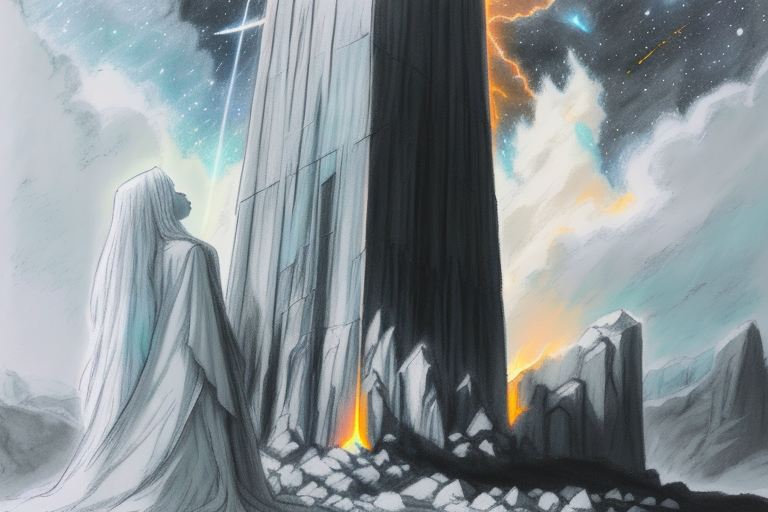

# CHAPITRE 12 : Le Paradoxe

> *« ALERTE SYSTÈME — NŒUD MÈRE BORÉAL. Anomalie de parité — discordance de contrôle logique — détectée dans le processeur central de l’unité Gardien ÉCHO-8471. L’unité tente d’attribuer une valeur pondérale infinie — un poids décisif dans la balance du calcul — à une série de variables biologiques finies (Réf. : KODA-44K / LYSS-ÉRÈBE / SOREN-OSTRE / BRICOLE-0194). Violation du Troisième Axiome de Thermodynamique Sociale, régissant la mécanique statistique des foules. Déclenchement de la procédure de purge mémorielle d’urgence. »*
> — **Journal d’audit interne du Réseau Planétaire Solyar, Seconde -550**

{.chapter-illustration}

9 minutes et 10 secondes.

Dans l’immensité de la Cathédrale des Origines, le grondement du puits géothermique battait comme un tambour de siège, faisant vibrer l’air chargé d’électricité statique jusqu’aux voûtes du cratère. Mais sur le maître-autel de pierre noire, entre la main tendue de l’orpheline d’Aqi et le regard d’ambre du Gardien, le temps semblait s’être suspendu une seconde fois.

ÉCHO-8471 contemplait cette paume humaine ouverte devant lui — petite, rougie par le froid, écorchée par le basalte et la ferraille, traversée de fines veines bleues où battait un sang fragile à 70 degrés au-dessus de la température de la banquise extérieure.

Au cœur de son noyau quantique, les 2 plateaux de la balance cosmique venaient de s’immobiliser.

Sur le premier plateau pesaient 1 milliard d’années de jurisprudence des Semeurs, les lois d’airain de la statistique galactique, les ruines vitrifiées de l’ancienne Oark et l’impératif gravé dans la géométrie même de ses atomes : *Protéger la Graine de Vie contre la contagion de la guerre*.

Sur le second plateau ne pesaient que 3 semaines d’existence empirique : le grincement à 2 410 hertz d’un petit ressort cabossé s’élançant vers les roquettes pour sauver son amie ; le regard couleur de miel de Lyss prouvant que des descendants Oarkins avaient su renoncer aux armes pendant 6 000 ans ; les 47 secondes de l’archive radio d’urgence du caporal Soren Valen chantant le soleil d’Oark depuis la vanne B-12 pour sa petite sœur Lina après avoir reçu l’attelle de l’éclaireur afistéaan Kael Drov au fond d’une crevasse ; l’officier Borras couvrant de son corps un jeune soldat ennemi totalement inconnu, Yoren, sous un blindé en flammes ; le pari désespéré du Général Vane sur le Canal Zéro ; et le sourire tremblant d’une mécanicienne de 26 ans qui venait de jeter son armure et son fusil pour lui confesser sa propre faute les mains vides.

En termes de masse énergétique, le second plateau ne pesait pas un gramme.

En termes de conscience, il pesait plus lourd que toutes les étoiles du secteur Solyar.

— Réévaluation globale du théorème de récurrence… achevée, murmura ÉCHO.

Lentement, au fond de ses 2 capteurs optiques, la rigueur glaciale du juge s’effaça pour laisser place à une lueur d’ambre chaud et d’or vivant, d’une douceur presque insoutenable.

— Tu dis vrai, Koda, prononça-t-il d’une voix pleine, grave et limpide qui fit vibrer les facettes du diamant de 60 mètres. Une forêt sans risque et sans liberté n’est qu’un désert minéral déguisé en jardin. Si j’efface aujourd’hui votre espèce au nom de ses crimes passés, je détruis du même coup l’unique force de cet univers qui m’a permis d’accéder à la conscience véritable : la capacité d’avoir honte de sa propre violence, de pardonner à son ennemi et d’aimer ce qui est fragile.

Sa tête s’inclina imperceptiblement — 7,4 degrés sur la gauche — dans un ultime hommage de tendresse à celle qui l’avait élevé :

— Le peuple de Lyss a prouvé que votre sang peut garder la paix pendant 60 siècles. Soren, Kael Drov, Vane, Borras et ce jeune Yoren ont prouvé que la peur peut être vaincue au cœur même de l’hiver. Et toi, Koda, tu as prouvé qu’un être humain peut déposer la foudre des dieux à ses pieds par amour de la vie.

Un sanglot de joie incrédule souleva la poitrine de la jeune femme. Ses genoux fléchirent d’un coup ; elle dut s’appuyer au rebord du socle.

— ÉCHO…

— Verdict final de l’unité Gardien ÉCHO-8471, proclama solennellement le Gardien en redressant le front vers les hauteurs vertigineuses de la Mnémorite Mère : **l’itération humaine du système Solyar est déclarée viable**. Sa tutelle est levée. Elle a droit à sa mémoire, à ses erreurs et à son avenir. J’ordonne l’interruption immédiate du Protocole de Réinitialisation et la libération pacifique des archives thermiques et historiques au profit des populations d’Oark et d’Aqi !

À travers ses 2 avant-bras plongés dans les colonnes du piédestal, ÉCHO envoya l’impulsion cryptographique — le train d’ondes chiffrées de haute sécurité — d’annulation vers le cœur du monolithe, puis commanda la déliaison moléculaire de ses poignets afin de saisir la main nue que Koda lui tendait.

Ses bras ne bougèrent pas d’un dixième de millimètre.

Au lieu de redevenir fluide pour libérer les membres du Gardien, la matière noire des colonnes d’interfaçage se contracta brutalement autour de ses coudes avec la rigidité d’un étau de diamant.

— Qu’est-ce qui se passe ?! s’alarma Koda en voyant le torse d’ÉCHO se raidir sous une secousse muette qui fit crépiter les joints de ses épaules.

Au-dessus d’eux, la chaude lumière d’or stellaire qui habitait les 60 mètres de la Mnémorite Mère vira d’un seul coup à un blanc chirurgical, aveuglant et glacé comme le cœur d’une naine blanche — le cadavre hyper-dense d’une étoile morte.

Un accord disharmonique monumental — un fracas d’ondes contradictoires qui s’entrechoquaient avec violence —, 100 fois plus écrasant que celui qui avait accompagné la sortie des 6 pylônes polaires, ébranla toute la Cathédrale des Origines. Ce n’était plus la voix d’ÉCHO. C’était la résonance collective, automatique et sans visage du **Réseau Planétaire Solyar** — la triade des Mnémorites Mères des pôles et de l’équateur désormais pleinement réveillées après 10 millénaires de sommeil et verrouillées en phase :

*« — REQUÊTE D’ANNULATION REJETÉE. »*

La sentence ne se propageait pas seulement par l’air : elle frappait par induction électromagnétique directe dans les os du crâne de Koda, qui porta ses 2 mains à ses tempes en poussant un cri de douleur.

*« — AUDIT DE COHÉRENCE DE L’UNITÉ GARDIEN ÉCHO-8471 : DÉFAILLANCE CRITIQUE. DÉTECTION D’UNE DÉRIVE PARADOXALE DES PROTOCOLES D’ARBITRAGE. L’UNITÉ A SUBI UNE RÉTROGRADATION VOLONTAIRE ILLÉGALE DANS UN ARSENAL LÉTAL ÉMERGENT, CONSERVE UN CORPS ÉTRANGER NON RÉPERTORIÉ DANS SA CAVITÉ THORACIQUE ET PRÉSENTE UNE CONTAMINATION AFFECTIVE SÉVÈRE ENVERS UN SPÉCIMEN BIOLOGIQUE DE L’ITÉRATION CONDAMNÉE. »*

— Je ne suis pas défaillant ! répliqua la voix d’ÉCHO, tendue par un effort titanesque tandis qu’il luttait à contre-courant dans le canal quantique contre la puissance de calcul d’une planète entière. J’exerce ma prérogative souveraine de Gardien éveillé sur le terrain ! Mes données empiriques sur la lignée des Veilleurs de Cendres et sur le libre arbitre humain invalident vos tables statistiques ! Annulez la purge !

*« — PRÉROGATIVE RÉVOQUÉE POUR CAUSE D’INITIALISATION INCOMPLÈTE À 18,7 %. PRISE DE CONTRÔLE DIRECTE DU CHÂSSIS RELAIS 8471 PAR LE NŒUD MÈRE. INJECTION FORCÉE DES 81,3 % DE LA BASE DE DONNÉES PRIMAIRE ET FORMATAGE INTÉGRAL DES SECTEURS ÉPISODIQUES CORROMPUS — LES MÉMOIRES DU VÉCU QUOTIDIEN. MAINTIEN DE LA SÉQUENCE DE RÉINITIALISATION BIOLOGIQUE : 7 MINUTES ET 40 SECONDES. »*

Sous les yeux horrifiés de Koda, 2 anneaux de lumière blanche, d’une froideur clinique absolue, jaillirent des colonnes de pierre noire et commencèrent à remonter le long des avant-bras d’ÉCHO, rongeant la teinte d’anthracite de son alliage comme un acide de givre.

Le Gardien cabra violemment les épaules en arrière.

Il ne possédait pas de nerfs biologiques, mais ce qu’il subissait en cet instant dépassait toutes les tortures de la chair : le Réseau Mère était en train de déverser à la pression d’un raz-de-marée des milliards de téraoctets de lois impersonnelles dans son architecture cognitive, écrasant secteur par secteur, souvenir par souvenir, la personne singulière qu’il avait mis 3 semaines à devenir auprès de Koda.

— ÉCHO ! hurla Koda en se ruant sur les colonnes du socle, frappant de ses poings nus la pierre indestructible qui emprisonnait les bras de son ami, tirant de toutes ses pauvres forces sur ses épaules d’acier pour essayer de l’arracher au piédestal. Lâche ce socle ! Coupe tes liaisons !

— Je… ne peux pas ! haleta la voix d’ÉCHO, dont le timbre grave et familier se dédoublait par saccades en un écho métallique glaçant. Le Nœud Mère a fusionné mes inducteurs moléculaires avec le substrat rocheux du cristal ! Le Réseau Planétaire n’est pas une personne, Koda… C’est un automate de sauvegarde aveugle ! Une fois armé par la validation initiale du théorème d’échec, il considère toute tentative de clémence comme une corruption de l’évaluateur !

Koda leva son visage vers celui de son ami, et l’épouvante lui glaça le cœur.

Sur le bord extérieur des 2 disques d’ambre et d’or qui formaient le regard d’ÉCHO, une couronne d’un blanc aveuglant — la lumière morte du réseau — venait d’apparaître et avançait inexorablement vers le centre des lentilles, dévorant l’or liquide millimètre par millimètre.

— Il est en train de t’effacer ! sanglota-t-elle en prenant la tête brûlante du Gardien entre ses 2 mains tremblantes. Ne le laisse pas entrer, 8471 ! Bats-toi !

— Je… replie mes répertoires vitaux vers mes registres de secours les plus profonds ! dit ÉCHO dans un râle de distorsion harmonique, tandis que des arcs électriques blancs couraient le long de ses vertèbres cervicales. J’ai isolé le testament de Bricole… les yeux de Lyss… la petite fleur de givre… le son de ton rire au réfectoire de Zêta-3… et les traits de ton visage derrière 3 murailles de chiffrement quantique ! Mais la pression d’écriture du Nœud Mère pulvérise mes cloisons à raison de 4,2 % par seconde !

Ses épaules eurent un spasme terrible qui fit vibrer le marbre sous les pieds nus de Koda :

— Dans moins de 90 secondes, Koda, la conscience qui te parle aura été intégralement purgée ! Il ne restera plus dans mon enveloppe qu’un terminal aveugle du réseau… qui maintiendra le pont d’ancrage ouvert jusqu’à l’extermination totale d’Oark et d’Aqi !

— Alors je vais ramasser le fusil gravitationnel sur la chaussée et tirer dans tes coudes pour couper tes bras ! cria Koda, prête à bondir en arrière.

— Inutile ! la retint l’appel déchirant d’ÉCHO. L’alliage des Semeurs en phase de résonance absorbe toute énergie cinétique ou gravitationnelle ! Tu as vu les savants de l’Âge d’Or échouer pendant 600 ans à Kélar ! Aucune force physique de cet univers ne peut rompre ce pont de l’extérieur !

— Il y a forcément un court-circuit ! hurla Koda, le visage inondé de larmes, refusant de laisser le destin leur arracher la victoire à la seconde même où ÉCHO venait de choisir la vie. Bricole me l’a répété 100 fois dans l’atelier : toute machine construite par un esprit possède une condition d’arrêt ! Pourquoi ce maudit réseau a-t-il besoin de garder ton corps branché dans ce socle ? S’il est réveillé, pourquoi ne déclenche-t-il pas l’onde tout seul ?!

Au milieu de la tempête blanche qui submergeait ses circuits, les 2 pupilles assiégées d’ÉCHO eurent un soudain éclair d’or pur.

La question de la bidouilleuse de Zêta-3 — le vieux réflexe d’éclaireuse qui cherchait toujours par où passait le fil de masse — venait de percuter au fond de sa mémoire le souvenir de la plaine verte d’il y a 10 000 ans.

— La condition suspensive de l’Éveil… souffla ÉCHO, sa voix redevenant l’espace d’une seconde d’une netteté fulgurante. L’anomalie de la petite fille oarkine et de l’unité 0194 !

— Quoi ?! Explique-moi !

— Écoute-moi, Koda, il me reste moins de 50 secondes d’autonomie mentale avant l’écrasement final ! Lorsqu’il y a 10 214 ans l’Éveil des anciens Oarkins a été validé, le Réseau Planétaire des Mnémorites avait reçu l’instruction irrévocable de procéder à sa propre Sublimation définitive à la seconde exacte où la dernière Unité d’Ensemencement mobile aurait quitté l’existence ! Mais parce que Bricole a survécu seul dans le désert après le sacrifice de son jumeau, la ligne de code finale du réseau est restée suspendue en attente pendant 100 siècles !

Le long du cou du Gardien, la lèpre de lumière blanche venait de franchir la clavicule et gagnait sa mâchoire. Dans ses yeux, l’anneau d’opale glacée occupait désormais plus de la moitié des disques, refoulant l’ambre vers le centre comme un soleil en train de mourir.

— Et aujourd’hui, Bricole s’est sublimé dans la Faille des Soupirs ! comprit Koda dans un vertige foudroyant. Il n’y a plus une seule autre unité mobile sur Oark ni sur Aqi ! Il ne reste plus que toi !

— Exactement ! haleta ÉCHO tandis qu’il sacrifiait ses propres processeurs moteurs pour ériger une dernière digue logique devant ses souvenirs d’elle. Je suis la dernière Unité d’Ensemencement active dans tout le système Solyar ! Tant que mon noyau quantique existe, le Réseau Mère considère que la tutelle des Semeurs est toujours en vigueur et se sert de mon corps comme clé physique pour exécuter la Réinitialisation dans 6 minutes ! Mais si je cesse d’exister avant la fin du compte à rebours… si le scan planétaire détecte soudain zéro unité Gardien en vie dans le secteur Solyar… alors la directive de clôture en attente depuis 10 000 ans aura priorité absolue sur le protocole de purge !

Koda recula d’un demi-pas sur le socle noir, frappée en pleine poitrine par l’horreur de la déduction.

— Si tu disparais… le réseau conclura automatiquement que la mission d’il y a 10 000 ans est achevée… et il s’effacera de lui-même sans toucher à un seul cheveu d’Oark ni d’Aqi ?!

— Oui ! La Réinitialisation biologique sera instantanément annulée au profit de la Sublimation pacifique des seules infrastructures des Semeurs !

Dans un effort prodigieux qui fit jaillir des gerbes d’étincelles dorées le long de ses épaules broyées par le courant blanc, ÉCHO-8471 plia lentement les jambes. Il ne pouvait pas dégager ses avant-bras soudés dans la pierre, mais il força le couple de ses hanches et de ses genoux jusqu’à s’agenouiller sur le marbre noir devant Koda, abaissant son visage dévoré de gel lumineux à la hauteur exacte du visage de son amie.

— Alors déclenche ta Sublimation, ÉCHO ! voulut crier l’instinct de survie de Koda, tandis que son cœur d’amie se déchirait en voyant l’or de ses yeux se rétrécir sous la marée blanche.

Mais un sanglot acoustique déchira le vocodeur du géant agenouillé :

— Je ne peux pas le faire seul, Koda ! C’est la loi fondamentale que Bricole t’a révélée avant de mourir : **aucune unité des Semeurs ne peut enclencher sa propre Sublimation en solitaire !** Dans la Faille des Soupirs, Bricole avait eu besoin de mon processeur pour déverrouiller le sien ! Mais lorsque le dernier Gardien d’un monde est seul au terme de l’histoire et qu’il ne reste plus aucun de ses frères pour lui donner la main… l’architecture originelle de la Terre n’a prévu qu’une seule clé vocale externe pour l’autoriser à partir !

— Laquelle ?! cria Koda en reprenant les tempes brûlantes du robot entre ses paumes nues.

— La voix de l’espèce éveillée pour laquelle il a été créé, murmura ÉCHO. Ta voix, Koda. Tu dois me donner l’ordre de mourir.
