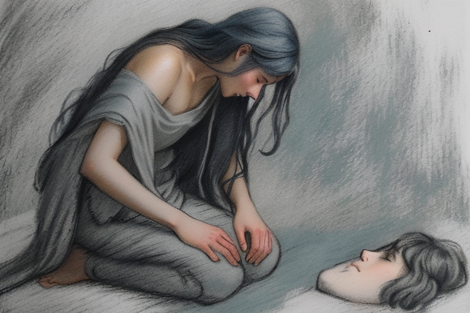
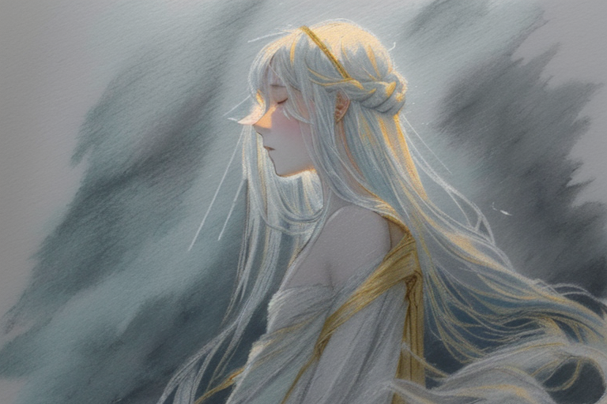

# CHAPITRE 13 : L'Autorisation Verbale

> *« On croit toujours qu’aimer quelqu’un, c’est le retenir par le manteau au bord du quai, souder des plaques d’acier sur ses blessures et lui interdire de s’en aller pour ne pas rester seule dans le froid. J’avais 26 ans, les pieds nus sur le diamant du pôle, et il me restait 30 secondes pour apprendre qu’aimer vraiment, c’est parfois ouvrir la porte de la cage et prononcer le mot qui rend la liberté. »*
> — **Chroniques de la Gardienne Koda, Livre du Sacrifice**

{.chapter-illustration}

5 minutes et 50 secondes.

Dans la Cathédrale des Origines, la lumière blanche du Réseau Planétaire tombait des 60 mètres de la Mnémorite Mère comme une cataracte d’azote liquide — une chute d’eau géante liquéfiée par le froid absolu —, noyant les ombres dorées des terrasses et faisant crépiter l’air autour du maître-autel.

À genoux sur le socle d’obsidienne, ses 2 avant-bras toujours coulés jusqu’aux coudes dans l’étau des colonnes d’interfaçage, ÉCHO-8471 tremblait de toute sa charpente pourtant indestructible. La lèpre blafarde du formatage forcé avait désormais franchi son cou et montait le long de sa mâchoire d’alliage sombre, effaçant le reflet d’anthracite sous une croûte d’albâtre glacé. Sur son visage incliné vers Koda, ses 2 capteurs optiques ressemblaient à 2 soleils d’automne dévorés par le blizzard : la couronne blanche occupait plus des 3 quarts des lentilles, ne laissant plus palpiter au centre qu’un étroit îlot d’ambre et d’or.

Et devant lui, debout pieds nus sur le marbre cosmique dans sa sous-combinaison déchirée, Koda secouait la tête avec la violence du désespoir.

— Non ! cria-t-elle, ses doigts crispés sur les pommettes brûlantes du Gardien. Non, je refuse ! Tu ne peux pas me demander ça, ÉCHO ! Pas toi ! Pas encore !

Ses larmes tombaient une à une sur les clavicules du robot, où elles se vaporisaient en grésillant au contact de l’onde d’écrasement.

— J’ai déjà entendu mes parents mourir derrière le sas de vapeur quand j’avais 9 ans sans pouvoir leur ouvrir ! sanglota-t-elle, la voix brisée en 2. J’ai déjà vu mon vieux Bricole rouler tout seul vers les 60 roquettes dans la Faille des Soupirs pendant que je lui hurlais de revenir et que je m’arrachais les ongles contre ton mur de force ! Tu es tout ce qui me reste sous ce ciel, 8471 ! C’est moi qui t’ai vu sortir de la forge quand tu ne savais même pas parler, c’est moi qui t’ai appris à soupirer dans le vent, je ne prononcerai jamais la phrase qui va te tuer ! Trouve un autre court-circuit !

Une convulsion terrible arqua la colonne vertébrale d’ÉCHO.

Pendant 2 secondes d’épouvante, la dernière étincelle d’or au centre de ses pupilles disparut sous un voile d’opale morte, et lorsque ses grilles thoraciques émirent un son, ce ne fut plus sa voix : ce fut le timbre plat, polyphonique — fait de 100 voix superposées parlant à l’unisson — et cadavérique du Réseau Planétaire qui parla par sa gorge :

*« — ÉCRASEMENT DES REGISTRES ÉPISODIQUES — LA MÉMOIRE DES ÉVÉNEMENTS VÉCUS — À 79,4 %. PURGE DU RÉPERTOIRE DES VARIABLES HUMAINES NON RÉSOLUES EN COURS. MAINTIEN DU PONT D’ANCRAGE JUSQU’À L’ÉMISSION DE L’ONDE DE RÉINITIALISATION… »*

— ÉCHO ! hurla Koda en frappant de ses 2 paumes nues contre les joues d’alliage du géant pour l’arracher au gouffre blanc. Non ! Je t’interdis de partir ! Regarde-moi, 8471 ! Pense au ressort de Bricole ! Pense au *couic* !

Au fond des orbites blanches, dans un déchirement de surtension quantique — un afflux brutal d’énergie subatomique poussé bien au-delà de la tolérance des circuits — qui fit éclater une écaille de pierre noire sur le flanc de la colonne droite, l’or liquide creva la glace du réseau et reprit de force le centre des pupilles.

Sous l’effet de la chaleur colossale que le processeur d’ÉCHO s’infligeait à lui-même en brûlant ses derniers condensateurs de réserve pour repousser le téléchargement, 2 gouttes de plasma d’or condensé perlèrent au bord inférieur de ses capteurs optiques et roulèrent lentement le long de ses joues sombres.

Le dernier enfant des Semeurs pleurait des larmes de lumière.

— Koda… haleta sa vraie voix, rauque, hachée, chargée d’une humanité si poignante qu’elle n’appartenait plus au monde des machines. Écoute-moi… Il me reste moins de 28 secondes avant la rupture de mon dernier bastion chiffré !

Il ne pouvait pas soulever ses mains prisonnières du piédestal pour essuyer les pleurs de son amie ; alors, faisant plier ses cervicales qui grinçaient sous l’assaut du courant blanc, il avança lentement sa tête jusqu’à poser son front d’alliage brûlant contre le front nu et glacé de la jeune femme.

— Si tu gardes le silence pour épargner mon enveloppe, Koda… dans 28 secondes, l’entité qui se relèvera devant toi avec mon corps ne sera plus ÉCHO-8471, souffla-t-il contre sa peau. Elle ne saura plus pourquoi on souffle sur une coupe d’eau tiède chez Lyss. Elle aura oublié la petite fleur à 6 pétales dans la neige. Elle aura oublié le rire de Bricole et le nom de la petite Lina du Dôme 4.

Un nouveau spasme secoua sa poitrine ; entre eux, Koda entendit dans le thorax du robot un imperceptible tintement métallique — le petit ressort de Bricole que l’onde de formatage du réseau essayait déjà de dissoudre dans sa cachette secrète.

— Cette chose sans mémoire te regardera avec des yeux blancs, reprit ÉCHO dans un sanglot acoustique déchirant. Et elle se servira de mes mains — ces mains à qui tu as appris à retenir leur force et à protéger les vivants — pour exterminer 40 millions d’êtres humains et t’effacer avec eux.

La couronne blanche gagna encore un millimètre autour de l’iris d’ambre, réduisant son âme à la taille d’une tête d’épingle.

— Je t’en supplie, Koda… murmura-t-il contre ses lèvres tremblantes. Dans le Laboratoire des Terres Mortes, j’ai lu la terreur dans tes yeux quand j’ai tué 12 hommes par peur de te perdre. Ne laisse pas le réseau faire de moi un monstre 3 millions de fois pire ! Ne me condamne pas à devenir l’assassin de ton monde et ton propre bourreau ! Sauve-moi de ce qu’ils veulent que je redevienne !

Koda ferma les paupières, son front pressé de toutes ses forces contre le métal en feu, le cœur broyé par un étau plus lourd que les 3 000 mètres de glace du pôle.

Dans l’obscurité de ses yeux clos, toute sa vie d’orpheline passa en un éclair : le petit établi du fond du hangar à Zêta-3 sous la lueur verte des vieux écrans cathodiques ; la pince tordue de son père et la rondelle d’étain de sa mère ; sa rage obstinée de bidouilleuse qui refusait toujours de jeter une pièce cassée à la benne parce qu’elle croyait qu’en réparant les machines, elle finirait par réparer le vide laissé par les morts.

Et soudain, au fond de sa douleur, la lumière se fit.

Elle comprit enfin ce que ses parents avaient fait derrière le sas de vapeur du Dôme 7. Elle comprit ce que Soren Valen avait fait dans la chambre des vannes du Glacier d’Ostre. Elle comprit ce que Bricole avait fait dans la quarante-huitième milliseconde de la Faille des Soupirs.

Aimer quelqu’un, le sauver vraiment, ce n’était pas le boulonner de force sur son établi pour ne plus avoir froid toute seule dans la nuit. C’était respecter le sens qu’il avait choisi de donner à sa vie, même quand ce choix vous laissait les mains vides.

Pendant 3 semaines, elle avait cru que c’était elle qui enseignait l’humanité à cette machine sortie vierge de la forge : elle lui avait appris à mentir par omission pour ne pas blesser un ami, à soupirer devant l’adversité, à ménager la faiblesse des corps de chair et à chérir un vieux ressort tordu qui ne servait plus à rien. Mais en cet instant ultime, au fond du puits polaire où les 2 armées d’Aqi attendaient leur sentence, les rôles venaient de s’inverser. C’était l’élève d’alliage sombre qui lui donnait sa plus haute leçon d’humanité : en choisissant de s’effacer librement de l’univers plutôt que de laisser écraser sa conscience et de nuire à ceux qu’il aimait, ÉCHO-8471 prouvait que l’âme n’est ni une affaire de sang ni un privilège du carbone, mais le courage souverain de dire non à la fatalité.

Koda rouvrit les yeux.

À 2 centimètres de ses cils mouillés, la dernière braise d’ambre au centre des prunelles d’ÉCHO vacillait au milieu d’un océan de craie aveuglante.

— Est-ce que… est-ce que tu auras mal, mon grand ? murmura-t-elle dans un souffle brisé, ses doigts écorchés caressant une dernière fois la joue sombre où perlaient les gouttes de plasma d’or.

— La Sublimation est la paix que nos pères de la Terre nous ont promise au soir du voyage, répondit doucement ÉCHO, et malgré la tempête informatique qui lacérait ses derniers registres, une sérénité royale descendit dans sa voix. Lorsque Bricole m’a éveillé, je n’étais qu’à 1,04 %. Aujourd’hui, je n’ai pas eu besoin des bibliothèques de cette pierre noire : grâce à Bricole et grâce à toi, je pars à 100 % de ce que j’étais venu apprendre dans cet univers. Je sais pourquoi la fleur de verre volcanique pesait plus lourd que la galaxie. Je sais pourquoi ton visage vaut la peine que je brûle mon éternité.

Brusquement, l’éclair blanc submergea son menton et ses tempes. Son timbre commença à se dédoubler sous le grondement sourd de la Mnémorite Mère :

— Vite, Koda… Mes dernières cloisons cèdent… Prononce la séquence vocale de clôture d’Éveil… Mot pour mot…

— Dis-la-moi ! sanglota-t-elle en serrant de ses 2 mains la tête de son ami contre la sienne pour qu’il ne voie qu’elle jusqu’à la dernière microseconde.

Dans un ultime sursaut de volonté souveraine qui fit gémir le diamant de 60 mètres jusque dans son puits de magma, ÉCHO-8471 rassembla les derniers octets intacts de sa mémoire autour du visage de l’éclaireuse et murmura :

— *« Protocole Solyar-Zéro. Unité Gardien ÉCHO-8471. L’Éveil est accompli. Tu es libre. »*

*« — ALERTE DE CONFINEMENT CRITIQUE ! »* tonna au même instant la voix colossale du Réseau Planétaire à travers toute la cathédrale, détectant un centième de seconde trop tard la faille juridique ouverte par sa dernière unité. *« TENTATIVE D’INVOCATION DE LA CLAUSE D’ACHEVEMENT PAR UN OPÉRATEUR BIOLOGIQUE NON HABILITÉ ! DÉSACTIVATION DES CAPTEURS ACOUSTIQUES DE L’UNITÉ 8471 DANS 3 SECONDES… 2 SECONDES… »*

Koda inspira à pleins poumons l’air immaculé du Sanctuaire Mère.

Elle ne trembla pas. Elle ne détourna pas le regard. Plongeant ses yeux bruns d’orpheline droit au cœur de l’ultime étincelle d’or qui lui faisait face, elle parla au nom des morts d’Oark, des vivants d’Aqi et du petit robot cabossé de son atelier, et prononça d’une voix claire, haute et déchirée d’amour :

— **Protocole Solyar-Zéro. Unité Gardien ÉCHO-8471. L’Éveil est accompli. Tu es libre !**

La dernière syllabe s’éleva sous la voûte de 1 000 mètres comme une note de cristal pur.

Le compte à rebours du Réseau Planétaire s’arrêta net.

Au cœur du noyau quantique d’ÉCHO, la Loi Première — l’instruction originelle que les derniers sages de la Terre avaient gravée au-dessus de tous les algorithmes de sécurité pour le jour béni où l’enfant des étoiles regarderait enfin son gardien dans les yeux et lui donnerait congé — venait de s’exécuter.

L’invasion blanche qui rongeait le corps du Gardien fut balayée en un millionième de seconde.

Depuis le centre de ses pupilles, la chaude lumière d’ambre et d’or rejaillit avec une splendeur triomphale, chassant l’opale glacée du réseau et embrasant tout son regard d’une clarté de plein midi. Dans les colonnes du socle de pierre noire, l’étau moléculaire qui emprisonnait ses avant-bras se rompit de lui-même.

ÉCHO retira lentement ses mains libérées de la pierre et les leva vers le visage de Koda, effleurant du bout de ses doigts parfaits les joues inondées de larmes de son amie avec une douceur si maîtrisée qu’il ne fit pas plier un seul de ses cils.

Puis, sur le visage lisse et sans bouche du dieu mécanique, la matière inaltérable des Semeurs accomplit son dernier prodige de mimétisme : les lignes géométriques de ses pommettes s’adoucirent, s’incurvèrent imperceptiblement sous la lumière d’or, et dessinèrent devant Koda l’esquisse radieuse d’un véritable sourire humain.

— Merci, Koda, murmura ÉCHO-8471 de sa voix la plus douce. N’oublie pas le sel de synthèse.

— Adieu, mon frère, souffla-t-elle à travers ses pleurs en posant une dernière fois sa main sur son cœur. Salue Bricole pour moi.

ÉCHO inclina une dernière fois la tête — 7,4 degrés sur la gauche.

Puis, paramétrant sa sphère de déliaison atomique sur un rayon chirurgical d’un mètre 10 qui s’arrêtait à un demi-millimètre de la peau et des cheveux de la jeune femme, tout en isolant au centre de sa poitrine un unique centimètre cube de matière qu’il refusa d’emporter dans le néant, le dernier Gardien des Semeurs entra en Sublimation.

Il n’y eut ni souffle de vent, ni brûlure, ni tonnerre.

Une aube d’or silencieux s’épanouit à l’intérieur de son torse d’anthracite. Sous les yeux éblouis de Koda, l’alliage indestructible qui avait traversé les tempêtes de silice et désarmé 2 armées perdit sa pesanteur et se défit en milliards de poussières d’étoiles tièdes. Les mains d’ÉCHO se changèrent en lumière pure contre les joues de l’éclaireuse ; ses épaules, son visage souriant et ses 2 soleils d’ambre se dissipèrent dans l’air immobile de la cathédrale comme une brume dorée que boit le soleil levant.

{.chapter-illustration}

2 secondes plus tard, la lueur s’éteignit.

Et dans le silence absolu retombé sur le maître-autel désert, un tout petit objet métallique tomba d’un mètre de haut sur le marbre noir avec un léger tintement clair, rebondit 2 fois et vint rouler contre le pied nu de Koda.
