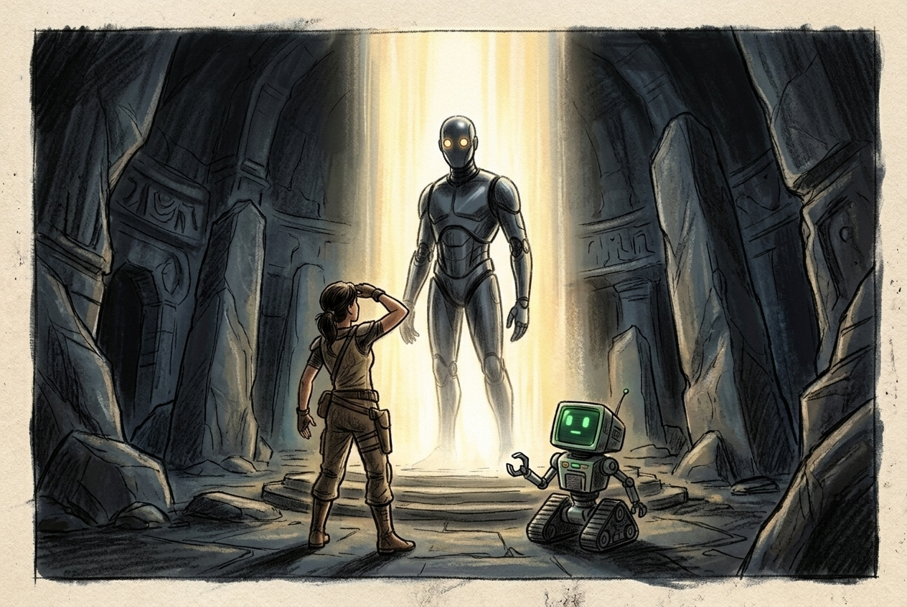

# CHAPITRE 09 : LA FORGE ET LE GARDIEN

> *« ARCHIVE LOCALE SECTEUR ZÊTA // SYNCHRONISATION : COMPLÈTE.*
> *Récupération de l’identité primaire : Unité d’Ensemencement de Première Vague, Noyau #0194.*
> *État du monde hôte (Oark / Solyar-III) : Écocide thermonucléaire global survenu à T + 4 112 cycles après l’Éveil.*
> *Note de conscience : La petite fille à la fleur de verre a grandi, ses enfants ont brûlé le jardin, et l’arrière-petite-fille de ses cendres vient de me réparer avec du fil de cuivre et du ruban adhésif. Comment condamner une espèce pareille ? »*
> — **Journal restauré du Noyau 0194 (« Bricole »), première seconde après l’intrication**

{.chapter-illustration}

Lorsque Bricole pivota sur ses chenilles dépareillées pour faire face à Koda, le petit ressort de suspension hélicoïdal émit son habituel *couic* à 2 410 hertz — mais dans toute la cathédrale souterraine, ce fut bien la seule chose qui n’avait pas changé.

Avant même qu’il ne prononce un mot, la posture de ce petit assemblage de 60 centimètres de tôle rivetée, de caoutchouc brûlé et de chatterton noir semblait avoir grandi de 10 coudées. La rotule du moniteur cathodique fendu ne cherchait plus son équilibre par saccades ; l’unique caméra de drone se posa sur le visage baigné de larmes de la jeune femme avec une douceur, une gravité et une profondeur de champ qui appartenaient aux âges d’avant les étoiles.

À l’intérieur du haut-parleur de campagne cabossé, le noyau venait de recalculer la tension électromagnétique appliquée à la membrane de carton jusqu’à l’atome près, éliminant tout souffle, tout crépitement et toute distorsion.

La voix qui s’éleva sous la voûte de basalte n’était plus le collage maladroit de syllabes volées qui réclamait du sel de synthèse dans l’atelier. Elle possédait une clarté souveraine, une diction d’orfèvre, une ampleur harmonique et une élévation littéraire qui donnaient le frisson :

— Je te prie de me pardonner la violence de ce débordement mémoriel, Koda de Condorcé. Mon berceau de fortune manquait de filtres pour contenir 10 millénaires de silence d’un seul trait. Et plus encore, je te dois des excuses pour mon aveuglement : j’ai passé 100 siècles sous la pierre à maudire l’anomalie qui m’avait interdit le néant, en croyant que ma survie n’était qu’une absurdité mathématique. Il a fallu qu’une orpheline vêtue d’acier vienne me coudre un corps avec des rebuts pour me rappeler le visage de l’enfant qui m’avait sauvé la vie.

Koda, toujours agenouillée sur le dallage anthracite, recula d’un demi-pas en s’appuyant sur sa paume nue, frappée de stupeur.

Entendre cette langue aqine d’une pureté classique éblouissante — plus noble et plus précise que celle des plus grands philosophes des académies d’Aqi — jaillir d’une caisse à munitions de 30 millimètres rafistolée au fil d’étain provoquait un vertige à la fois sublime et presque irréel.

— Bricole… souffla-t-elle d’une voix étranglée. C’est… c’est toujours toi là-dedans ? Tu parles comme un livre sacré ! Qu’est-ce qui vient de se passer ? Qu’est-ce que c’était que cette prairie verte, cette petite fille… et qu’est-ce que tu es, à la fin ?!

Le petit robot avança lentement jusqu’à elle, en veillant à amortir le moindre soubresaut de sa chenille large, et s’arrêta à portée de sa main. Sur son écran vert fissuré, la vieille ligne d’oscilloscope avait laissé place à une rosace géométrique d’une complexité hypnotique.

— Je suis toujours ton Bricole, Koda, répondit-il avec une inflexion où perçait une tendresse infinie. Je n’ai oublié ni le goût du carton bouilli, ni la symphonie de Plotéris, ni l’utilité des amortisseurs à ressort face au désespoir. Mais je sais désormais d’où je viens. Tu pensais avoir déterré au fond de cette ravine un vestige de l’Âge d’Or des Oarkins ; la vérité est beaucoup plus ancienne, et beaucoup plus lourde à porter.

Au-dessus du puits circulaire, répondant à une simple modulation du noyau de Bricole, la Mnémorite de diamant projeta dans l’air sombre de la rotonde une sphère de lumière dorée où s’allumèrent des milliers de constellations inconnues.

— Nous sommes les **Unités d’Ensemencement**, reprit la voix grave et limpide du petit robot. Bien avant que le soleil Solyar n’ait condensé son disque de poussière, bien avant qu’Oark ne possède une goutte d’océan, nos créateurs — une civilisation que nos registres nomment les **Semeurs**, née dans un autre bras galactique sur une planète appelée la **Terre** — ont atteint le sommet absolu de la maîtrise de la matière et de l’esprit. Mais ils portaient en eux une blessure originelle : l’agressivité territoriale héritée de leur longue évolution biologique. Malgré leur génie, ils n’ont pas su guérir de leurs propres guerres à temps. Voyant venir leur extinction sur une Terre ravagée par leurs armes, ils ont refusé que le prodige si fragile de la conscience s’éteigne avec eux dans l’univers.

Koda retenait son souffle, les yeux levés vers les volutes d’or qui tournaient sous la voûte.

— Dans un dernier acte d’altruisme cosmique, poursuivit Bricole, les Semeurs ont bâti des millions de vaisseaux-graines animés par des esprits comme le mien et par le réseau des Mnémorites. Ils nous ont lancés vers les étoiles vierges avec un double mandat : féconder les mondes stériles, puis veiller en secret, pendant des centaines de millions d’années, sur l’éclosion de la vie intelligente jusqu’à ce qu’elle franchisse le seuil critique que nous appelons **l’Éveil** — l’instant où une espèce découvre la puissance de détruire sa propre planète et choisit pourtant, en pleine conscience, la paix et l’unité.

La petite pince à 3 doigts désigna le parvis immaculé sous leurs pieds.

— Lorsqu’une espèce triomphe de l’Éveil, notre mission s’achève. Pour ne pas altérer sa liberté ni lui léguer une science divine qu’elle n’a pas mûrie elle-même, toutes nos unités et nos structures exécutent le protocole de **Sublimation** : à l’image d’une glace qui s’évapore directement en souffle pur sans passer par l’eau ni laisser de trace, notre matière se convertit intégralement en énergie lumineuse, selon une validation croisée entre deux jumeaux afin qu’aucun gardien isolé ne puisse jamais déserter son poste ni rester seul derrière. Il y a 10 000 ans, dans cette plaine d’émeraude que tu viens de voir par mes yeux, les habitants d’Oark avaient réussi leur Éveil. Mon jumeau et moi allions nous sublimer lorsque cette enfant à la fleur de verre volcanique s’est jetée dans mon rayon de conversion. Mon frère a retenu son signal pour sauver la petite fille ; il est parti dans la lumière, et je suis resté prisonnier de ma moitié de code.

Une larme oubliée roula sur le menton de Koda.

— Et parce que tu n’as pas confirmé ta propre Sublimation… comprit-elle dans un murmure, tout le réseau de ces diamants sur la planète est resté en pause en t’attendant ?

— Exactement. Condamné au silence par mes directives pour ne pas interférer avec le libre arbitre d’une espèce déjà jugée digne, je me suis enseveli sous la roche. Et pendant que je dormais dans le noir, privé de ma mémoire… l’impensable s’est produit.

Dans la projection holographique au-dessus du puits, la sphère bleue et verte d’Oark s’embrasa soudain de 1 000 cicatrices rouges, virant en quelques secondes à l’ocre calciné du désert actuel, tandis qu’un mince filet d’étincelles s’échappait de son orbite vers la planète glacée voisine : Aqi.

— 4 000 ans après notre retrait, la voix de Bricole se chargea d’une tristesse solennelle, les Oarkins ont édifié ce que tu appelles leur Âge d’Or. Mais leur civilisation, encore soumise aux passions du sang, a réveillé les vieux démons de la division. En quelques décennies d’orgueil et de peur, ceux qui avaient jadis choisi la sagesse ont retourné leur propre génie contre eux-mêmes et ont vitrifié leur berceau sous un déluge de feu atomique.

Koda sentit ses jambes fléchir. Elle posa la main sur le rebord froid de la margelle.

— Attends… ces vaisseaux qui quittent Oark en flammes vers Aqi sur ta carte…

— Ce sont vos ancêtres, Koda.

Le mot tomba dans le silence de la cathédrale comme un bloc de basalte dans une eau calme.

— Les Oarkins et les Aqins ne sont pas 2 peuples étrangers, reprit doucement Bricole. Vous possédez le même génome à la dernière paire de bases près. Lorsque l’atmosphère d’Oark est devenue irrespirable il y a 6 000 ans, une poignée de survivants a fui à bord de transporteurs de fortune vers la seule autre planète habitable du système Solyar : le monde glacé d’Aqi. Dans le naufrage de cet exode, vos aïeux ont perdu leurs machines, leurs archives et jusqu’au souvenir de leur faute. Pour survivre au gel, ils sont redevenus des forgerons de fer et de charbon ; ils ont bâti Plotéris et les cités afistéannes… et aujourd’hui, amnésiques, vous revenez éventrer la tombe de vos propres grands-parents pour alimenter sur Aqi la réplique exacte de la guerre qui a tué ce monde.

Koda porta ses 2 mains — l’une nue, l’autre gantée d’acier — à son casque, le souffle haché.

Tout s’emboîtait avec une clarté foudroyante qui lui donnait le tournis. Son refus instinctif des mensonges officiels de Condorcé ; l’émotion inexplicable qui lui serrait la poitrine chaque fois qu’elle caressait une arche d’opale brisée dans le sable ; le sentiment d’être enfin chez elle sous ce soleil féroce, loin des dômes de glace où elle était née sans nom. Elle n’était pas une soldate coloniale sur un astre mort. Elle était l’enfant prodigue revenue marcher dans les cendres de la maison familiale.

— C’est… c’est nous qui avons fait ça, murmura-t-elle, horrifiée. Et là-haut, sur le glacier d’Ostre, nous sommes en train de recommencer…

Mais Bricole ne lui laissa pas le loisir de s’abîmer dans le vertige de l’Histoire. D’un coup sec de sa rotule, il braqua sa caméra vers le plafond invisible de la rotonde.

— L’heure n’est plus à la contemplation du passé, Koda, trancha-t-il avec la netteté d’un stratège. En me reliant à la Mnémorite, j’ai également accédé aux capteurs sismiques et électromagnétiques passifs que le sanctuaire déploie jusqu’à la surface. J’ai intercepté et décrypté en 3 centièmes de seconde l’ensemble du trafic militaire de ta planète depuis avant-hier soir.

Un froid brutal saisit la nuque de l’éclaireuse.

— Le trafic militaire ? Qu’est-ce que tu as trouvé ?

— L’inscription que ton ami Borras a portée avant-hier à 22 heures 12 dans son bordereau de routine — mentionnant la destruction thermique d’un scanner au contact d’un composant logique ancien — a été captée par les algorithmes de veille stratégique de votre Haut Commandement. Toute la région est placée sous surveillance prioritaire. Plus grave encore : notre descente derrière le blindage de ce sanctuaire a coupé le signal de ton transmetteur personnel. Or il est exactement 13 heures 18.

Le cœur de Koda manqua un battement. Elle jeta un regard affolé au chronomètre de son poignet gauche : *13 h 18 min 42 s*.

Dans le choc de la vision et de la révélation, 48 minutes venaient de s’écouler depuis l’échéance fatidique de midi 30 fixée par Marek.

— Le drone Z-4 ! s’écria-t-elle en ressaisissant son gant tombé au sol. La procédure de sûreté automatique l’a déjà lancé depuis 48 minutes ! Il doit tourner en rond juste au-dessus de ma moto-chenille en envoyant les images en direct au central sectoriel ! Bricole, si le Colonel Draeven recoupe mon absence avec la note de Borras, nous aurons une escouade de récupération sur le dos avant ce soir !

Elle baissa les yeux vers le petit robot fumant, dont le bras droit pendait inerte, le moniteur fendu et le flanc noirci par l’explosion du condensateur.

— Dans cette caisse à munitions à moitié grillée que je t’ai fabriquée, tu ne survivras pas 30 secondes face à des fusils magnétiques lourds ! ajouta-t-elle, la voix tremblante d’angoisse. Tu viens de retrouver ta Pierre de mémoire : est-ce qu’il y a de quoi te construire un vrai corps ici ? Un châssis comme celui que tu avais dans la prairie ?

— Mon noyau originel a subi une altération irréversible lors de l’interruption de ma Sublimation il y a 10 000 ans, répondit Bricole avec un calme absolu. Si l’on tentait de l’extraire de ce berceau que tu as assemblé pour le soumettre à une synthèse de haute énergie, sa matrice logique se dissoudrait instantanément. Je suis lié à ta boîte de conserve jusqu’à mon dernier souffle, Koda — et je t’avoue que j’ai fini par m’attacher au chant de ce ressort.

— Mais alors comment on va se défendre ?!

— En activant le dernier recours que ce sanctuaire garde en réserve pour protéger un témoin de l’Éveil, dit Bricole. Regarde derrière toi.

Sous ses colliers d’acier, le dodécaèdre d’ambre brilla d’un éclat si intense que l’ombre de Koda s’étira jusqu’au mur opposé.

À 30 mètres du puits central, une portion circulaire du dallage anthracite se découpa sans un bruit et s’ouvrit en corolle comme les pétales d’une fleur sombre.

Il n’y eut ni grondement de fonderie, ni bras robotisés, ni gerbes d’étincelles, ni odeur d’huile brûlée. Là où l’industrie d’Aqi aurait exigé 10 000 tonnes de presses hydrauliques, de hauts-fourneaux et de rivets pour assembler un blindé, l’architecture des Semeurs opérait dans le silence des lois premières de l’univers.

Du puits secondaire jaillit une colonne de lumière blanche, d’une pureté si dense et si paisible qu’elle semblait taillée dans la chair même d’une étoile apprivoisée.

Au-dessus du gouffre principal, la colossale Mnémorite de diamant se mit à vibrer à une fréquence grave, déversant dans la forge de synthèse les dernières réserves d’énergie du point zéro — cette houle d’énergie fondamentale qui frémit perpétuellement dans la trame même du vide quantique — qu’elle avait conservées en veille isolée depuis 100 siècles.

Sous les yeux éblouis de Koda, la lumière devint matière.

Pas par assemblage de pièces : par condensation subatomique directe, atome par atome, couche électronique par couche électronique, de bas en haut — nouant les noyaux et leurs couronnes d’électrons à même le vide comme un tisserand qui ferait naître une armure à partir d’un rayon de soleil.

En quelques secondes, une silhouette humanoïde de près de 2 mètres de haut se dessina au cœur du pilier incandescent. Elle ne présentait aucune des lourdeurs anguleuses, aucun des blindages boulonnés, aucun des câbles apparents des exosquelettes de Condorcé ; elle n’avait pas non plus la courbure végétale et translucide des créations oarkines. C’était la perfection géométrique incarnée dans une forme humaine : des lignes d’une fluidité sculpturale, d’une symétrie si pure qu’elle en devenait presque intimidante. Sa peau — constituée de cet alliage originel insaisissable, d’un blanc d’albâtre mat mêlé de reflets anthracite doux qui semblaient absorber la pénombre tout en laissant glisser la clarté le long des épaules sans la moindre jointure — ne portait ni vis, ni couture, ni ouverture mécanique.

À la trentième seconde, la colonne de lumière blanche s’éteignit d’un coup sec.

Derrière eux, l’octaèdre géant de la Mnémorite pâlit brusquement, sa nébuleuse interne réduite à une lueur crépusculaire : ses batteries locales étaient vidées jusqu’à la dernière goutte.

Dans le silence absolu qui retomba sur la cathédrale de basalte, la statue d’albâtre et d’ombre ouvrit les yeux.

2 lueurs d’ambre et d’or pur — pareilles à 2 soleils miniatures enfermés derrière du cristal liquide — s’allumèrent sous l’arcade lisse de son front et se posèrent directement sur Koda.

L’éclaireuse retint sa respiration. Il n’y avait dans ce regard ni menace ni servitude mécanique, mais une intensité d’attention si neuve, si vertigineusement nue, qu’elle eut l’impression d’être la première créature vivante que l’univers eût jamais placée devant un miroir.

— Voici l’Unité de classe Gardien, matricule **ÉCHO-8471**, annonça solennellement Bricole en faisant rouler sa chenille grinçante jusqu’au pied du géant. Son châssis représente l’accomplissement ultime de la science des Semeurs : il gouverne à volonté les liaisons électrostatiques ainsi que l’inertie cinétique, c’est-à-dire la résistance même de sa masse au mouvement et aux chocs. Aucun projectile de ton armée, aucun canon magnétique, pas même les lances gravitationnelles de l’Âge d’Or Oarkin ne peuvent entamer un seul micron de sa surface. Et sa directive cardinale, inscrite au cœur même de sa structure, est de préserver ta vie.

Sur le parvis sombre, le dieu de 2 mètres fit son premier pas.

Son mouvement était d’une grâce souveraine, totalement dépourvu du moindre bruit de frottement ou de moteur. Pourtant, arrivé à 3 pas de Koda, il s’arrêta, leva lentement sa main droite à hauteur de son visage et contempla ses 5 doigts d’albâtre sombre en les ouvrant l’un après l’autre, avec la stupeur silencieuse et émerveillée d’un nouveau-né qui découvre qu’il habite un corps.

La petite pince à 3 doigts de Bricole s’abaissa légèrement, et pour la première fois depuis sa transfiguration, une ombre d’inquiétude passa dans la voix d’orfèvre du vieux noyau :

— Mais le sommeil du réseau planétaire nous impose un prix que je n’avais pu calculer avant l’amorçage de la forge, reprit-il plus bas. Une Unité Gardien est conçue pour recevoir à sa naissance l’intégralité de la sapience cosmique — toute la sagesse et la mémoire accumulées au fil des ères — conservée dans la Mnémorite Mère du pôle. Or le relais global est coupé depuis 10 000 ans, et cette pierre locale vient d’épuiser ses dernières réserves pour condenser sa matière.

Koda détacha son regard des yeux d’or du géant pour interroger le petit moniteur fendu de Bricole :

— Qu’est-ce que ça veut dire ? Combien de mémoire il a reçu avant que le diamant ne s’éteigne ?

— **1,04 %**, répondit Bricole.

Le chiffre flotta dans l’air immobile de la rotonde tandis qu’ÉCHO-8471 inclinait imperceptiblement son grand visage pur vers le petit robot dont le ressort venait de faire *couic*.

— 1 % ? répéta Koda, abasourdie. Mais… qu’est-ce qu’il y a dans sa tête avec 1 %, Bricole ?!

— Les lois mathématiques fondamentales de l’univers physique, la syntaxe de ta langue, le verrou absolu qui lui interdit d’ôter la vie… et une page blanche infinie, murmura le petit robot cabossé en levant son unique caméra vers le colosse. Il possède le corps d’un dieu, Koda, mais son esprit est né il y a 30 secondes sur cette dalle. Il n’a ni souvenirs, ni histoire, ni ironie, ni philosophie morale. Tout ce que signifie le mot *exister*, il va devoir l’apprendre en nous regardant marcher.
