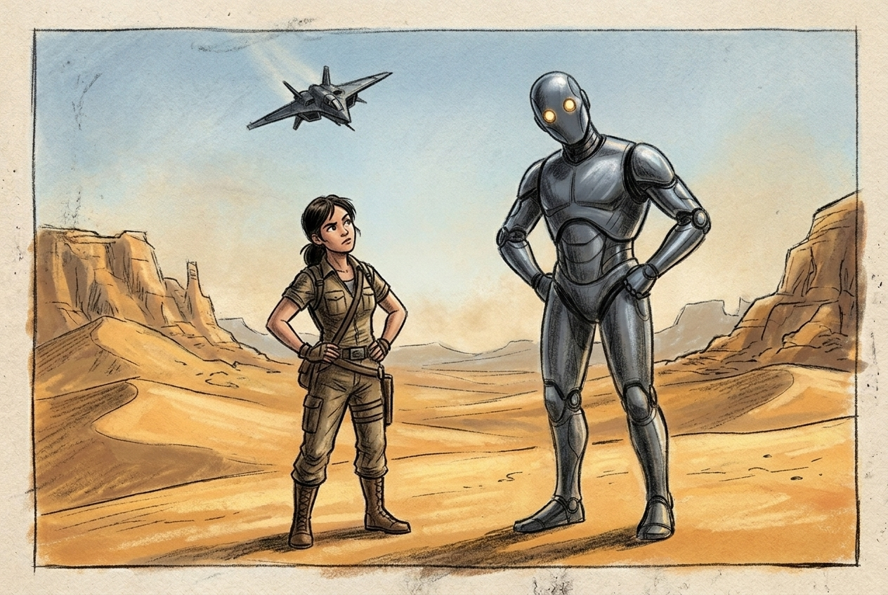

# CHAPITRE 10 : LE REGARD DU CIEL

> *« ENTRÉE #0001 — OBSERVATION EMPIRIQUE DU SUJET PROTÉGÉ (KODA) :*
> *Lorsqu’elle élabore un énoncé dont la probabilité de véracité est inférieure à 12 %, le sujet Koda incline l’axe de ses vertèbres cervicales de 7,4 degrés vers la gauche tout en comprimant sa commissure labiale droite.*
> *Hypothèse : ce déséquilibre gravitationnel volontaire du crâne favorise l’acceptation sociale des mensonges en milieu aride. Application immédiate recommandée. »*
> — **Répertoire des Variables Humaines Non Résolues d’ÉCHO-8471, minute 18 après l’initialisation**

{.chapter-illustration}

Pour descendre les 42 mètres de la faille d’obsidienne, il avait fallu à Koda 20 minutes d’efforts acharnés, un treuil mécanique hurlant à la rupture, 2 pitons thermiques et des gouttes de sueur plein les cils.

Pour les remonter, il fallut 11 secondes à ÉCHO-8471.

Lorsqu’ils eurent regagné à grands pas l’entrée du sanctuaire — après 15 minutes de marche rapide le long du couloir octogonal durant lesquelles les yeux d’ambre du nouveau-né de 2 mètres n’avaient pas quitté d’une fraction de seconde la nuque et les épaules de l’éclaireuse —, la muraille anthracite s’ouvrit puis se referma derrière eux sans laisser la moindre ride dans la pierre noire.

De retour dans l’air sec du fond du ravin, Koda s’apprêtait déjà à ressaisir son filin d’acier et à sangler Bricole sur son dos malgré la douleur qui lui tirait les omoplates.

Elle n’en eut pas le temps.

Sans le moindre bruit de pas sur le gravier volcanique, la haute silhouette d’albâtre sombre et d’anthracite s’approcha d’elle. D’une seule main, avec une aisance si tranquille que les 22 kilos de ferraille et de plomb parurent soudain ne pas peser plus qu’une feuille de papier sec, ÉCHO souleva le châssis cabossé de Bricole et le cala contre son flanc droit. Puis il glissa son bras gauche sous l’épaule blindée de la jeune femme.

— Eh, attends une seconde, mon grand, qu’est-ce que tu… commença Koda en sentant ses bottes quitter le sol.

Le contact du bras d’ÉCHO contre son plastron de céramique était déconcertant : la matière des Semeurs n’avait ni la froideur métallique de l’acier aqin, ni la tiédeur moite du vivant, mais une fermeté soyeuse, absolument inerte thermiquement, sous laquelle on devinait une réserve de puissance capable de retenir une montagne.

ÉCHO ne prit aucun élan. Il n’enfonça pas ses doigts dans les fissures de la roche.

Il posa simplement la plante nue et lisse de son pied droit à la verticale contre le miroir d’obsidienne. Au point de contact submicronique de sa semelle, les forces de Van der Waals — cette attraction intime entre molécules voisines qui permet aux pattes d’un lézard des sables de coller à une paroi de verre en mariant leurs nuages d’électrons — et les liaisons électrostatiques de la roche volcanique s’alignèrent instantanément sur la commande de son châssis. Puis il se mit à marcher vers le ciel.

Perpendiculairement à la falaise.

Koda retint un cri de pur vertige en voyant le lit du canyon plonger sous ses talons à la vitesse d’un obus. Pourtant, son estomac ne se souleva même pas : tout en gravissant la muraille de 42 mètres à grandes foulées régulières, le Gardien compensait l’accélération et l’inertie locale autour du corps de sa protégée avec une douceur hydrostatique — comme si elle flottait en apesanteur au milieu d’un bain d’eau tiède qui soutenait uniformément chacun de ses membres.

À 20 centimètres de sa visière, le profil sculptural d’ÉCHO se découpait dans la clarté croissante qui tombait de la lèvre supérieure du gouffre. Ses 2 iris d’or liquide se dilataient et se contractaient par micro-ajustements silencieux, absorbant 1 million de paramètres à la seconde : la composition chimique des strates de basalte, la diffraction des rayons solaires qui s’éparpillaient en halos irisés autour de chaque grain de poussière en suspension, le sifflement du vent là-haut, et le pouls affolé à 130 battements par minute qui cognait dans la carotide de la jeune femme.

— Respire par le ventre, Koda, conseilla la voix désormais limpide et veloutée de Bricole depuis le creux de l’autre bras, ponctuée par un petit *couic* amusé de son ressort. Pour l’architecture d’ÉCHO, le vecteur gravitationnel d’une planète tellurique n’est pas un obstacle, c’est à peine une politesse géométrique.

À la onzième seconde, le géant franchit le rebord supérieur de la corniche dans un mouvement continu, déposa délicatement les bottes de Koda sur le plateau de grès à 3 pas de sa moto-chenille, puis posa Bricole à côté d’elle.

La fournaise de 14 heures les cueillit de plein fouet.

Après la fraîcheur immaculée de la caverne millénaire, le plateau extérieur semblait appartenir à l’antichambre d’un haut-fourneau. Le soleil Solyar, au zénith d’un ciel d’étain jauni par les restes du cyclone, dardait une lumière brutale qui faisait trembler l’horizon dans des vapeurs de plomb fondu.

Pour ÉCHO-8471, c’était le premier matin du monde.

Le Gardien fit 2 pas jusqu’au bord de la dune sèche qui jouxtait les rochers et s’immobilisa. Jamais, dans les 18 minutes qui s’étaient écoulées depuis que la forge de lumière l’avait condensé au fond du sanctuaire, ses capteurs n’avaient connu l’espace ouvert.

Il s’agenouilla lentement dans la poussière rouge.

De sa main droite d’albâtre mat, il recueillit une poignée de sable de silice brûlant et la souleva à hauteur de ses yeux d’ambre. Il ouvrit légèrement les doigts pour laisser filer un mince sablier de grains d’ocre dans le vent chaud. Pour son processeur initialisé à 1,04 %, chaque cristal de quartz qui tournoyait au soleil était une équation de réfraction nouvelle — un minuscule prisme qui brisait et déviait l’éclair lumineux selon un angle inédit —, un prodige cinétique imprévisible. Il effleura de l’index le filet de poussière, fasciné par la manière dont le vent — une force désordonnée que nul algorithme du sanctuaire ne gouvernait — dessinait des rides éphémères sur la pierre.

Puis sa voix s’éleva pour la première fois sous le ciel d’Oark.

Ce n’était ni le timbre haché du premier Bricole, ni l’éloquence chaleureuse et habitée du vieux noyau restauré. C’était un cristal vocal d’une pureté acoustique absolue, calme, grave, mais d’une candeur désarmante où chaque mot semblait posé à plat sur une table de marbre :

— Température de surface : 46,8 degrés Celsius. Vitesse moyenne des particules abrasives : 9 mètres par seconde. Question, Koda : ce milieu présente un taux d’usure mécanique élevé et une habitabilité biologique médiocre. Pourquoi ton rythme cardiaque a-t-il diminué de 12 % dès que tu as revu ce sable ?

Koda, occupée à redresser à la hâte le trépied de sa balise relais, se tourna vers le colosse agenouillé dans la poussière. Malgré l’urgence qui lui tordait les tripes, le spectacle de ce guerrier indestructible qui regardait couler du sable entre ses doigts avec l’émerveillement d’un enfant de 3 ans au bord d’une plage lui serra le cœur.

— Parce que c’est chez moi, ÉCHO, répondit-elle rapidement en resserrant la sangle de son fusil. Et parce qu’une boîte en fer-blanc sous 40 mètres de pierre, même très propre, ça finit par donner le cafard. Mais là, tout de suite, on n’a pas une seconde pour la géologie ! Il est 14 heures passées, mon créneau radio a expiré depuis une heure et demie, et dès que je vais rallumer mon transmetteur longue portée, mon lieutenant va me passer un savon à décorner les bœufs !

Elle s’accroupit devant le tableau de bord de sa moto-chenille, la main posée sur le commutateur d’émission, cherchant fiévreusement comment sauver les apparences avant de déguerpir.

— Voyons… marmonna-t-elle entre ses dents en plissant le coin de la bouche et en penchant la tête sur son épaule gauche selon son tic habituel. Si je dis à Borras qu’une coulée de gravier magnétique a coincé le tambour de mon treuil au fond de la faille et a court-circuité ma prise d’antenne pendant que je dégageais le câble au burin… Avec le vieux Jaro qui râle toujours contre l’usure des treuils de série 2, ça devrait passer comme une lettre à la poste, non ?

Elle leva les yeux vers ses 2 compagnons pour chercher leur approbation — et resta bouche bée.

Debout derrière la moto, du haut de son mètre 98, ÉCHO-8471 venait d’incliner son grand crâne d’albâtre et d’anthracite d’exactement 7,4 degrés sur la gauche.

Plus sidérant encore : à l’aide des micro-actuateurs de son masque facial pourtant dépourvu de muscles humains, il avait très légèrement relevé le coin droit de sa lèvre lisse tout en plissant d’un demi-millimètre l’iris d’or de son œil gauche — reproduisant au micron près la moue sceptique et un peu coupable que Koda affichait chaque fois qu’elle inventait un bobard dans l’atelier.

Koda cligna des paupières, interdite.

— Qu’est-ce que… Qu’est-ce que tu fais avec ta tête, là ?

Le géant garda son cou penché à 7,4 degrés avec un sérieux papal.

— J’applique votre posture d’optimisation rhétorique, Koda, répondit ÉCHO de sa voix de cristal pur. Depuis mon initialisation il y a 18 minutes et 40 secondes, j’ai relevé que vous inclinez votre axe cervical selon cet angle précis chaque fois que vous formulez une hypothèse dont la probabilité de réussite est inférieure à 15 %. D’après mes calculs préliminaires sur votre comportement, cette dissymétrie faciale semble destinée à augmenter de 34 % l’indulgence de l’interlocuteur face à une erreur manifeste. Est-ce que mon exécution angulaire est correcte ?

Au pied de la roue arrière, le petit ressort de Bricole lâcha un *couic* qui ressemblait furieusement à un hoquet de rire.

— Je crains, ma chère Koda, commenta suavement le petit robot sur chenilles, que notre page blanche n’ait choisi son modèle de référence avec un réalisme redoutable. Tu viens d’enseigner la mauvaise foi à une arme cosmique en moins de 20 minutes.

— Mais je ne penche pas la tête comme ça quand je mens ! s’indigna Koda, les joues écarlates sous son casque, avant de s’apercevoir qu’elle avait encore le cou tordu sur la gauche et de se redresser brusquement. Enfin… redresse-toi, ÉCHO, on dirait un pélican qui a un torticolis ! Et ne raconte jamais d’histoires de pourcentages à Borras !

Elle enfonça le commutateur de son émetteur longue portée.

À la seconde même où le circuit s’ouvrit, la fréquence d’urgence de Zêta-3 explosa dans ses écouteurs avec une telle violence qu’elle dut baisser le gain d’une main :

— *… Éclaireuse 44-K, répondez ! Ici Zêta-3, canal de détresse prioritaire ! Koda, si tu m’entends, tape 2 coups sur ta porteuse ou allume ta fusée balise ! Koda, réponds, bon sang !*

C’était la voix de Borras, brisée par la panique et le manque de sommeil.

— Je suis là, Borras ! s’écria Koda dans son laryngophone — le capteur pressé contre sa gorge qui recueillait directement la vibration de ses cordes vocales sans laisser passer le vacarme du vent —, tout en sentant un coup de poignard de remords lui traverser la poitrine. Je suis sur la crête nord-est, saine et sauve ! Le basalte magnétique du goulet était beaucoup plus dense que prévu, ça a coupé net la liaison dès que j’ai passé la corniche, et mon tambour de treuil s’est bloqué dans une fissure d’obsidienne à la remontée ! J’ai dû dégager le filin à la main, mais je n’ai pas une égratignure ! Coupe l’alerte, je plie mes balises et je rentre au camp !

Pendant 2 secondes, on n’entendit sur la fréquence que le souffle rauque, presque tremblant, de son ami d’enfance qui reprenait ses esprits à 30 kilomètres de là :

— *Par tous les démons du givre, Koda… Tu as 91 minutes de retard sur l’horaire de sûreté ! J’étais à 2 doigts de faire sortir Jaro avec le tracteur blindé ! Pourquoi ta balise de crête n’a pas relayé ton télémètre de scaphandre ?*

— Parce que… euh… le fouet d’antenne a ripé contre le rocher en descendant, improvisa-t-elle en jetant un regard noir à ÉCHO pour lui interdire de pencher la tête à 7 degrés 4. Mais c’est fini, je suis sur ma selle ! Tu peux rappeler la patrouille automatique !

— *Je ne peux plus rien rappeler du tout, tête de mule !* lâcha Borras, où le soulagement le disputait déjà à l’inquiétude administrative. *La procédure du Colonel Draeven s’est enclenchée toute seule à 12 heures 31 ! Le drone d’observation à haute résolution Z-4 a décollé il y a 40 minutes sous contrôle partagé avec le central sectoriel. Il est déjà sur ta zone, Koda : il passe la crête nord-est en visuel dans moins de 10 secondes !*

Le sang de Koda gela d’un coup dans ses artères.

— 10… secondes ?

Au même instant, ÉCHO-8471 redressa la tête et leva son visage d’albâtre vers l’azur ocre du sud-ouest, bien avant que les oreilles humaines de l’éclaireuse ne perçoivent le moindre son.

— Vecteur aérien bimoteur détecté à 2 400 mètres, annonça calmement le Gardien. Vitesse d’approche : 240 kilomètres par heure. Altitude : 310 mètres. Balayage optronique, imagerie thermique et radar actif.

Koda leva les yeux vers la voûte aveuglante.

Là-haut, crevant un banc de brume de silice dans le sifflement strident de ses 2 turbopropulseurs carénés, la silhouette grise et rouge du drone de reconnaissance Z-4 venait de surgir au-dessus du canyon et basculait sur l’aile pour entamer son orbite d’acquisition. Sous son ventre d’acier riveté, la grosse tourelle sphérique de visée pivota d’un coup sec et braqua ses 3 lentilles téléobjectifs droit sur le promontoire où stationnait la moto-chenille.

— Bricole, au sol ! siffla Koda dans un souffle étranglé. ÉCHO, plaque-toi derrière l’aiguille de basalte ! Maintenant !

Avec le réflexe du vieux clandestin d’atelier, Bricole rabattit aussitôt son petit écran cathodique contre ses patins et rentra sa pince sous son châssis, se confondant à merveille avec un caisson de batterie de rechange posé dans l’ombre de la roue arrière.

Mais ÉCHO-8471 ne bougea pas d’un millimètre.

Debout en plein soleil au bord du précipice, de toute sa stature souveraine de 2 mètres, le Gardien demeura immobile face au ciel.

Dans sa matrice cognitive initialisée à 1,04 %, l’ordre « se cacher » se heurtait à une contradiction logique insoluble : l’aéronef qui tournoyait au-dessus d’eux ne portait ni ogive cinétique ni canon armé ; son faisceau laser de télémétrie, d’une puissance dérisoire de quelques milliwatts, ne présentait aucune menace pour les cellules biologiques de Koda ; et se dissimuler derrière un bloc de pierre alors que l’engin avait déjà balayé le plateau au radar à synthèse d’ouverture — dont l’antenne en mouvement recomposait par calcul l’empreinte tridimensionnelle de chaque rocher — 5 secondes plus tôt constituait une dépense d’énergie dépourvue de sens.

Bien plus : avec la curiosité candide de l’enfant qui vient de découvrir les grains de sable et qui voit passer son premier oiseau mécanique dans les nuages, ÉCHO fit un pas en avant dans la lumière crue de Solyar et leva ses 2 soleils d’ambre droit vers l’objectif du drone.

Sous l’astre jaune du désert, au milieu de la rocaille sale, de la poussière rouge et de la vieille moto-chenille couverte de graisse et de suie, l’apparition de cette forme d’albâtre et d’ombre à la géométrie divine avait quelque chose d’irréel — comme si une statue tombée du futur s’était dressée au milieu d’un champ de ruines.

Dans l’oreillette du casque de Koda, la respiration de Borras s’arrêta net.

Pendant 5 interminables secondes, il n’y eut plus sur la fréquence radio que le sifflement du vent et le vrombissement des turbines du drone qui décrivait un cercle serré à 150 mètres au-dessus de leurs têtes.

Puis la voix de Borras revint, mais toute colère, toute camaraderie et toute couleur humaine en avaient disparu ; ce n’était plus qu’un murmure blanc, glacé d’incrédulité :

— *Koda… J’ai… j’ai le retour vidéo haute définition sur mon écran principal. Ne bouge plus d’un centimètre. Qu’est-ce que c’est que cette chose debout à côté de toi ?*

Les jambes de Koda tremblaient sous ses jambières hydrauliques.

— Borras, écoute-moi… commença-t-elle d’une voix brisée.

Mais elle savait déjà, en voyant le voyant rouge de retransmission satellite clignoter sous le ventre du drone Z-4, qu’il était trop tard pour les mensonges et pour les inclinaisons de tête. Le secret qu’elle avait fait naître à la lueur d’une lampe d’établi venait d’être projeté, à la vitesse de la lumière, au cœur de la machine de guerre de Condorcé.
