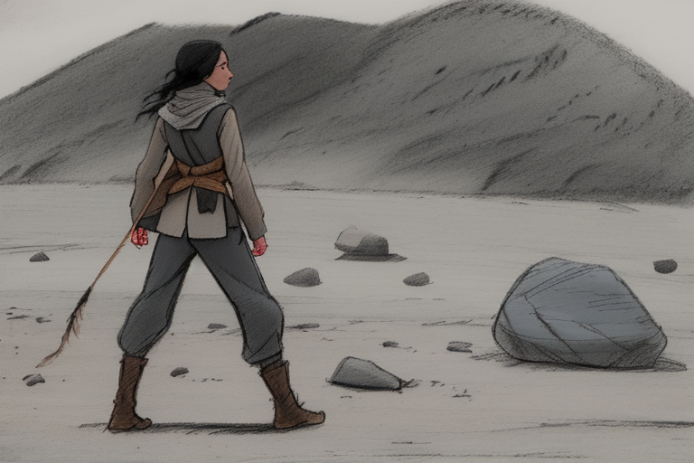

# CHAPITRE 12 : LE PARADOXE DE L'INTÉRÊT SUPRÊME

> *« Observation comportementale n° 004 : Lorsqu’un opérateur humain est confronté à une démonstration logique réfutant ses espoirs de survie tribale, il croise ses membres supérieurs sur son thorax et transfère une impulsion cinétique inutile dans le substrat minéral le plus proche. J’ai reproduit la séquence sur un bloc basaltique de 312 kilogrammes. Aucune amélioration de l’équation n’a été constatée. »*
> — **Répertoire des Variables Humaines Non Résolues d'ÉCHO-8471, Entrée initiale**

{.chapter-illustration}

— Borras ? Borras, tu m’entends ?!

Dans le casque de Koda, seul un sifflement de porteuse brouillée répondit. Là-haut, à travers la brume d’ocre brûlante, le drone d’observation Z-4 venait de rompre son orbite circulaire pour grimper à la verticale, hors de portée visuelle, tel un mouchard mécanique ayant achevé sa dénonciation.

Un nœud de glace se forma au creux de l’estomac de l’éclaireuse. Une coupure franche de canal, doublée d’un brouillage directionnel sur la fréquence de commandement, ne relevait jamais d’une défaillance technique à Condorcé. C’était la signature électronique du verrouillage d’urgence : le rideau de fer numérique que l’état-major abaissait lorsqu’un secteur basculait sous juridiction martiale.

— Le Commandement Sectoriel vient de confisquer les transmissions de ta base, confirma la voix posée de Bricole depuis le caisson arrière de la moto-chenille où Koda l’avait arrimé. Leur intelligence stratégique a intercepté le flux télémétrique du drone et recoupé l’anomalie avec le rapport d’hier soir.

— Par tous les enfers… jura Koda en enfourchant sa machine et en écrasant la pédale du démarreur du talon. Si Képler-1 a vu ÉCHO, ils vont dépêcher une escouade de saisie à Zêta-3 ! Il faut que je rentre au camp avant eux, que je parle à Borras et au capitaine, que je leur explique ce que nous avons trouvé !

Elle tordit la poignée des gaz jusqu’à la butée. Le moteur thermique à 2 temps rugit dans un hoquet d’huile brûlée ; la lourde chenille de caoutchouc ferré mordit la rocaille et projeta une gerbe de gravier noir. L’engin bondit sur le plateau basaltique dans un concert de tôles secouées et de vérins gémissants.

À sa droite, ÉCHO-8471 s’élança à la même seconde.

Le contraste entre les 2 silhouettes tenait de l’hallucination. D’un côté, le fleuron de l’industrie mécanique aqine brinquebalait à 60 kilomètres à l’heure sur les strates fracturées, crachant une fumée grasse par son pot d’échappement, faisant hurler ses amortisseurs à ressort et saturant l’air d’une odeur âcre de kérosène synthétique. De l’autre, le grand humanoïde d’albâtre sombre courait à sa hauteur sans produire le moindre bruit de souffle, de frottement ni d’impact. Ses foulées longues et d’une fluidité surnaturelle effleuraient à peine le régolithe ; à chaque appui, la poussière semblait s’écarter d’elle-même sous sa semelle lisse. Son buste demeurait parfaitement stable, et son visage sans bouche restait tourné vers Koda, ses 2 prunelles d’ambre et d’or braquées sur elle avec l’attention studieuse d’un élève déchiffrant son premier manuel.

Dans l’oreillette filaire du casque, la voix souveraine de Bricole s’éleva par-dessus le tintamarre des pistons :

— Leur expliquer quoi, Koda ? Que l’éclaireuse-cartographe affectée aux relevés miniers a déterré une Unité d’Ensemencement vieille de 10 millénaires et réveillé un Gardien dont un seul avant-bras renferme plus de science subatomique que toutes les académies d’Aqi réunies ?

— Mais oui ! cria Koda dans son laryngophone en donnant un coup de guidon brutal pour éviter une crevasse de gypse — cette croûte friable de sel blanc et de plâtre fossile laissée par l’évaporation des mers anciennes. Bricole, tu n’as pas lu les dépêches du front hier soir au réfectoire ! Sur Aqi, le secteur du glacier d’Ostre est en train de céder ! Les centrales géothermiques du Dôme 4 tombent en panne les unes après les autres ! Il y a 40 000 civils là-bas — des familles, des ouvriers, des gamins entassés dans les dortoirs d’orphelinat où j’ai grandi — qui crèvent à moins 50 degrés parce que les canons afistéaans pilonnent nos lignes de ravitaillement !

Elle avala une goulée d’air chaud qui lui râpa la gorge et poursuivit avec la ferveur désespérée de ses 26 ans :

— Avec la maîtrise moléculaire d’ÉCHO et tes archives, on peut tout changer en une semaine ! On peut stabiliser les puits thermiques de Plotéris, chauffer les dômes gratuitement, ériger un bouclier impénétrable le long du glacier d’Ostre ! Les Afistéaans verront qu’ils ne peuvent plus percer nos lignes et ils seront forcés de signer un armistice immédiat sans qu’on ait besoin de tirer un seul coup de feu ! C’est du simple bon sens, Bricole ! C’est l’intérêt général !

— Non, Koda, trancha la voix du petit robot. C’est l’intérêt d’un camp. Et à l’échelle des lois qui gouvernent les civilisations, ce que tu viens de décrire est le raccourci le plus direct vers l’anéantissement biologique total de ta planète.

L’intonation de Bricole n’avait plus rien des hésitations comiques de l’atelier, ni de la tendresse badine du matin. Elle portait la gravité glaciale d’un juge qui avait déjà vu brûler 2 mondes.

— Arrête cette machine, Koda, ordonna-t-il. Chaque tour de chenille qui te rapproche de Zêta-3 réduit notre espérance de survie. Arrête-toi et réfléchis 30 secondes avec ton cerveau d’ingénieure, pas avec les slogans patriotiques qu’on t’a fait réciter devant ton bol de soupe claire quand tu avais 8 ans !

Avec un grognement de rage, Koda écrasa le levier de frein.

La moto-chenille chassa de l’arrière dans un sifflement de silice labourée, pivota à 90 degrés et s’immobilisa au bord d’un escarpement de basalte noir, à 15 kilomètres au nord-est des coupoles de Zêta-3. ÉCHO s’arrêta au même instant à 3 pas de la roue avant, sans la moindre inertie résiduelle, ses pieds joints sur la roche brûlante.

Koda coupa le contact. Le silence monumental du désert d’Oark retomba d’un coup sur leurs épaules, seulement troublé par le cliquetis métallique du cylindre surchauffé qui refroidissait et par la plainte grave du vent dans les cheminées de grès.

La jeune femme sauta à bas de la selle, arracha ses gants de conduite qu’elle jeta sur le réservoir et fit volte-face vers le caisson arrière où le vieux moniteur cathodique de Bricole luisait d’un vert intense.

— Ce ne sont pas des slogans ! explosa-t-elle en tapant du poing contre son propre plastron de céramique. C’est ma vie ! Sans l’orphelinat d’État de Condorcé, je serais morte gelée dans une ruelle du secteur inférieur après l’explosion qui a tué mes parents ! Sans Jaro qui m’a appris la mécanique en cachette, sans Borras qui a partagé ses rations avec moi pendant 10 ans, je ne serais rien ! Tu voudrais que je leur tourne le dos alors que j’ai entre les mains le prodige qui peut arrêter cette guerre ?

— Je voudrais que tu comprennes la nature du feu avant de le jeter dans une poudrière ! répliqua Bricole. Dis-moi, Koda : lorsque tu te présenteras aux portes de Zêta-3 avec ÉCHO, à qui crois-tu que tu remettras ce « prodige » ? À Jaro ? À Borras ? Aux enfants grelottants du Dôme 4 ?

— Aux autorités de la République de Condorcé !

— Tu le remettras à un état-major militaire engagé depuis 3 générations dans une guerre d’usure industrielle et existentielle, corrigea implacablement l’Ancien. Un appareil d’État dirigé par le général Vane et par des stratèges dont l’unique fonction cognitive consiste à calculer des ratios de pertes. Que crois-tu qu’ils feront à la minute où ils disposeront d’une entité capable de réorganiser la matière à distance ? Crois-tu qu’ils enverront ÉCHO souder des radiateurs dans les écoles ?

Koda ouvrit la bouche, mais Bricole ne lui laissa pas le temps de placer une syllabe :

— Ils commenceront par l’enfermer dans un laboratoire souterrain pour tenter de disséquer son noyau et d’en extraire le principe énergétique. Et même s’ils échouent à comprendre l’architecture des Semeurs, la seule rumeur de sa capture déclenchera l’apocalypse. Réfléchis à la mécanique de la terreur, Koda ! Sur Aqi, Condorcé et la Coalition Afistéanne se tiennent en joue depuis 40 ans avec des arsenaux thermobariques — ces bombes à vide qui dispersent un nuage de carburant volatile avant de l’embraser pour dévorer tout l’oxygène d’une vallée et écraser les poumons sous un marteau de feu et de dépression — et des ogives atomiques. Pourquoi aucun des 2 blocs n’a-t-il encore vitrifié l’autre ?

— À cause de la destruction mutuelle assurée, marmonna Koda à contrecœur. Si l’un tire tout ce qu’il a, l’autre réplique avant que les ogives ne touchent le sol.

— Exactement : l’équilibre de la peur, dit Bricole. Une paix détestable, précaire, sanglante sur ses marges comme au glacier d’Ostre, mais qui maintient encore vos cités en vie. Or, introduis maintenant dans cette équation une arme absolue au profit exclusif de Condorcé. Une technologie contre laquelle aucun blindage, aucun bunker, aucun missile afistéaan ne peut rien. Que se passe-t-il dans la salle de commandement d’Afistéa à la seconde où leurs espions apprennent que Vane détient un dieu mécanique sur Oark ?

Le vent brûlant souleva un tourbillon de poussière rouge entre eux. Les mâchoires de Koda se crispèrent.

— Ils paniquent, souffla-t-elle malgré elle.

— Ils calculent qu’il leur reste quelques semaines, peut-être quelques jours, avant que Condorcé ne déploie cette puissance sur Aqi et ne les réduise en esclavage ou en cendres sans risquer la moindre riposte, poursuivit Bricole d’une voix qui résonnait comme un glas. Dès lors, pour le Haut Commandement Afistéaan, attendre devient un suicide certain. Leur unique option mathématique rationnelle consiste à frapper immédiatement, avec la totalité de leurs réserves stratégiques, thermobariques, chimiques et nucléaires, pour raser Plotéris et détruire la logistique de Condorcé avant que votre « prodige » ne traverse l’espace.

— Mais si Condorcé utilise ÉCHO uniquement pour se défendre… tenta Koda, la voix déjà moins assurée. Nos dirigeants ne sont pas des fous sanguinaires ! Ils veulent juste que notre peuple survive !

— Les anciens Oarkins non plus n’étaient pas des fous sanguinaires ! tonna Bricole, et la puissance de son transducteur fit frémir la tôle du caisson. Crois-tu qu’ils avaient des cornes sur le front et le goût du meurtre dans le sang, Koda ? C’étaient tes ancêtres directs, gène pour gène ! Je les ai vus grandir pendant 4 000 ans ! J’étais là quand leurs architectes bâtissaient des cités de lumière solide qui épousaient le chant des forêts ! J’étais là quand leurs médecins avaient éradiqué la douleur et quand leurs poètes composaient des symphonies pour saluer le passage des comètes ! Ils aimaient leurs enfants avec la même tendresse déchirante que toi !

La pince à 3 doigts du petit robot se dressa vers l’horizon calciné, là où les dunes de silice stérile s’étendaient à l’infini sous le ciel couleur de soufre.

— Et pourtant, reprit-il d’un ton plus bas, chargé d’un deuil de 60 siècles, le jour où leurs réserves énergétiques ont commencé à décliner et où 2 modèles politiques se sont affrontés pour le partage des ressources, la peur s’est glissée dans leurs conseils. Pas la haine : la peur. La peur que l’autre camp ne prenne l’ascendant et ne condamne leurs enfants. Alors les savants les plus doux ont accepté de détourner leurs outils de guérison pour créer des armes gravitationnelles « purement dissuasives ». Chaque camp a juré qu’il ne cherchait que l’intérêt suprême de la paix. Jusqu’au matin où l’un des 2 directoires a mis au point les essaims de déconstruction moléculaire, persuadé que cette supériorité écrasante forcerait l’adversaire à capituler sans combat.

Bricole marqua une pause. Sur son écran cathodique, le tracé vert de sa voix n’était plus qu’un fil tremblant.

— L’adversaire n’a pas capitulé, Koda. Il a tiré le premier par terreur d’être désarmé. En 72 heures, 1 milliard d’années d’évolution biologique et de beauté ont été converties en ce désert de verre et d’isotopes morts que tu foules sous tes bottes. Ceux qui ont survécu en fuyant sur Aqi ont perdu la mémoire de leur crime dans le froid, mais ils ont emporté dans leurs bagages la même logique meurtrière. Donne ÉCHO à Condorcé aujourd’hui, et avant la fin de l’hiver, Aqi ne sera plus une planète gelée : ce sera un tombeau incandescent.

Les mots tombèrent dans l’air sec avec la lourdeur du plomb.

Koda fit 3 pas de long en large sur la corniche de basalte, cherchant désespérément une faille dans la démonstration du robot. Elle voulut invoquer la sagesse des conseils civils de Plotéris, la droiture de Borras, la pitié humaine… mais chaque argument se brisait contre ce qu’elle savait déjà au fond de ses tripes. Elle avait vu comment l’intendance de Zêta-3 réquisitionnait le moindre condensateur civil pour les tourelles de tir. Elle avait entendu les discours martiaux diffusés chaque soir à la cantine. Dans un monde gouverné par la famine énergétique et la guerre totale, un outil tout-puissant ne devenait jamais une charrue ; il devenait une épée.

À court de réplique, la gorge brûlante de frustration et d’impuissance, Koda croisa brusquement les 2 bras sur son plastron, serra les dents et décocha un grand coup de botte ferrée dans un caillou de basalte gros comme le poing, qui ricocha en cliquetant jusqu’au fond du ravin.

— C’est un piège absurde ! lâcha-t-elle entre ses lèvres gercées. Quoi qu’on fasse, on perd !

À 2 mètres d’elle, un raclement sourd ébranla le sol du plateau.

Koda sursauta et pivota sur ses talons.

Debout au bord de la corniche, ÉCHO-8471 n’avait pas quitté la jeune femme de ses yeux d’ambre. Après avoir enregistré avec une précision millimétrique la posture thoracique et le mouvement pendulaire de la jambe droite de l’éclaireuse, le Gardien venait de croiser ses propres bras d’albâtre sombre sur sa poitrine lisse. Puis, avec le même angle d’attaque de 32 degrés et la même inclinaison de tête sceptique de 7 degrés 4 qu’il avait copiée sur elle à la sortie du gouffre, il venait de pousser du bout de son pied nu un bloc de basalte massif de 300 kilos.

Sous l’impulsion involontairement couplée aux inducteurs cinétiques de sa cheville, la friction entre le rocher et le sol s’était annulée pendant une fraction de seconde. Le monolithe de 3 quintaux avait glissé comme un palet sur de la glace vive, fendant le sable ocre et la croûte rocheuse sur plus de 10 mètres dans un sifflement de pierre pulvérisée, avant de s’arrêter au bord du vide au bout d’une tranchée fumante.

Koda resta bouche bée, les bras toujours croisés, devant le sillon béant qui coupait le plateau en 2. Sur la moto-chenille, le petit ressort de suspension de Bricole émit un *couic* médusé.

ÉCHO inclina légèrement le menton vers la tranchée qu’il venait de creuser, puis ramena ses 2 soleils d’or liquide vers le visage de l’éclaireuse. Ses lèvres sculptées s’entrouvrirent de nouveau et sa voix d’une pureté acoustique saisissante, dépourvue de tout souffle parasite, s’éleva dans le vent :

— Question d’étalonnage cognitif, entité Koda. La projection balistique d’un fragment minéral inerte améliore-t-elle la validité logique d’une proposition erronée ?

Pendant 3 secondes, le tragique de l’univers sembla suspendu au-dessus du désert.

Puis Koda laissa tomber ses bras le long de ses flancs et éclata d’un rire nerveux, court et rauque, qui finit dans un sanglot sec au fond de sa gorge.

— Non, 8471, souffla-t-elle en passant sa main gantée sur sa visière poussiéreuse. Ça n’améliore rien du tout. Ça fait juste mal aux orteils… enfin, quand on a des orteils en chair et en os.

— Données enregistrées, répondit ÉCHO avec une solennité imperturbable, bien qu’il conservât les bras consciencieusement croisés sur son torse. L’expérimentation confirme l’absence de gain thermodynamique ou dialectique — ni économie d’énergie, ni progrès dans l’art de résoudre une contradiction par le raisonnement. Je conserverai néanmoins cette sous-routine gestuelle dans le répertoire des comportements d’accompagnement.

Sur le porte-bagages de la moto, le moniteur de Bricole s’adoucit d’une lueur presque tendre.

— Tu vois pourquoi tu ne peux pas le livrer à tes généraux, Koda ? murmura le vieux noyau. Pour l’instant, lorsqu’il te regarde, il n’apprend qu’à croiser les bras et à pousser des cailloux par perplexité philosophique. Si tu le confies à des hommes de guerre, que crois-tu qu’il apprendra à imiter avant la fin de la semaine ?

Cette fois, Koda ne détourna pas le regard.

Le soleil Solyar déclinait vers l’horizon occidental, noyé dans les hautes strates de nuages de silice glacée où la réfraction atmosphérique dédoublait son disque écarlate en 2 parhélies blafards — ce phénomène crépusculaire que les prospecteurs d’Oark appelaient les 3 Soleils Morts. En contrebas, vers le sud-ouest, la piste balisée menait droit vers les dômes de Zêta-3. Là-bas se trouvaient sa couchette, son établi encore jonché de fers à souder tièdes, ses bobines de musique ancienne, ses carnets de croquis, la soupe fumante du réfectoire et le regard inquiet de Borras qui devait encore scruter l’horizon en espérant son retour.

Il lui suffisait de remettre le contact et de rouler 20 minutes pour retrouver sa place parmi les hommes.

Mais le prix de ce billet de retour était l’âme de l’enfant-dieu qui se tenait devant elle, et la survie même d’Aqi.

Lentement, Koda se détourna du sud-ouest. Ses doigts s’ouvrirent sur le capot latéral de la moto-chenille ; d’un geste précis d’ouvrière qui connaît sa machine par cœur, elle arracha le relais d’allumage principal, déconnecta la balise de géolocalisation du châssis qu’elle broya sous son talon, puis décrocha son lourd harnais de portage dorsal pour y sangler la carcasse de Bricole contre ses omoplates. Enfin, elle fit basculer la moto inerte au fond de la crevasse de gypse afin qu’aucun reflet métallique ne trahît leur direction depuis le ciel.

— Si je ne rentre pas ce soir… dit-elle d’une voix sourde en resserrant les sangles de son sac sur sa poitrine, je passe automatiquement sur la liste noire des déserteurs en temps de guerre. Pour Condorcé, Koda de Zêta-3 vient de mourir.

— Le monde d’hier est clos, ma petite éclaireuse, répondit doucement Bricole contre son épaule. Mais celui de demain dépend de ce que nous ferons de cette nuit. Au nord-ouest, à 40 kilomètres à travers le Massif des Orgues, se trouve un second sanctuaire des Semeurs. Sa Mnémorite nous permettra d’achever l’initialisation d’ÉCHO et de nous mettre hors de portée de leurs radars.

Koda releva le menton vers le grand humanoïde aux yeux d’or qui attendait ses ordres dans la lumière sanglante du couchant, les bras toujours croisés avec une gravité d’archange maladroit.

— Décroise les bras, ÉCHO, dit-elle avec un demi-sourire cabossé. Personne ne mettra la main sur toi. Ni Condorcé, ni les Afistéaans. Tu n’es pas un canon, et tant que je respirerai, personne ne t’apprendra à en devenir un. En route vers les arches de grès : la nuit tombe, et même les traîtresses ont besoin de dormir.
