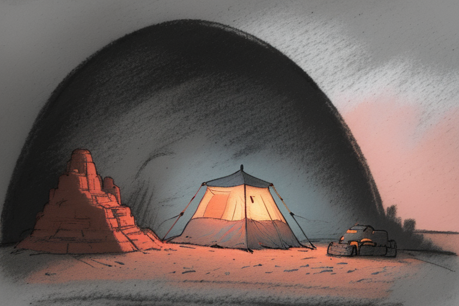

# CHAPITRE 13 : LA NUIT DES 3 SOLEILS MORTS

> *« Sur la Terre d’avant le Silence, nos créateurs avaient nommé la nuit "le temps où l’espèce se pardonne d’exister". Pendant 8 heures par rotation planétaire, le prédateur le plus féroce de la biosphère déposait ses outils, fermait ses paupières et acceptait d’être aussi vulnérable qu’une feuille morte, livré aux seules chimères de sa mémoire. C’est à cet abandon que nous avons mesuré qu’ils possédaient une âme. »*
> — **Journal du Noyau SOLYAR-0194 (Bricole), Fragments de la Longue Veille**

{.chapter-illustration}

À mesure que les 3 Soleils Morts s’enfonçaient derrière la ligne brisée des plateaux, la fournaise d’Oark bascula sans transition dans le froid sidéral du désert.

En moins d’une heure, le thermomètre extérieur du poignet de Koda chuta de 46 à moins 4 degrés. Partout autour d’eux, les dalles de basalte qui avaient emmagasiné la rage solaire tout le jour se contractaient avec des claquements secs, pareils à des coups de fouet tirés dans l’ombre. Le vent d’est, rabattu vers le sol par la chute de pression thermique, charriait une farine de silice glacée qui sifflait entre les colonnes rocheuses.

À 4 kilomètres du ravin où gisait sa moto-chenille sacrifiée, Koda dénicha l’abri qu’elle cherchait : une arche naturelle de grès rouge, creusée en demi-dôme au flanc d’un ancien lit de torrent asséché. Une corniche de magnétite brute surplombait la cavité, formant un écran naturel contre les balayages radar des satellites de basse orbite tout en coupant les bourrasques du nord.

— Halte ici jusqu’à l’aube, souffla Koda en laissant glisser le harnais de portage le long de ses bras endoloris. Si je continue à marcher dans ces éboulis de nuit sans allumer mes phares, je vais me briser une cheville avant d’avoir atteint le pied du massif.

Elle déposa délicatement le châssis de Bricole contre la paroi du fond, à l’abri du givre de sable, puis s’affala assise contre le grès.

Interdiction absolue d’allumer un feu chimique ou même un réchaud à pastilles : la moindre plume d’infrarouge dans ce désert minéral aurait brillé comme un phare sur les capteurs thermiques de Zêta-3. Pour toute chaleur, Koda dut se contenter de régler le circuit de survie de sa sous-combinaison au minimum afin d’économiser ses batteries, avant de sortir de sa sacoche un pain de protéines compressées aussi dur et gris qu’une brique de ciment.

Elle déverrouilla son casque avec un chuintement de joints pneumatiques et le posa sur ses genoux. L’air nocturne d’Oark, sec à faire saigner les narines et chargé d’une odeur métallique d’oxyde de fer, lui saisit les joues.

Pendant quelques minutes, seul le bruit de ses mâchoires broyant la ration froide troubla le silence de l’arche.

Puis, en cherchant sa gourde au fond de son sac de flanc, ses doigts rencontrèrent un petit objet métallique qu’elle avait glissé là 3 jours plus tôt pour le réparer : le boîtier d’allumage du réchaud de campagne de Jaro, sur lequel le vieux mécanicien avait gravé au poinçon une caricature maladroite de Koda coiffée d’une clé à molette, suivie des mots : *« Touche pas à mes soudures, gamine. »*

La bouchée de ration resta coincée dans la gorge de l’éclaireuse.

Jusqu’à cette minute, l’adrénaline de la découverte, le vertige du sanctuaire et l’urgence de la dispute avec Bricole l’avaient portée en avant comme sur une vague. Mais là, dans le noir glacé de cette caverne perdue, le poids réel de ce qu’elle venait de faire lui tomba sur la poitrine de toute sa masse.

À cette heure précise — 21 heures 30 —, la cloche du souper venait de sonner à Zêta-3. Mais personne ne devait rire ce soir sous les néons de la cantine. Son siège au bout de la table d’aluminium était vide. La porte de son atelier avait dû être forcée au chalumeau par la sécurité militaire ; des officiers de renseignement venus de Képler-1 retournaient sans doute ses tiroirs, confisquaient ses vieux carnets de fossiles, piétinaient les bandes magnétiques de musique qu’elle avait patiemment recollées. Et dans le poste de transmission, Borras — son grand frère de misère, celui qui lui tenait la main dans les caves de Plotéris quand les sirènes de bombardement hurlaient — devait fixer un écran noir en se demandant comment la petite Koda avait pu trahir les siens.

Elle n’avait plus de maison. Elle n’avait plus de nom. Si elle croisait demain l’un des 14 hommes et femmes avec qui elle partageait son sel et son eau depuis 3 ans, le règlement militaire leur imposait de lui loger une balle ferromagnétique — l’un de ces dards d’acier aimanté que les fusils de Condorcé catapultaient à 5 fois la vitesse du son — entre les 2 épaules.

Sans un bruit, Koda ramena ses genoux contre son menton, enfouit son visage dans le creux de ses bras croisés et laissa couler sur ses manches des larmes brûlantes que le froid du désert glaçait aussitôt.

Elle ne sanglotait pas à voix haute — l’orphelinat de guerre lui avait appris très tôt à pleurer sans réveiller le dortoir —, mais ses épaules tressautaient par petites secousses régulières dans l’ombre.

Au fond de l’arche, un léger crissement de métal rompit l’immobilité, suivi d’un *couic* familier à 2 410 hertz.

Bricole venait de faire avancer sa chenille asymétrique de 50 centimètres sur le sable. Il avait abaissé la luminosité de son tube cathodique au minimum pour ne projeter qu’une lueur d’émeraude très douce, pareille à une veilleuse d’enfant, et sa pince de soudeuse à 3 doigts vint se poser avec une maladresse infinie sur le cuir élimé de la botte de Koda.

— Le deuil d’une appartenance est la plus rude des amputations biologiques, murmura la voix de l’Ancien, modulée si bas qu’elle semblait naître directement à l’intérieur du grès. Ne rougis pas de tes larmes, Koda. Même lorsque la cage était étroite et que le geôlier marchait vers l’abîme, l’oiseau qui en brise les barreaux pleure toujours le perchoir où il a appris à chanter.

Koda releva son visage strié de poussière et de sel, s’essuya les cils du revers de sa manche et tenta un sourire qui ne trompa personne.

— Tu parles d’un oiseau… souffla-t-elle d’une voix enrouée. Je suis surtout une idiote qui a réussi à se mettre toute son espèce à dos en moins de 12 heures. Dis-moi la vérité, Bricole. Tes créateurs… les Semeurs de la Terre… est-ce qu’ils ont connu ça, eux aussi ? Le moment où l’on comprend que son propre monde court dans le mur et qu’on ne peut plus marcher avec lui ?

Sur le petit écran bombé, les lignes de phosphore vert dessinèrent une onde lente, mélancolique.

— Ils l’ont connu trop tard, Koda, répondit Bricole. C’est de ce retard même que nous sommes nés.

Il fit pivoter son châssis vers l’ouverture de l’arche, où la voûte noire du système Solyar commençait à se piqueter d’étoiles d’une netteté chirurgicale.

— Dans les registres que la première Mnémorite m’a restitués ce matin, reprit-il, il existe un fichier scellé que chaque Unité d’Ensemencement reçoit lors de sa forge initiale : le Mémorial de la Terre. Contrairement à ce que tu pourrais croire, nos créateurs n’étaient pas des dieux de lumière nés dans la sagesse. C’étaient des bipèdes de carbone, pétris des mêmes terreurs nocturnes, des mêmes jalousies territoriales et de la même soif de chaleur que les habitants d’Aqi. Leur science avait simplement grandi plus vite que leur cœur. Lorsqu’ils ont maîtrisé l’ingénierie subatomique et la manipulation de la trame quantique, ils ont cru avoir vaincu la mort. Mais ils avaient conservé dans leur sang les réflexes des chasseurs de la préhistoire.

Koda écoutait, oubliant le froid qui lui mordait les doigts. À l’entrée de la grotte, immobile comme un pilier de basalte poli, ÉCHO-8471 avait tourné la tête vers eux, ses 2 disques d’ambre recueillant chaque syllabe.

— Lorsque leur biosphère a commencé à s’effondrer sous le poids de leurs guerres climatiques et de leurs armes d’effacement, poursuivit Bricole, une poignée de savants, de poètes et d’ingénieurs ont compris que leur espèce ne franchirait pas le cap de sa propre toute-puissance. Comme toi aujourd’hui, on les a traités de traîtres et de défaitistes. Alors, en secret, dans le désert glacé du pôle de leur monde, ils ont bâti les Arches de Semence. Ils n’y ont mis ni leurs drapeaux, ni leurs frontières, ni leurs armes, ni même leurs propres corps condamnés. Ils n’y ont déposé que ce qu’ils avaient eu de meilleur : le code génétique de la vie consciente, et nous, leurs enfants de métal et de diamant, chargés de parcourir la galaxie pendant des éons — des âges géologiques entiers se chiffrant en centaines de millions d’années — pour faire éclore d’autres humanités et veiller sur elles jusqu’à ce qu’elles surmontent la fièvre de l’enfance.

La petite pince de soudeuse resserra imperceptiblement son contact sur la botte de Koda.

— Les Semeurs sont morts sur une planète calcinée, Koda. Mais avant de s’éteindre, ils ont accompli le seul geste qui rachetait toute leur histoire : ils ont préféré donner une chance à des inconnus qui naîtraient 1 milliard d’années plus tard sous d’autres soleils, plutôt que de mourir en serrant leurs fusils. Ce que tu as fait cet après-midi sur ce plateau en renonçant à Zêta-3 procède exactement de la même noblesse. Tu n’es pas une déserteuse. Tu es l’héritière de ceux qui ont refusé que la nuit ait le dernier mot.

Un long souffle tremblant s’échappa des lèvres de Koda. Elle tendit la main et caressa doucement le capot cabossé du petit robot, là où elle avait soudé 3 nuits plus tôt une plaque de tôle récupérée sur une boîte à outils.

— Merci, Bricole, murmura-t-elle. Pour une vieille carte logique trouvée dans la boue, tu sais parler aux vivants. Mais si je ne dors pas 4 heures maintenant, l’héritière des Semeurs va s’écrouler au premier canyon demain matin.

Elle déroula son sac de couchage thermique à même la couche de sable fin au fond de l’arche, s’y glissa tout habillée avec son armure légère, ramena son casque près de sa main droite et ferma la glissière isolante jusqu’au menton. Puis elle posa la joue sur sa sacoche en guise d’oreiller et ferma les paupières.

La fatigue de 40 heures de veille l’enveloppa presque aussitôt.

Pourtant, 2 minutes plus tard, un bruissement singulier — le déplacement lent et méthodique d’une masse parfaitement symétrique dans la silice — lui fit rouvrir un œil.

Ce qu’elle vit dans la pénombre émeraude du tube cathodique de Bricole lui coupa toute envie de dormir.

ÉCHO-8471 avait quitté son poste d’observation à l’entrée de la grotte. Le Gardien de 2 mètres venait de s’allonger de tout son long sur le dos, dans le sable glacial, à très exactement 40 centimètres parallèlement au sac de couchage de Koda. Ses jambes fuselées d’albâtre sombre étaient jointes au cordeau ; ses 2 mains aux doigts parfaits étaient posées à plat l’une sur l’autre au milieu de son sternum ; sa tête reposait droit dans le gravier sans le moindre coussin.

Et sous son front lisse, ses 2 soleils d’ambre et d’or venaient de s’éteindre derrière ses diaphragmes optiques clos.

Koda resta figée sur un coude, clignant des yeux d’incrédulité. À côté d’elle, Bricole fit pivoter son moniteur d’un quart de tour, manifestement tout aussi interloqué que l’humaine.

10 secondes s’écoulèrent. Puis 20. Puis 40.

Le géant ne bougeait pas d’un micron. On eût dit le gisant d’un roi antique sculpté dans une pierre tombale.

À la quarante-deuxième seconde exacte, les diaphragmes optiques d’ÉCHO se rouvrirent sans un clic. Ses 2 prunelles d’or liquide pivotèrent latéralement vers le visage médusé de Koda.

— Mais qu’est-ce que tu fabriques, ÉCHO ? chuchota l’éclaireuse, partagée entre l’ahurissement et un fou rire nerveux.

— J’expérimente empiriquement l’état d’arrêt volontaire périodique que votre espèce désigne sous le vocable de « sommeil », répondit le Gardien de sa voix cristalline, toujours allongé tout droit sur le dos, les mains jointes sur la poitrine comme un cadavre modèle.

— Tu… tu essaies de dormir ?

— Affirmation exacte, dit ÉCHO en fixant la voûte de grès rouge au-dessus de lui. Au cours des 42 dernières secondes, j’ai adopté votre décubitus horizontal, occulté mes capteurs photoniques frontaux qui recueillent la lumière et abaissé la cadence de mes boucles d’analyse périphérique de 88 %. Conclusion de l’essai : cette procédure est d’une inefficacité opérationnelle absolue. Mon châssis ne subit aucune régénération cellulaire, ma vigilance tactique s’effondre et le substrat de silicate sous mon crâne ne présente aucune propriété ergonomique. Pourquoi vous infligez-vous quotidiennement 6 à 8 heures de coma fonctionnel ?

Koda étouffa un éclat de rire dans le col de son sac thermique — un vrai rire, clair et chaud, qui chassa d’un coup le fantôme gris du désespoir.

— Parce que mon cerveau n’est pas gravé dans du diamant quantique, 8471 ! Si je ne dors pas, mes neurones s’encrassent, mes muscles lâchent et je finis par confondre ma clé de 12 avec mon tube de ration. Et puis… quand on dort, on rêve.

Dans l’ombre, la tête d’ÉCHO tourna de 7 degrés 4 vers elle.

— Le terme « rêve » figure dans mon lexique de base avec la mention : *hallucination endogène survenant durant la phase paradoxale du repos biologique* — des images forgées de l’intérieur par votre propre écorce cérébrale à l’instant où l’esprit s’embrase dans un corps immobile, énonça le Gardien. Quelle est la valeur adaptative d’une illusion interne qui consomme du glucose cérébral pour projeter des événements factuellement faux ?

Le sourire de Koda s’adoucit dans la pénombre verte. Elle resta appuyée sur son coude, contemplant ce dieu indestructible qui la questionnait depuis le sable comme un enfant de 5 ans découvrant le monde.

— Ça sert à revoir ceux qui ne sont plus là, ÉCHO, murmura-t-elle. Dans la journée, la réalité est têtue : mes parents sont morts sous les décombres du secteur minier de Plotéris quand j’avais 4 ans, Aqi est un bloc de glace, et ce désert veut notre peau. Mais quand je rêve… parfois, je retrouve l’odeur de graisse chaude et de cannelle de la veste de mon père. Ou bien je cours sur une plage d’Oark où il y a encore de l’eau bleue, comme sur les gravures des vieux livres. Un rêve, c’est le seul endroit où les orphelins ont encore une maison.

Un silence de plusieurs secondes s’installa sous l’arche, bercé par le sifflement du vent glacé contre la corniche extérieure.

Toujours étendu sur le dos à côté d’elle, ÉCHO ramena ses yeux d’ambre vers le plafond de pierre. Au cœur de ses lentilles, les filaments d’or liquide se mirent à tournoyer lentement.

— Vous avez employé le qualificatif « orpheline » à 3 reprises depuis mon éveil, dit-il d’un ton pensif. Définition lexicale : *individu biologique privé de ses géniteurs ascendants*. Or, lorsque j’analyse les conditions de ma propre synthèse dans la forge du premier sanctuaire, je constate que je n’ai été engendré par aucun organisme biologique, que mes créateurs originels de la Terre sont éteints depuis 1 milliard d’années, et que le Réseau Planétaire qui devait assurer ma tutelle cognitive est muet.

Il tourna de nouveau ses prunelles dorées vers Koda.

— Selon votre nomenclature, entité Koda, suis-je également un orphelin ?

Le cœur de la jeune femme rata un battement.

Elle contempla cette silhouette immaculée, née quelques heures plus tôt dans le désert le plus hostile de la galaxie avec 1 % de mémoire, condamnée à porter le fardeau d’une guerre qu’elle n’avait pas choisie, sans père, sans mère, sans peuple.

Lentement, Koda sortit son bras droit de la chaleur de son sac de couchage et posa sa paume nue, marquée de petites cicatrices de brûlures d’étain et de cals d’ouvrière, sur le dos des mains d’albâtre sombre jointes sur la poitrine du Gardien. La matière des Semeurs n’était pas glacée comme l’acier d’Aqi : elle avait pris instantanément la température exacte de sa peau.

— Oui, ÉCHO, dit-elle tout bas. Tu es un orphelin, toi aussi. Bricole, toi et moi… on est la plus drôle de famille d’orphelins que cette foutue planète ait jamais portée. Mais chez nous, sur Aqi, quand les orphelins se trouvent, ils ne se lâchent plus.

Les capteurs d’ÉCHO descendirent vers la main humaine posée sur la sienne, mesurant la pression de 300 grammes, la pulsation du sang dans les capillaires du poignet et la chaleur de 36 degrés 8 qui ne servait aucune fonction mécanique.

— Enregistrement d’une nouvelle entrée dans le répertoire des *Variables humaines non résolues*, prononça doucement le Gardien. Corrélation établie : l’absence partagée d’ascendants génère une cohésion opérationnelle supérieure aux liens hiérarchiques réglementaires.

Il se redressa d’un seul mouvement fluide, sans s’aider des coudes, et vint s’asseoir en tailleur à l’entrée de l’arche, tournant le dos à la grotte pour faire face à l’immensité obscure du désert.

— Reposez votre système nerveux et générez vos hallucinations endogènes, Koda, ajouta-t-il sans se retourner. L’unité Bricole et moi-même assurerons la veille périmétrique. Aucune menace ne franchira ce seuil durant votre phase d’arrêt.

Koda sourit dans l’ombre, rentra son bras au chaud et ferma les yeux. Pour la première fois de sa vie, bien qu’elle fût traquée par toute une armée au milieu d’un monde mort, elle s’endormit sans avoir peur du noir.

Pendant 5 heures, la nuit des 3 Soleils Morts coula sur le Massif des Orgues. Tandis que la respiration de la jeune femme s’élevait, régulière et paisible, Bricole et ÉCHO demeurèrent côte à côte sous la voûte d’étoiles — le petit robot cabossé au ressort grinçant et l’archange d’albâtre sombre, échangeant par brèves impulsions silencieuses les premiers rudiments de la grammaire du monde.

Puis, à l’orient, la ligne noire du plateau basaltique commença à pâlir d’une lueur livide, couleur de cendre et de soufre.

L’aube se levait sur Oark.

Soudain, avant même que le premier rayon solaire n’eût touché la crête de l’arche, le buste d’ÉCHO-8471 se figea. Au fond de l’ombre, ses 2 yeux d’ambre s’embrasèrent brusquement d’un or aveuglant : à 30 kilomètres au sud-est, 5 signatures mortelles venaient de déchirer le ciel.
