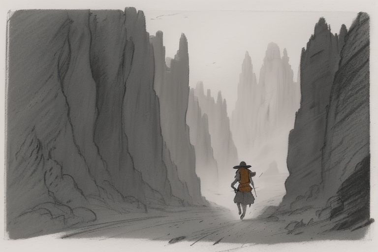

# CHAPITRE 17 : LE MAÎTRE DU RELIEF

> *« Procédure de maintenance observée sur l’opératrice Koda : Lorsqu’un instrument électronique d’origine aqine présente une défaillance d’affichage par encrassement de silice, l’opératrice applique une percussion palmaire latérale de 40 newtons sur le boîtier tout en émettant la séquence phonétique : "Allez, vieux tas de rouille, coopère." Contre toute attente probabiliste, le contact électrique s’est rétabli en 0,3 seconde. Sous-routine archivée pour usage ultérieur. »*
> — **Répertoire des Variables Humaines Non Résolues d'ÉCHO-8471, Entrée n° 009**

{.chapter-illustration}

Le Massif des Orgues ne pardonnait rien à ceux qui prétendaient le lire sur un écran d’état-major.

C’était un enchevêtrement cyclopéen de failles basaltiques, de cheminées de soufre éteintes et de couloirs de grès rouge que 6 millénaires de tempêtes thermiques avaient sculptés en lames de rasoir. Vue d’orbite, la région ressemblait à une cicatrice morte ; vue d’en bas, à travers la visière balafrée de Koda, c’était une forteresse vivante dont chaque courant d’air ascendant, chaque veine de minerai et chaque surplomb racontait une histoire.

— À gauche, dans la diaclase ! souffla Koda en agrippant le rebord d’une corniche de schiste pour plonger dans la fente verticale qui tranchait net le bloc rocheux. Vite ! Le vent rabat la poussière chaude vers le fond du goulet, ça va noyer notre sillage infrarouge !

Elle se laissa glisser le long de la paroi abrupte dans un crissement de bottes ferrées, amortissant sa réception au fond du boyau rocheux malgré la douleur sourde qui lui lançait dans les côtes depuis l’explosion des Dents de Scorie. Sur son dos, le châssis de Bricole protesta par un couinement aigu de son ressort de suspension tordu.

Une seconde plus tard, ÉCHO-8471 atterrit à ses côtés. Il avait sauté d’une hauteur de 12 mètres sans plier le buste, absorbant l’intégralité de son énergie cinétique au moment précis où ses semelles d’albâtre sombre touchaient le gravier, si bien que pas un caillou ne roula sous ses pieds.

Au-dessus de l’étroite fente de ciel ocre qui découpait le sommet du canyon, 3 sillons d’un blanc aveuglant venaient de déchirer la stratosphère. Un grondement caverneux, semblable à l’éboulement d’une montagne, roula longtemps entre les murailles de pierre.

— Entrée atmosphérique de 3 transporteurs suborbitaux de classe lourde, annonça ÉCHO de sa voix égale, en levant ses prunelles d’ambre vers les traînées de plasma. Vecteur de descente convergente. Point d’impact balistique calculé : notre position précédente aux Dents de Scorie. Délai avant le déploiement des unités au sol : 4 minutes et 10 secondes.

— Ils n’ont pas envoyé la garde territoriale, commenta Bricole depuis le harnais de Koda. Le freinage magnétique que je capte sur les basses fréquences correspond aux barges d’assaut de la Troisième Division. Les Cuirassiers de Fer. Ton commandement te fait un honneur considérable, Koda : on ne déploie d’ordinaire un tel tonnage d’acier que pour éventrer une citadelle afistéanne.

— Qu’ils gardent leurs honneurs et leurs médailles, répliqua la jeune femme en déverrouillant d’un coup sec le bracelet de télémétrie fixé au poignet gauche de son armure. Ils connaissent nos manuels d’exploration, mais c’est moi qui ai dressé la carte topographique de ce secteur l’hiver dernier. Et il y a 2 ou 3 détails que j’ai oublié de verser aux archives du ministère.

Accroupie contre une veine de roche noirâtre incrustée de paillettes métalliques, elle dégaina sa pince multifonction de sa ceinture. En 20 secondes de gestes précis — cette dextérité fiévreuse des nuits d’atelier où ses doigts allaient plus vite que sa pensée —, elle ouvrit le boîtier de son transpondeur Zêta-3, arracha la puce de coupure d’urgence et court-circuita le condensateur thermique à l’aide d’un pont de fil de cuivre torsadé.

Au moment où elle refermait le cadran de son détecteur passif de poignet pour vérifier la fréquence d’émission, l’affichage à cristaux liquides grésilla et vira au noir, encrassé par la farine de silice qui s’était infiltrée sous le joint.

Agacée, Koda frappa par 2 fois le flanc du boîtier métallique du plat de sa main gantée en marmonnant entre ses dents :

— Allez, vieux tas de rouille, coopère…

Sous le choc sec de la paume, la soudure froide du vieux circuit imprimé — une goutte d’étain terne qui faisait faux contact depuis l’hiver précédent — reprit sa place ; l’écran vert se ralluma aussitôt avec un bip docile.

Debout à un demi-mètre d’elle, ÉCHO-8471 inclina la tête de 7 degrés 4. Ses capteurs d’or liquide balayèrent successivement la main droite de l’éclaireuse, le boîtier cabossé et la courbe de tension rétablie.

— Analyse d’intervention mécanique, prononça le Gardien avec le sérieux imperturbable d’un physicien devant un phénomène inédit. Vous venez d’appliquer une onde de choc brutale accompagnée d’une injonction vocale dépourvue de code binaire sur un instrument défectueux, et son fonctionnement nominal s’est rétabli en 3 dixièmes de seconde. S’agit-il d’une procédure de maintenance acoustique standard chez votre espèce ?

Koda éclata d’un petit rire sec tout en achevant de régler son leurre.

— C’est la loi fondamentale de la mécanique de Zêta-3, 8471 : quand l’électronique fait sa mauvaise tête, une claque amicale et un juron bien senti valent tous les manuels d’ingénierie d’Aqi. Mais pourquoi as-tu déverrouillé ce second émetteur ? ajouta-t-elle en voyant qu’il pointait toujours le transpondeur modifié.

— Ce dispositif diffuse votre signature biométrique sur la fréquence militaire de Condorcé, précisa ÉCHO. Le conserver actif réduisait notre espérance de furtivité de 91 %, mais le détruire alerterait immédiatement leurs algorithmes de poursuite.

— C’est bien pour ça que je ne le détruis pas, sourit Koda d’un air carnassier derrière sa visière fendue. Je viens de bloquer la boucle télémétrique pour qu’elle répète mon pouls d’effort à 130 battements par minute, et j’ai court-circuité la résistance chauffante pour qu’elle rayonne exactement à 37 degrés 5.

Elle s’approcha d’une anfractuosité humide au bas de la paroi, là où un *khor* des sables — un gros arthropode charognard à la carapace d’écailles grises, long comme un chien de traîneau — se terrait à l’abri de la tempête. Avant que la bête n’ait pu claquer ses mandibules, Koda lui colla le transpondeur enduit de résine adhésive entre les plaques dorsales, puis frappa du plat de son fusil contre la pierre. Effrayé, l’animal détala à toute allure dans la galerie latérale qui descendait vers les plaines du sud, emportant avec lui le fantôme électronique de l’éclaireuse.

— Admirable ! s’exclama Bricole, dont le petit écran cathodique trépida d’allégresse. Une démonstration d’asymétrie cognitive d’une élégance rare ! Tandis que les calculateurs balistiques de Condorcé mobiliseront 2 compagnies blindées pour encercler un crustacé nécrophage dans le bassin méridional, nous disposons d’un couloir aveugle vers le nord-ouest !

— Direction la Faille des Soupirs, acquiesça Koda en se relevant d’un bond. Quelle distance jusqu’à ton second sanctuaire, Bricole ?

— 17,8 kilomètres à vol d’oiseau, soit 24 kilomètres par les défilés tortueux que tu empruntes, répondit le petit robot. Les registres géodésiques que j’ai extraits de la première Mnémorite — ces relevés qui mesurent au millimètre la courbure et les repères profonds du globe — sont formels : il s’agit d’un nœud de défense secondaire. Si sa Mnémorite locale est intacte, je pourrai non seulement activer son dôme de répulsion périmétrique pour interdire l’accès du canyon à toute l’armée de Condorcé, mais surtout transférer à ÉCHO les bibliothèques opérationnelles qui lui manquent encore.

Ils se remirent en marche à un train d’enfer.

Pendant 2 heures, Koda mena la danse à travers le dédale minéral avec la maestria d’une virtuose jouant de son instrument. Elle ne courait pas au hasard : elle déchiffrait la couleur des strates et le chant du vent. Lorsqu’un drone de haute altitude passait au zénith, elle entraînait ses 2 compagnons sous des voûtes de magnétite brute dont l’anomalie magnétique naturelle brouillait les radars à ouverture synthétique. Lorsque les capteurs sismiques parachutés par l’avant-garde de Condorcé commençaient à pulser dans le sol à 2 kilomètres en aval, elle leur faisait gravir des crêtes de basalte spongieux qui absorbaient les ondes de choc de ses bottes, ou marcher dans le lit des torrents de silice fluide dont le frottement perpétuel couvrait tout bruit de pas.

Elle était dans son élément, souveraine, transformant l’hostilité même d’Oark en manteau d’invisibilité.

Pourtant, à mesure que l’effort se prolongeait sous la fournaise de 49 degrés, la mécanique humaine commença à accuser ses limites. Ses réserves d’eau tiédissaient ; l’hématome sur ses côtes lui arrachait une grimace à chaque escalade ; la sueur salée lui brûlait la coupure du sourcil.

À mi-chemin de la Faille des Soupirs, alors qu’une patrouille d’aéronefs légers balayait la vallée voisine aux projecteurs infrarouges, Koda dut s’adosser 5 minutes sous le surplomb d’une arche de grès, au creux d’une cheminée thermique qui dispersait leur chaleur corporelle vers les hauteurs.

Elle déverrouilla la pipette d’hydratation de son casque et aspira 2 gorgées d’eau recyclée au goût de plastique chaud. Ses doigts tremblaient légèrement sur la crosse de son fusil.

Dans la pénombre rougeâtre de la cavité, les 2 lentilles d’ambre et d’or d’ÉCHO se posèrent sur elle. Le Gardien se tenait debout à un mètre, aussi immaculé, aussi frais et silencieux qu’à la minute où il était sorti du berceau de lumière de la forge.

— Entité Koda, dit-il soudain à voix basse, ajustant le volume de son vocodeur à l’acoustique exacte de la grotte pour qu’aucun décibel ne s’échappe au-dehors. Je relève une incohérence persistante dans vos paramètres biologiques et décisionnels.

Koda haussa un sourcil fatigué et laissa retomber sa nuque contre le grès.

— Encore une, 8471 ? Je croyais que tu t’étais habitué à mes défauts de fabrication depuis cette nuit.

— Vos constantes actuelles indiquent une fréquence cardiaque de 136 battements par minute, un tremblement musculaire périphérique de 4 hertz dans les phalanges et une concentration élevée de catécholamines — ces hormones d’alerte et d’adrénaline que vos glandes déversent dans le sang sous le coup d’une menace —, énonça-t-il avec un sérieux absolu. Or, aucun vecteur hostile ne nous a localisés depuis 47 minutes, et votre stratégie de dissimulation topographique affiche une efficacité mesurée de 94 %. Pourquoi votre organisme maintient-il une réponse de détresse métabolique alors que la menace immédiate est écartée ?

Un pli mélancolique étira les lèvres gercées de l’éclaireuse.

— Ça s’appelle avoir peur, ÉCHO. Et la peur humaine n’a pas d’interrupteur marche-arrêt.

— Je possède la définition lexicale du terme « peur » dans mon noyau de base, répondit le Gardien en inclinant la tête. *Réaction adaptative d’un organisme vivant face à un péril identifié.* Cependant, cette définition n’explique pas la seconde anomalie que j’ai enregistrée au cours de notre progression.

— Laquelle ?

— Lors de l’engagement aux Dents de Scorie, puis il y a 20 minutes lorsque nous avons contourné le poste d’écoute avancé de Condorcé, vous avez exigé à 2 reprises que je ne provoque aucun éboulement susceptible de blesser les soldats lancés à notre poursuite. Pourtant, selon les transmissions radio que j’ai interceptées et décryptées sur leurs canaux tactiques, ces mêmes individus ont reçu l’ordre formel de mettre fin à vos fonctions vitales à vue. L’investissement d’énergie pour préserver la vie d’un prédateur actif est mathématiquement absurde. Pourquoi refusez-vous leur élimination ?

Au-dessus de l’épaule de Koda, le moniteur de Bricole adoucit son éclat. Pour une fois, la vieille intelligence des Semeurs ne répondit pas à la place de la jeune femme ; elle attendit, muette, comme si la réponse importait autant à l’Ancien qu’au Nouveau-Né.

Koda baissa les yeux sur ses gants râpés par le basalte.

— Parce que ce ne sont pas des prédateurs, ÉCHO. Sous ces casques, il y a peut-être Jaro, qui m’a appris à purger un vérin hydraulique quand je suis arrivée à Zêta-3 avec mes diplômes au rabais. Il y a Marek, qui partageait ses rations de sucre quand je passais mes nuits à l’atelier. Et là-bas, dans leur salle de commandement, il y a Borras.

Sa voix se brisa imperceptiblement sur ce nom.

— Relevé acoustique confirmé, dit aussitôt ÉCHO. À chaque occurrence vocale du signifiant « Borras », votre tension artérielle augmente de 12 millimètres de mercure et votre timbre vocal subit une inflexion de fréquence que mes tables associent à une lésion physique interne. Cet individu est pourtant la source administrative de votre traque. Il vous a trahie.

— Non ! protesta Koda plus vivement qu’elle ne l’aurait voulu, avant de baisser le ton. Il ne m’a pas trahie par méchanceté, ÉCHO. Il a eu peur, lui aussi. Il a pensé aux 40 000 civils qui meurent de froid aujourd’hui sur Aqi, derrière le glacier d’Ostre. Il a cru qu’en suivant le règlement, il sauvait notre monde. C’est ça que tes équations ne peuvent pas saisir : chez nous, les monstres les plus dangereux sont presque toujours des gens terrorisés qui essaient de protéger ceux qu’ils aiment. Si je commence à les tuer parce qu’ils ont peur de moi, alors Bricole avait raison dès le début : nous ne valons pas mieux que les Oarkins qui ont brûlé cette planète.

Dans l’ombre de l’arche, les filaments d’or au cœur des yeux d’ÉCHO tournoyèrent lentement, à une vitesse que Koda ne leur avait jamais vue.

Pendant 4 secondes entières, le Gardien demeura immobile. Dans son processeur initialisé à 1,04 %, une boucle logique venait de se heurter pour la première fois à une grandeur non quantifiable : la valeur accordée par une créature éphémère à ceux-là mêmes qui cherchaient à la détruire.

— Une entité qui protège son agresseur par empathie envers la peur de ce dernier, répéta doucement ÉCHO, comme s’il pesait chaque syllabe. Ce comportement contredit les lois de la sélection darwinienne élémentaire — la mécanique évolutive qui pousse chaque espèce vivante à éliminer ses rivaux pour survivre. Je ne dispose d’aucun théorème dans mon noyau initial permettant de modéliser cette équation.

— C’est parce que ce n’est pas un théorème, mon jeune ami, murmura la voix grave et mélodieuse de Bricole sous la voûte rocheuse. C’est une anomalie que les Semeurs eux-mêmes ont mis 1 milliard d’années à rencontrer sans jamais tout à fait la résoudre. Ne l’efface pas de ta mémoire vive, 8471. Conserve-la précieusement.

— Entrée enregistrée dans le répertoire *Variables humaines non résolues*, répondit ÉCHO.

Soudain, les capteurs du Gardien se braquèrent vers le plafond de grès. Une poussière fine venait de se détacher de la corniche, vibrant au rythme d’une onde basse qui se propageait dans le socle rocheux de toute la chaîne de montagnes.

— Alerte sismique et acoustique, reprit ÉCHO en revenant instantanément à sa froideur opérationnelle. Les transporteurs lourds de la Troisième Division n’ont pas suivi le leurre thermique vers le sud. Ils ont établi un barrage en arc de cercle sur le secteur septentrional en analysant la géométrie des canyons. 18 signatures de réacteurs dorsaux lourds convergent vers la Faille des Soupirs.

Koda bondit sur ses pieds, resserra les bretelles de son harnais et empoigna son fusil.

— Ils ne nous traquent plus à la trace ! lâcha-t-elle avec un frisson glacé. Ils ont deviné que je cherchais un abri souterrain profond et ils verrouillent toutes les gorges aveugles du massif ! En route ! Si on n’est pas sous la porte du sanctuaire avant 10 minutes, nous sommes morts !
