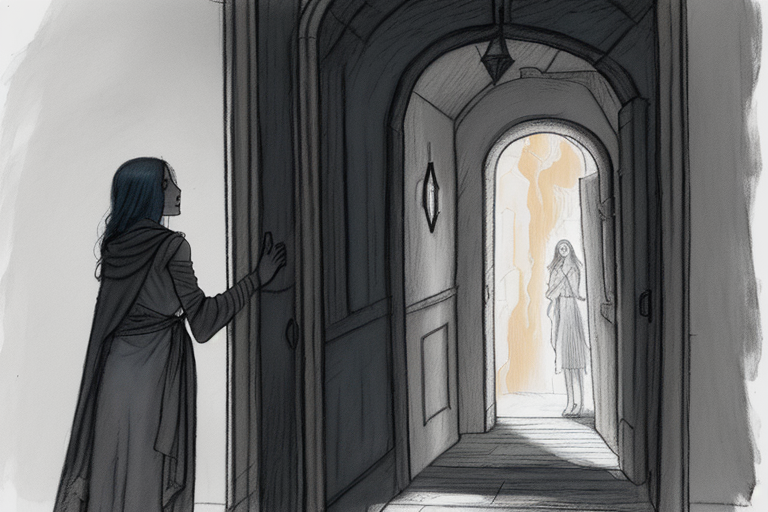

# CHAPITRE 18 : LE REFUGE ILLUSOIRE

> *« Les ouvrages périphériques du Réseau Solyar furent conçus pour résister à l’érosion des ères géologiques, aux impacts météoritiques et à la fureur des étoiles. Ils ne furent cependant pas prévus pour survivre à la trahison de la montagne elle-même lorsque l’écorce planétaire se fendit sous les armes gravitationnelles de l’Âge d’Or. »*
> — **Registres Géodésiques de la Première Mnémorite, Relevé d'Intégrité Sectoriel**

{.chapter-illustration}

La Faille des Soupirs tirait son nom du gémissement continu que le vent d’Oark produisait en s’engouffrant entre ses murailles verticales, hautes de 300 mètres et si resserrées par endroits que la lumière du jour n’y tombait jamais.

Lorsque Koda, Bricole et ÉCHO débouchèrent au fond du cirque terminal après une course effrénée à travers les éboulis de schiste, l’après-midi déclinait déjà en une pénombre couleur de cendre. La jeune femme titubait d’épuisement. Ses bottes ferrées patinaient dans une couche épaisse de scories volcaniques anciennes ; à travers sa cartouche filtrante saturée de silice, chaque inspiration avait le goût d’un fer rouge qu’on lui enfonçait dans la trachée.

Devant eux, la gorge se terminait en cul-de-sac contre une falaise cyclopéenne de basalte noir.

Mais la montagne avait bougé depuis le temps des Semeurs.

Lors du cataclysme final qui avait vitrifié Oark 6 000 ans plus tôt, une onde de choc tectonique avait cisaillé la paroi en 2. Des centaines de milliers de tonnes de roche fondue puis refroidie s’étaient effondrées devant l’entrée du second sanctuaire. Sous cet amas titanesque de blocs enchevêtrés, on ne distinguait plus que l’angle supérieur d’un vantail géométrique parfait, taillé dans cette même matière d’albâtre sombre et inaltérable que le corps d’ÉCHO, mais coincé de biais dans sa glissière par la torsion du socle continental.

— Par l’abîme… souffla Koda en s’arrêtant net, les mains appuyées sur ses genoux tremblants. Bricole, dis-moi qu’il y a une autre porte ! L’entrée est ensevelie sous la moitié de la falaise !

Sur son épaule, le vieux moniteur cathodique de Bricole projeta un faisceau de balayage vert contre le chaos rocheux.

— Il n’existe jamais qu’un seul vecteur d’accès par sanctuaire secondaire, Koda ! répondit la voix tendue du petit robot. Mais regarde sous la clé de voûte, à 4 mètres sur ta droite : le vantail des Semeurs a résisté à l’effondrement ! Un bloc de basalte vitrifié de 40 tonnes est tombé devant le seuil, et la torsion sismique a grippé les verrous magnétiques internes à 10 centimètres d’ouverture ! Même une souris des sables ne pourrait pas s’y faufiler tant que le vantail n’aura pas coulissé d’au moins 30 centimètres supplémentaires !

Koda plissa les paupières dans la pénombre. Derrière le monolithe de roche brute qui barrait le passage, l’alliage divin de la porte millénaire demeurait obstinément scellé, sourd aux appels radio de Bricole.

Au même instant, le ciel au-dessus du canyon explosa de lumière et de fracas.

3 masses colossales, noires et carrées comme des barges de fonderie, venaient de surgir au-dessus de la crête supérieure de la gorge. Leurs tuyères ventrales à fusion crachèrent des colonnes de feu bleuâtre pour annuler leur vitesse de chute, soulevant au fond du cirque un ouragan de cendres qui faillit jeter Koda à genoux. Des projecteurs au xénon — des lampes à arc remplies d’un gaz rare qui dardait un éclat blanc aussi cru que la foudre — s’allumèrent sous le ventre des vaisseaux, transformant le crépuscule naissant en un jour blafard et glacé.

— Contact visuel établi avec la Troisième Division d’Assaut Lourd, annonça ÉCHO sans élever la voix au milieu du rugissement assourdissant des réacteurs. Largage aéroporté en cours à l’embouchure du canyon, distance 420 mètres. 20 unités bipèdes lourdes détectées.

À 400 mètres derrière eux, les rampes d’assaut des transporteurs s’abattirent à 10 mètres du sol.

Des formes massives, hautes de près de 3 mètres, sautèrent dans le vide sans parachute et s’écrasèrent dans le lit du canyon avec une succession de bangs sourds qui firent danser les graviers autour des bottes de Koda. C’étaient les Cuirassiers de Fer : l’élite absolue des armées de Condorcé. Enfermés dans des exosquelettes de siège blindés au carbure de bore et à l’acier trempé, mus par des vérins hydrauliques gros comme des troncs d’arbres qui crachaient des jets de vapeur blanche à chaque foulée, ils se relevèrent dans un cliquetis terrifiant d’armes lourdes. Sur leurs épaules droites trônaient des paniers thermobariques multiples ; au bout de leurs bras asservis luisaient les rails allongés des canons à impulsion magnétique de siège.

*« — Cibles verrouillées au fond du cul-de-sac ! »* hurla une voix amplifiée par des mégaphones de coque qui résonna contre les falaises comme le tonnerre. *« Première escouade, tir de barrage pour fixer l’entité ! Deuxième escouade, avancez en tortue ! »*

— ÉCHO, le rocher et la porte ! cria Koda en se ruant vers l’éboulis. Si tu ne nous ouvres pas un passage maintenant, on est cuits !

Le Gardien la dépassa en 3 foulées silencieuses.

Alors que les premiers éclairs violets des canons à impulsion lourds déchiraient l’air du canyon et faisaient voler en éclats les colonnes de basalte autour d’eux, ÉCHO posa d’abord sa main gauche contre le monolithe de 40 tonnes qui obstruait le parvis. Ses yeux d’ambre virèrent à l’or blanc ; une onde de résonance subatomique courut le long de son avant-bras et annula pendant 2 secondes la friction moléculaire entre la pierre volcanique et le sol. D’une simple poussée latérale, sans un grognement, il fit glisser les 40 tonnes de roche d’un mètre sur le côté, dégageant l’accès au vantail millénaire des Semeurs.

Mais derrière le rocher, la porte du sanctuaire restait bloquée par la contrainte tectonique, n’offrant qu’une fente noire de 10 centimètres.

— Force l’ouverture par résonance quantique, 8471 ! s’égosilla Bricole depuis le dos de Koda tandis qu’une grêle de shrapnels s’écrasait contre le bouclier de pierre. Les verrous internes sont grippés depuis 6 000 ans !

ÉCHO s’immobilisa devant le vantail récalcitrant.

Pendant une demi-seconde, au milieu des éclairs violets et du tonnerre des canons de siège qui faisaient trembler toute la gorge, le Gardien consulta sa mémoire fraîchement constituée. Puis, avec une gravité liturgique absolue, il leva sa main droite, rabattit son bras selon un angle exact de 45 degrés et frappa du plat de sa paume d’albâtre contre le blindage ancien en prononçant d’une voix d’une solennité sépulcrale :

— Vieux tas de rouille. Coopère.

Accroupie derrière le rocher, les oreilles sifflantes sous le déluge de feu, Koda resta une fraction de seconde pétrifiée par ce qu’elle venait d’entendre — avant de laisser échapper un éclat de rire incrédule, presque hystérique, au bord même du gouffre. Sur son épaule, le moniteur de Bricole tressauta d’un spasme vert :

— Par les étoiles… tu lui as enseigné le chamanisme de Zêta-3 !

Dans la milliseconde qui suivit sa percussion palmaire, ÉCHO engagea la véritable résonance subatomique de ses inducteurs. Une harmonique pure traversa l’alliage du vantail, libérant les verrous grippés par le séisme millénaire. La lourde paroi des Semeurs recula de 30 centimètres supplémentaires dans un glissement de soie avant de se bloquer définitivement contre la roche mère, ouvrant une brèche verticale de 40 centimètres de large d’où s’échappa un souffle d’air frais, sec et vierge de toute poussière.

— La procédure de maintenance acoustique humaine a démontré une efficacité de 100 %, déclara froidement ÉCHO par-dessus le vacarme des explosions. Passage dégagé. Entrez.

Koda ne se le fit pas répéter. Elle plongea à plat ventre sous le linteau, rampant sur les coudes dans la poussière glacée tout en protégeant le châssis de Bricole contre la paroi, et se faufila à travers l’entrebâillement du vantail originel.

Dehors, une salve d’obus à haute vélocité et de grenades à plasma s’abattit sur l’éboulis. Une détonation secoua toute la falaise ; une langue de flammes oranges lécha l’ouverture juste au moment où ÉCHO franchissait le seuil à son tour, de profil, et repoussait le monolithe extérieur de 40 tonnes contre la fente.

Le bloc titanesque retomba devant le seuil avec un fracas apocalyptique qui fit vibrer le sanctuaire jusque dans ses fondations, scellant l’ouverture dans un nuage de suie noire.

D’un coup, tout bruit extérieur cessa.

L’isolation acoustique et électromagnétique des murs était si totale que Koda resta quelques secondes à quatre pattes sur le sol lisse, haletante, à écouter le sifflement de ses propres bronches et les battements affolés de son cœur.

Elle se redressa péniblement, détacha les sangles de son harnais dorsal et posa Bricole à même le dallage afin de soulager ses épaules meurtries. La lampe frontale de son casque découpa un long corridor octogonal aux parois d’un gris anthracite parfait, sans jointure, qui s’enfonçait en pente douce dans les entrailles de la montagne.

— On a réussi… souffla-t-elle en s’appuyant contre le mur inaltérable, un sourire tremblant au coin des lèvres. 40 tonnes de basalte devant une porte des Semeurs qui coopère ! Même avec leurs canons de siège, les Cuirassiers de Fer peuvent toujours taper dessus jusqu’à l’hiver prochain, ils n’égratigneront pas un millimètre de ce métal !

Mais au sol, la chenille asymétrique de Bricole ne s’arrêta pas. Au contraire, le petit robot fit pivoter son écran cathodique vers le plafond du couloir avec une brusquerie fébrile, son unique pince de soudeuse vibrant sur son axe.

— Ne célèbre pas notre survie trop vite, Koda ! lança la voix grave de Bricole, et l’éloquence cristalline de son vocodeur trahissait une urgence glaciale. ÉCHO, analyse les harmoniques de basse fréquence dans la voûte supérieure !

Le Gardien leva le visage vers le plafond du corridor. À cet endroit, à une quinzaine de mètres derrière le sas d’entrée, la perfection géométrique du boyau des Semeurs présentait une blessure ancienne : le cataclysme tectonique d’il y a 6 000 ans avait fait glisser 2 strates continentales l’une sur l’autre, créant un décalage de quelques centimètres dans le manchon protecteur qui isolait le couloir de la roche mère. Un mince filet de sable rougeâtre s’en écoulait, inerte, depuis des millénaires.

— Détection de vibrations mécaniques à haute fréquence dans la strate basaltique supérieure, annonça ÉCHO. Les unités d’assaut extérieures n’attaquent pas le vantail du sanctuaire ni le bloc d’obstruction. Elles ont utilisé leurs réacteurs dorsaux pour escalader le surplomb de la falaise. Elles forent la roche naturelle directement à l’aplomb de la fracture tectonique du plafond.

Le sourire de Koda s’effaça d’un coup.

— Elles forent la roche… répéta-t-elle, le sang quittant ses joues.

— L’ingéniosité militaire des armées d’Aqi ne manque jamais de ressource lorsqu’il s’agit de détruire, reprit Bricole en lançant son petit moteur électrique à plein régime, sa chenille rouillée et son ressort couinant furieusement dans la paix sacrée du couloir tandis qu’il dévalait la pente vers le cœur du complexe. Lorsqu’un coffre-fort est indestructible, on éventre la montagne dans laquelle il est scellé ! Ils introduisent des charges thermobariques de brèche minière directement dans la faille géologique qui surplombe la galerie d’accès !

— À quelle distance sommes-nous de la salle centrale ? cria Koda en s’élançant à la suite du petit robot.

— 200 mètres ! Mais la faille tectonique court tout le long de la galerie supérieure ! Si nous n’activons pas le bouclier de confinement de la Mnémorite avant qu’ils ne fassent sauter la voûte rocheuse, toute la compagnie d’assaut va s’engouffrer directement dans l’artère du sanctuaire !

Ils dévalèrent le boyau octogonal dans une course éperdue.

Autour d’eux, l’architecture souterraine des Semeurs défilait dans le faisceau dansant de la lampe frontale : des parois d’une géométrie si pure qu’elles semblaient polies dans un diamant noir d’un seul tenant, indifférentes aux siècles comme aux armées. Pourtant, à mesure qu’ils s’enfonçaient sous la montagne, une trépidation sourde, presque viscérale, commença à remonter par la semelle des bottes ferrées de Koda. Là-haut, à 30 mètres au-dessus de leurs crânes, les foreuses à plasma des Cuirassiers de Fer mordaient furieusement la lèvre de basalte naturel, élargissant la cicatrice laissée par l’apocalypse d’autrefois pour y glisser leurs cylindres d’explosif liquide.

Devant l’éclaireuse à bout de souffle, Bricole bondissait maladroitement sur chaque marche des paliers intermédiaires, son petit ressort tordu répétant son *couic* affolé à chaque rebond. 3 fois, son châssis asymétrique menaça de chavirer dans la pente ; 3 fois, la main d’albâtre d’ÉCHO le cueillit au vol avec une précision chirurgicale avant de le reposer sur le dallage sans ralentir d’un dixième de seconde.

— Encore 80 mètres ! haleta Bricole, dont le tube cathodique clignotait sous les secousses. Prépare-toi à l’intrication dès que nous franchirons le seuil de la rotonde !

Ils n’étaient plus qu’à 50 mètres de la rotonde centrale lorsque la montagne entière se souleva sous leurs pieds.

Là-haut, dans la fracture de la galerie supérieure, 6 charges thermobariques lourdes de siège venaient de détoner simultanément.

Même à travers le blindage du sanctuaire, l’onde sismique fut si brutale que Koda fut projetée contre la paroi gauche du couloir. Un grondement sourd, monstrueux, déferla dans le tube octogonal, suivi d’un souffle d’air brûlant chargé de poussière de basalte pulvérisé, d’odeur d’explosif nitré — ces composés d’azote à détonation brisante utilisés pour fendre le roc — et de fumée noire. La roche millénaire qui coiffait le tronçon fracturé du couloir venait de céder, ouvrant une brèche béante de 4 mètres de large entre le canyon extérieur et les entrailles du refuge.

À travers le nuage de suie qui descendait la pente derrière eux, les faisceaux aveuglants de 20 projecteurs au xénon transpercèrent l’obscurité, accompagnés du fracas cadencé, lourd et implacable de 60 tonnes d’acier hydraulique en marche.

Le refuge venait de se refermer sur eux comme un tombeau.
