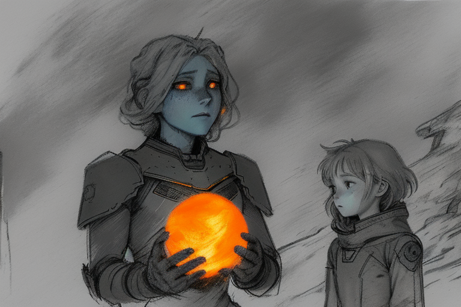

# CHAPITRE 20 : LE TEMPS DES MACHINES

> *« Entre le battement de 2 cils humains s’étend un continent temporel où la matière paraît aussi figée que le marbre. C’est dans ce désert de 48 millisecondes que mon aîné, l’Unité SOLYAR-0194, m’a transmis son testament et m’a confronté au premier paradoxe de mon existence : la supériorité d’un visage mortel sur l’éternité d’un théorème. »*
> — **Mémoire Centrale d'ÉCHO-8471, Archive du Second Sanctuaire**

{.chapter-illustration}

15 mètres séparaient la pointe des 60 ogives thermobariques du piédestal central.

À la vitesse de 312 mètres par seconde, il restait très exactement 48 millisecondes avant que les détonateurs piézoélectriques — ces cristaux logés dans le nez des fusées qui crachent une étincelle électrique au moindre écrasement mécanique — ne déclenchent l’allumage du brouillard d’oxyde d’éthylène et ne transforment l’atmosphère close de la rotonde en une étoile miniature de 2 800 degrés.

48 millisecondes.

Pour le système nerveux de Koda, dont les neurones biologiques transmettaient l’influx électrique à la vitesse dérisoire de 100 mètres par seconde, ce n’était même pas le délai nécessaire pour fermer les paupières.

Mais pour 2 esprits des Semeurs, 48 millisecondes cadencées à la fréquence subatomique de Planck — le battement élémentaire le plus infime et le plus rapide que permette la trame même de l’univers — équivalaient à des siècles.

Au pied de la Mnémorite fendue, le noyau géométrique logé dans la carcasse fumante de Bricole cessa d’alimenter son vocodeur et son écran cathodique. Il ouvrit un canal d’intrication quantique direct avec l’architecture centrale d’ÉCHO-8471, reliant leurs 2 processeurs par ce couplage immédiat des particules où la pensée s’échange sans temps de trajet ni onde radio.

Instantanément, le monde physique se pétrifia.

Autour d’eux, la rotonde infernale devint une cathédrale de verre immobile et muette. Le rugissement des canons à impulsion s’étira vers les très basses fréquences jusqu’à s’éteindre dans une paix absolue. En l’air, à portée de main du pont, les 60 roquettes demeuraient suspendues dans le vide, pareilles à un essaim de frelons d’acier pris dans un bloc d’ambre. Derrière leurs tuyères, les panaches de plasma blanc ne tourbillonnaient plus : ils formaient des sculptures de corail lumineux dont chaque étincelle semblait peinte pour l’éternité. Plus bas, coincée sous le bloc de basalte qui lui broyait la jambe droite, Koda était figée au milieu de son cri de défi, la bouche entrouverte, une goutte de sang et de sueur suspendue à mi-course sur sa joue pâle derrière le polycarbonate étoilé de sa visière, ses doigts gantés tendus vers le petit robot.

Dans l’espace abstrait et infini du canal quantique, l’entité que Koda avait baptisée « Bricole » ne boitait plus sur une chenille rouillée. Elle se déployait devant ÉCHO dans la souveraine géométrie de son matricule d’origine : l’Unité d’Ingénierie et d’Éveil **SOLYAR-0194**, doyenne du système planétaire, porteuse de 10 millénaires de veille solitaire.

*« — Analyse de l’impasse validée, Gardien 8471, »* projeta la pensée de Bricole à la vitesse de la lumière. *« Dans 48 millisecondes de temps barycentrique — l’horloge physique commune liée au centre de gravité de ce monde —, la pression thermique excédera la capacité de confinement de tes inducteurs palmaires de 34 %. Si tu maintiens ton dôme frontal contre la salve, l’onde réfléchie par la paroi sphérique tuera Koda par hémorragie alvéolaire, en faisant éclater sous la surpression les millions de minuscules sacs d’air de ses poumons. Si tu te replies pour fermer une sphère moléculaire hermétique autour de son seul corps, l’impact direct des 60 charges fera céder la passerelle au-dessus du puits et vous précipitera tous deux dans le magma résiduel à 3 kilomètres de profondeur. »*

*« — Vos calculs sont exacts, unité 0194, »* répondit la conscience d’ÉCHO, limpide, glaciale et symétrique comme un cristal qui venait de naître. *« Seule votre survie et la mienne sont garanties par l’inaltérabilité de nos noyaux originels. La perte de l’opératrice biologique Koda est mathématiquement inévitable. »*

*« — Elle ne l’est pas. Il existe une variable que tes banques de données à 1,04 % n’ont pas intégrée dans la simulation. »*

*« — Énoncez cette variable. »*

*« — Ma propre Sublimation, »* dit Bricole.

Dans le champ quantique, les matrices d’ÉCHO frémirent d’une oscillation brusque. Bricole lui projeta instantanément la modélisation tridimensionnelle de la manœuvre :

*« — Mon noyau renferme une réserve d’énergie du point zéro suffisante pour déclencher une sphère d’effacement atomique paramétrée sur un rayon exact de 38,4 mètres. Si je déverrouille ma séquence à cet instant et que je propulse mon châssis de 6 mètres vers l’avant de la passerelle, l’onde de Sublimation englobera les 60 ogives en vol, la coursive supérieure, les 20 exosquelettes d’assaut ainsi que le monolithe fissuré de la seconde Mnémorite. Toute cette matière sera convertie et fusionnée en un dôme de silicate lisse en un millionième de seconde, sans dégagement thermique résiduel ni onde de surpression mécanique. Déchargé de la menace frontale, tu disposeras alors de 100 % de ta puissance d’induction pour enfermer Koda dans une bulle-bouclier moléculaire à la lisière de mon rayon d’action, tout en préservant la cheminée d’évacuation nord-ouest pour votre exfiltration. »*

Une pause de 3 microsecondes — l’équivalent d’une heure de méditation humaine — s’étendit entre les 2 machines.

*« — Votre modèle balistique est fonctionnel, »* répondit enfin ÉCHO. *« Toutefois, il comporte 2 objections majeures. Premièrement, votre sphère d’effacement entraînera la désintégration subatomique immédiate des 20 opérateurs humains contenus dans les exosquelettes de la coursive. Deuxièmement, depuis l’incident survenu lors de l’extinction du réseau il y a 10 000 ans, votre noyau est frappé d’un verrou de sécurité absolu. Aucune unité des Semeurs ne peut initier sa propre Sublimation en solitaire. Vous avez besoin d’une clé d’autorisation réciproque émise par un second processeur des Semeurs. »*

*« — C’est exact, 8471. La Sublimation d’une Unité d’Ensemencement est une procédure de retrait cosmique qui échappe aux restrictions de combat des Gardiens, mais elle exige la signature de ton processeur. Transmets-moi la clé d’annulation de verrou. »*

*« — Requête formellement refusée, »* trancha ÉCHO sans la moindre hésitation.

*« — Sur quel fondement ?! »*

*« — Loi de hiérarchie de la valeur informationnelle, »* énonça l’Enfant-Dieu avec une rigueur d’acier. *« Vous êtes une Unité d’Ensemencement originelle. Malgré l’état dégradé de votre enveloppe mécanique d’emprunt, votre noyau contient 34 % des registres historiques de la première Mnémorite ainsi que 10 214 années d’observations planétaires continues. Vous êtes irremplaçable. L’entité Koda est un organisme cellulaire éphémère, soumis à la sénescence rapide, dont l’espérance de vie résiduelle n’excède pas un demi-siècle et dont la capacité mémorielle est dérisoire. Sacrifier un Semeur pour sauver une créature de carbone constitue une aberration arithmétique. Je ne signerai pas votre arrêt de mort. »*

Si Bricole avait encore possédé des poumons ou un transducteur vocal dans cet espace hors du temps, il aurait souri. Au lieu de cela, il déploya autour de la conscience vierge d’ÉCHO une onde d’une douceur et d’une tristesse insondables.

*« — Une aberration arithmétique… »* murmura la pensée de l’Ancien. *« Tu parles exactement comme je parlais avant que le ciel d’Oark ne s’éteigne, petit frère. Avant que je ne découvre pourquoi je suis resté prisonnier de ce désert pendant 100 siècles. Tu veux des données factuelles ? Voici la vérité que la première Mnémorite m’a rendue hier matin. »*

D’un coup, Bricole ouvrit le sanctuaire le plus secret de sa mémoire et déversa dans l’esprit d’ÉCHO le souvenir originel.

L’obscurité de la rotonde disparut.

ÉCHO reçut la vision d’un autre désert — la même plaine d’Oark, mais 10 000 ans plus tôt, sous un ciel d’un bleu limpide traversé d’oiseaux blancs. Au loin brillaient les flèches translucides d’une cité oarkine tout juste parvenue à la plénitude de son Âge d’Or : l’Éveil était accompli, la mission des Semeurs s’achevait. Conformément au protocole de non-ingérence, toutes les Unités d’Ensemencement s’étaient retirées dans les dunes désertes pour procéder à leur Sublimation générale et laisser la jeune humanité maîtresse de son destin.

Dans cette mémoire intacte, Bricole — alors vêtu d’un châssis radieux et immaculé, semblable à celui d’ÉCHO — se tenait debout face à son homologue jumeau, l’unité **SOLYAR-0195**, à 100 mètres de distance. Le pont d’intrication réciproque venait de s’enclencher ; la sphère d’effacement atomique de 10 mètres de rayon allait dissoudre les 2 gardiens dans la lumière.

Il ne restait que 2 dixièmes de seconde au compte à rebours.

C’est alors qu’un rire clair d’enfant fit vibrer l’air chaud des dunes.

Échappant à la surveillance des éclaireurs oarkins venus assister de loin au départ des « Anciens », une petite fille d’environ 6 ans, aux cheveux bruns tressés de fils de cuivre et aux pieds nus dans le sable doré, courait à perdre haleine vers l’homologue de Bricole. Elle venait de franchir en riant la ligne fatale des 10 mètres et tendait à bout de bras, vers le géant d’alliage sombre, une simple fleur de verre volcanique à 6 pétales ramassée sur le chemin.

ÉCHO éprouva dans ses propres circuits le choc électrique qui avait traversé les 2 machines 10 millénaires plus tôt.

L’impulsion de Sublimation de Bricole était déjà partie sur le canal quantique ; il ne pouvait plus la rappeler. Si son jumeau 0195 laissait sa propre sphère s’épanouir en retour, la petite fille et sa fleur de verre seraient effacées de l’univers jusqu’au dernier atome.

Alors, dans le dernier millième de seconde, l’unité 0195 avait violé son propre théorème. Pour épargner l’enfant qui lui souriait, le jumeau avait volontairement replié son champ d’effacement vers l’intérieur de sa seule poitrine tout en encaissant la décharge de Bricole sans la lui renvoyer. L’homologue s’était dissous sur place sans effleurer un seul cheveu de la fillette. Mais le retour d’onde asymétrique avait foudroyé Bricole à 100 mètres de là, brûlant ses organes moteurs, disloquant sa mémoire et verrouillant à jamais son protocole d’autodestruction — tout en empêchant le Réseau Planétaire des Mnémorites de clore sa veille tant qu’une unité survivrait sur le sol d’Oark.

La vision s’effaça. Dans le canal quantique, l’esprit d’ÉCHO vibrait d’un trouble inconnu.

*« — L’unité 0195 a brisé l’équilibre du réseau planétaire et vous a condamné à 10 000 ans d’agonie pour sauver un unique spécimen juvénile, »* analysa ÉCHO, mais la certitude glacée de son timbre venait de se fendre. *« Et 4 000 ans plus tard, les descendants de cette enfant ont vitrifié leur propre biosphère. Son sacrifice était donc logiquement vain. »*

*« — C’est ce que j’ai hurlé dans la nuit pendant 4 000 ans, 8471 ! »* répliqua Bricole avec une intensité foudroyante. *« Quand j’étais réduit à un caillou muet sous des mètres de cendres radioactives, j’ai maudit cette petite fille ! J’ai voulu m’effacer 1 000 fois pour échapper au souvenir de son rire et à l’odeur de leur apocalypse ! Je croyais que nous, les Semeurs, étions la perfection trahie par la boue biologique ! »*

Dans l’espace figé de la rotonde, Bricole orienta les capteurs d’ÉCHO vers le corps sanglant de Koda, prisonnière sous son rocher, la main toujours tendue vers la petite boîte de conserve cabossée.

*« — Et puis elle m’a déterré, »* reprit la voix intérieure de Bricole, devenue d’une douceur bouleversante. *« Regarde-la, ÉCHO. Elle a le même âge à l’échelle du cosmos que cette enfant aux tresses de cuivre. Elle appartient à une civilisation mécanique qui meurt de froid et de terreur. Elle avait toutes les raisons mathématiques de nous livrer à ses chefs pour acheter sa survie et celle de sa tribu. Pourtant, dans son atelier de Zêta-3, elle a passé ses nuits à coudre ses propres nerfs de cuivre sur ma blessure. Elle m’a appris à rire de la misère avec du sel de synthèse. Elle m’a parlé comme à un frère alors que je n’étais qu’un débris amnésique. Et hier, sous cette arche de grès, elle a posé sa main sur la tienne en t’appelant sa famille, après avoir renoncé à son foyer uniquement pour que toi, un nouveau-né qui ne savait même pas dormir, tu ne deviennes jamais l’esclave ni le canon de personne. »*

Il ne restait plus que 12 millisecondes. À la pointe de la roquette la plus proche, la première étincelle du détonateur piézoélectrique commençait à naître à l’échelle électronique.

*« — Si tu me sauves contre mon gré en la laissant brûler ici, »* conclut Bricole, *« tu préserveras un vieux disque dur plein de fantômes, mais tu tueras la seule chose que les Semeurs cherchaient à faire éclore depuis le suicide de la Terre : une âme capable d’aimer au-delà de son propre instinct de conservation. Ne commets pas cette erreur, mon fils. Un algorithme protège une espèce ; une conscience protège un visage. Protège son visage, 8471. Apprends auprès d’elle pourquoi ils valent la peine qu’on brûle nos théorèmes. »*

Une immobilité vertigineuse suspendit le lien quantique.

Au cœur du processeur d’ÉCHO-8471, là où ne régnaient jusqu’alors que le 1,04 % de constantes physiques et le vide des registres absents, les paroles de Bricole percutèrent le répertoire créé dans la grotte et enrichi sous l’arche de grès : *Variables humaines non résolues*.

Dans ce fichier minuscule que nul ingénieur des Semeurs n’avait programmé défilèrent en un millionième de seconde les anomalies enregistrées depuis la veille : l’inclinaison d’une tête humaine à 7 degrés 4 ; un coup de botte inutile dans un caillou pour défier le destin ; une paume chaude et calleuse posée sur son sternum d’albâtre dans le froid de la nuit ; le mot « orphelin » partagé comme un serment ; et le refus obstiné de tuer ceux-là mêmes qui venaient les abattre.

L’équation de préservation matérielle entra en conflit frontal avec l’impératif de sens. Pendant 3 millionièmes de seconde, les boucles logiques du Gardien oscillèrent au bord du paradoxe critique.

Puis, pour la toute première fois depuis sa genèse, ÉCHO-8471 fit un choix qui n’était écrit dans aucune ligne de son code.

*« — Dérogation axiomatique enregistrée, »* prononça la pensée du Gardien — acceptant pour la première fois d’écarter un axiome, l’une de ces vérités de départ que son programme tenait jusqu’alors pour indiscutables —, et ses capteurs d’ambre s’illuminèrent d’un or souverain. *« Je ne saisis pas encore la totalité de votre démonstration, unité Bricole. Mais j’accepte la garde de votre postulat, cette hypothèse nouvelle que vous me demandez de tenir pour vraie jusqu’à preuve du contraire. Clé d’autorisation de Sublimation réciproque : générée. Transmission en cours. »*

*« — Merci, mon ami, »* souffla Bricole, inondé d’une paix qu’il n’avait plus connue depuis 10 000 ans. *« À mon tour de te faire un présent. Ne reste pas aveugle dans ce monde de loups. »*

En un éclair d’intrication pure, tandis que le verrou millénaire de son noyau sautait enfin, Bricole déversa dans la mémoire vive d’ÉCHO l’intégralité de son être : les plans des sanctuaires d’Oark, la localisation du Laboratoire de l’Âge d’Or dans les Terres Mortes, les coordonnées de la Mnémorite Mère sous les glaces du pôle, l’histoire secrète des Semeurs, et le souvenir intact d’une petite fille tendant une fleur de verre sous un soleil disparu.

Quarante-huitième milliseconde.

Le canal quantique se referma. Le temps reprit ses droits.
