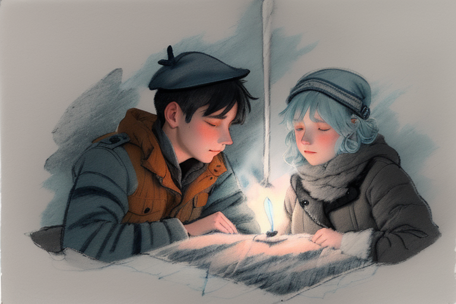

# CHAPITRE 06 : La Brume d'Ammoniac

> *« On nous apprend à l'instruction que le soldat afistéaan n'a pas le même sang que nous, qu'il sent le soufre et qu'il ne craint pas le gel. Cette nuit, au fond du trou, j'ai vu ses mains sans ses moufles : il avait exactement les mêmes engelures violettes que moi autour des ongles, et quand il m'a montré la photo de sa mère et de sa petite sœur Maren devant les fourneaux éteints de Val-Noir, j'ai cru voir notre propre chambre au Dôme 4, Lina. Ne répète jamais ça à personne à l'école, promis ? »*
> — **Cassettes magnétiques du caporal Soren Valen, Bobine n° 15 (Non transmise — Conservée dans sa capote)**

{.chapter-illustration}

À minuit, sur le Glacier d’Ostre, le froid cessa d’être une température pour devenir une bête vivante qui cherchait à mordre.

Le thermomètre à alcool de la Redoute Nord était descendu à moins 55 degrés, juste à la limite de congélation du liquide rouge dans le tube de verre. Et pire que le blizzard, les bombardements lourds de l’après-midi avaient fissuré les poches de gaz fossile emprisonnées sous la banquise centrale : une brume d’ammoniac anhydre — un gaz d’ammoniac pur, totalement privé d’eau, qui dévore l’humidité des yeux et des bronches au moindre contact — et de cristaux d’azote, lourde, jaunâtre, caustique, rampait au ras des champs de barbelés en brûlant les joints de caoutchouc des masques respiratoires.

Puis, à 0 h 18, le collecteur thermique principal de la tranchée s’éteignit dans un claquement sec de disjoncteur.

En moins de 3 minutes, dans les abris de la Troisième Compagnie, la buée des haleines se transforma en neige sèche. Les culasses des fusils magnétiques commencèrent à coller aux gants ; dans le poste de secours, le plasma sanguin destiné aux blessés se figea dans ses flacons de verre malgré les couvertures chauffantes.

— Le câble haute tension du secteur C a été cisaillé par le dernier tir de mortier à 200 mètres devant le parapet ! cria le sergent-chef Darnel dans le combiné grésillant du téléphone à manivelle. Si personne ne va ponter les 2 bouts dans le no-man’s-land avant une demi-heure, toute la canalisation d’eau chaude va éclater par le gel et la compagnie entière sera raide morte avant la relève !

Dans l’étroit boyau d’accès, les 6 sapeurs de l’équipe technique échangèrent des regards livides derrière leurs lunettes givrées. Sortir seul en rampant dans la brume d’ammoniac par moins 55, entre les mines antipersonnel et les tireurs d’élite afistéaans équipés de lunettes thermiques, c’était tirer à pile ou face avec la mort. Le jeune Milo fit un pas en avant en tremblant de tous ses membres, mais une main gantée de cuir raccommodé le repoussa fermement en arrière.

— Reste au chaud, p’tit gars, lança la voix gouailleuse de Soren « Demi-Volt » Valen derrière son groin filtrant. Tu sais même pas faire une épissure propre à la lumière du jour, alors dans la soupe jaune à tâtons, tu serais capable de nous brancher sur la radio ennemie ! Passe-moi la pince isolante, 2 manchons de plomb et ma bobine de cuivre. J’en ai pour 20 minutes, le temps d’aller prendre l’air frais.

— Fais pas le malin, Valen, gronda affectueusement le vieux Darnel en lui serrant l’épaule à travers sa lourde capote. Suis le fil guide au ras de la glace et ne lève pas le casque d’un pouce. Si ça tire, tu lâches la pince et tu rentres.

— Lâcher ma pince ? Vous voulez que l’intendance me retienne 3 mois de solde, sergent ?

Soren vérifia d’une tape sur sa poitrine que son petit magnétophone *Sonor-3* et la photo de Lina étaient bien calés au chaud contre sa doublure intérieure, bascula par-dessus le parapet de glace bleue et s’enfonça à plat ventre dans le brouillard toxique.

Dès les premiers mètres hors de la tranchée, le silence feutré du no-man’s-land se referma sur lui comme un linceul.

Sous ses coudes et ses genoux matelassés, la croûte de verglas grinçait. Autour de lui, la brume d’ammoniac réduisait la visibilité à moins de 3 pas ; des silhouettes fantomatiques de chevaux de frise tordus et de cadavres anciens figés dans la banquise émergeaient soudain de l’ombre jaune avant de disparaître. À travers le filtre à charbon de son masque, une odeur piquante d’urine chimique et de fer gelé lui irritait la gorge. Sa main gauche, coulissant le long du gros câble gainé de gutta-percha noire — cette gomme végétale isolante et coriace qui ne se fendillait pas sous le gel extrême — à demi enfoui dans la neige, avançait mètre par mètre.

100 mètres. 150 mètres.

Ses doigts commençaient à s’engourdir malgré ses doubles moufles lorsqu’il rencontra enfin la rupture : un cratère d’obus tout frais dont le souffle avait déchiqueté la gaine blindée et écarté les 2 extrémités de cuivre de 80 centimètres.

Soren se glissa au bord de l’entonnoir, sortit sa pince coupante et tira de sa poche sa précieuse bobine de fil de cuivre. Il venait de dénuder la première tresse métallique à la lueur minuscule de sa lampe dynamo masquée de tissu rouge lorsqu’un sifflement strident déchira le ciel bas.

Un obus de mortier égaré, tiré à l’aveugle par une batterie de secteur.

Soren n’eut que le temps de se plaquer la tête dans les bras. La détonation secoua la banquise à 30 mètres sur sa gauche. Il ne fut touché par aucun éclat, mais sous l’onde de choc sismique, le pont de neige durcie qui surplombait une ancienne faille glaciaire juste sous son ventre céda avec un craquement sec de verre brisé.

Le sol disparut sous lui.

Soren bascula dans le vide, dévala une paroi quasi verticale de glace vive qui lui laboura les côtes, rebondit contre une corniche et s’écrasa 8 mètres plus bas dans un amas de poudreuse et de blocs éboulés.

Pendant 10 secondes, étourdi par le choc, le souffle coupé, il resta immobile au fond du gouffre noir. Là-haut, la fente étroite par laquelle il était tombé se refermait déjà à demi sous une coulée de neige, le coupant du vent hurlant de la surface. Au fond de la crevasse, l’ammoniac ne pénétrait pas, mais le froid y était celui d’un caveau scellé depuis l’origine des temps.

Soren gémit, tâta sa jambe droite — intacte —, puis chercha à tâtons sa lampe dynamo tombée à côté de lui. Il pressa la poignée à ressort qui couina dans le noir.

Le mince faisceau jaunâtre balaya les parois de glace bleue translucide… et s’arrêta net à 2 mètres de ses bottes.

2 yeux écarquillés le fixaient derrière les lentilles rondes d’un masque à gaz anguleux à groin de cuir brun.

Un uniforme couleur de rouille. Une étoile à 6 branches frappée sur un casque d’acier plat. Un soldat de la Coalition Afistéanne.

Le cœur de Soren bondit dans sa gorge. Par pur réflexe de survie, sa main droite lâcha la lampe et plongea vers l’étui de son pistolet magnétique de sapeur ; en face de lui, l’éclaireur ennemi, à demi enseveli sous un lourd quartier de banquise qui lui écrasait la cuisse gauche, venait d’épauler d’une main tremblante sa carabine courte à impulsion.

Dans le silence absolu de la crevasse, les 2 canons se braquèrent à un mètre 50 l’un de l’autre, éclairés par la lampe posée dans la neige entre eux.

Une seconde passa. 2 secondes.

À travers le faisceau rasant, Soren vit le doigt de l’Afistéaan posé sur la détente. Le soldat avait perdu sa moufle droite dans sa chute ; sa main nue, marbrée de brûlures de gel violettes et blafarde d’ischémie — cet arrêt local de la circulation sanguine lorsque le froid contracte les artères jusqu’à priver la chair d’oxygène —, tremblait si violemment que le canon de sa carabine battait la mesure contre son genou. Et derrière les oculaires embués du masque ennemi, sous le casque trop large qui avait glissé en arrière, Soren aperçut un visage imberbe, creusé par la faim, qui n’avait pas 21 ans.

Si l’un d’eux tirait dans ce boyau de glace d’un mètre de large, le ricochet magnétique ou l’éboulement du plafond les tuerait tous les 2 sur le coup.

Lentement, très lentement, Soren ouvrit ses doigts raidis malgré son poignet gauche foulé dans la chute et laissa son pistolet redescendre sur la neige sans toucher à la détente. Puis il leva ses 2 paumes ouvertes à hauteur de ses épaules.

— Eh ben… murmura Soren à travers sa membrane vocale, en essayant de faire sourire sa voix malgré son cœur qui cognait à 140. Si on m’avait dit ce matin que je tomberais dans le salon d’un voisin sans frapper à la porte… Tire pas, camarade. À cette distance, on va juste réussir à se faire tomber 100 tonnes de glaçons sur la tête, et le sergent Darnel m’a défendu de mourir avant d’avoir réparé son chauffage.

L’éclaireur afistéaan ne baissa pas tout de suite son arme. Sa poitrine soulevait sa capote couleur de rouille par saccades courtes, sifflantes. Puis un spasme de douleur lui tordit le cou lorsqu’il essaya de bouger sa jambe coincée sous le bloc de glace bleue, et la lourde carabine s’affaissa de côté dans la poudreuse.

— *Ma… ma jambe…* souffla une voix rauque, cassée par la soif, dans un dialecte afistéaan des vallées minières du Sud que Soren comprenait à moitié pour l’avoir entendu chez les prisonniers des mines de Plotéris. *Je suis tombé… il y a 2 heures. Ma cartouche thermique est morte. Si tu dois m’achever, Plotéri… fais-le vite. Je sens plus mes mains.*

Soren regarda la main nue et bleuie du garçon, puis l’indicateur chimique fixé sur le plastron ennemi : la pastille de chauffe de son gilet de survie était complètement noire, épuisée. Dans 20 minutes, par moins 55 degrés, l’hypothermie — la chute inexorable de la température centrale du corps en dessous du seuil où le muscle cardiaque peut encore se contracter — arrêterait son cœur.

Sans dire un mot, Soren rampa sur ses genoux jusqu’au blessé.

L’Afistéaan se raidit contre la paroi de glace, les paupières fermées, attendant le coup de couteau qu’on leur promettait dans tous les manuels d’instruction de la Coalition en cas de capture par les « bouchers de Condorcé ».

Au lieu d’une lame, il sentit Soren saisir doucement sa main nue glacée et l’envelopper dans l’une de ses propres moufles de rechange en laine doublée de fourrure synthétique. Puis Soren décrocha de sa ceinture sa dernière cartouche thermique de secours au magnésium-fer. La goupille d’allumage était gelée ; avec la dextérité d’un prestidigitateur, Soren sortit sa pince, enroula 2 tours de son fil de cuivre autour de l’amorce, la court-circuita d’un coup sec sur la pile de sa lampe dynamo pour créer une étincelle, et glissa le cylindre brûlant directement sous le pan ouvert de la capote couleur de rouille, contre le flanc du blessé.

Une bouffée de chaleur sèche monta aussitôt entre eux.

L’éclaireur afistéaan rouvrit les yeux, stupéfait.

— *Tu… tu me donnes ta cartouche ?* bredouilla-t-il tandis qu’une quinte de tremblements nerveux secouait tout son corps qui commençait à se réchauffer. *Mais comment tu vas remonter sans geler ?*

— T’occupe pas, j’ai le sang qui bout naturellement, moi, je suis un gars du Dôme 4 ! répondit Soren en s’asseyant en tailleur tout contre l’épaule de l’ennemi pour partager l’abri de sa propre capote et faire écran au courant d’air glacial de la faille. On m’appelle Demi-Volt. Soren Valen. Et toi ?

Le jeune soldat le dévisagea longuement à la lueur de la lampe dynamo posée sur leurs genoux joints, puis dégrafa le bas de son groin de cuir trop serré pour respirer plus librement.

— *Kael*, dit-il d’une voix encore tremblante. *Éclaireur Kael Drov, 21 ans, de la Quatrième Compagnie de marche de Val-Noir.*

Soren dévissa le bouchon isolant de sa gourde maintenue sous son aisselle — où il restait un fond d’eau tiède sucrée à l’eucalyptus — et la tendit à Kael. Le garçon but 2 petites gorgées avides, puis força la main de Soren à reprendre la gourde pour qu’il boive à son tour.

En reposant sa main sur sa poitrine pour boutonner son col autour de la cartouche chauffante, Kael fit glisser hors de sa poche intérieure un petit carnet de cuir noirci et une photographie cartonnée aux bords dentelés qui tomba sur le genou de Soren.

Soren la ramassa avec précaution et l’éclaira de sa lampe.

Sur le cliché pris au magnésium dans une cour d’immeuble souterrain aux murs de brique givrée, on voyait une femme au visage usé par la poussière de charbon et une fillette d’une dizaine d’années aux tresses blondes serrées sous un bonnet de laine, toutes deux emmitouflées dans des couvertures devant les grands fourneaux éteints des fonderies de Val-Noir. La fillette tenait contre son menton un petit accordéon de bois rafistolé au fil de fer. Au bas de la photo, une écriture appliquée avait tracé à l’encre violette : *Pour notre Kael — Maman et Maren. Reviens-nous avant le grand gel.*

— Ta petite sœur ? demanda doucement Soren.

La gorge de Kael se noua. Du bout de sa moufle prêtée, il effleura le visage de la fillette aux tresses sur le carton froissé.

— *Elle s’appelle Maren, elle a 11 ans*, murmura-t-il, et dans le silence de la crevasse, toute la propagande de 40 ans de guerre venait de s’évanouir. *Mon père est mort dans les galeries de soufre l’hiver dernier. Je travaillais comme boiseur au puits numéro 3 de Val-Noir avant qu’ils raflent toute ma classe d’âge pour boucher les trous sur Ostre. Chez nous, le collecteur central du dôme a gelé la semaine dernière. Maren m’a écrit sur ce carnet qu’ils brûlent les meubles de l’école pour chauffer le dispensaire…*

Kael tourna son visage tiré vers Soren, les yeux brillants d’une détresse nue.

— *Nos officiers nous disent que c’est vous, à Plotéris, qui détournez tous les cargos d’isotopes d’Oark dans des bunkers géants pour nous faire crever de froid jusqu’au dernier… C’est vrai, Soren ? Vous avez vraiment du feu plein vos maisons ?*

Pour toute réponse, Soren ouvrit sa propre vareuse grise, tira de sa poche la pochette de mica et la posa à côté de la photo de Maren.

Dans le halo jaune de la lampe dynamo, la petite Lina souriait sur son lit d’hôpital du Dôme 4, avec ses 3 chandails superposés, son tuyau d’oxygène sous le nez et son petit cheval en fil de cuivre.

Kael contempla l’enfant malade pendant 10 longues secondes sans prononcer un mot. Une larme unique perla au bord de ses cils, roula sur sa pommette sale et gela presque instantanément contre le caoutchouc de son masque.

— *Elle a quel âge ?* souffla l’Afistéaan.

— 9 ans, dit Soren, la voix serrée. Elle s’appelle Lina. Au Dôme 4 de Plotéris, il fait moins 9 dans les dortoirs ce soir, Kael. On n’a pas plus de charbon que vous. Nos généraux nous racontent exactement la même saloperie sur vos bunkers de Val-Noir pendant qu’on se gèle les os dans le même trou.

Les 2 garçons restèrent assis épaule contre épaule au fond de la faille de glace bleue, les 2 photographies côte à côte sur leurs genoux — la petite sœur de Plotéris et la petite sœur de Val-Noir —, écoutant au-dessus de leurs têtes le grondement sourd des canons qui recommençaient à tonner dans la nuit.

Puis Soren secoua la tête, rangea la photo de Lina contre son cœur et reprit sa pince isolante.

— Allez, dit-il d’un ton bourru pour cacher son émotion. Si ta petite Maren t’attend à Val-Noir et que Lina attend mes cassettes, c’est pas le moment de faire des stalactites ici. Ta jambe n’est pas cassée net, c’est juste la cheville qui est prise sous le biseau du bloc. Aide-moi à pousser quand je fais levier avec ma barre d’ancrage.

Pendant 20 minutes d’efforts haletants dans le noir, unissant leurs forces contre la pierre d’eau gelée, Soren parvint à soulever le quartier de glace de 3 pouces et à dégager la botte de Kael. Voyant que Soren grimaçait en tenant sa barre de fer de la main gauche à cause de son poignet foulé dans la chute, Kael sortit de sa trousse de campagne sa propre attelle d’aluminium souple doublée de feutre et la serra soigneusement autour du poignet de Soren ; en échange, avec 2 éclisses de bois arrachées à une vieille caisse de munitions éboulée et 3 mètres de son précieux fil de cuivre, Soren confectionna une attelle solide autour de la cheville de l’éclaireur, puis lui tailla des marches au piolet le long de la paroi oblique qui remontait vers le rebord sud de la crevasse — du côté des lignes afistéannes.

Au sommet de la faille, alors que la brume d’ammoniac commençait à se dissiper sous les premières bourrasques précédant l’aube, les 2 jeunes hommes s’arrêtèrent à plat ventre au bord du cratère.

Kael voulut défaire la moufle de laine et rendre la cartouche chauffante encore tiède, mais Soren referma fermement les doigts de l’Afistéaan dessus.

— Garde-les, Kael. Tu as 300 mètres à ramper avec une patte folle, moi j’ai ton attelle au poignet, un bout de fil à tordre et je cours comme un lapin.

Kael saisit l’avant-bras de Soren et le serra de toutes ses forces.

— *Notre état-major prépare une attaque massive sur la Brèche d’Ostre dans 2 ou 3 jours, Soren*, murmura-t-il tout contre son casque dans un souffle d’angoisse. *Des dizaines de chars et des lanceurs thermobariques… Si ça perce de ton côté, ne reste pas dans les tranchées de devant. Recule avec les tiens, je t’en supplie.*

— Et toi, garde la tête basse si nos mortiers arrosent, répondit Soren avec un sourire triste derrière sa visière givrée. Rentre vivant à Val-Noir pour écouter jouer Maren.

L’éclaireur afistéaan glissa dans l’ombre blanche vers le sud et disparut derrière les barbelés. Soren resta encore 5 minutes dans le cratère pour achever en hâte l’épissure du gros câble thermique avec le reste de son cuivre ; lorsque l’arc bleu jaillit sous ses gants et que le courant de haute tension se remit à ronfler vers les abris de la Troisième Compagnie, il regagna sa tranchée à plat ventre, le cœur battant d’un secret qu’aucun rapport militaire d’Aqi ne pourrait jamais comprendre.
