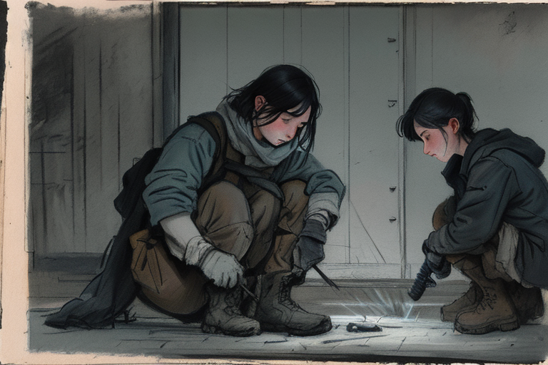

# CHAPITRE 08 : Le Camp Ennemi

> *« Entrée 012 — Tentative d'application du protocole dit "Humour de garnison". Objectif : abaisser le taux de cortisol plasmatique de l'organisme Koda-09 avant l'infiltration d'un périmètre hostile. Formule employée : corrélation statistique entre le chlorure de sodium du substrat et l'état psychologique de désespoir, conformément aux archives de l'unité Bricole. Résultat : bien que ma proposition fût chimiquement exacte et dépourvue d'incongruité voulue, le sujet a souri et sa fréquence cardiaque a diminué de 11 battements par minute. Le mécanisme demeure incompréhensible. »*
> — **Répertoire des Variables Humaines Non Résolues d'ÉCHO-8471**

{.chapter-illustration}

Contrairement aux casemates de béton gris que Condorcé coulait dans la roche comme des dents de fer, l’avant-poste afistéaan de *Boréal-9* — inscrit sous le code Krav-4 sur les cartes d’état-major plotéris — ressemblait à une colonie de scarabées géants blottis au creux d’un cirque de dunes.

7 dômes hémisphériques en toile de kevlar bitumé, maintenus sous pression par des souffleries externes qui toussaient dans la nuit, s’alignaient le long d’un pipeline d’extraction d’eau saumâtre — une eau souterraine lourde et chargée de sels minéraux amers. Autour du périmètre, point de murs crénelés, mais un triple réseau de barbelés électrifiés, des projecteurs à arc au xénon qui fouillaient la brume de silice avec des faisceaux blafards, et 4 pylônes de détection radar dont les coupelles rouillées tournaient en grinçant à chaque rafale. Tout, ici aussi, portait la marque indélébile de la vieille industrie d’Aqi : le vacarme rauque des générateurs au fioul lourd, l’odeur âcre de graisse graphitée et d’ozone qui prenait à la gorge à 200 mètres sous le vent, la mécanique fatiguée que l’on rapiéçait à coups de clé anglaise pour tenir une semaine de plus.

Allongée à plat ventre sur la crête de grès surplombant le flanc ouest du camp, Koda ajusta le zoom optique cabossé de sa visière. Il était 2 heures du matin. La température extérieure avait chuté à 11 degrés, et des voiles de sable noir couraient au ras du sol comme des serpents d’ombre.

À sa droite, accroupi dans une immobilité minérale qui le confondait avec les blocs de basalte, ÉCHO-8471 analysait le campement.

— Effectif total de *Boréal-9* : 28 soldats de la Coalition Afistéanne, murmura le Gardien sur une fréquence acoustique directive que seule l’oreille de Koda pouvait capter. 2 sentinelles en exosquelette léger sur la passerelle nord. 4 mécaniciens éveillés dans le hangar logistique numéro 3. Les 22 autres organismes sont en phase de sommeil paradoxal dans les dômes un et 2. Les combinaisons lourdes de classe NRBC sont stockées au fond du hangar 3, à 42 mètres de la clôture ouest.

— Et les capteurs périmétriques ? souffla Koda, les paumes moites dans ses gants usés.

— Des barrières infrarouges à double faisceau couplées à un sismographe à fil tendu. Technologie rudimentaire. Si je marche devant toi, je peux absorber le rayonnement infrarouge sur mon épiderme et annuler l’onde de pression mécanique de tes bottes dans le substrat sableux sur un rayon de 120 centimètres. En revanche, je relève que ton rythme cardiaque vient d’atteindre 118 battements par minute et que ta sécrétion de cortisol — l’hormone du stress et de l’alerte vitale que tes glandes surrénales déversent dans ton sang — augmente de manière exponentielle. Cette tension musculaire accroît de 23 % le risque de faux pas sur ta cheville lésée.

Koda essaya de déglutir, la gorge sèche. Malgré toute sa bravoure, l’idée de ramper sans arme chargée au milieu d’un camp afistéaan avec une cheville foulée lui tordait l’estomac.

Dans l’obscurité à côté d’elle, ÉCHO-8471 tourna la tête vers son profil. Puis il baissa ses capteurs d’ambre vers la dune, ramassa entre son pouce et son index une pincée de régolithe grisâtre mêlé d’efflorescences blanchâtres et de cendres portées par le vent du sud, et la tendit très sérieusement devant la visière de la jeune femme.

— Koda, énonça le Gardien d’un timbre d’une gravité scientifique absolue. L’analyse spectrographique indique que cette poussière contient 0,02 % de chlorure de sodium, le sel alimentaire ordinaire, et 99,98 % de probabilité de nécrose cellulaire, la mort prématurée des tissus vivants par irradiation résiduelle. Dois-je te la passer pour assaisonner ton désespoir ?

Pendant 2 secondes, Koda crut avoir mal entendu. Elle détourna les yeux des barbelés et dévisagea le géant d’ardoise accroupi dans l’ombre avec sa pincée de sable radioactif au bout des doigts.

Puis l’écho de sa propre boutade du réfectoire de Zêta-3 — et de l’adieu de Bricole dans le sanctuaire — lui revint en plein cœur, transfiguré par la littéralité désarmante de son compagnon. Au bord même du champ de mines ennemi, un sourire irrépressible fendit ses lèvres gercées et ses épaules se détendirent d’un coup.

— Pourquoi souris-tu ? s’enquit ÉCHO en penchant la tête de 7 degrés 4, sincèrement perplexe. Mon estimation chimique était pourtant exacte au centième de pour 100 près.

— Ne change jamais une virgule à tes calculs, 8471, souffla Koda en essuyant une goutte de sueur au coin de son œil. Tu viens de battre Jaro et Bricole réunis. Allez, garde ton sel, le projecteur tourne.

Le faisceau blafard du projecteur au xénon balaya la dune, écrasa les ombres, puis glissa vers le sud, ouvrant une fenêtre de 11 secondes.

— Maintenant, dit ÉCHO.

Ils dévalèrent le talus de sable en une glissade muette. Koda gardait la main gauche posée contre le flanc d’ardoise du Gardien. Sous les semelles ferrées de l’éclaireuse, les grains de silice ne s’écrasaient pas avec leur crissement habituel ; ils s’écartaient sans friction, amortis à l’échelle moléculaire par le champ cinétique qu’ÉCHO déployait sous ses pas. Lorsqu’ils franchirent la ligne des capteurs infrarouges, l’entité tendit simplement la paume vers la borne émettrice : la lumière invisible se courba autour d’eux pour frapper le récepteur d’en face sans perdre un milliwatt d’intensité.

En 9 secondes, ils étaient plaqués contre la paroi souple du hangar numéro 3.

À l’intérieur, des voix humaines résonnaient derrière la bâche doublée de plomb. Sans utiliser de lame, ÉCHO fit glisser l’index le long de la couture vulcanisée — le joint de caoutchouc traité au soufre et soudé à chaud — du panneau d’accès secondaire : les liaisons polymères, ces longues chaînes de molécules qui assuraient la cohésion de la colle industrielle, se défirent proprement sur un mètre 50 de hauteur. Koda se faufila la première derrière une rangée de caisses de munitions vides et d’essieux de chenillettes démontés.

Une odeur familière la frappa aussitôt à travers son filtre usé : du solvant chaud, du chou déshydraté qu’on fait bouillir sur un réchaud de fortune, et du tabac gris de contrebande.

Accroupie dans l’ombre d’un établi de levage, Koda glissa un regard entre deux fûts d’huile hydraulique.

Au centre du hangar éclairé par des baladeuses grillagées, 4 soldats afistéaans en treillis couleur de rouille étaient assis sur des caisses d’obus autour d’un poêle à induction cabossé. Depuis l’âge de 6 ans, sur les affiches des réfectoires de Condorcé et dans les films d’instruction de l’orphelinat, on montrait les Afistéaans sous les traits de brutes fanatiques, aux visages fermés de bêtes de proie, nés uniquement pour incendier les villes des Plotéris et voler le charbon de leurs enfants.

Or le jeune mécanicien qui tendait ses mains gercées au-dessus du poêle n’avait que 19 ans.

Son cou trop maigre flottait dans le col élimé de sa vareuse maculée de cambouis. Il avait exactement les mêmes cernes violets que Jaro après 2 nuits blanches sur une turbine à Zêta-3, les mêmes grands yeux clairs fatigués par la poussière de silice, et lorsqu’il toussa pour éclaircir ses bronches, son voisin — un vieux sergent grisonnant au front bandé d’un linge sale — lui tendit une gamelle d’étain fumante avec un geste bourru et paternel.

— Bois tant que c’est chaud, Tali, grommela le sergent dans le dialecte afistéaan des côtes de l’Est que le traducteur d’oreillette de Koda restitua à voix basse. Le convoi de ravitaillement a encore été ajourné. La radio de minuit dit que les rations de charbon ont été réduites de moitié dans tous les districts ouvriers de Havre-Gris sur Aqi. Il fait moins 46 sur les docks ce soir.

Le jeune Tali baissa la tête sur sa gamelle. Ses épaules maigres s’affaissèrent.

— Mon père a les poumons brûlés par 30 ans de fonderie à Havre-Gris, sergent, murmura le garçon d’une voix étranglée d’angoisse. Et ma mère fait la queue dès 4 heures du matin devant les chaudières municipales pour ramener un seau de braises… Quand ils m’ont réquisitionné à ma sortie d’apprentissage parce que je savais régler les injecteurs de pompes, j’ai cru que notre paie d’Oark leur donnerait droit à un bon de chauffage supplémentaire. S’ils gèlent dans notre cuisine pendant que je graisse des soupapes à des millions de kilomètres… Pourquoi est-ce qu’ils nous font ça, sergent ? Qu’est-ce qu’on leur a pris, à ces gens de Condorcé, pour qu’on s’entre-tue jusque sur 2 planètes ?

— Pose pas de questions, petit. Finis de remonter ton compresseur de forage. Si *Boréal-9* n’envoie pas son quota d’isotopes demain soir, les générateurs de Havre-Gris s’éteindront aussi.

Derrière ses fûts d’huile, les doigts de Koda se crispèrent sur le métal froid. *Qu’est-ce qu’on leur a pris ?* Exactement les mêmes mots, la même détresse, le même mensonge symétrique que Borras lui avait servi 5 jours plus tôt à la table de Zêta-3. 2 peuples jumeaux qui s’éventraient des 2 côtés du même miroir et pleuraient les mêmes parents transis sous la glace.

Une pression légère d’ÉCHO sur son épaulière la rappela à l’urgence.

Tout au fond de la travée, dans le râtelier blindé réservé aux équipes de décontamination des Terres Mortes, pendaient 3 scaphandres lourds NRBC modèle *Korsak-9*. C’étaient des monstres d’acier plombé, de caoutchouc néoprène noir d’un centimètre d’épaisseur et de verre au cérium teinté d’or — un cristal optique enrichi en terres rares pour ne jamais noircir ni se fendre sous les bombardements de rayons gamma —, pesant près de 70 kilos à vide, mais équipés de servomoteurs d’assistance autonomes et de doubles cartouches dorsales neuves.

Pendant que les soldats discutaient autour du poêle, ÉCHO s’avança dans la pénombre du râtelier. Avec une force tranquille qui ignorait la masse, il décrocha d’une seule main le scaphandre le plus proche sans faire tinter un seul crochet métallique, rabattit les jambières contre le plastron et le souleva comme un vêtement d’enfant. Koda s’empara sur l’étagère inférieure de 4 filtres de rechange au plomb-bismuth et d’un kit de joints d’étanchéité.

Ils n’étaient plus qu’à 3 mètres de la fente de la bâche lorsque le jeune Tali se leva de sa caisse, une burette d’huile dans une main et sa lourde moufle de travail dans l’autre, et contourna les fûts pour aller chercher une clé dynamométrique sur l’établi du fond.

Il tomba nez à nez avec Koda.

Pendant une seconde interminable, le garçon de 19 ans resta figé, les yeux écarquillés devant l’éclaireuse en armure de Condorcé qui le tenait en joue avec son pistolet déchargé et l’ombre titanesque aux yeux d’ambre qui se dressait derrière elle. Sa bouche s’ouvrit pour appeler à l’aide.

L’entraînement militaire de Koda lui commandait de frapper à la trachée avec la crosse d’acier. Mais à 50 centimètres d’elle, ses yeux tombèrent sur les phalanges maigres du garçon, crevassées par le solvant, brûlées par le fer à souder et noires exactement du même cambouis que les mains de Jaro dans l’atelier de Zêta-3 ; et dans le revers transparent de la moufle que Tali serrait contre sa poitrine, elle aperçut une photographie cartonnée aux bords dentelés : un vieux couple d’ouvriers aux cheveux blancs emmitouflés dans des manteaux élimés devant les grues givrées de Havre-Gris, entourant leur fils adolescent en bleu d’apprenti qui souriait timidement, avec ces mots tracés d’une écriture tremblante à l’encre violette : *À notre petit Tali — Papa et Maman. Reviens-nous vivant.*

Le bras de Koda refusa de frapper. Elle baissa son arme.

ÉCHO agit avant même que le cri n’ait franchi les cordes vocales du mécanicien.

Son index d’ardoise effleura la carotide de Tali avec une pression millimétrée de 3,4 bars pendant 2 dixièmes de seconde. Le barorécepteur du sinus carotidien — ce minuscule capteur nerveux logé dans la paroi de l’artère pour réguler la tension sanguine — envoya un signal de surpression instantané au bulbe rachidien, provoquant une mise en veille réflexe : le garçon s’affaissa doucement sans la moindre douleur. Koda le retint à 2 bras par les épaules pour que sa tête ne heurte pas le béton, l’allongea avec précaution contre le fût d’huile et replaça la moufle contenant la photo de ses vieux parents entre ses doigts inertes.

— Dors bien, petit mécano, souffla-t-elle.

Mais en glissant des mains du garçon au début de sa syncope, la burette d’huile en fer-blanc avait rebondi sur le coffret du pilier central et fait basculer le levier rouge de dépressurisation d’urgence.

Une sirène mécanique rauque déchira aussitôt la nuit de *Boréal-9*. Sur le toit du hangar et le long des pylônes, les gyrophares orange se mirent à tourner.

— Alerte d’intrusion secteur 3 ! hurla le vieux sergent en bondissant sur son fusil magnétique tandis que, dehors, les bottes ferrées des exosquelettes de garde ébranlaient déjà la passerelle. Tali ! Où es-tu, gamin ?! Transmettez au commandement sectoriel ! Verrouillez le radar de tir !

Au sommet du pylône central, la grande parabole de conduite de tir pivota vers le hangar, couplée aux mitrailleuses lourdes de 20 millimètres, tandis que l’émetteur radio haute fréquence commençait à charger ses condensateurs pour envoyer l’alerte générale sur tout le réseau planétaire. Si le message partait, toutes les patrouilles afistéannes et les écoutes de Condorcé sauraient en 3 minutes que 2 intrus s’étaient emparés d’un équipement NRBC aux portes des Terres Mortes.

— Sors, Koda, ordonna ÉCHO en la poussant par la fente de la bâche avec le scaphandre lourd sous le bras.

Debout dans le tourbillon de sable éclairé par les projecteurs qui convergeaient vers eux, alors que les canons automatiques achevaient leur rotation à 30 mètres au-dessus de leurs têtes, ÉCHO-8471 fit face au boîtier de contrôle du pylône radar.

Il n’avait pas le temps d’entrer par une interface logicielle lente. Pour empêcher les canons automatiques de faucher les soldats qui sortaient en désordre et bloquer l’émission radio, il utilisa la prérogative brute de son architecture : une impulsion électromagnétique dirigée à cohérence quantique, un faisceau d’ondes subatomiques vibrant toutes rigoureusement au même rythme.

Un fil invisible d’énergie frappa le cœur du pylône. Pas d’explosion, pas d’étincelle. À l’intérieur du coffret blindé, tous les transistors de silicium virent leurs jonctions atomiques réécrites simultanément en isolants purs, devenus aussi incapables de conduire l’électricité qu’un morceau de verre. Les gyrophares s’éteignirent d’un coup, les tourelles se figèrent à mi-course et la parabole s’arrêta net dans un silence sidérant, plongeant *Boréal-9* dans le noir complet.

Mais au moment même où l’impulsion traversait l’antenne en cours d’émission, une fraction infinitésimale de l’onde porteuse s’échappa dans la haute atmosphère d’Oark sous la forme de 3 millisecondes d’une modulation harmonique, une vibration régulière parfaitement étrangère à toute physique connue sur Aqi.

Tandis qu’ils s’enfonçaient au pas de course dans les dunes noires du sud, ÉCHO calcula la dispersion du signal résiduel.

— Le jeune mécanicien Tali reprendra connaissance dans 4 minutes sans séquelle neurologique, annonça-t-il dans l’oreillette de Koda. Cependant, l’extinction d’urgence de l’émetteur en pleine charge a généré un artefact spectral de 0,003 seconde sur la bande de télémétrie orbitale.

Haletante malgré sa cheville que l’adrénaline anesthésiait tandis que le Gardien portait le lourd scaphandre volé comme une plume, Koda tourna une dernière fois la tête vers les dômes plongés dans l’obscurité.

— 3 millièmes de seconde de parasites sur un poste afistéaan en panne ? souffla-t-elle. Personne chez Condorcé ne remarquera jamais une aiguille pareille dans une tempête de sable.

Elle ignorait que, 100 kilomètres plus au nord, le général Vane ne cherchait plus des armées, mais précisément des aiguilles.
