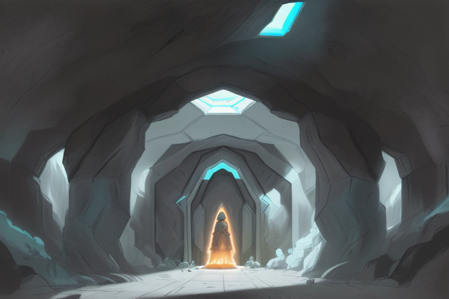

# CHAPITRE 11 : Le Laboratoire de l'Âge d'Or

> *« Ne cherchez pas les palais de nos pères sous les vents du nord ; là-bas, même la pierre a oublié qu'elle fut bâtie. Mais au fond du cratère où le ciel est tombé, sous 300 coudées de verre mort, la lumière qu'ils avaient solidifiée attend encore le pas de ceux qui n'ont pas peur des fantômes. »*
> — **Chants des Veilleurs de Cendres de Lyss, Livre des Fondations Perdues**

{.chapter-illustration}

Le Bassin de Kélar ne ressemblait pas au reste d’Oark. Ici, même le sable était mort.

À perte de vue sous un ciel couleur de plomb violacé, la plaine n’était qu’un océan de verre noir tordu en vagues figées, hérissé d’aiguilles de silice fondue qui se dressaient vers les nuages comme les côtes calcinées d’un léviathan. Aucun vent ne soulevait de poussière : la croûte vitrifiée, tranchante et lisse, crépitait sous une pluie invisible de particules gamma. Par endroits, l’ionisation de l’air — l’arrachement continu des électrons des molécules de gaz sous l’effet de l’intense radioactivité — au-dessus des failles de cobalt ancien était si forte que des langues de feu Saint-Elme, ces aigrettes lumineuses d’électricité statique d’un bleu livide, couraient le long des arêtes rocheuses en grésillant dans la lumière blafarde.

Enfermée dans le scaphandre lourd *Korsak-9* dérobé quelques heures plus tôt à l’avant-poste afistéaan de *Boréal-9*, Koda avançait avec l’impression de marcher au fond d’un océan de poix dans un cercueil de plomb.

Malgré les vérins d’assistance hydrauliques qui gémissaient à chaque foulée contre ses cuisses et soulageaient sa cheville foulée, les 70 kilos de blindage afistéaan lui broyaient les clavicules. Tout, dans cette carapace noire, hurlait l’industrie brutale et désespérée d’Aqi : le ronflement rauque des turbines de filtration dorsales, les joints de caoutchouc néoprène d’un centimètre d’épaisseur qui sentaient le soufre vulcanisé et la graisse minérale rance, la sueur acide de l’inconnu qui l’avait portée avant elle, et la condensation chaude qui ruisselait sur son front sans qu’elle pût se gratter le visage.

Et surtout, il y avait le bruit. Collé contre sa tempe gauche à l’intérieur du casque trop large, le dosimètre acoustique du scaphandre ne faisait plus des bips : il crachait un grésillement continu, furieux, pareil à de la friture bouillante jetée sur une plaque de fonte rouge.

*19,4 sieverts par heure.*

À 3 centimètres de l’autre côté de sa visière dorée au cérium, l’air même suffisait à déchirer l’ADN humain en lambeaux irréparables en moins de 4 minutes.

Pourtant, à 2 pas devant elle, ÉCHO-8471 marchait tête nue dans l’enfer atomique.

Les éclairs bleus d’ionisation glissaient sur son épiderme d’ardoise stellaire sans même ternir l’éclat de sa surface. Ses pieds géométriques foulaient le verre radioactif avec une grâce silencieuse, brisant d’une pression calculée du talon les lames d’obsidienne les plus instables pour ménager un chemin plat aux lourdes bottes plombées de sa compagne. Depuis qu’elle portait le *Korsak-9* dont l’attelle pneumatique bloquait sa cheville, il avait cessé de boiter, mais il réglait sa vitesse au centième de kilomètre-heure sur le souffle rauque qu’elle expulsait dans son micro.

— Temps d’exposition cumulé de tes cartouches dorsales : 4 heures et 38 minutes, annonça la voix pure d’ÉCHO à travers le canal inductif qu’il avait couplé à sa radio afistéanne. La saturation du filtre au plomb-bismuth atteint 71 %. Tes réserves glycogéniques — le carburant glucosé stocké dans ton foie et tes muscles — diminuent, mais ta fréquence cardiaque demeure stable. Nous arrivons au point d’entrée vertical.

Devant eux, au centre d’un cirque de colonnes de basalte tordues comme des cierges fondus, le sol s’ouvrait sur un puits hexagonal de 30 mètres de large.

Ce n’était pas un cratère d’impact. Les bords du gouffre, bien qu’ébréchés en surface par l’antique bombardement qui avait vitrifié la région 6 000 ans plus tôt, plongeaient dans les ténèbres selon une rampe hélicoïdale taillée sans le moindre joint dans une matière blanche opalescente qui avait résisté au feu thermonucléaire.

— Le relevé gravimétrique indique que la structure souterraine débute à 380 mètres sous le plancher basaltique, précisa ÉCHO en s’engageant le premier sur le rebord. La pente est de 12 degrés. Pose tes semelles exactement dans mes empreintes : la vitrification superficielle réduit le coefficient de friction de 40 %.

— Reçu, 8471, souffla Koda à travers ses dents serrées. Si je glisse avec 70 kilos de plomb sur le dos, tu n’auras même pas besoin de me ramasser à la petite cuillère, je rebondirai jusqu’au noyau de la planète.

— Cette trajectoire est physiquement impossible, répliqua très sérieusement le Gardien en tendant son avant-bras d’ivoire sombre comme une rampe vivante à hauteur du gantelet de Koda. Mon châssis présente une résistance mécanique suffisante pour stopper ta masse cinétique en 0,004 seconde sans traumatisme articulaire.

La main blindée de caoutchouc noir de Koda se referma sur le poignet lisse et tiède de l’entité, et ils entamèrent la descente dans la spirale d’ombre.

À mesure qu’ils s’enfonçaient sous l’épaisse carapace de roche du manteau d’Oark, le grésillement hystérique du dosimètre commença à ralentir. À 100 mètres de profondeur, il ne crépitait plus que par saccades espacées ; à 250 mètres, l’air extérieur perdit sa lueur bleutée d’ionisation ; à 380 mètres, au bas de la rampe en colimaçon, le compteur Geiger émit un dernier tic-tac paresseux avant de se taire tout à fait.

Devant eux se dressait une porte.

Elle ne comportait ni volant de décompression, ni gonds d’acier, ni rivets, ni serrure électronique. C’était un voile continu d’une substance laiteuse et nacrée, asymétrique comme l’intérieur d’un coquillage géant, qui semblait couler lentement sur lui-même tout en demeurant parfaitement solide.

Lorsque Koda et ÉCHO s’arrêtèrent à 3 pas du seuil, un son s’éleva de la paroi.

Ce n’était pas le grondement d’un moteur diesel ni le sifflement gras d’un vérin hydraulique. C’était une note unique, cristalline, harmonique — la vibration pure d’un diapason d’argent que l’on aurait effleuré dans le vide. Un rideau de lumière bleu pâle traversa de haut en bas le scaphandre de Koda. En une seconde, sans une goutte de solvant chimique ni un jet de vapeur sous pression, toutes les poussières radioactives de cobalt et de césium incrustées dans les coutures du caoutchouc et le plomb de son armure furent désintégrées à l’échelle atomique.

Puis la paroi nacrée s’ouvrit en silence, non pas en coulissant sur des rails, mais en se rétractant en corolle comme la pupille d’un œil vivant.

Koda fit 3 pas lourds à l’intérieur et s’arrêta, le souffle coupé.

— Atmosphère interne : 78 % d’azote, 21 % d’oxygène purifié, température constante de 21 degrés Celsius, radioactivité résiduelle nulle, énonça ÉCHO. Cette enceinte est maintenue en stase homéostatique — un équilibre physique et thermique auto-régulé comme celui d’un organisme vivant au repos — depuis 6 180 ans. Tu peux retirer ton enveloppe extérieure.

Les mains tremblantes d’épuisement, Koda actionna les poignées de déverrouillage thoraciques du lourd *Korsak-9*. Le plastron plombé s’ouvrit en 2 avec un chuintement gras de joints pneumatiques et d’huile chaude, et elle s’extirpa de la carapace noire comme un papillon froissé sortant d’une gangue de goudron. Le lourd scaphandre afistéaan resta debout tout seul sur ses jambières rigides au milieu du sas d’albâtre, grotesque, anguleux, balafré de peinture jaune écaillée, puant le caoutchouc brûlé et la peur au seuil d’un autre univers.

Koda retira ses bottes internes pour soulager sa cheville enflée, tomba à genoux pieds nus sur le sol et leva la tête.

Ils se trouvaient au sommet d’une cathédrale souterraine d’un kilomètre de diamètre dont aucune ligne n’était droite et dont aucun matériau ne portait le nom d’un métal connu sur Aqi.

Des arches élancées, asymétriques et fluides comme des branches d’arbres pétrifiées dans de la lumière solide, s’élançaient jusqu’à une voûte translucide qui diffusait une clarté dorée, douce comme un matin d’été. Pas une vis, pas un boulon, pas un câble électrique apparent, pas une trace d’usure, de suie ou de rouille. Des passerelles sans garde-corps, minces comme des lames de verre mais d’une rigidité absolue, flottaient à différentes hauteurs dans l’espace vide, maintenues en lévitation par des champs tensoriels — des trames invisibles de forces multidirectionnelles qui tendaient l’espace local comme les cordes entrecroisées d’une harpe — et faisaient vibrer l’air d’un imperceptible bourdonnement musical. Tout autour des galeries supérieures s’alignaient des consoles organiques en forme de calices endormis.

Depuis son enfance dans les galeries glacées de Plotéris et ses mois de prospection dans la crasse mécanique de Zêta-3, Koda n’avait connu que la technologie de la souffrance et de l’effort : le fer qui grince, la soudure qui fume, la chaufferette qui tousse, la machine qui lutte contre son propre poids avant de crever. Même les rares vestiges oarkins qu’elle avait déterrés dans les couloirs sains de la surface n’étaient que des poteries d’argile vitrifiée, des fondations de pierre brute ou de simples fibres de quartz primitives. Ici, la matière avait cessé de peser et de souffrir. Sous ses paumes nues et ses plantes de pieds écorchées, le sol de lumière solidifiée était tiède comme une peau vivante au soleil.

— Les Semeurs ont bâti un palais pareil… murmura-t-elle, persuadée que seuls les créateurs d’ÉCHO et de Bricole avaient pu sculpter un tel prodige. Regarde cet endroit, 8471… C’est beau à en pleurer.

Elle se releva et marcha lentement le long de la balustrade immatérielle, laissant courir ses doigts noirs de cambouis sur la surface tiède et nacrée d’une arche. Au creux d’une alcôve latérale baignée d’une lueur d’aigue-marine, un jardin de cristaux suspendus oscillait lentement au gré d’un courant harmonique inaudible. Chaque prisme translucide conservait en son cœur l’empreinte holographique d’une espèce botanique disparue d’Oark : des fougères hélicoïdales aux nervures d’or, des fleurs nocturnes qui s’ouvraient jadis au passage des lunes, des mousses luminescentes des anciennes mers australes.

Mais à côté d’elle, l’attention d’ÉCHO ne se portait pas sur les arches de lumière solide ni sur les passerelles flottantes.

Ses capteurs d’ambre étaient braqués droit devant eux, tout au centre de l’abîme circulaire vers lequel convergeaient toutes les galeries, tous les anneaux d’analyse et tous les faisceaux de mesure du complexe.

Là, suspendu à 20 mètres au-dessus d’un puits énergétique éteint, trônait un octaèdre parfait de 12 mètres de haut.

Au milieu des courbes fluides, chatoyantes et organiques du complexe, l’objet paraissait d’une étrangeté absolue. Ses 8 faces planes et ses arêtes tranchantes, d’un noir stellaire identique au châssis d’ÉCHO, coupaient l’espace avec une rigueur géométrique inhumaine. Aucune poussière, aucun reflet doré des voûtes ne s’y accrochait : c’était un fragment de nuit pure, immuable, indifférent au temps. Et tout autour de ce diamant sombre se dressaient des centaines d’anneaux de résonance quantique, de canons à neutrinos — ces particules fantômes sans charge électrique capables de traverser les blindages les plus denses — et de capteurs gravitationnels, pareils à une forêt d’instruments chirurgicaux braqués sur le cœur d’un dieu immobile.

— Tu fais erreur sur l’identité des bâtisseurs de cette enceinte, Koda, déclara ÉCHO en s’avançant sur la passerelle de lumière qui s’illumina d’un halo pâle sous ses pas. Seule la Mnémorite Majeure qui lévite au centre a été déposée dans cette strate géologique il y a 400 000 ans par les Semeurs. Le complexe de lumière solide qui nous entoure, les passerelles en lévitation et les instruments qui encerclent le cristal n’ont pas été conçus par nos créateurs. Ils ont été construits par tes propres ancêtres oarkins, 4 siècles avant leur extinction.

Koda s’immobilisa net au milieu du pont translucide, comme si la foudre venait de lui tomber sur la nuque. Elle regarda tour à tour ses pieds nus posés sur le vide lumineux, les arches sans couture de la voûte et le géant d’ardoise.

— Nos… nos ancêtres ? balbutia-t-elle, incapable d’assembler les mots. Les Oarkins ont bâti ça ?! Mais c’est impossible, 8471 ! Dans les couloirs sains, leurs ruines n’ont même pas d’acier trempé ! Et qu’est-ce qu’ils essayaient de faire à la Mnémorite avec tous ces canons braqués dessus ?

ÉCHO posa sa main d’ardoise sur le calice translucide de la première console. Sans même déployer sa puissance subatomique, il laissa couler une infime impulsion dans les circuits photoniques — ces réseaux où l’information circulait sous forme d’éclairs de lumière pure plutôt que d’électrons — endormis depuis 6 millénaires.

Un soupir harmonique parcourut toute la cathédrale souterraine. Des milliers de glyphes d’argent s’allumèrent en cascade le long des arches courbes, et la mémoire secrète de l’Âge d’Or s’ouvrit devant eux.
