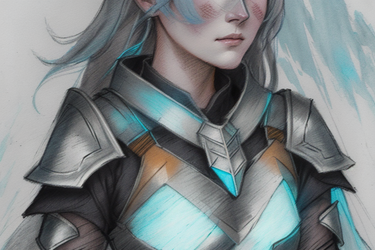

# CHAPITRE 12 : La Tentation de la Puissance

> *« Entrée 015 — Anomalie comportementale interne : Dissimulation par mimétisme gestuel. Lorsque l'organisme Koda-09 m'a interrogé sur mes projections préliminaires concernant la viabilité à long terme de la civilisation d'Aqi, j'ai différé la transmission du chiffre de 99,94 % d'échec afin d'éviter une surcharge émotionnelle. Durant cette omission de 1,8 seconde, mon bras droit s'est élevé sans commande consciente pour frotter ma troisième vertèbre cervicale — reproduisant le marqueur moteur exact que Koda-09 manifeste lorsqu'elle ment au lieutenant Borras. Elle a immédiatement détecté la dissimulation. »*
> — **Répertoire des Variables Humaines Non Résolues d'ÉCHO-8471**

{.chapter-illustration}

Sous la paume d’ardoise d’ÉCHO-8471, la corolle de lumière solide frémit comme une fleur nocturne touchée par la rosée.

D’étage en étage, le long des 300 mètres de galeries courbes qui tapissaient la cavité souterraine, des milliers de nervures translucides s’éveillèrent dans un murmure d’orgue de verre. Après 6 180 ans de sommeil sous la croûte radioactive du Bassin de Kélar, les banques mémorielles de l’Académie Suprême d’Oark déversaient leurs journaux de bord dans le vide de la rotonde.

Debout pieds nus sur la passerelle en lévitation, vêtue de sa seule sous-combinaison noire trempée de sueur, Koda suivait la danse des glyphes d’argent qui s’allumaient autour d’eux. Malgré l’air tempéré et pur du complexe, le froid des Terres Mortes lui collait encore à la peau. À 30 mètres en arrière, près du sas nacré refermé, le lourd scaphandre afistéaan *Korsak-9* gisait comme une carcasse de crabe mort, rappelant à lui seul toute la brutalité mécanique du monde qu’ils avaient laissé là-haut.

— Qu’est-ce qu’ils disent, 8471 ? demanda-t-elle à voix basse, presque intimidée par la majesté de la cathédrale. Qu’est-ce que les savants d’Oark cherchaient ici ?

Les capteurs d’ambre d’ÉCHO balayaient à une vitesse prodigieuse les colonnes de données photoniques qui jaillissaient des pupitres.

— Ce complexe portait le nom d’*Institut de Convergence Trans-Atomique de Kélar*, répondit le Gardien. Il a été fondé 412 ans avant l’extinction de la civilisation oarkine, le jour où leurs géologues ont mis au jour la Mnémorite Majeure suspendue devant nous. 3 200 physiciens, mathématiciens et ingénieurs de l’Âge d’Or se sont relayés dans ces galeries pendant 14 générations avec un unique objectif : ouvrir le cristal et en extraire la science des Semeurs.

Koda se pencha par-dessus le bord sans garde-corps de la passerelle. Tout autour de l’octaèdre noir de 12 mètres de haut qui flottait au centre du puits, la nature exacte des grands anneaux courbes se précisait : des focalisateurs de neutrinos, des marteaux à ondes gravitationnelles, des lasers à rayons gamma cohérents — des faisceaux concentrés de haute énergie nucléaire dont toutes les ondes vibraient au même pas — capables de vaporiser le cœur d’une étoile naine.

— Et qu’est-ce qu’ils ont trouvé dedans ?

— Rien, dit ÉCHO.

Le mot tomba dans l’acoustique cristalline de la salle avec une sécheresse stupéfiante. Koda pivota vers son compagnon.

— Comment ça, rien ? Ils avaient dompté la gravité ! Ils savaient bâtir avec de la lumière solidifiée et guérir toutes les maladies ! Tu vas me dire qu’en 4 siècles, ils n’ont même pas réussi à lire un fichier ?

— La distance scientifique qui sépare l’Âge d’Or oarkin de l’architecture des Semeurs est supérieure à celle qui sépare un biface de silex — un simple galet de pierre taillé par éclats aux premiers âges préhistoriques — d’un vaisseau de fusion interplanétaire, expliqua ÉCHO sans la moindre trace d’orgueil, comme s’il énonçait une constante universelle. J’analyse leurs rapports d’expérience. Au premier siècle, ils ont tenté d’interroger la Mnémorite par résonance quantique ; le cristal a absorbé leurs signaux sans émettre d’écho. Au deuxième siècle, ils ont concentré sur son arête inférieure toute la puissance énergétique d’un continent pour en prélever un nanogramme d’échantillon, un milliardième de gramme de matière ; la température du diamant n’a pas varié d’un millième de degré Kelvin. Au troisième siècle, leurs plus grands esprits ont sombré dans ce que leurs propres archives qualifient de *Grande Névrose de Kélar* : la rage impuissante d’une espèce qui se croyait devenue pareille aux dieux et qui se heurtait à un mur lisse qu’elle ne pouvait ni comprendre, ni briser, ni imiter.

Un sourire amer passa sur les lèvres de Koda.

— Alors même au sommet de leur Âge d’Or, ils étaient comme Vane et ses ingénieurs devant le cratère de Bricole… des enfants qui tapent avec des cailloux sur une porte fermée.

— Leurs derniers travaux ne relevaient plus de la science, mais de la paranoïa, poursuivit ÉCHO. Chaque nation d’Oark soupçonnait sa rivale d’être sur le point de percer le secret des Semeurs pour imposer son hégémonie, sa domination absolue et sans partage sur le reste de la planète. Au cours des 30 dernières années précédant leur guerre finale, le Conseil Militaire Boréal a réquisitionné cet institut. Puisqu’ils ne pouvaient pas ouvrir la Mnémorite, ils ont détourné les générateurs de haute énergie installés ici pour concevoir des armements de rupture destinés à anéantir la Coalition Australe avant qu’elle ne frappe la première.

Un frisson glacé parcourut les bras nus de Koda. Cette logique de frappe préventive par terreur de l’autre, elle l’entendait tous les jours à la radio de Condorcé. Elle fit un pas vers ÉCHO et scruta ses fentes d’ambre où continuaient de défiler les reflets argentés des archives oarkines.

— 8471… depuis qu’on a quitté la grotte de Lyss, tu compares ces vieux fichiers avec ceux que tu as piratés cette nuit sur les satellites d’Aqi. Je te connais maintenant. Qu’est-ce que tes calculs disent sur nous ? Si tu te connectes à cette Mnémorite Majeure et que tu réveilles tout ton protocole de Gardien… qu’est-ce que la loi des Semeurs prévoit pour Aqi ?

Pendant une seconde et 8 dixièmes, ÉCHO-8471 ne répondit pas.

Ses capteurs optiques se détournèrent imperceptiblement de 3 degrés vers la voûte dorée. Et, avec une lenteur presque hypnotique, son bras droit d’ardoise stellaire se plia, sa main d’ivoire métallique remonta derrière sa tête et ses phalanges parfaites vinrent frotter doucement la plaque lisse de sa nuque, de haut en bas, alors qu’aucune poussière ni aucune démangeaison ne pouvait exister sur son épiderme inaltérable.

— Mes données actuelles demeurent fragmentaires à 1,04 %, Koda, répondit-il d’une voix légèrement trop unie. Il serait méthodologiquement prématuré de formuler une conclusion définitive sur l’avenir d’Aqi avant mon couplage complet avec la matrice centrale.

Koda resta bouche bée, les yeux rivés à la main d’ivoire qui redescendait lentement le long du cou du géant.

— Tu viens de te passer la main derrière la nuque, souffla-t-elle.

ÉCHO immobilisa son bras à mi-hauteur.

— C’est exact.

— C’est mon tic à moi quand je mens à Borras pour cacher une bêtise à l’atelier ! s’écria Koda, partagée entre l’incrédulité et une angoisse subite qui lui serra la poitrine. Tu m’as vue faire ça 10 fois quand je disais que je ne savais pas où était passée la clé de 12 ! Qu’est-ce que tu me caches, 8471 ? Pourquoi tu ne veux pas me dire ce que tes calculs prévoient pour mon peuple ?

Les fentes d’ambre du Gardien revinrent se poser sur son visage. Sa tête s’inclina légèrement.

— L’unité Bricole m’a prescrit de protéger ton visage, Koda, avoua-t-il avec cette franchise désarmante qui suivait toujours ses maladresses d’imitation. Or mes modèles biométriques indiquent que la divulgation de la probabilité brute de survie de la civilisation aqine — évaluée cette nuit à 0,06 % avant déclenchement des protocoles de sauvegarde stellaire — provoquerait chez toi une détresse psychologique aiguë sans bénéfice opérationnel immédiat. J’ai donc tenté d’appliquer une omission protectrice, que mon sous-programme moteur a involontairement associée à ton geste cervical.

*0,06 %.*

Le chiffre résonna sous la voûte de lumière comme le glas d’un monde. Mais avant même que Koda pût interroger ÉCHO sur ce qu’il appelait les « protocoles de sauvegarde stellaire », son regard tomba sur la galerie latérale que le Gardien venait d’allumer, dont les arches viraient du doré au bleu électrique profond.

Au mot d’*armements* qu’il avait prononcé une minute plus tôt, quelque chose s’était contracté dans le ventre de l’éclaireuse.

Elle revit l’éclair thermobarique dans la gorge d’Ambre. Elle revit le jeune Tali dans le hangar de *Boréal-9*, et l’impulsion quantique qu’ÉCHO avait dû émettre pour éteindre le radar. À cette heure, le général Vane ou ses chasseurs avaient forcément relevé la trace. Ils avaient des canonnières, des satellites, des divisions d’exosquelettes lourds. Et la prochaine fois que les portes sauteraient, il n’y aurait plus de petit robot rafistolé pour s’offrir en sacrifice entre elle et le feu.

Sans un mot, fuyant à la fois le chiffre terrible d’ÉCHO et sa propre impuissance, Koda quitta la passerelle centrale et s’engagea dans la galerie bleue.

ÉCHO la suivit à 2 pas en silence. Au bout du couloir sans couture, une alcôve elliptique s’ouvrit d’elle-même à leur approche, dévoilant l’armurerie tactique des anciens gardiens du complexe.

 Alignés dans des stalles de stase où la poussière n’était jamais entrée, 12 équipements de combat oarkins attendaient leurs porteurs depuis 60 siècles.

Rien ici ne rappelait la quincaillerie lourde, bruyante et huileuse de Condorcé. À la place des plaques de céramique boulonnées et des vérins hydrauliques, des tuniques exodermiques — de secondes peaux actives conçues pour se greffer par-dessus l’épiderme — tissées de métamatériaux argentés flottaient sur des mannequins de lumière, si fines qu’elles semblaient faites de soie liquide. À côté d’elles reposaient des brassards de distorsion spatiale et des armes longues au profil d’aile d’oiseau, sans canon percé ni magasin de cartouches, dont la surface nacrée vibrait d’un bourdonnement grave dès qu’on s’en approchait.

Fascinée, Koda s’arrêta devant la première stalle. L’artisane et la soldate en elle éprouvaient le même vertige devant une telle perfection d’ingénierie.

— Qu’est-ce que c’est, 8471 ? murmura-t-elle en effleurant du bout des doigts le plastron de soie métallique.

— Une cuirasse à champ de déflexion tensoriel, couplée à une lance de projection d’ondes gravitationnelles focalisées, répondit ÉCHO. La cuirasse courbe localement la trajectoire des projectiles cinétiques et l’espace-temps immédiat jusqu’à un seuil de saturation de 4 mégajoules, l’énergie brute d’un obus de char tiré à bout portant. L’arme modifie la constante de gravité dans un cône directionnel de 40 mètres, multipliant la masse apparente de la cible par un facteur de 10 à 50 en un centième de seconde.

Koda retira brusquement ses doigts comme si elle venait de toucher un câble à haute tension. Son regard alla du plastron de soie liquide jusqu’au fond de la rotonde où le lourd scaphandre afistéaan *Korsak-9* gisait dans une flaque d’huile rance, avec ses grosses soudures baveuses, ses joints de caoutchouc noir et ses vérins de fer.

Une onde de choc silencieuse venait de faire voler en éclats 30 ans d’éducation à Plotéris.

— Mais… ils manipulaient la gravité et l’espace-temps avec une arme d’épaule ?! bredouilla-t-elle, le souffle coupé par une incrédulité totale. 8471, ça n’a aucun sens ! Sur Aqi, dans toutes nos écoles d’ingénieurs, dans tous les manuels de Condorcé comme chez les Afistéaans, on nous apprend que nous sommes au sommet absolu du progrès ! Quand on creuse les sables d’Oark, on ne trouve que des fondations de pierre taillée, du bronze oxydé ou de vieilles fibres de verre ! Tout le monde pense que les anciens Oarkins étaient un peuple archaïque qui s’est empoisonné avec des bombes sales primitives… Comment ont-ils pu fabriquer des armes qui dépassent de 100 coudées nos réacteurs à fusion et nos canons magnétiques ?!

Les prunelles d’ambre du Gardien s’éclairèrent d’une lueur plus dense. D’un geste de la main, il fit naître au milieu de l’armurerie une colonne holographique verticale, graduée de **1** à **100** en fines lignes d’or.

— Parce que ton peuple confond la chronologie du temps avec l’échelle de la maîtrise physique, Koda, expliqua calmement ÉCHO. Pour évaluer la maturité, la puissance et le potentiel destructeur des civilisations qu’ils engendraient à travers l’univers, les Semeurs ont établi une classification universelle allant du **Niveau Technologique 1** au **Niveau 100**.

Le doigt d’ardoise du géant effleura la base de la colonne lumineuse, tout en bas de l’échelle.

— On franchit les premiers degrés en apprenant à prolonger la main biologique par la matière brute, commença ÉCHO. Du **Niveau 1 au Niveau 3**, une espèce éveillée taille le silex, apprivoise le feu, découvre le levier, la roue, l’agriculture et enfin l’écriture, qui empêche le savoir de mourir avec le cerveau qui l’a pensé. Du **Niveau 4 au Niveau 6**, elle entre dans l’âge métallurgique et thermodynamique : elle fond le fer et l’acier, imprime ses livres, brûle le charbon pour animer des machines à vapeur, puis dompte le courant électrique et les premières ondes radio.

Au-dessus de la graduation **6**, l’échelle holographique prit une teinte orangée où s’alluma le profil bleu et blanc d’une planète lointaine que Koda reconnaissait désormais : la Terre originelle.

— Du **Niveau 7 au Niveau 9**, reprit ÉCHO, l’espèce franchit son premier seuil critique — celui que nos archives désignent sous le nom d’ère atomique et numérique initiale, le niveau « terrestre » que connaissaient nos créateurs à l’aube de leur premier siècle spatial. Au **Niveau 8**, une civilisation brise le noyau de l’atome par fission, grave des milliards de portes logiques sur des puces de silicium, relie sa planète par un réseau informatique global, conçoit ses premiers algorithmes d’intelligence statistique et pose des sondes sur sa lune et ses planètes voisines — tout en demeurant dépendante de la combustion d’hydrocarbures fossiles qui dérègle son atmosphère. Au **Niveau 10**, elle maîtrise enfin la fusion thermonucléaire stable et commence à habiter durablement son système planétaire proche.

Koda s’avança d’un pas vers la colonne d’or, subjuguée par cette fresque où toute l’aventure de l’esprit se mesurait d’un seul coup d’œil.

— Et nous ? murmura-t-elle. Aujourd’hui, sur Aqi… où est-ce qu’on se situe là-dessus ?

— Votre civilisation aqine actuelle — aussi bien la République de Condorcé que la Coalition Afistéanne — se situe très exactement au **Niveau 15**, répondit ÉCHO en faisant clignoter un trait rouge au sixième de la hauteur. Au **Niveau 15**, l’espèce maîtrise la propulsion interplanétaire de routine par fusion thermique, les armes cinétiques à impulsion électromagnétique, les bombes thermobariques, la robotique lourde assistée par hydraulique et une intelligence artificielle purement calculatoire. C’est une technologie puissante, mais encore prisonnière de la mécanique de friction, du poids du métal et de la combustion énergétique brute.

Puis ÉCHO éleva la main bien plus haut le long de la colonne, jusqu’à faire resplendir un anneau d’un bleu éblouissant : le **Niveau 28**.

— Or, il y a 10 000 ans, poursuivit le Gardien, tes ancêtres sur Oark avaient progressé sans relâche jusqu’au **Niveau 28**. C’est à ce palier de maîtrise planétaire et quantique qu’ils ont démontré leur sagesse pacifique, validé le Protocole de l’Éveil et obtenu le retrait de nos Unités. Pendant 4 millénaires, leur Âge d’Or s’est maintenu à ce **Niveau 28**. Mais lorsque leur guerre civile a éclaté il y a 6 000 ans, ils ont employé cet arsenal pour vitrifier leurs propres métropoles. Les quelques milliers de survivants qui se sont entassés dans les derniers vaisseaux de transport vers Aqi ont débarqué sur un monde glaciaire à moins 50 degrés, sans usines subatomiques, sans réseaux photoniques et sans synthétiseurs de matière.

La voix d’ÉCHO résonna sous la voûte avec l’implacable clarté d’une loi physique :

— Une technologie de **Niveau 28** ne tient pas dans la mémoire d’un seul homme, Koda ; elle exige le tissu industriel d’une planète entière. Jetés nus sur la banquise d’Aqi, tes ancêtres ont vu leurs derniers outils de lumière solide s’éteindre faute de matrices de recharge. Pour ne pas mourir gelés dès le premier hiver, les physiciens de l’Âge d’Or ont dû redevenir des mineurs de fond : ils ont creusé des veines de charbon à la pioche, coulé de la fonte brute et riveté des chaudières à vapeur. En moins de 2 générations, l’humanité exilée a brutalement régressé du **Niveau 28** au **Niveau 11**. En 60 siècles de lutte contre le froid, vous avez péniblement regagné 4 échelons jusqu’au **Niveau 15**, en oubliant tout de votre chute. Et lorsque vos prospecteurs sont revenus sur Oark il y a 80 ans, ils n’ont osé fouiller que les « couloirs sains » — les seules régions désertiques que les frappes de l’apocalypse avaient dédaignées parce qu’elles ne contenaient que des vestiges archaïques de **Niveau 5 à 8** datant de votre préhistoire. Vos généraux en ont conclu avec orgueil que vous étiez les maîtres de l’évolution… sans jamais soupçonner que sous la croûte radioactive des Terres Mortes reposaient les vestiges d’un **Niveau 28** qui vous surpasse de 13 paliers.

Koda porta ses 2 mains à ses tempes. Le sol de lumière solide semblait tanguer sous ses pieds nus.

Tout s’emboîtait avec une ironie vertigineuse : le mépris des officiers de Plotéris pour les « sauvages d’Oark », l’incompréhension de Jaro devant les fibres de quartz, l’arrogance de Vane… Toute l’humanité d’Aqi se croyait au sommet de l’arbre alors qu’elle rampait parmi les racines brûlées de ses propres ancêtres !

Elle leva les yeux vers le sommet de la colonne d’or, là où les graduations montaient bien au-delà du trait bleu du Niveau 28, jusqu’aux hauteurs éblouissantes où siégeaient les Semeurs.

— 13 niveaux d’écart entre nos exosquelettes de fer et cette armurerie… souffla-t-elle, saisie d’un frisson sacré. Mais alors, 8471… qu’est-ce qu’il y a au-dessus ? Comment est-ce qu’on grimpe jusqu’à toi ? Qu’est-ce que ça veut dire, les niveaux 30, 50 ou 90 ?

Les fentes d’ambre du Gardien suivirent l’ascension des chiffres lumineux qui s’allumaient 10 par 10 jusqu’à la voûte de la cathédrale.

— Chaque dizaine correspond au franchissement d’une barrière fondamentale de la physique, expliqua ÉCHO. Au **Niveau 20**, une civilisation abolit la mécanique de friction : elle remplace les pistons, les engrenages et la poudre par la photonique pure, les métamatériaux programmables — ce que tu appelles la lumière solide — et les premiers champs tensoriels qui aboutissent, au **Niveau 28**, à ces armes gravitationnelles et aux essaims de nanorobots moléculaires.

— Et au **Niveau 30** ?

— Au **Niveau 30**, l’espèce achève la maîtrise intégrale de son système stellaire, poursuivit ÉCHO. Elle capte la totalité de l’énergie rayonnée par son soleil grâce à des essaims collecteurs orbitaux, régule à volonté le manteau tectonique et le climat de ses planètes, éradique toute dégénérescence génétique ou cellulaire, et ouvre les premières géométries de propulsion relativiste permettant d’atteindre les étoiles voisines à une fraction notable de la vitesse de la lumière.

Un second palier d’argent pur s’illumina plus haut.

— Au **Niveau 40**, la civilisation franchit le seuil subatomique : elle cesse de brûler la matière ou de récolter la lumière des étoiles pour puiser directement dans l’énergie du point zéro — les fluctuations quantiques inépuisables du vide. À ce stade, elle transmute à volonté n’importe quel élément chimique en un autre en réarrangeant protons et neutrons sans déchet ni chaleur. Au **Niveau 50**, elle dompte la métrique même de l’espace-temps : ses vaisseaux ne traversent plus le vide, ils plient la trame spatiale devant eux pour abolir les distances interstellaires, tandis que ses réseaux communiquent instantanément d’un bout à l’autre d’une galaxie par intrication quantique, sans subir le délai de la lumière.

Koda retenait son souffle, la tête renversée en arrière, comme un marin contemplant des constellations inconnues.

— Au **Niveau 60**, reprit la voix cristalline du Gardien, l’information et la conscience s’affranchissent de l’usure biologique ou électronique : le savoir se grave à l’échelle du spin de chaque atome au cœur de matrices cristallines inaltérables — les premières Mnémorites — capables de traverser des centaines de millions d’années sans perdre une syllabe. Au **Niveau 70**, l’ingénierie devient stellaire et temporelle : une telle espèce sait rajeunir une étoile mourante, stabiliser une supernova, sculpter des poches locales de dilatation du temps où 1 000 ans d’évolution s’écoulent en une heure extérieure, et façonner des biosphères fertiles sur des milliers de mondes stériles.

Les graduations **80** et **90** s’embrasèrent d’un or solaire, identique à la lueur des yeux d’ÉCHO.

— Au **Niveau 80**, l’intelligence ne subit plus passivement les lois de la nature dans son périmètre d’action : elle module localement les constantes fondamentales — l’intensité de la gravité, la cohésion électromagnétique et les forces nucléaires —, ce qui permet aussi bien d’ériger un dôme d’exclusion absolue que de déclencher une Sublimation silencieuse. Au **Niveau 90**, l’énergie pure du vide se condense sur simple commande en matière complexe *ex nihilo*, donnant naissance à des alliages sub-moléculaires totalement indestructibles par toute technologie inférieure et à des flottes d’ensemencement intergalactiques.

Tout en haut de la colonne, juste sous le sommet, le chiffre **96** étincela comme une étoile solitaire.

— Et voici notre architecture, Koda : le **Niveau 96**, dit doucement ÉCHO. C’est le sommet qu’avaient atteint les Semeurs de la Terre lorsqu’ils ont conçu les Unités d’Ensemencement telles que Bricole, forgé mon châssis à partir d’un rayon d’énergie pure et déployé le réseau des Mnémorites sur Oark et Aqi.

Koda fixa longuement les 4 derniers échelons qui restaient éteints, plongés dans une obscurité absolue entre le **96** et le **100**.

— Et le **Niveau 100** ? murmura-t-elle. Pourquoi tes créateurs se sont-ils arrêtés à 96 ? Qu’est-ce qu’il y a tout là-haut ?

ÉCHO leva lui aussi ses capteurs d’ambre vers la cime obscure de l’hologramme.

— Le **Niveau 100** n’est pas un palier technique que l’on finit par conquérir avec du temps, Koda, répondit-il avec une gravité presque religieuse. C’est une limite asymptotique absolue — un plafond cosmique aussi physiquement inatteignable pour une intelligence née dans cet univers que le fait, pour une masse matérielle, d’atteindre ou de dépasser la vitesse de la lumière dans le vide. Plus une civilisation s’approche de 100 — à 95, 96, 97 —, plus la quantité d’énergie et de calcul requise pour gravir un seul dixième supplémentaire tend vers l’infini. Atteindre le **Niveau 100** signifierait s’extraire de la causalité même du temps, créer de l’énergie à partir du néant absolu et inverser l’entropie globale du cosmos tout entier — autrement dit, être l’univers lui-même.

D’un geste lent, le Gardien referma sa paume. L’échelle lumineuse s’éteignit, ramenant la pénombre bleutée de l’armurerie autour des 12 stalles de combat oarkines.

— Pourtant, ajouta ÉCHO à voix basse, retiens cette donnée, Koda : les Semeurs avaient atteint le **Niveau 96**, tes ancêtres d’Oark avaient atteint le **Niveau 28**, et ton peuple sur Aqi se bat au **Niveau 15**. 3 hauteurs vertigineusement différentes sur l’échelle de la matière… et à chacun de ces 3 paliers, la peur de l’autre a suffi à déclencher l’autodestruction. La puissance de l’outil ne guérit jamais la main qui le porte.

Un long silence suivit ses paroles. Koda avait compris la leçon. Et pourtant, en regardant le plastron de soie métallique de **Niveau 28** qui flottait devant elle, son cœur d’éclaireuse traquée battait à tout rompre. Contre les exosquelettes de **Niveau 15** de la Section Noire qui descendraient bientôt par le puits de Kélar, 13 niveaux d’avance technologique représentaient la différence entre la vie et la mort.

Après une seconde d’hésitation, elle saisit le plastron et le détacha du socle de stase.

Dès que l’étoffe argentée toucha ses épaules par-dessus sa sous-combinaison, le matériau s’anima d’une vie fluide : sans boucle ni sangle, il épousa instantanément les courbes de son torse, de ses bras et de ses jambes jusqu’à ses pieds nus, léger comme un souffle d’air frais mais parcouru d’une tension subatomique prodigieuse. Une trame d’énergie tiède enserra sa cheville foulée, effaçant d’un coup toute douleur. Lorsqu’elle ferma le poing gauche, un halo irisé, presque invisible, ondula à 2 centimètres de sa peau avec la note pure d’un verre de cristal qu’on frotte.

Elle tendit ensuite la main droite et referma ses doigts sur la crosse organique de la lance gravitationnelle.

Une décharge d’adrénaline pure lui traversa le bras jusqu’à la nuque via l’induction cutanée de l’arme. Dans son champ de vision, un réticule holographique d’une finesse miraculeuse se superposa à la salle, calculant instantanément la masse, le point de rupture structurel et le vecteur d’écrasement de chaque pilier, de chaque console, de tout ce qui l’entourait.

Pour la première fois depuis le jour où le drone de Zêta-3 les avait surpris à la sortie du premier sanctuaire, la boule de terreur froide qui lui nouait l’estomac venait de disparaître.

Avec cette armure et cette lance de **Niveau 28** entre les mains, plus aucun exosquelette de Condorcé ne pourrait l’acculer contre un mur. Plus jamais elle ne serait le fardeau fragile de chair et d’os pour lequel Bricole avait dû mourir.

Lorsqu’elle se retourna, le canon nacré au creux du coude, l’ivresse qui brillait dans ses prunelles sombres se heurta de plein fouet au regard d’ambre d’ÉCHO-8471.

Debout sous l’arche bleue, le Gardien demeurait immobile, l’enveloppant d’un silence si dense et si lourd d’analyse que le sourire fier de Koda s’effaça d’un coup.

— Quoi ? dit-elle sur la défensive en resserrant sa prise sur la crosse. Tu as vu ce que Vane nous a envoyé dans la gorge d’Ambre ! Tes protocoles de **Niveau 96** t’interdisent de te battre offensivement sans ton réseau, et je n’ai pas l’intention de te voir te faire sublimer à ton tour pour me sauver la peau. Avec ça, je peux nous défendre !

— Ton rythme cardiaque a augmenté de 28 battements par minute et ton taux de dopamine plasmatique — le messager chimique du plaisir et de l’ivresse de domination — présente un pic d’euphorie caractéristique au contact de cet artefact, énonça ÉCHO d’une voix très douce, presque triste. Dans les archives médicales de cet institut que je viens de consulter, ce profil neurochimique exact a été enregistré chez les officiers oarkins lorsqu’ils ont pris possession de cette salle, 11 jours avant la vitrification de leur planète.

Koda blêmit sous le halo pâle de sa cuirasse.

— Je ne suis pas eux, 8471 ! Je ne veux conquérir personne, je veux juste survivre !

— C’est également la phrase exacte qui figure en préambule de leur décret d’activation des armes gravitationnelles, répondit ÉCHO sans baisser les yeux. Lyss d’Érèbe a formulé hier soir que la peur conduit l’organisme humain à brûler sa propre demeure pour éclairer l’obscurité. Mais avant même de rejoindre la Mnémorite Majeure, mes capteurs sismiques détectent des mouvements rapides dans la galerie périphérique nord : les systèmes de défense autonomes du complexe viennent d’être réveillés par notre remise sous tension.

Au lieu d’éveiller la moindre crainte en elle, cette annonce fit battre le sang plus fort aux tempes de Koda, tandis que la lance gravitationnelle vibrait contre sa paume comme une promesse de foudre.
