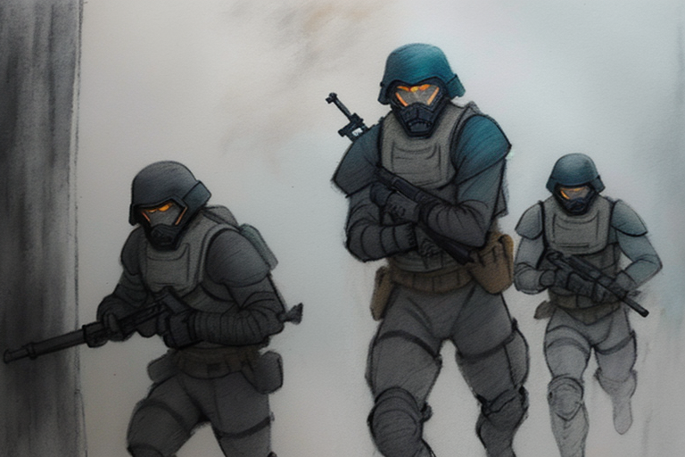

# CHAPITRE 15 : L'Assaut de l'Élite

> *« Règle d'engagement prioritaire pour la Section Noire à Kélar : Ne tentez aucune sommation verbale. La déserteuse Koda-09 constitue l'interface de commandement tactique de l'artefact. Tant que son cerveau émettra des ordres, la machine repoussera nos hommes. Brisez le bouclier de l'opératrice par saturation cinétique simultanée dès l'ouverture du sas : un automate privé de pilote redevient une pièce de musée. »*
> — **Carnets personnels du Général Vane, Directive opérationnelle Kélar-Zéro**

{.chapter-illustration}

La seconde déflagration ne vint pas de la surface ; elle frappa directement la paroi nacrée du sas d’entrée, à 30 mètres derrière eux.

Pendant 6 180 ans, la porte organique de l’Institut de Kélar avait contenu la pression rocheuse et le rayonnement gamma sans faiblir d’un micron. Mais les sapeurs de la Section Noire du général Vane n’avaient pas cherché à la déverrouiller : ils y avaient ventousé 4 charges creuses au plasma thermobarique.

Dans un rugissement sourd qui fit vibrer toutes les passerelles en lévitation comme des cordes de harpe surtendues, le voile de nacre vola en éclats. Un geyser de fumée noire, grasse, chargée d’odeur de cordite brûlée — cette poudre propulsive sans fumée à base de nitroglycérine —, de plomb vaporisé et d’ozone militaire, s’engouffra dans la cathédrale de lumière solide.

Avant même que les volutes d’encre ne se soient dissipées sur le sol immaculé, 12 masses d’acier sombre jaillirent de la brèche au pas de charge.

C’étaient des exosquelettes d’assaut lourds *Titan-IV*, la pointe la plus meurtrière de l’arsenal de Condorcé. Hauts de 2 mètres 40, carapaçonnés de plaques de céramique noire doublées de feuilles de plomb antiradiation, ils avançaient dans un vacarme assourdissant de pistons hydrauliques, de turbines dorsales hurlantes et de semelles ferrées qui étoilaient le sol de cristal à chaque foulée. Leurs épaulières crachaient des faisceaux laser de désignation rouge sang à travers la fumée.

— Contact visuel ! aboya la voix amplifiée du commandant Varek dans les haut-parleurs externes de son blindage. Cible alpha et cible humaine sur la passerelle centrale ! Déployez les pylônes de confinement ! Abattez l’opératrice sans sommation !

3 grenades aveuglantes au magnésium détonèrent simultanément au-dessus de l’anneau supérieur, tandis que 8 canons magnétiques lourds ouvraient le feu en rafales continues.

Le fracas fut apocalyptique. Dans l’acoustique pure de la rotonde oarkine, les détonations hypersoniques des projectiles de tungstène lancés à 3 kilomètres par seconde résonnèrent comme si le ciel lui-même s’écroulait sur la Mnémorite Majeure.

— Koda, derrière mon châssis ! lança ÉCHO-8471 en bondissant d’un pas latéral pour couvrir sa compagne de son corps d’ardoise.

Mais l’onde de choc des grenades au magnésium avait déjà balayé l’entrée du pont, et 4 commandos avaient pris position sur les galeries latérales en surplomb, ouvrant un angle de tir croisé qui contournait la silhouette du Gardien pendant que 6 autres soldats ancraient dans le dallage de lourds harpons électromagnétiques reliés à des générateurs d’arc pour entraver ÉCHO.

Une grêle de fer et de feu s’abattit sur Koda.

Elle n’eut même pas le temps de plonger. Autour de son corps, la cuirasse de soie métallique des Anciens réagit au centième de milliseconde : le halo irisé du bouclier à distorsion spatiale s’illumina d’un éclat violet aveuglant. Les 20 premiers projectiles de tungstène ne ricochèrent pas ; l’espace lui-même se plissa à 3 centimètres de la peau de Koda, courbant la trajectoire des balles qui allèrent pulvériser les corolles de cristal derrière elle dans une pluie d’étincelles d’argent.

Dans cette cathédrale bâtie 6 000 ans plus tôt pour dialoguer avec les étoiles, l’irruption de la guerre mécanique aqine produisait un contraste d’une brutalité obscène. Les lourdes bottes ferrées des *Titan-IV* broyaient les dalles d’albâtre luminescentes en laissant derrière elles des traînées noires de graisse graphitée et de suie ; les douilles d’alliage brûlant éjectées à la cadence de 900 coups par minute tintaient en rebondissant sur les escaliers de lumière solide ; l’odeur âcre de la poudre sans fumée et du gasoil surchauffé étouffait le parfum subtil d’ozone purifié qui régnait sous la voûte. D’un côté, la lourdeur aveugle du fer, du plomb et des vérins qui crachaient leur huile ; de l’autre, la géométrie silencieuse du Gardien d’ardoise que les harpons de 50 000 volts ne parvenaient même pas à faire frémir, et la grâce mortelle de l’armure d’argent qui entourait l’éclaireuse d’un cocon de lumière pliée.

Pourtant, sous la violence cinétique phénoménale du barrage continu, Koda fut projetée à genoux sur la passerelle, les tympans vrillés par le chant aigu de sa propre armure dont les condensateurs tensoriels montaient déjà en surcharge thermique.

— Feu à volonté sur la déserteuse ! hurla Varek en s’avançant au centre du pont pendant que les arcs de 50 000 volts des harpons enveloppaient ÉCHO d’une cage d’éclairs bleus. Saturez son bouclier ! Elle commande la machine !

L’instinct de survie — cette terreur animale, viscérale, qui lui avait broyé le cœur dans la gorge d’Ambre — submergea Koda. Elle ne voulait pas mourir ici. Elle ne voulait pas qu’ÉCHO soit forcé de se sublimer comme Bricole.

Elle épaula la lance gravitationnelle oarkine.

Aussitôt, l’induction neuro-cutanée de la crosse tenta de lui réinjecter dans les veines la même décharge brûlante de dopamine et d’ivresse meurtrière que 20 minutes plus tôt dans la galerie nord. Le réticule doré s’alluma devant sa rétine, hurlant d’écraser, de broyer, de réduire ces envahisseurs de fer en flaques d’acier plat.

Koda pressa la zone d’induction à puissance réduite.

L’arme oarkine n’émit ni flamme ni fumée. Seule une note grave, profonde comme le battement d’une cloche sous-marine, parcourut le bras de Koda, et l’air devant le canon se tordit comme au-dessus d’un brasier.

À 20 mètres en face d’elle, les 2 exosquelettes de pointe qui chargeaient côte à côte s’arrêtèrent net en pleine course.

Dans un cône invisible de 4 mètres de large, l’arme venait de multiplier la constante gravitationnelle par 25. Les 2 colosses de 300 kilos pesèrent soudain 7 tonnes et demie chacun. Leurs vérins hydrauliques de jambes explosèrent instantanément dans un jet d’huile bouillante ; les châssis d’acier trempé se plièrent sur eux-mêmes avec un crissement de tôle froissée et s’écrasèrent à plat ventre contre la passerelle qui se fendit sous le choc, clouant leurs occupants au sol, vivants mais incapables de soulever un doigt sous leur propre masse.

Haletante, l’épaule meurtrie par le recul tensoriel, Koda pivota sur un genou vers la galerie de droite, d’où un troisième soldat de la Section Noire, agenouillé derrière une corolle brisée, ajustait son canon magnétique sur elle.

Le réticule holographique de la lance verrouilla immédiatement le thorax de l’homme. La jauge d’énergie indiquait que son bouclier à elle n’avait plus que 12 % de réserve : si ce tireur faisait feu en même temps que Varek, elle était morte. En revanche, une simple pression du pouce sur le curseur rouge porterait le facteur gravitationnel à 50 — le même facteur qu’elle avait utilisé avec un sourire d’orgueil sur les drones de la galerie nord — et écraserait instantanément la cage thoracique du soldat à l’intérieur de sa cuirasse avant qu’il ait pu presser la détente.

Le pouce de Koda glissa sur le curseur. La lance monta en fréquence dans ce chant de diapason strident qui promettait la toute-puissance.

Puis, à travers le zoom optique parfait que l’arme projetait dans sa rétine, 2 détails lui sautèrent au visage.

Sur l’épaulière noire écaillée du soldat, à côté du matricule blanc, quelqu’un avait peint au pochoir l’insigne bleu et argent du Bataillon de Marche d’Ostre — l’unité d’origine de Jaro et de ces milliers de sapeurs qui venaient de périr ce matin même dans la glace fondue de la Brèche d’Ostre pour défendre les enfants du Dôme 4. Et derrière la visière blindée qu’un éclat de cristal venait de fendre, brillaient 2 yeux gris dilatés par l’épouvante de ce lieu inconnu : les yeux d’un garçon de Condorcé qui n’avait peut-être que 22 ans, qui tremblait dans son harnais trop lourd et qui croyait défendre sa petite sœur contre un monstre.

Dans la mémoire de Koda retentit soudain la voix glaciale d’ÉCHO, 3 minutes plus tôt au pied de la Mnémorite :

*« Et toi-même, qui détiens la connaissance de cette vérité, il t’a suffi de tenir cette arme entre tes mains pendant 10 minutes dans la galerie nord pour éprouver l’ivresse d’écraser tes ennemis… L’autodestruction est inscrite dans votre structure même. »*

En un éclair vertigineux, les images de l’hologramme d’Oark et le souvenir honteux de son propre sourire féroce dans le couloir nord se superposèrent à la visière fendue du jeune soldat d’Ostre.

Si elle poussait ce curseur à 50 G, si elle broyait le cœur de ce garçon dans sa boîte de fer pour sauver sa propre peau après avoir goûté au plaisir de détruire, alors ÉCHO avait raison. Alors la prophétie de l’Itération Défaillante s’accomplissait jusqu’au bout : il n’y avait plus aucune différence entre les orateurs qui vitrifiaient les continents, le général Vane qui sacrifiait ses provinces, et l’orpheline de Zêta-3.

*Non*, cria toute l’âme de Koda contre la musique tentatrice de la lance. *Je ne suis pas votre monstre ! Je ne recommencerai pas !*

Ses doigts se crispèrent sur la crosse nacrée. Délibérément, au prix d’un effort surhumain contre son propre réflexe de conservation, elle ramena le curseur au minimum non létal et décala son canon de 15 centimètres vers la droite pour ne viser que le fût du fusil magnétique du jeune soldat sans toucher son corps.

Cette demi-seconde de repentir et de miséricorde suffit à la brutalité mécanique de Condorcé pour reprendre ses droits.

Resté en retrait derrière le pilier d’entrée, le commandant Varek avait vu l’ondulation violette du bouclier de la déserteuse vaciller et le canon de sa lance dévier d’un pouce pour épargner le tireur de droite. Vétéran de 30 assauts urbains sur les banquises d’Aqi, l’officier des forces spéciales ne connaissait ni le remords moral ni l’hésitation : pour lui, une cible qui retenait son coup était une cible déjà morte. Il coupla le condensateur de surcharge de son propre fusil à impulsion lourde avec celui de son lieutenant posté à sa gauche.

— Tir groupé au point de flexion ! Maintenant !

2 barreaux d’uranium appauvri — ce métal résiduel près de 2 fois plus dense que le plomb, utilisé pour fracasser les blindages les plus épais par sa seule force d’impact —, propulsés à 4 000 mètres par seconde dans un éclair bleu d’arc magnétique, frappèrent simultanément le flanc droit du champ tensoriel de Koda au même millimètre carré, juste à l’instant où elle abaissait sa garde pour ne pas tuer le soldat d’Ostre.

L’énergie combinée dépassa le seuil critique de 4 mégajoules.

Avec un claquement sec de cristal brisé, le bouclier à distorsion de l’Âge d’Or vola en éclats lumineux. Le premier projectile dévia d’un pouce et laboura l’épaulière gauche de Koda, déchirant la soie métallique et fracassant sa clavicule ; le second lui traversa de part en part le bas du thorax droit, juste sous les côtes, avant d’aller s’enfoncer en sifflant dans la rampe translucide.

Koda n’entendit même pas son propre cri.

Soulevée de terre par la violence de l’impact cinétique, la lance gravitationnelle lui échappant des mains pour glisser dans l’abîme central, elle alla s’abattre à la renverse sur le pont de lumière solide à 8 mètres d’ÉCHO.

Un flot de sang écarlate, chaud et mousseux, jaillit de son flanc et de ses lèvres pour s’étaler en une corolle sombre sur le verre immaculé des anciens Oarkins. Sa poitrine refusait de se soulever ; à chaque tentative d’inspiration, un sifflement humide sortait de sa plaie ouverte et le dôme doré de la cathédrale chavirait dans un brouillard glacé.

— Cible humaine neutralisée ! claironna la voix métallique de Varek dans le fracas des bottes ferrées qui s’élançaient sur la passerelle. Maintenez les pylônes à impulsion sur l’entité ! 50 000 volts en continu ! Finissez la déserteuse et préparez la cage de transport !

À travers le voile rouge qui noyait ses paupières, la haute silhouette noire du commandant Varek s’arrêta à 2 mètres de ses pieds nus tachés de sang. Le lourd canon encore fumant du fusil magnétique s’abaissa lentement vers son front.

Koda tourna la tête de côté sur le verre froid, cherchant dans la fumée les yeux d’ambre de son ami. Elle avait refusé de tuer ; elle mourait les mains propres. Mais ce qu’elle lut soudain dans les capteurs d’ÉCHO la glaça plus fort que la mort.

— 8471… souffla-t-elle dans une bulle d’écume rouge. Non… ne fais pas comme moi… Pardon…
