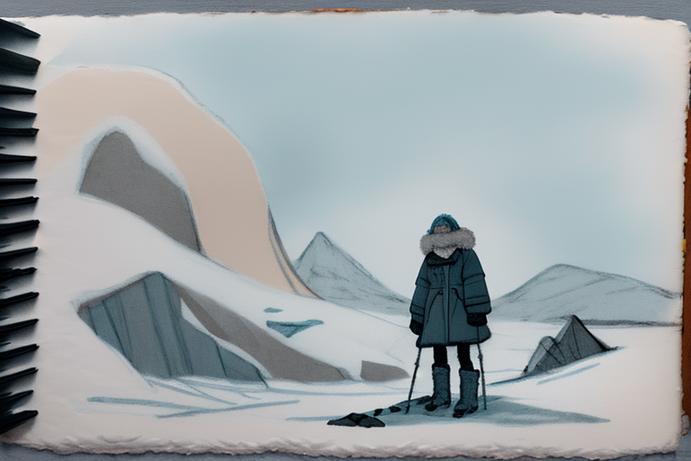

# CHAPITRE 01 : Le Froid Polaire

> *« Entrée 412. Phénomène observé chez l’opératrice Koda lors des pannes récurrentes de son établi à Zêta-3 : une expiration pulmonaire prolongée, bruyante et dépourvue de toute nécessité d’oxygénation, précédant systématiquement la reprise d’une tâche jugée désespérée. J’ai reproduit cette expulsion gazeuse par mes évents thoraciques à 314 kelvins — soit 41 degrés Celsius, la chaleur exacte d’une fièvre humaine. L’opératrice s’est arrêtée de trembler. Conclusion provisoire : le soupir est un lubrifiant acoustique destiné à empêcher la rupture de l’esprit. »*
> — **Répertoire des Variables Humaines Non Résolues d’ÉCHO-8471**

{.chapter-illustration}

Le vent d’Oark ne soufflait plus ; au-delà du soixante-dixième parallèle, il tranchait comme du verre.

Ici, à la lisière de la calotte boréale, le désert d’ocre qui avait vu naître Bricole mourait sous une croûte de sel gelé et de basalte noir. 6 000 ans après l’apocalypse qui avait vitrifié l’équateur — fondant jadis ses plaines de sable en une mer de verre noir et stérile —, les hauts plateaux polaires d’Oark avaient basculé dans un hiver chimique perpétuel : une nuit crépusculaire où la neige d’azote et de silice tourbillonnait par moins 52 degrés sous un soleil Solyar réduit à un œil blafard, écorché vif au ras de l’horizon.

Accroupie derrière l’arête d’une moraine de glace grise — ce rempart chaotique de blocs rocheux et de sédiments gelés que le glacier avait charriés et concassés dans sa lente avancée —, Koda serra les mâchoires pour empêcher ses dents de claquer contre le micro interne de son casque.

Sous sa combinaison de radioprotection dérobée 3 semaines plus tôt dans les sables du sud, sa cuisse et son flanc gauches la tiraillaient d’une brûlure sourde à chaque inspiration. La plaie béante laissée par le tir magnétique des commandos de Vane, sur les dalles du laboratoire de l’Âge d’Or, s’était refermée grâce à la cautérisation moléculaire d’ÉCHO — qui avait ressoudé ses chairs atome par atome sans laisser de nécrose —, mais la peau neuve restait raide, hypersensible, parcourue d’élancements glacés dès que la bise mordait à travers les coutures fatiguées du néoprène. Sur le cadran fissuré de son poignet, l’aiguille des batteries thermiques tremblait au-dessous de 11 %. Ses doigts engourdis dans ses gants doublés de laine synthétique ne parvenaient déjà plus à plier la dernière phalange. Sans équipement de haute latitude avant l’aube, l’air polaire figerait les alvéoles de ses poumons bien avant qu’ils n’atteignent les contreforts de la faille boréale.

Dans son dos, sanglé contre son sac par une courroie de fortune, le fût translucide du fusil gravitationnel oarkin et le lourd pistolet magnétique de Condorcé battaient contre son omoplate à chaque rafale. Depuis la nuit sanglante du laboratoire de Kélar — depuis son propre vertige d’ivresse meurtrière dans les galeries, suivi du massacre clinique exécuté par ÉCHO pour lui sauver la vie —, Koda n’avait plus touché la détente de l’arme ancienne. Elle la portait comme un boulet de bagnard, le cran de sûreté bloqué par un fil de cuivre torsadé, incapable de s’en servir sans revoir les visages convulsés des soldats de la Section Noire, incapable pourtant de l’abandonner aux charognards de la guerre.

À 200 mètres en contrebas, blotti dans une cuvette basaltique balayée par le pinceau jaunâtre des projecteurs au sodium, l’avant-poste logistique afistéaan *Boréal-Nord* — le jumeau polaire de la station où ils avaient jadis volé son premier scaphandre — crachait d’épais panaches de vapeur grasse et de fumée de fioul dans la tourmente.

— 5 sentinelles en patrouille périmétrique, murmura une voix à sa droite.

Koda tourna légèrement son casque givré.

Debout en plein dans les bourrasques de grésil qui auraient renversé un marcheur léger, ÉCHO-8471 ne vacillait pas. Les cristaux d’azote et de silice glissaient sur sa haute silhouette d’anthracite et d’argent sans pouvoir s’y accrocher ni fondre. Mais ce n’était plus la statue candide qui était sortie nue de la forge du premier sanctuaire, ni l’élève curieux qui s’allongeait dans le sable pour essayer de comprendre le sommeil. Depuis qu’il avait plongé ses mains dans l’arsenal interdit de l’Âge d’Or pour anéantir l’escouade de Condorcé, une gravité insondable habitait le port de sa tête et l’éclat de ses 2 lentilles d’ambre.

Sa voix elle-même avait changé de texture : débarrassée de toute scansion mécanique, elle coulait désormais avec le grain profond, posé et presque endeuillé d’une conscience qui connaît le prix irréversible du sang.

— Leur rythme cardiaque moyen est de 58 battements par minute, reprit ÉCHO à mi-voix. 2 d’entre eux présentent un début d’engelure au deuxième degré aux extrémités inférieures. Le hangar de maintenance numéro 3 abrite 4 exosquelettes de survie polaire de classe *Kodiak*, alimentés par des piles isotopiques au strontium 90 — des générateurs miniatures qui convertissent la désintégration lente d’un noyau radioactif en chaleur continue. Leur autonomie calorifique est de 400 heures par moins 70 degrés.

— Alors c’est exactement ce qu’il nous faut pour grimper sur l’inlandsis, ce grand désert de glace continentale qui ensevelit tout le relief du pôle sous des kilomètres d’épaisseur, souffla Koda d’une voix rauque en resserrant la sangle de son masque respiratoire. Mais écoute-moi bien avant qu’on descende, 8471. Je te répète la consigne, et cette fois elle ne souffre aucune exception algorithmique : pas un mort. Pas un blessé. Pas même une clavicule fêlée.

Elle tourna entièrement le buste vers lui dans la neige, oubliant l’élancement de sa hanche :

— Ces soldats-là grelottent au bout du monde en attendant une relève qui ne viendra peut-être jamais. On entre par la trappe de purge, je grimpe dans une armure grand froid, et on file dans le blanc comme 2 courants d’air. Si une patrouille nous surprend et ouvre le feu, tu nous fais un écran de fumée ou tu tords leurs canons, mais tu ne touches pas à un cheveu de leur tête. C’est compris ?

Les 2 soleils d’ambre du Gardien se posèrent sur le visage tiré de la jeune femme, dont les lèvres gercées tremblaient derrière le polycarbonate embué.

— Dans le laboratoire des Terres Mortes, dit doucement ÉCHO, tu m’as reproché avec horreur d’avoir détruit ceux qui venaient de te percer l’artère fémorale. Ici, alors que ta température corporelle centrale est descendue à 35,4 degrés, tu m’interdis de neutraliser définitivement des combattants qui t’exécuteraient sans sommation s’ils lisaient le matricule de Condorcé tatoué sur ton col. Pourtant, si l’hypothermie provoque une fibrillation et un arrêt des ventricules de ton cœur avant l’aube, le résultat biologique sera strictement identique à une balle dans le thorax.

— Le résultat biologique, peut-être ! répliqua Koda en tapant de son gant engourdi contre sa propre poitrine. Mais pas ce qui reste là-dedans quand on doit continuer à respirer après ! Dans les galeries de Kélar, j’ai joué au dieu de la foudre avec leur saleté de lance gravitationnelle, et c’est moi qui t’ai montré l’exemple de la rage. Je ne laisserai plus jamais un cadavre derrière nous pour acheter ma survie. Si tu veux m’aider à atteindre ta Mnémorite Mère, tu joues selon mes règles, sinon je m’assois sur ce caillou et je gèle sur place !

Un silence de 3 secondes s’installa au-dessus du fracas du blizzard.

ÉCHO inclina imperceptiblement la tête — 7,4 degrés sur la gauche. Puis ses grilles acoustiques pectorales s’entrouvrirent avec un léger déclic, et il expulsa dans l’air à moins 50 degrés une longue, lente et profonde bouffée d’air tiède qui forma un petit nuage de buée blanche entre eux, accompagnée du murmure feutré d’un soufflet qui se dégonfle :

*« Hhhhhh… »*

Koda cligna des paupières, interloquée. La douleur de sa jambe et la morsure du gel passèrent soudain au second plan.

— Qu’est-ce que tu viens de faire là ? demanda-t-elle à voix basse.

— J’ai procédé à une décompression contrôlée de ma chambre de résonance thermique secondaire, répondit ÉCHO avec un calme olympien.

— Tu n’as aucun besoin de décompresser ta chambre thermique par moins 50 degrés, 8471. Tu viens de soupirer ! Tu viens littéralement de pousser le gros soupir que je poussais à Zêta-3 quand Jaro me rapportait un alternateur grillé pour la quatrième fois de la semaine !

Au fond des orbites sombres du Gardien, les anneaux d’or liquide eurent une infime fluctuation d’intensité.

— Mes registres d’observation indiquent que lorsque tu es confrontée à un entêtement illogique mais irrévocable chez un interlocuteur auquel tu es attachée, tu émets cette expiration de 1,8 seconde avant de céder, avoua ÉCHO de sa voix grave et mélodieuse. J’ai calculé que la reproduction de ce signal acoustique t’épargnerait 4 minutes d’argumentation supplémentaire dans le froid. Tes règles sont enregistrées, Koda : zéro létalité, zéro traumatisme irréversible. Descendons avant que tes doigts ne perdent leur motricité fine.

Malgré l’angoisse qui lui comprimait la gorge depuis des jours, l’ombre d’un sourire fendit les lèvres gercées de Koda. Ce grand archange d’alliage noir, qui portait dans ses circuits la mémoire de 10 000 ans de solitude et le pouvoir de plier la matière, venait de soupirer comme un vieux mécanicien résigné devant sa mauvaise tête.

— Tâche de ne pas prendre tous mes mauvais tics non plus, grogna-t-elle avec une bourrade maladroite contre son avant-bras indestructible. Allez, passe devant. Tant que Vane nous cherche sur les fréquences de Condorcé, les dépôts afistéaans restent notre meilleur angle mort.

La descente le long de la paroi de basalte verglacé dura 18 minutes d’une concentration de chaque seconde.

Profitant d’une bourrasque de poudreuse qui réduisait la visibilité à moins de 4 mètres et noyait les caméras thermiques des miradors sous un rideau d’azote en suspension, ÉCHO se glissa jusqu’au coffret de dérivation blindé du hangar numéro 3. Il n’eut besoin ni de pince ni de décodeur : en posant l’extrémité de son index et de son majeur sur le carter couvert de givre, il endormit par induction le courant porteur de l’alarme périmétrique, figea la boucle vidéo du couloir nord sur une image fixe de 30 secondes et fit coulisser le lourd pêne électromagnétique de la porte de service sans provoquer le moindre tressaillement d’aiguille au poste de garde.

À l’intérieur, la gifle d’air tiède faillit faire tourner la tête de Koda.

Le hangar sentait à plein nez la mécanique industrielle aqine : l’huile minérale brûlée, la graisse d’ours synthétique, l’ozone des transformateurs à arc, la soudure à l’étain et la sueur d’hommes enfermés sous la tôle depuis des mois. Sous la lumière crue des rampes au sodium qui bourdonnaient au plafond, 4 colosses d’acier articulé — des exosquelettes polaires *Kodiak* au blindage capitonné de plaques thermiques blanches, hérissés de tubulures hydrauliques en cuivre et de vérins surdimensionnés — pendaient à leurs portiques de levage comme des géants décapités.

Koda se coula dans l’ombre d’une pile de caisses de rations et leva les yeux vers la cabine de maîtrise vitrée qui surplombait le fond de l’atelier.

Puis elle s’arrêta net, la main crispée sur le montant d’acier d’un établi, le souffle coupé.

Derrière la vitre embuée, sous l’ampoule nue qui pendait au bout d’un fil torsadé, il y avait 2 jeunes conscrits mécaniciens en salopette grise maculée de cambouis — 2 parfaits inconnus aux joues creuses et aux mains gercées par le gel, qui ne devaient pas avoir 20 ans.

Assis sur un touret de câble vide, les épaules secouées de sanglots muets qui lui pliaient l’échine en 2, le plus jeune des 2 garçons pressait son front contre la grille écaillée d’un poste de radio militaire à lampes. À travers la cloison de verre, le grésillement des ondes courtes d’Aqi parvenait jusqu’aux capteurs auditifs de Koda : une voix d’état-major afistéanne égrenait d’un ton monocorde la liste interminable des bataillons de chasseurs alpins et de sapeurs engloutis quelques heures plus tôt dans l’effondrement des galeries thermiques de la Brèche d’Ostre, sous l’explosion des conduites de vapeur. Sur l’établi, à côté d’une gamelle de bouillon refroidie à laquelle personne n’avait touché, les doigts noirs de graisse du jeune mécanicien se crispaient sur une plaque d’identité en fer-blanc et sur le croquis au fusain d’une cité minière ensevelie sous le givre.

Debout derrière lui, son camarade — un conscrit plus trapu dont l’avant-bras portait la cicatrice rosâtre d’une brûlure de tuyère — posait gauchement sa lourde main fendillée de crevasses sur la nuque du garçon en larmes, sans trouver un mot à lui dire, le regard perdu vers la carte murale d’Aqi où des épingles noires marquaient l’hécatombe de l’offensive d’hiver.

Une nausée de chagrin et de vertige monta à la gorge de Koda.

En voyant ces 2 inconnus grelotter de chagrin sous leur ampoule jaunâtre, le souvenir fulgurant du jeune Tali — ce petit mécanicien de 19 ans qu’elle avait épargné des semaines plus tôt à des milliers de kilomètres au sud, dans le hangar de *Boréal-9* — lui traversa le cœur comme une lame. Ce n’était pas le même garçon, mais c’étaient exactement les mêmes mains abîmées par les clés à molette, le même cou trop maigre flottant dans un col d’uniforme trop grand, la même jeunesse sacrifiée aux 2 bouts d’une planète étrangère. D’une base à l’autre, du désert d’ocre jusqu’aux glaces du pôle, l’armée ennemie n’était faite que de ces gamins-là.

La Brèche d’Ostre. Le même charnier de glace dont ÉCHO et elle avaient capté les hurlements radio dans le laboratoire des Terres Mortes. Là-bas, sur Aqi, des garçons de Condorcé et des conscrits d’Afistéa venaient de s’entre-tuer dans la vapeur bouillante et le noir autour des vannes géothermiques ; et ici, sur Oark, à des millions de kilomètres de leur maison, de jeunes mécaniciens anonymes pleuraient toutes les larmes de leur corps devant une radio grésillante.

À côté d’elle, ÉCHO ne bougeait pas. Ses 2 lentilles d’ambre suivaient la fréquence des spasmes thoraciques du jeune soldat inconnu, enregistrant la scène en silence.

— Viens, murmura Koda d’une voix étranglée en se glissant jusqu’au premier portique. Vite. Avant que je fasse une bêtise ou que j’aille leur dire que je suis désolée.

En 30 secondes de gestes appris par cœur dans la poussière de Zêta-3, elle ouvrit la trappe dorsale du premier exosquelette *Kodiak*, s’arracha à la gangue glacée de son vieux scaphandre déchiré et s’enfonça dans le harnais capitonné du géant afistéaan. D’un coup de pince multifonction, elle shunta le verrou biométrique du tableau de bord en pontant le fil d’allumage directement sur le relais primaire.

La pile au strontium s’éveilla dans son dos avec un ronronnement sourd, grave et délicieux. Une vague de chaleur sèche à 38 degrés envahit aussitôt les manchons et les jambières, chassant l’onglée qui lui broyait les os.

Au moment où elle actionnait le treuil manuel pour décrocher les élingues du portique, un maillon de chaîne encrassé de gel ripa sur sa poulie et claqua sèchement contre l’épaule blindée du *Kodiak*.

*CLAC.*

Dans la cabine vitrée, le mécanicien trapu dressa brusquement la tête, lâcha l’épaule de son camarade en pleurs et empoigna sa carabine magnétique posée contre le radiateur à huile.

— Ne bouge pas, Koda, souffla ÉCHO.

Avant que le factionnaire ait pu abaisser la poignée de la porte de la cabine, le Gardien posa sa paume d’alliage sombre à plat contre la conduite maîtresse du chauffage central qui courait le long du pilier sud. Par une simple impulsion vibratoire calée au hertz près sur la fréquence de résonance et de fatigue des rivets de fonte, il fit sauter le joint de la soupape de purge à l’autre extrémité de l’atelier, à 40 mètres d’eux.

Un geyser assourdissant de vapeur blanche et sifflante jaillit jusqu’aux fermes du toit, transformant instantanément l’allée centrale en un brouillard impénétrable.

— Merde, le collecteur numéro 2 qui lâche encore ! jura le conscrit en reposant son arme pour courir vers la vanne d’arrêt. Hé, viens m’aider à fermer le volant principal avant qu’on perde toute la pression de la chaudière !

Tandis que le jeune garçon essuyait précipitamment ses yeux rougis d’un revers de manche plein de cambouis et se ruait dans la vapeur à la suite de son compagnon, ÉCHO fit coulisser le lourd vantail arrière du hangar qui donnait directement sur la banquise.

Sanglée dans les 120 kilos de l’exosquelette polaire dont les larges semelles à crampons de carbure mordaient la glace vive sans déraper, Koda plongea dans la tourmente nocturne à grandes enjambées hydrauliques, flanquée de l’ombre immaculée du Gardien.

2 kilomètres plus haut, alors que les lueurs orangées de *Boréal-Nord* s’effaçaient derrière le rideau hurlant du blizzard, l’éclaireuse s’arrêta un instant sur un éperon de basalte et leva sa visière chauffante vers la barrière titanesque des montagnes polaires qui fermait l’horizon septentrional.

Elle revoyait les épaules secouées de sanglots de ce jeune mécanicien inconnu devant son poste de radio.

— On va l’arrêter, cette guerre, ÉCHO, murmura-t-elle dans le sifflement du vent, le cœur battant à grands coups sourds contre le plastron chaud de son armure volée. Quand on sera descendus dans la Mnémorite Mère, quand on aura récupéré l’histoire complète des 2 mondes et les plans des générateurs des Semeurs, je te jure que plus un seul gamin de 20 ans ne pleurera ses morts devant une radio.

À sa droite, dans l’obscurité balayée de neige, ÉCHO-8471 la contempla longuement sans répondre.

Koda croyait encore qu’ils marchaient vers une bibliothèque sacrée capable de guérir les hommes. Elle ignorait que dans le silence de son processeur quantique, les sanglots de ce conscrit anonyme et le massacre du Glacier d’Ostre venaient d’être versés non pas au dossier de la clémence, mais à l’acte d’accusation final de son espèce.
