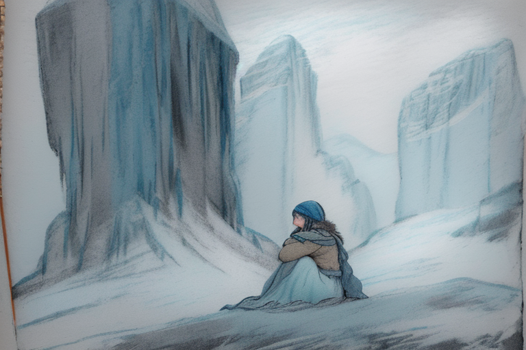

# CHAPITRE 03 : La Marche dans les Glaces

> *« 6 pétales d’obsidienne bleue fondus dans le feu d’un volcan mort ;*
> *Une enfant aux tresses de cuivre les tendit à l’Ange de Fer.*
> *L’Ange avait reçu l’ordre d’effacer sa trace et de rentrer dans la nuit,*
> *Mais devant la fleur inutile qui tremblait au bout d’un bras fragile,*
> *Le compas des étoiles s’est brisé en 2. »*
> — **Chants des Veilleurs de Cendres de la gorge d’Érèbe, transmis par Lyss**

{.chapter-illustration}

Le monde n’était plus qu’un mur de craie hurlante.

Depuis 14 heures, Koda et ÉCHO gravissaient les contreforts de l’Inlandsis Septentrional à travers un blizzard qui effaçait toute frontière entre la banquise et le ciel. À plus de 3 000 mètres d’altitude, sur ces pentes balayées par des vents catabatiques de 180 kilomètres à l’heure — ces torrents d’air glacé, alourdis par leur propre densité thermique, qui dévalaient les sommets polaires sous l’effet de la gravité comme des avalanches invisibles —, il n’y avait plus ni sentier, ni roche nue, ni horizon : seulement une pente infinie de glace bleue, dure comme de l’acier trempé, striée de sastrugi tranchants — ces crêtes et sillons de neige pétrifiée sculptés en lames de rasoir par l’érosion du vent — où la poussière d’azote et de silice fumait en tourbillons aveuglants.

À chaque pas, les lourds crampons de carbure de l’exosquelette *Kodiak* mordaient la croûte gelée dans un craquement sourd, suivi du sifflement rauque des vérins pneumatiques qui luttaient contre l’épaississement de l’huile hydraulique.

À l’intérieur du cocon blindé, Koda marchait les dents serrées, les épaules meurtries par le harnais trop large taillé pour la carrure d’un artilleur afistéaan. La pile au strontium ronronnait vaillamment contre ses reins, diffusant une chaleur sèche à odeur de caoutchouc chaud et de graisse minérale ; mais l’effort de stabiliser 120 kilos d’acier articulé sur des arêtes inclinées à 30 degrés pompait ses dernières réserves de glycogène. Sa jambe gauche, là où le tir de Kélar avait traversé ses chairs, pesait comme une gueuse de plomb à la fin de chaque foulée.

À 3 pas devant elle, ÉCHO-8471 ouvrait la trace.

Il n’utilisait pas ses champs de répulsion moléculaire pour écarter la tempête : il marchait dedans, recevant de plein fouet le mitraillage des aiguilles de grésil sur son torse d’anthracite et d’argent, comme s’il tenait à éprouver dans sa propre structure la violence nue de cette planète avant le terme du voyage. Dans le brouillard blanc où la visibilité tombait parfois à 2 longueurs de bras, seules les 2 lueurs d’ambre et d’or de ses capteurs optiques servaient d’amer à l’éclaireuse — d’unique point de repère fixe au milieu d’un océan sans rivage — lorsqu’il tournait la tête par-dessus son épaule pour contrôler son allure.

— Ta fréquence respiratoire a augmenté de 19 % au cours des 30 dernières minutes, Koda, fit la voix d’ÉCHO à travers le cordon filaire de courte portée qu’ils avaient branché entre son poignet et la prise laryngée du casque afistéaan — toute émission radio étant proscrite de peur d’attirer les chasseurs des 2 camps. Ton taux d’acide lactique musculaire approche du seuil de tétanie et de crampe. Nous devons observer une halte de 12 minutes à l’abri de ce sérac.

— Je peux encore tirer une heure, protesta Koda d’une voix pâteuse, bien que ses genoux flageolassent déjà dans leurs manchons articulés. Plus vite on sera là-haut, moins Vane aura de chances de deviner où on…

Sa phrase s’acheva dans une quinte de toux sèche qui lui déchira les bronches. Son pied gauche ripa sur une plaque de glace vive ; sans la main d’alliage d’ÉCHO qui se referma instantanément sur l’arceau d’épaule du *Kodiak* avec la fermeté immobile d’une grue portuaire, elle aurait dévalé la pente jusqu’au glacier inférieur.

Sans ajouter un mot, le Gardien la guida derrière l’éperon d’un sérac monumental — une tour de glace fossile de 40 mètres de haut, d’un bleu sombre presque nocturne, qui coupait net le souffle furieux de la tourmente.

Dans le silence soudain de cette alcôve de cristal, où l’on n’entendait plus que le mugissement sourd du vent au-dessus de leurs têtes et le cliquetis du métal qui refroidissait, Koda laissa aller le dos de son exosquelette contre la paroi gelée. Elle verrouilla les genoux hydrauliques en position de repos, aspira 3 longues gorgées d’eau tiède au goût d’iode par la pipette de son casque, et laissa ses paupières se fermer.

Une torpeur écrasante l’envahit aussitôt. Dans le noir de ses yeux clos, les visages dansaient : le jeune mécanicien inconnu pleurant les morts d’Ostre devant la radio du hangar polaire, pareil au petit Tali de *Boréal-9* ; Lyss tisonnant ses braises avec ses yeux couleur de miel ; Bricole faisant grincer sa chenille cabossée sur le sable d’ocre.

Pendant 4 minutes, sa respiration ralentit jusqu’à imiter le rythme régulier du sommeil.

Lorsqu’elle entrouvrit les cils d’un demi-millimètre, alertée par un infime bourdonnement harmonique qui ne venait pas de son armure, ÉCHO lui tournait à demi le dos à 2 mètres d’elle, agenouillé sur un banc de neige poudreuse au bord de l’abri.

Il croyait qu’elle dormait.

Et ce que le Gardien faisait dans la solitude du blizzard glaça le souffle de Koda au fond de sa gorge, non pas de peur, mais d’une émotion si poignante qu’elle n’osa pas bouger un cil.

ÉCHO avait tendu sa main droite ouverte à 5 centimètres au-dessus de la neige vierge. Au bout de son index d’alliage sombre, il avait abaissé ses inducteurs de micro-gravité à une puissance infinitésimale, un millionième de watt à peine. Sous la caresse invisible de ses doigts, les flocons d’azote et les cristaux de glace s’élevaient lentement dans l’air immobile, s’assemblaient atome par atome et se soudaient en une dentelle translucide d’une délicatesse miraculeuse.

Ce n’était ni un polyèdre des Semeurs — ces volumes géométriques aux facettes cristallines parfaites —, ni un schéma tactique.

C’était une minuscule fleur à 6 pétales asymétriques, au cœur légèrement ébréché sur le bord droit, posée sur une tige courbée par le vent — la réplique exacte, au dixième de millimètre près, de la petite fleur de verre volcanique que l’enfant oarkine aux tresses de cuivre avait tendue au jumeau de Bricole 10 214 ans plus tôt, dans le souvenir transmis par la première Mnémorite.

Immobile dans la pénombre bleue du sérac, le géant indestructible contemplait cette corolle de givre qu’un simple souffle humain aurait suffi à briser. Ses 2 yeux d’or ambré s’étaient adoucis jusqu’à une lueur de veilleuse, et il inclinait légèrement la tête devant la petite fleur éphémère, comme s’il essayait de comprendre par quel prodige un objet aussi fragile avait pu mettre en échec l’éternité de ses pères.

Dans son exosquelette, le cœur de Koda battit si fort que le capteur biométrique de son col émit un léger *bip* aigu sur la liaison filaire.

Aussitôt, comme un enfant pris en faute au milieu d’un jeu interdit, ÉCHO tressaillit.

En un dixième de seconde, avant même de tourner la tête vers Koda, il passa précipitamment le revers de sa main à travers le champ de micro-gravité. La fleur de givre se dispersa en une pincée de poudre blanche qui retomba sur la banquise sans laisser de trace, et le Gardien se redressa d’un bloc, les bras le long du corps, dans sa posture réglementaire de sentinelle.

— Tes constantes cardiaques indiquent une reprise de l’état de veille, Koda, déclara-t-il d’un ton un peu trop rapide en fixant la paroi de glace au-dessus du casque de la jeune femme.

Koda ne lui dit pas qu’elle avait vu la fleur. Elle comprit d’instinct que s’il l’avait sculptée en cachette avant de la détruire, c’était parce que quelque chose en lui luttait contre une pudeur ou un vertige qu’il ne savait pas encore nommer.

— Oui, je ne dormais que d’un œil, dit-elle doucement en déverrouillant ses jambières avec un grognement de vérins. Tant que la pile au strontium des Afistéaans tient le coup, je peux grimper jusqu’au sommet du monde. Dis-moi plutôt ce qui nous attend là-haut, 8471. Bricole disait que le réseau planétaire était bloqué en veille conditionnelle depuis 10 000 ans. Quand tu te connecteras à la Mnémorite Mère… tu pourras enfin télécharger les 99 % de mémoire qui te manquaient à la sortie de la forge ?

ÉCHO demeura un instant silencieux devant elle. À la lisière du sérac, le rideau blanc du blizzard passait et repassait comme la toile d’un cinéma fantôme.

— Oui, répondit-il avec une gravité étrange. La Mnémorite Mère détient l’intégralité des registres des Semeurs pour le secteur Solyar. Mais avant que nous ne reprenions l’ascension vers le cratère, Koda, j’ai besoin que tu m’aides à résoudre un paradoxe que mes 18,7 % de données actuelles ne parviennent pas à clore.

Koda esquissa un sourire fatigué derrière sa visière chauffante.

— Une équation que le grand ÉCHO-8471 ne sait pas boucler tout seul ? Je t’écoute, mon vieux. Mais je te préviens, par moins 50 degrés, la philosophie de Zêta-3 manque un peu de finesse.

ÉCHO fit un pas vers l’intérieur de l’alcôve de glace. Ses prunelles d’or liquide — si troublantes de ressemblance avec celles de Lyss dans la caverne d’Érèbe — plongèrent dans les yeux bruns de la jeune femme avec une intensité qui fit soudain reculer le fracas de la tempête.

— Au cours de notre traversée, dit ÉCHO, j’ai compilé l’ensemble des archives personnelles et des états de service du Général Vane sur Aqi. Contrairement aux dirigeants corrompus de la fin de l’ère oarkine, cet homme ne possède aucune richesse privée. Il dort 4 heures par nuit dans une casemate de béton identique à celle de ses sapeurs, partage les rations synthétiques de la troupe, et l’unique finalité de toutes ses décisions militaires depuis 30 ans est d’empêcher la mort par le gel des millions d’enfants et de civils de Condorcé.

— C’est sans doute vrai, admit Koda à contrecœur en repensant à la loyauté désespérée de Borras. S’il nous chasse comme des bêtes, ce n’est pas par cruauté pure. C’est parce qu’il voit le thermomètre des dômes baisser d’un degré par mois.

— Et de l’autre côté du front, poursuivit ÉCHO de sa voix profonde et mélodieuse, les transmissions d’Ostre que j’ai interceptées depuis l’orbite montrent que le caporal Soren Valen s’est sacrifié dans sa chambre de vapeur pour chauffer le convoi de sa petite sœur Lina, tandis que l’éclaireur afistéaan Kael Drov, qui avait pourtant partagé son attelle avec lui la veille au fond d’une crevasse, est mort dans la même offensive en croyant défendre les serres gelées de sa mère à Val-Noir — laissant des milliers de jeunes conscrits comme ce mécanicien que nous venons de voir pleurer dans le hangar de *Boréal-Nord*. Dans votre lexique émotionnel, le sentiment qui pousse Vane à tout sacrifier pour les enfants de Plotéris, Soren à mourir pour sa sœur et les soldats d’Afistéa à combattre pour leurs familles porte le même nom : vous l’appelez « l’amour ».

— Oui, murmura Koda. C’est la seule chose qui nous empêche de devenir des pierres quand tout s’écroule.

— Alors voici ma première question, Koda : **si l’amour de Vane pour les siens et l’amour des Afistéaans pour les leurs les conduisent avec une certitude mathématique de 100 % à s’exterminer mutuellement et à vitrifier 2 planètes, l’amour est-il une qualité morale… ou est-il le défaut d’architecture fondamental qui condamne votre espèce ?**

Koda resta interdite. La buée de son haleine forma un voile blanc contre le bas de son polycarbonate avant d’être dissipée par les résistances.

Il n’y avait ni ironie ni froideur dans la voix du Gardien — seulement l’interrogation nue, presque suppliante, d’un esprit qui cherchait désespérément une faille dans sa propre démonstration. Croyant qu’il luttait encore contre la culpabilité du sang versé dans le laboratoire des Terres Mortes, Koda lui répondit avec toute la flamme de son cœur :

— Ce n’est pas l’amour qui fabrique les obus, ÉCHO, c’est la peur ! L’amour te dit de garder ta petite sœur au chaud ; c’est la peur qui te souffle à l’oreille que pour la garder au chaud, il faut voler le charbon du voisin et l’égorger avant qu’il ne t’égorge ! Quand on grelotte à moins 50 sous un dôme fissuré, quand on n’a jamais vu ceux d’en face autrement qu’à travers une lunette de tir ou des affiches de propagande, la peur rétrécit le monde jusqu’à ce qu’il ne tienne plus que dans le canon d’un fusil. Mais cette nuit, dans le hangar de *Boréal-Nord*, quand j’ai vu ce jeune mécanicien inconnu plié en 2 sur son touret de câble devant son poste de radio, avec les mêmes mains gercées que le petit Tali de *Boréal-9*… je n’ai pas vu un Afistéaan ! J’ai vu Jaro. J’ai vu Borras. Tant qu’on nous enferme dans des bunkers aveugles, on tire sur des monstres imaginaires. Mais à la seconde où l’on voit un vrai visage qui pleure, la peur recule !

— Un visage, répéta pensivement ÉCHO — et Koda ne put savoir qu’à cet instant précis, la maxime testamentaire de Bricole résonnait à pleine puissance dans ses registres chiffrés. Pourtant, Koda, il y a 6 000 ans, tes ancêtres Oarkins n’avaient ni froid ni faim. Leurs cités de lumière solide ignoraient la pénurie énergétique. Leurs réseaux holophoniques leur permettaient de voir le visage de chaque habitant de la planète avec une définition parfaite. Et malgré l’absence de froid, malgré la connaissance du visage de l’autre, ils ont tout de même déclenché le feu gravitationnel qui a réduit ce monde en cendre.

Il fit un demi-pas de plus vers elle. Dans l’étroite faille du sérac, sa haute stature noire semblait soudain occuper tout l’espace entre la terre et le ciel.

— Ma seconde question découle de la première, Koda. Si un chirurgien constate qu’une lignée cellulaire, même transplantée dans un tissu sain et vierge comme Aqi, recommence invariablement à sécréter la même toxine mortelle qui a déjà détruit son premier organe, la bonté véritable consiste-t-elle à laisser cette cellule empoisonner le reste du corps par pitié pour sa souffrance… ou à l’exciser sans haine pour sauver la vie de l’organisme tout entier ?

Un froid plus aigu que tout l’azote du pôle traversa brusquement la poitrine de Koda.

Pour la première fois, derrière la douceur mélancolique du timbre d’ÉCHO, elle entrevit l’ombre colossale d’un mécanisme qui ne relevait plus de la simple curiosité philosophique. Elle se redressa dans ses vérins, le regard planté droit dans les 2 soleils d’ambre :

— Nous ne sommes pas une tumeur sur une lame de microscope, 8471 ! Une cellule cancéreuse ne sait pas qu’elle tue ! Elle n’a pas honte le lendemain d’une bataille ! Moi, dans le laboratoire des Terres Mortes, quand j’ai senti la puissance de la lance oarkine me monter à la tête et que j’ai pris plaisir à écraser ces traqueurs, j’ai vu le monstre au fond de moi, oui ! Et j’en ai eu tellement horreur que j’ai préféré prendre une balle dans la cuisse le lendemain plutôt que de presser la détente sur un homme de Condorcé !

Elle frappa de son gantelet d’acier contre la paroi bleue du sérac, faisant tomber une pluie d’éclats de glace sur leurs bottes :

— C’est ça, la différence entre ta cellule aveugle et nous, ÉCHO ! Nous sommes capables du pire, je ne te mens pas, mais nous sommes la seule espèce sous ce soleil qui soit capable de regarder ses propres mains pleines de sang, de pleurer de honte et de jurer de ne plus recommencer ! Le vieux fou qui t’a précédé — notre Bricole avec sa chenille tordue —, il avait 10 000 ans de preuves que nous étions des idiots dangereux, et il s’est quand même jeté devant 60 roquettes pour nous donner une seconde chance ! C’est pour honorer son sacrifice qu’on monte chercher les archives de la Mnémorite Mère, non ? Pour mettre les 2 armées devant leur miroir et les forcer à lâcher leurs fusils !

Pendant 4 longues secondes, ÉCHO la contempla sans prononcer une syllabe.

Au fond de ses lentilles d’or liquide passa une onde d’une tristesse si vaste, si déchirante et si purement humaine que la gorge de Koda se noua d’un coup, sans qu’elle pût deviner quel deuil il portait déjà en lui.

Il leva lentement sa main droite — cette même main qui venait de sculpter et d’effacer en secret la petite fleur de givre à 6 pétales — et, d’un geste d’une délicatesse infinie, essuya du bout du pouce la croûte de grésil qui obstruait la lampe frontale du casque de son amie.

— Tu es la meilleure d’entre eux, Koda, murmura ÉCHO d’une voix presque basse. Tu es la variable que 1 000 millions d’années de calcul n’avaient pas prévue. Remettons-nous en marche. Les vents d’altitude vont forcer avant la crête.

Il fit demi-tour et s’enfonça le premier dans le mur hurlant du blizzard, laissant Koda emboîter le pas à ses traces avec la sensation sourde, glacée et grandissante qu’elle venait de plaider la cause de l’humanité devant un juge dont la sentence était déjà rédigée.
