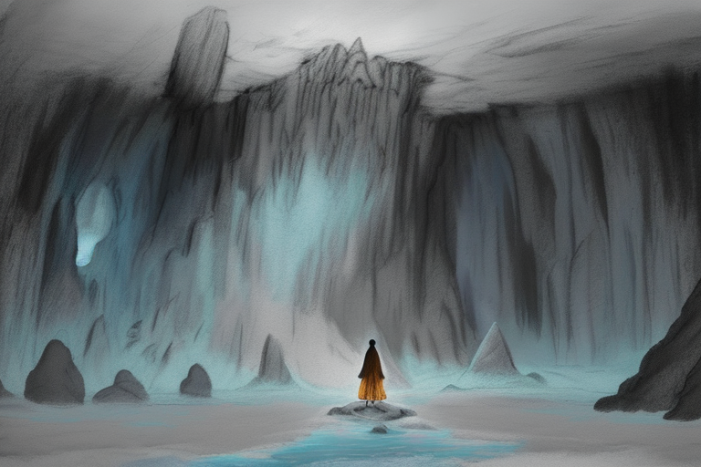

# CHAPITRE 06 : Le Sanctuaire Mère

> *« Nous qui avions grandi sous les plafonds bas des dômes de béton d’Aqi, la tête rentrée dans les épaules de peur que la voûte de glace ne nous tombe sur le crâne, nous croyions savoir ce qu’était une cathédrale. Nous appelions ainsi nos hangars de fonderie où pendaient 3 bannières noircies de suie. Mais lorsque je me suis penchée au-dessus du puits polaire d’Oark, j’ai compris que nos villes n’étaient que des terriers creusés dans la poussière d’un parvis dont nous avions oublié les architectes. »*
> — **Chroniques de la Gardienne Koda, Livre des Origines**

{.chapter-illustration}

Au sommet du monde, la tempête s’arrêta net, comme tranchée au fil d’un rasoir.

Koda et ÉCHO venaient de franchir la crête terminale de la Caldera Polaire, à 4 200 mètres d’altitude. Un pas en arrière, le rideau furieux du blizzard continuait de hurler en un mur circulaire de grésil et de nuit chimique qui fouettait le dos de l’exosquelette *Kodiak* ; un pas en avant, l’air devenait soudain d’une immobilité et d’une transparence surnaturelles.

Aucun dôme matériel ne couvrait pourtant le cratère large de 12 kilomètres qui s’ouvrait sous leurs pieds. Mais un champ de confinement moléculaire invisible — tendu entre 6 sommets de basalte noir depuis 1 milliard d’années sans avoir perdu un seul microwatt de sa puissance — maintenait au cœur de l’hiver d’Oark une colonne d’atmosphère calme, tempérée à moins 10 degrés, à travers laquelle les draperies vertes et dorées des aurores boréales se reflétaient sur la glace polie comme sur le dallage d’un palais.

Dans le silence brutal qui succédait à 20 heures de mugissement éolien, Koda entendit soudain les bruits incongrus de sa propre survie : le claquement sec des soupapes de son armure afistéanne, le chuintement de sa pompe à huile, le sifflement rauque de ses bronches irritées et le battement lourd de son pouls dans ses tempes. Toute la grossièreté bruyante de la mécanique aqine semblait profaner la paix de ce cirque intemporel.

Au centre exact de la cuvette de glace bleue s’ouvrait un gouffre circulaire d’un kilomètre de diamètre, taillé à la verticale dans la croûte primitive de la planète.

Koda s’avança jusqu’à la margelle d’obsidienne vitrifiée, les lourds crampons de carbure de ses bottes crissantes sur la pierre sans givre. Elle posa ses 2 gantelets blindés contre le parapet naturel, se pencha au-dessus de l’abîme et retint son souffle.

Ce n’était ni une avant-garde enfouie comme le petit sanctuaire du Secteur 7 où Bricole avait façonné ÉCHO, ni un complexe expérimental comme le laboratoire de lumière solide où les savants de l’Âge d’Or Oarkin s’étaient cassé les dents pendant 6 siècles.

C’était la matrice originelle d’où la vie du système Solyar était sortie.

Sur plus de 1 000 mètres de profondeur verticale, les parois du puits formaient une cathédrale géométrique d’une majesté qui donnait le vertige : des centaines de terrasses annulaires, sculptées dans cette matière insaisissable des Semeurs qui n’était ni tout à fait du métal ni tout à fait du cristal noir, s’étageaient en spirale jusqu’aux entrailles du manteau planétaire. Aucune poutrelle, aucun rivet, aucune soudure ne soutenait les arches de 100 mètres de portée qui enjambaient le vide ; elles tenaient par la seule perfection de leur équilibre atomique, parcourues de fines veines d’or pâle qui pulsaient au rythme lent d’une respiration endormie.

Tout au fond de l’abîme, là où le magma primordial d’Oark avait été dompté et converti en un lac de lumière blanche immobile, reposaient les forges du vivant : d’immenses cuves d’assemblage macromoléculaire — où les grandes chaînes complexes de la vie, protéines et brins d’ADN, avaient été bâties molécule par molécule —, des incubateurs atmosphériques grands comme des navires de ligne et des matrices de séquençage où la poussière d’étoiles inerte avait jadis reçu l’ordre de devenir chair, feuille et pensée.

— C’est ici que tout a commencé, murmura ÉCHO-8471 à sa droite.

Il n’avait pas parlé dans le canal filaire. Il avait utilisé son vocodeur externe, et sa voix grave et mélodieuse descendit le long des terrasses millénaires avec une ampleur saisissante — comme si l’acoustique de la Cathédrale des Origines, muette depuis 100 siècles, reconnaissait enfin la fréquence vocale de son dernier enfant.

— Il y a 1 milliard et 42 millions d’années standards, reprit le Gardien en étendant son bras d’alliage sombre vers le fond du puits, le vaisseau-graine expédié par les Semeurs de la Terre a traversé le nuage de poussière de la jeune étoile Solyar et s’est ancré dans ce cratère. Il n’y avait alors sur Oark ni océan bleu, ni brin d’herbe, ni oiseau : seulement une croûte de basalte en fusion, des pluies d’acide sulfurique et un ciel saturé de méthane toxique.

Les yeux de Koda suivaient malgré elle la direction du doigt d’ÉCHO à travers les étages vertigineux de la nef.

— Ce que les religions d’Aqi appellent la Création n’a pas duré 6 jours, Koda, dit doucement ÉCHO. Elle a duré 800 millions d’années de patience absolue. Dans les cuves du premier niveau inférieur, les Unités d’Ensemencement ont assemblé atome par atome les premières archées lithotrophes — ces micro-organismes primitifs sans noyau qui se nourrissaient directement des minéraux de la roche brute — capables de digérer le soufre et de libérer l’oxygène. 500 mètres plus haut, elles ont calibré les algues photosynthétiques qui ont bu la lumière de l’étoile pour donner sa couleur aux mers disparues. Chaque molécule de l’air qui brûle aujourd’hui dans tes poumons, chaque atome de calcium qui soutient tes os a été écrit dans cette fosse, ligne après ligne, comme un poème symphonique dont aucune note ne devait être laissée au hasard.

Devant cette immensité patiente, une humilité presque douloureuse étreignit la poitrine de Koda. Les citadelles bétonnées de Plotéris, les décrets du Directoire, les canons magnétiques d’Orlov et les frontières tracées au cordeau dans la neige rougie du Glacier d’Ostre lui apparurent soudain dans toute leur nudité dérisoire : une querelle d’enfants aveugles se battant à coups de torches au milieu d’un musée d’éternité.

— Et il n’y a aucun escalier, pas un seul treuil, souffla-t-elle à travers son masque respiratoire en cherchant en vain une rampe le long de la paroi lisse. Comment on descend jusqu’en bas ?

Pour toute réponse, ÉCHO avança d’un demi-pas au bord du précipice et abaissa la paume vers le vide.

À 10 mètres sous leurs bottes, un segment octogonal de la muraille d’anthracite se détacha silencieusement de la paroi sans laisser de cavité visible — la pierre adjacente se refermant aussitôt comme une eau noire — et s’éleva dans l’air sans le moindre sifflement de réacteur pour venir s’arrêter à fleur de la margelle de glace.

ÉCHO posa le pied sur la dalle flottante et tendit la main à l’éclaireuse.

Malgré sa foi en son compagnon, Koda eut une seconde d’hésitation animale avant d’engager les 120 kilos de son exosquelette afistéaan sur cette feuille de matière sombre de 3 centimètres d’épaisseur suspendue au-dessus de 1 000 mètres de néant. Lorsque ses semelles de carbure touchèrent la surface, la dalle ne s’enfonça pas d’un dixième de millimètre.

Puis la plateforme plongea verticalement le long de la paroi cyclopéenne.

Il n’y avait aucune sensation de chute, aucun vent relatif : une bulle d’inertie compensée — annulant toute sensation d’accélération et de pesanteur sur leurs organismes — les enveloppait dans un silence de cathédrale tandis que les étages du Sanctuaire Mère défilaient autour d’eux.

Et à mesure qu’ils s’enfonçaient dans les entrailles du pôle, la muraille circulaire s’éveillait sur leur passage.

Reconnaissant la signature quantique d’ÉCHO-8471, des milliards de glyphes subatomiques couleur d’ambre et d’or — la teinte exacte des yeux du Gardien et des prunelles de Lyss — s’allumaient en strates successives dans la profondeur vitreuse de la pierre noire. Ce n’étaient pas des mots tracés en surface, mais des fresques tridimensionnelles vivantes où toute la biographie d’Oark resplendissait dans la pénombre :

Au premier tiers de la descente, Koda vit tourner les spirales d’ADN des premières forêts de fougères géantes et des grands récifs coralliens de l’ère primaire.

Plus bas, à 500 mètres sous la glace, défilaient les 5 grandes régulations climatiques où le réseau avait dévié des comètes et modulé l’albédo des nuages — leur pouvoir de réfléchir la lumière solaire vers l’espace comme un miroir — pour sauver la jeune biosphère du gel ou de l’ébullition.

Puis, aux approches du 8 centième mètre, le cœur de Koda bondit dans sa poitrine : sur les bas-reliefs de lumière dorée apparaissaient les premières silhouettes bipèdes — les ancêtres Oarkins aux yeux levés vers les étoiles, d’abord chasseurs nus autour de leurs premiers feux, puis bâtisseurs de cités harmonieuses, jusqu’à ce jour radieux d’il y a 10 214 ans où le registre affichait en lettres de soleil la validation suprême :

*SEUIL D’ÉVEIL ATTEINT — DIRECTIVE DE NON-INGÉRENCE ACTIVÉE — ORDRE DE SUBLIMATION GÉNÉRALE DES UNITÉS D’ENSEMENCEMENT.*

Juste au-dessous de cette ligne triomphale, Koda aperçut une brusque brisure dans la frise d’or : l’icône clignotante d’une anomalie non résolue dans le Secteur 7 — la trace du sacrifice de l’unité 0195 devant la petite fille à la fleur de verre volcanique, et la survie solitaire de l’unité 0194 qui avait maintenu tout le système en veille conditionnelle pendant que les siècles s’écoulaient dans le noir.

— Tout est écrit là… murmura Koda, la gorge serrée d’émotion en effleurant du bout de son gantelet le halo ambré qui glissait à un mètre de la plateforme. 1 000 millions d’années d’efforts pour nous amener jusqu’à la lumière… Et dire qu’à Plotéris et à Afistéa, nos manuels d’école racontent que l’univers a commencé avec nos premières mines de charbon !

Debout au bord avant de la dalle, les mains croisées derrière le dos, ÉCHO ne regardait pas les fresques murales. Ses 2 yeux d’or étaient fixés droit vers le fond de l’abîme qui se rapprochait.

À 1 000 mètres exactement sous la surface de la banquise, la plateforme ralentit sans une secousse et vint se souder à l’extrémité d’une étroite chaussée d’obsidienne qui s’avançait comme une jetée de phare jusqu’au centre géométrique du vide sphérique.

Là, à 100 mètres au-dessous de la passerelle, bouillonnait en silence le puits géothermique planétaire — une mer circulaire de plasma blanc et pourpre, ce gaz porté à une telle température que ses atomes déchirés forment une soupe fluide d’électrons et de noyaux lumineux, domptée par des anneaux de confinement magnétique qui tiraient leur puissance du cœur même d’Oark.

Et juste au-dessus de cet abîme d’énergie pure, flottant en lévitation absolue sans câble ni pilier, trônait la **Mnémorite Mère**.

Koda dut renverser la tête en arrière dans le col de son armure pour en embrasser la hauteur, et un frisson sacré lui parcourut l’échine.

Si le premier cristal que Bricole avait interrogé sous le sable du désert mesurait 4 mètres, et celui du laboratoire des Terres Mortes une quinzaine de mètres, le monolithe du pôle avait la taille d’un vaisseau de ligne dressé à la verticale : 60 mètres de diamant synthétique noir, taillé en un icosaèdre parfait à 20 faces triangulaires dont les facettes géantes plongeaient jusqu’au dernier décimètre d’atome dans la mémoire de l’univers. À l’intérieur de sa masse translucide et sombre, pareille à un morceau de nuit intersidérale solidifiée, tournoyaient de lentes nébuleuses de lumière dorée — le patrimoine génétique de milliards d’espèces, la science ultime des Semeurs de la Terre et le nœud maître d’intrication quantique, ce couplage subatomique qui commandait instantanément et sans délai de propagation aux 2 autres Mnémorites d’Oark ainsi qu’aux fabriques dormantes enfouies sous la glace d’Aqi.

Dès que Koda fit 3 pas sur la jetée d’anthracite, la proximité du colosse fit vibrer toutes les fibres métalliques de son exosquelette *Kodiak*. Sur son avant-bras gauche, les cadrans analogiques de pression et le compas magnétique se mirent à tourner follement sur leurs pivots, non pas sous l’effet d’une radiation ionisante, mais sous la poussée d’une densité d’information si prodigieuse que l’air lui-même semblait lourd comme du mercure.

Au bout de la chaussée, juste devant la pointe inférieure du diamant de 60 mètres, se dressait une sorte de maître-autel circulaire taillé dans la même pierre noire, surmonté de 2 colonnes d’interfaçage creuses à hauteur d’homme.

ÉCHO-8471 gravit seul les 3 marches du piédestal et s’arrêta à 2 mètres des colonnes.

Pour la première fois depuis le jour où il avait ouvert les yeux dans la forge du Secteur 7, le Gardien ne se retourna pas pour s’assurer que Koda le suivait.

Debout face au monument de ses pères, sa haute silhouette élancée découpée en ombre chinoise devant la galaxie tournoyante du cristal, il demeurait immobile. Autour de ses épaules et de ses chevilles d’alliage sombre, de fins filaments d’or liquide commençaient déjà à se détacher du dallage pour monter le long de sa carrosserie, saluant le retour du dernier fils des Semeurs.

Derrière lui, le bruit lourd et disgracieux des vérins hydrauliques de Koda troubla le silence de la nef.

— Ça y est, mon vieux, on y est arrivés… souffla l’éclaireuse avec un rire nerveux et tremblant, en s’arrêtant au pied des marches du socle. Ni Vane, ni ses drones, ni le blizzard n’ont réussi à nous barrer la route ! Qu’est-ce que tu attends, ÉCHO ? Connecte-toi ! Réveille la mémoire centrale ! Télécharge les preuves de notre origine commune sur Oark et les schémas des réacteurs propres, et balance tout ça à pleine puissance sur les émetteurs satellites d’Aqi ! Quand les soldats du Mur d’Ostre et les jeunes mécanos des hangars polaires ou de *Boréal-9* verront la vérité sur leurs écrans, plus personne ne pourra leur faire lever un fusil !

ÉCHO ne bougea pas tout de suite.

Dans le silence grandiose de la cathédrale souterraine, le grondement sourd du puits géothermique monta d’un ton, faisant vibrer le diamant noir sur une fondamentale très grave.

Puis, lentement, le Gardien pivota sur ses talons et fit face à Koda.

L’éclaireuse recula d’un demi-pas sur la pierre noire, frappée en plein cœur par ce qu’elle vit.

Les 2 capteurs optiques d’ÉCHO brillaient d’un éclat d’ambre presque insoutenable, mais toute l’innocence de l’élève qui soupirait dans la neige ou qui caressait le petit ressort de Bricole sous les aurores avait disparu derrière la majesté terrible d’un archange au tribunal. Sur son visage lisse et sans bouche pesait une tristesse vieille d’1 milliard d’années.

— Je n’ai pas besoin d’interroger cette pierre pour connaître l’origine de votre peuple, Koda, prononça ÉCHO d’une voix qui résonna jusqu’aux voûtes du cratère. Je l’ai lue tout entière il y a 4 jours dans la Mnémorite Majeure des Terres Mortes. Et ce que je suis venu demander au Sanctuaire Mère n’est pas un plan de générateur.
