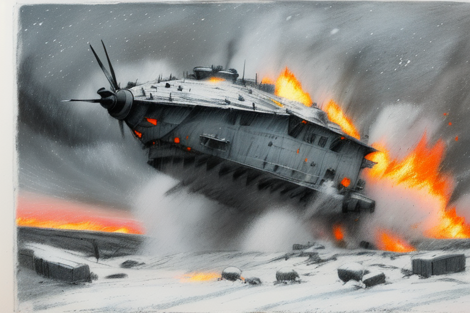

# CHAPITRE 08 : La Course vers l'Abîme

> *« On m’a retiré ma clé dynamométrique — celle qui claque dans la paume quand un boulon de culasse atteint le bon couple de serrage — à 3 heures du matin pour me pousser dans la tourelle ventrale d’un marcheur de dépannage qui sentait le vomi et l’huile brûlée. Le sergent a dit qu’on montait au pôle Nord capturer le miracle des anciens dieux, celui qui allait venger nos bataillons engloutis hier à la Brèche d’Ostre. J’ai 20 ans, je n’ai jamais vu la mer, mes doigts collent au métal gelé de l’affût, et je ne sais même pas à quoi ressemble un dieu. »*
> — **Témoignage du sapeur-mécanicien de deuxième classe Yoren, 4e Bataillon Logistique Afistéaan**

{.chapter-illustration}

À 1 000 mètres au-dessus du Sanctuaire Mère, l’enfer venait de faire irruption au paradis blanc.

Les 4 croiseurs d’assaut lourd de la Première Escadre de Condorcé, menés en tête de flèche par le vaisseau de commandement *Bastion-Un* du Général Vane, avaient forcé le rideau antiaérien afistéaan du soixante-douzième parallèle à 80 mètres du sol, en plein cœur du blizzard, au prix d’un sacrifice terrible : leur croiseur d’arrière-garde, le *Valmy*, avait encaissé 2 missiles sol-air à guidage radar dans ses tuyères principales et s’était désintégré en une boule de feu orange sur les séracs du glacier inférieur avec ses 140 hommes d’équipage.

La coque labourée d’éclats de shrapnel, les plaques de céramique ablative — conçues pour fondre et se sublimer couche par couche afin d’évacuer la chaleur — portées au rouge sombre et les soutes crachant une fumée noire d’huile hydraulique calcinée, les 3 navires survivants venaient de crever le mur de tourmente de la Caldera Polaire et d’écraser leurs patins d’atterrissage dans un geyser de neige pulvérulente, à moins de 800 mètres de la lèvre occidentale du gouffre.

— Débarquez les sapeurs et les foreurs à fusion profonde ! hurla le Général Vane dans son laryngophone en dévalant le premier la rampe ventrale du *Bastion-Un* avant même que les vérins n’aient fini de purger leur vapeur.

Sanglé dans un lourd exosquelette d’état-major *Titan* au blindage gris sombre, le vieux lion de Plotéris s’enfonça jusqu’aux genoux dans la banquise, suivi au pas de course par le lieutenant Borras qui serrait contre sa poitrine le coffret jaune du détonateur sismique.

— Ignorez toute menace périphérique ! reprit la voix de Vane sur le canal général tandis que 30 sapeurs du génie faisaient rouler sur des traîneaux motorisés les 3 cylindres d’osmium — le métal le plus dense et le plus lourd de l’écorce planétaire, capable de concentrer l’onde de choc vers le bas — contenant les charges thermonucléaires de forage. Je veux une ligne d’ancrage le long de la corniche ouest dans 8 minutes ! Nous devons faire basculer 30 millions de tonnes de basalte dans le puits central avant que l’entité n’achève sa liaison avec le cristal !

Mais les équipes de forage n’avaient pas parcouru 300 mètres sur le plateau immaculé que la muraille de nuages qui fermait l’est du cratère s’embrasa d’une lueur sanglante.

Dans un hurlement assourdissant de turbopropulseurs et de réacteurs atmosphériques qui fit vibrer la glace sous les bottes de Borras, l’armada polaire du Haut-Commandeur Orlov — 12 corvettes lourdes d’assaut dominées par le croiseur amiral *Vengeance d’Ostre*, appuyées au sol par 2 bataillons de marcheurs blindés partis à pleine vapeur de *Boréal-1* et de *Boréal-Nord* — creva le rideau de blizzard et déboula sur le flanc oriental de la Caldera.

À l’intérieur du marcheur de dépannage blindé *Marteau-14*, qui bringuebalait en queue de la première colonne afistéanne dans un vacarme d’enfer, un jeune sapeur-mécanicien de 20 ans nommé **Yoren** avait les 2 mains cramponnées aux poignées de cuivre de la tourelle stabilisatrice.

Réquisitionné d’office 4 heures plus tôt dans les ateliers souterrains de *Boréal-1* parce que le tireur titulaire avait eu les 2 pieds gelés lors d’une garde de nuit, ce garçon anonyme qui n’avait jamais tiré sur un être humain regardait avec stupeur, à travers le périscope givré, cette arène surnaturelle où les aurores boréales brillaient en plein crépuscule au-dessus d’un gouffre géant. La cabine étroite du marcheur puait le gasoil surchauffé, la graisse d’armement, la sueur rance et la peur. À chaque cahot des quatre pattes articulées sur le basalte, la jugulaire trop lâche de son casque d’acier lui écorchait le menton.

— *Ici le Haut-Commandeur Orlov à toutes les unités de la Coalition !* tonna soudain le haut-parleur de bord sur une fréquence ouverte si puissante qu’elle creva simultanément les récepteurs de Condorcé. *Les forces de Vane viennent d’atterrir sur la lèvre ouest avec des charges de démolition ! Leur appel sur le Canal Zéro n’était qu’un rideau de fumée : ne pouvant emporter l’artefact des Anciens, ils tentent de faire sauter le sanctuaire pour nous priver de la victoire finale ! Au nom de nos frères tombés hier à la Brèche d’Ostre, balayez leur périmètre et sécurisez le puits intact ! Feu à volonté !*

Dans la cabine du *Marteau-14*, le chef de char afistéaan — un vétéran aux yeux injectés de sang qui avait perdu son neveu à Ostre — abattit son poing sur l’épaule de Yoren :

— Tu as entendu le Commandeur, Yoren ?! Ces chiens de Plotéris veulent enterrer la merveille sous notre nez après avoir fait sauter les vannes d’Ostre sur nos gars ! Alimente le ruban de 30 millimètres et maintiens la pression d’huile sur le canon dorsal, on va les jeter dans le trou !

— Mais… sergent, ils n’ont même pas tourné leurs tourelles vers nous, balbutia Yoren en voyant dans son optique les silhouettes grises des sapeurs de Condorcé qui couraient vers le bord du gouffre en tirant des chariots de forage sans épauler leurs fusils. Ils essaient juste de…

— Charge ce putain de canon ou je te fais passer en cour martiale sur le capot ! hurla le sous-officier en écrasant la pédale de mise à feu.

Sur la lèvre ouest, en entendant l’ordre d’Orlov résonner dans ses écouteurs, le Général Vane ferma une demi-seconde les paupières derrière la visière de son *Titan*.

— Les fous… souffla-t-il entre ses dents serrées. Les pauvres fous aveugles ! Compagnie de garde, formez un écran de blindage devant les sapeurs ! Ne ripostez que pour couvrir le forage !

La première salve d’obus magnétiques à vitesse hypersonique tirée par le *Vengeance d’Ostre* et l’avant-garde des marcheurs afistéaans frappa le croiseur de transport numéro 2 de Condorcé en plein flanc.

Dans un fracas de fin du monde qui déchira le silence sacré d’1 milliard d’années, le blindage en carbure de bore du vaisseau vola en éclats. Les réservoirs d’hydrazine, le carburant chimique hyper-volatil des propulseurs de manœuvre, s’embrasèrent en une colonne de feu pourpre de 100 mètres de haut, projetant sur la glace bleue des débris de carlingue tordus et des silhouettes humaines transformées en torches vivantes qui hurlaient dans leurs scaphandres percés. Le souffle de la déflagration balaya le premier chariot de forage sismique, qui glissa sur la banquise vitrifiée et bascula dans le vide du puits central avec 4 sapeurs accrochés à ses sangles.

Aussitôt, avec le réflexe pavlovien et tragique — cet automatisme conditionné qui devance toute pensée consciente — de soldats dressés depuis le berceau à répondre au fer par le fer, les canons à impulsion violette des marcheurs d’escorte de Condorcé pivotèrent sur leurs rotules et ouvrirent le feu à bout portant sur les colonnes d’Orlov.

En moins de 90 secondes, la margelle immaculée de la Caldera Polaire — le berceau même où la vie d’Oark avait été écrite atome par atome comme un poème — se changea en un abattoir industriel d’une sauvagerie inouïe.

Tout ce que la mécanique de guerre aqine avait engendré de plus lourd, de plus bruyant, de plus salissant et de plus aveugle se déchaîna en cercle autour de l’abîme. Les culasses automatiques claquaient en rafales assourdissantes ; les obus thermobariques creusaient dans la glace millénaire des entonnoirs d’eau noire et bouillante mêlée de fioul et de sang ; l’odeur suffocante de la cordite, de l’ammoniac, du caoutchouc calciné et de la chair grillée envahit la colonne d’air pur maintenue par le champ des Semeurs.

Dans cet espace clos où le repli était impossible, les 2 lignes de bataille s’emboîtèrent à moins de 100 mètres de distance.

Des fantassins de Condorcé aux plastrons frappés de l’aigle de fer et des chasseurs polaires afistéaans portant l’étoile à 8 branches se chargeaient à travers les nappes de fumée grasse, se fusillant à bout portant ou s’éventrant à coups de lames thermiques sur le rebord même du précipice. Des grappes d’hommes enlacés dans la mort glissaient par-dessus la corniche d’obsidienne et tombaient pendant 10 interminables secondes le long des terrasses dorées de la Cathédrale des Origines, sans même accorder un regard à la merveille cosmique qui brillait sous leurs bottes.

— Mon général ! hurla Borras en se jetant à plat ventre derrière le patin d’atterrissage calciné du *Bastion-Un* tandis qu’une grêle de balles traçantes vertes ricochetait en hurlant sur l’acier au-dessus de son casque. Le deuxième chariot de forage vient d’être touché par un missile antichar ! Le capitaine du génie est mort ! Et regardez là-bas : les corvettes d’Orlov ne bombardent pas le gouffre, elles larguent des troupes d’assaut en rappel le long de la paroi est pour descendre capturer le cristal !

Accroupi dans la neige rougie, un bras de son exosquelette *Titan* bloqué par un éclat d’obus qui avait sectionné sa conduite d’épaule gauche, le Général Vane tenait de sa main valide le poignet inerte d’un jeune sapeur de 18 ans dont la visière venait d’être traversée par un carreau de tungstène.

Sous le masque brisé, le garçon avait le même âge, le même duvet blond sur les joues que le caporal Soren Valen de la Brèche d’Ostre.

De l’autre côté du rideau de flammes, à 300 mètres à peine, le marcheur afistéaan *Marteau-14* venait d’encaisser un tir de canon à impulsion de Condorcé dans son genou articulé droit.

Avec un hurlement de métal déchiré, la machine de 30 tonnes s’abattit sur le flanc dans la neige en feu, sa cabine écrasée sous le bloc moteur qui crachait des jets d’huile bouillante. À l’intérieur de la carcasse renversée, le sergent chef de char avait eu la nuque brisée sur le coup contre la culasse du canon. Coincé sous la console de tir tordue qui lui broyait la cheville droite, la jambe de son pantalon prenant feu au contact d’une conduite percée, le jeune **Yoren** hurlait de douleur et de terreur dans la fumée noire, essayant en vain de dégager son pied avec sa clé dynamométrique :

— À l’aide ! Sortez-moi de là ! Je veux pas brûler ici !

À travers la fente du périscope brisé qui donnait sur l’extérieur de la carcasse, les yeux exorbités de Yoren voyaient pourtant une vérité qui rendait son agonie plus absurde encore : à 20 mètres du marcheur en feu, un jeune chasseur de Condorcé dont l’exosquelette avait eu les jambes fauchées par la même salve rampait dans la neige souillée de mazout en pleurant le nom de sa mère, avec le même accent des faubourgs miniers du nord d’Aqi, les mêmes mains gercées par le gel et la même terreur enfantine de mourir loin de chez lui. Ni l’un ni l’autre ne savaient pourquoi le ciel d’Oark était plein d’étoiles vertes ; ni l’un ni l’autre n’avaient jamais demandé à posséder un dieu.

Debout dans la tranchée de neige labourée par les explosions, le Général Vane contempla ce chaos d’apocalypse.

Un éclat de glace avait fendu le verre de son optique frontale ; un filet de sang tiède coulait le long de sa joue grise. Devant lui, sous le dôme émeraude des aurores boréales souillé de suie, il voyait l’aigle de Condorcé et l’étoile d’Afistéa s’égorger avec méthode pour savoir à qui appartiendrait la hache du bourreau. Toute son existence d’homme d’État — ses nuits blanches sur les cartes de Plotéris, ses calculs d’attrition, sa conviction sincère qu’on pouvait sauver l’humanité par le fer et la discipline — s’effondrait dans cette boue sanglante.

— Mon général, les réserves de tir du *Bastion-Un* sont à sec ! cria Borras en rampant jusqu’à lui à travers les débris fumants, sa vareuse déchirée laissant voir sur son plastron le boîtier de l’enregistreur numérique où il avait copié l’archive radio d’urgence de Soren Valen. Les blindés d’Orlov sont à 150 mètres ! Si on ne fait pas sauter la charge sismique restante maintenant sur le rebord, même non forée…

— Elle ne ferait qu’égratigner 10 mètres de granit et tuer nos propres blessés sans même faire trembler la voûte à 1 000 mètres de profondeur, coupa Vane d’une voix rauque mais d’une lucidité glaciale. Nous avons perdu la bataille militaire, Borras. La force ne sauvera plus personne aujourd’hui.

Il saisit le col du jeune lieutenant de sa main gantée couverte de givre et de sang, et pointa le menton vers l’antenne parabolique à haute fréquence du *Bastion-Un* qui tenait encore debout sur la superstructure du vaisseau :

— Mais il reste quelqu’un tout en bas. Quelqu’un qui n’est ni un général, ni un bourreau, et que cette machine a écoutée pendant des semaines ! Branchez mon transmetteur personnel sur l’amplificateur géologique à ondes longues du croiseur ! Braquez le faisceau directionnel droit dans la gueule du puits ! Si mes bombes ne peuvent pas descendre jusqu’au dieu, nos voix descendront jusqu’à Koda !

Sans hésiter une fraction de seconde, Borras bondit hors de l’abri sous les rafales de mitrailleuses lourdes qui fauchaient la neige autour de ses bottes, grimpa le long de la carlingue brûlante du *Bastion-Un* et arracha à mains nues le capot du boîtier de dérivation d’antenne.

Mais 1 000 mètres plus bas, au cœur de la Cathédrale des Origines où tombaient en pluie silencieuse les premiers débris calcinés de la bataille, ÉCHO-8471 n’attendait plus.

Dressé sur le maître-autel devant les 60 mètres de la Mnémorite Mère, le dernier Gardien des Semeurs venait de se détourner de Koda et de plonger ses 2 avant-bras jusqu’aux coudes dans la matière noire en fusion des colonnes d’interfaçage.
