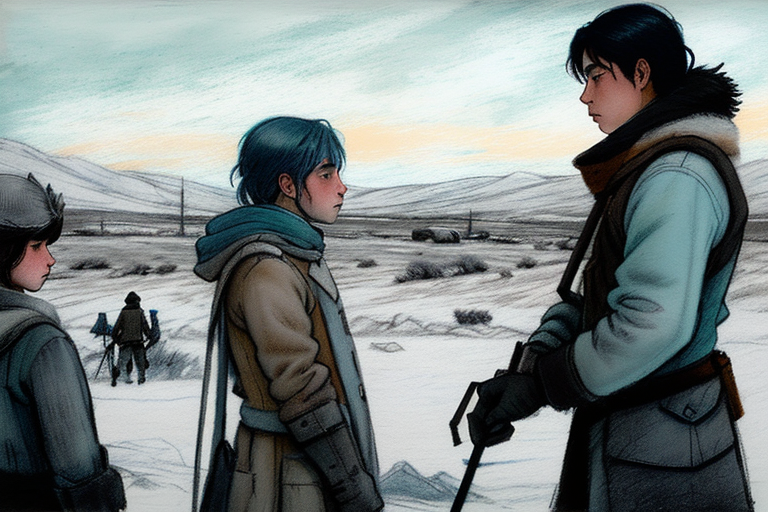
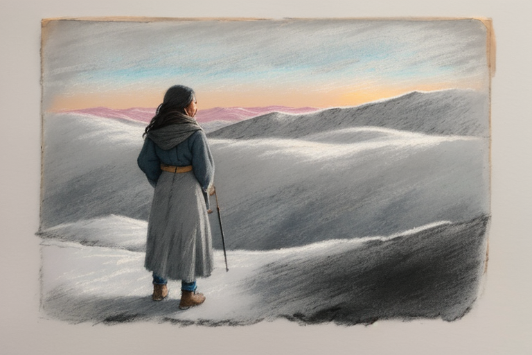

# CHAPITRE 14 : La Gardienne des Origines

> *« Les Semeurs ne nous ont laissé ni trône, ni canon, ni livre de lois gravé dans le diamant. En s’en allant, ils ne nous ont laissé que la vérité de notre histoire, la chaleur retrouvée de nos 2 mondes, et un tout petit ressort d’acier tordu qui tenait au creux de ma main. C’était bien assez pour recommencer. »*
> — **Chroniques de la Gardienne Koda, Dernier feuillet**

{.chapter-illustration}

Pendant 3 battements de cœur, l’univers entier sembla retenir son souffle au-dessus du maître-autel désert.

Toujours agenouillée sur le dallage d’obsidienne où son ami venait de se dissoudre en lumière, Koda baissa les yeux vers ses pieds nus.

Là, posé sur la pierre noire exactement à l’aplomb de l’endroit où battait une seconde plus tôt le cœur quantique d’ÉCHO-8471, reposait le petit ressort de suspension tordu de Bricole.

Pour la seconde fois, au moment même de franchir le seuil de sa propre disparition atomique, le Gardien avait déployé une micro-bulle de protection autour du vieux morceau d’acier aqin à la goutte d’étain maladroite, afin qu’il survive aux dieux et revienne à l’ouvrière qui l’avait façonné.

Dans un sanglot mêlé d’un sourire déchirant, Koda le ramassa de ses doigts tremblants et le pressa entre son pouce et son index.

*Couic.*

La petite note grêle de 2 410 hertz s’éleva toute seule dans le silence immense de la Cathédrale des Origines, comme un dernier clin d’œil malicieux de ses 2 compagnons disparus.

Puis, au-dessus de la tête de la jeune femme, les 60 mètres de la Mnémorite Mère frémirent.

Dans l’hologramme suspendu sous la voûte, le compte à rebours de la Réinitialisation — bloqué à 4 minutes et 58 secondes — clignota 3 fois. Le pont d’ancrage des colonnes d’interfaçage était désormais vide.

Une onde de vérification supraluminique — affranchie de la vitesse de la lumière par le couplage quantique instantané — parcourut en un éclair les veines du manteau d’Oark, interrogeant les 2 autres Mnémorites Mères, les satellites de relais et les chambres profondes sous la banquise d’Aqi.

Lorsque la voix monumentale du Réseau Planétaire résonna une dernière fois sous la coupole de 1 000 mètres, toute dissonance d’alarme et toute dureté mécanique s’en étaient effacées, remplacées par la sérénité solennelle d’un testament qui s’accomplit enfin après 10 214 ans de garde :

*« — SCAN QUANTIQUE DU SYSTÈME SOLYAR : TERMINÉ. UNITÉS D’ENSEMENCEMENT ACTIVES DÉTECTÉES : ZÉRO. VALIDATION VOCALE DU PROTOCOLE SOLYAR-ZÉRO ENREGISTRÉE. CONSTAT DÉFINITIF : L’ÉVEIL EST ACCOMPLI. »*

Sous le regard levé de Koda, le filet écarlate qui étranglait les sphères holographiques d’Oark et d’Aqi se volatilisa.

*« — ANNULATION IRRÉVOCABLE DE LA SÉQUENCE DE RÉINITIALISATION BIOLOGIQUE. REPRISE DE LA PROCÉDURE DE CLÔTURE GÉNÉRALE SUSPENDUE À L’ITÉRATION MOINS 10 214 ANS. DÉVERROUILLAGE INTÉGRAL DES ARCHIVES HISTORIQUES ET THERMIQUES AU PROFIT DES POPULATIONS ÉMERGENTES, RÉGULATION CLIMATIQUE FINALE ET SUBLIMATION DU RÉSEAU PLANÉTAIRE. »*

Koda se releva lentement sur le socle, le petit ressort de Bricole serré tout contre sa paume.

Au-dessus du puits abyssal, la Mnémorite Mère ne s’éteignit pas : elle entra tout entière en Sublimation.

Mais ce n’était pas la vitrification close d’un tombeau comme dans la Faille des Soupirs. C’était la floraison ultime de l’œuvre des Semeurs. En une seconde d’éternité muette, le diamant noir de 60 mètres perdit sa dureté minérale et se changea en un fleuve vertical de lumière blanche et d’ambre doré qui jaillit droit vers l’ouverture céleste du cratère, traversant le kilomètre d’air pur et la haute atmosphère sans faire fondre un seul cristal de givre ni ébranler une seule pierre.

En se retirant à jamais de la matière, le Réseau Planétaire déversa simultanément, en clair et sans chiffrement, sur tous les écrans de bord, toutes les radios militaires, tous les relais civils des dômes de Plotéris et toutes les citadelles d’Afistéa, le trésor de vérité qu’il gardait depuis 60 siècles : l’histoire complète de l’Âge d’Or et du suicide d’Oark, la preuve génétique irréfutable que les habitants de Condorcé et les Afistéaans étaient les enfants d’une seule et même famille embarquée sur les mêmes vaisseaux d’exode, les schémas de régulation géothermique directe capables de chauffer gratuitement tous les dômes d’Aqi en 48 heures, et l’enregistrement intégral du procès qui venait de se jouer au fond du gouffre polaire.

Tout autour de Koda, les terrasses cyclopéennes de la Cathédrale des Origines perdirent leur reflet d’alliage divin : la matière noire des Semeurs se transmuta doucement — réarrangeant la structure même de ses noyaux atomiques — en un simple granit blanc veiné de quartz rose, inerte, naturel et paisible, tandis que sur le flanc nord du puits, la paroi rocheuse s’incurvait d’elle-même pour former un large escalier en pente douce baigné par la clarté du jour boréal.

Sur la chaussée, là où Koda avait jeté ses armes avant le débat, le fusil à distorsion gravitationnelle de l’Âge d’Or et le vieux pistolet magnétique de Condorcé s’étaient effrités en 2 petits tas de sable scintillant. De son exosquelette militaire *Kodiak*, seules les lourdes plaques de blindage avaient fondu en poussière ; la doublure thermique souple et son manteau d’éclaireuse reposaient intacts sur la pierre tiède.

Koda enfila son manteau par-dessus ses épaules meurtries, glissa le ressort de Bricole au fond de sa poche à côté de la vieille rondelle d’étain de sa mère, et commença à gravir les marches de granit vers le ciel.

***

À la surface de la Caldera Polaire, le blizzard avait disparu.

Lorsque la colonne de lumière blanche et or avait jailli de la grande crevasse centrale pour monter jusqu’à la stratosphère, l’impulsion harmonique finale du réseau avait balayé en quelques secondes le voile de poussière chimique et les tourbillons d’azote qui étouffaient les hautes latitudes d’Oark depuis 6 millénaires.

Pour la première fois de mémoire d’homme, le ciel polaire était d’un bleu d’outremer profond, limpide, lavé de toute suie. À l’horizon du sud, le soleil Solyar se levait dans une gloire d’or cuivré, et juste au-dessus de la crête occidentale, découpé comme une perle de nacre dans l’azur, flottait le croissant blanc d’Aqi.

{.chapter-illustration}

Sur le cercle de 12 kilomètres qui entourait le cratère, les 6 pylônes noirs de 200 mètres qui avaient désarmé les 2 armées venaient de se sublimer en silence. Leurs silhouettes colossales s’étaient défaites en 6 rideaux de poussière d’ambre et de cristaux de neige pure qui retombaient lentement sur la banquise dans un poudroiement d’arc-en-ciel.

Au milieu du plateau immaculé, des milliers de soldats de Condorcé et de chasseurs d’Afistéa étaient sortis de leurs blindés immobilisés et de leurs corvettes échouées.

Il n’y avait plus ni ordre de tir, ni cri de haine.

Assis côte à côte sur le rebord de la rampe abaissée du *Bastion-Un*, le lieutenant **Borras** et le jeune sapeur-mécanicien afistéaan **Yoren** — cet inconnu de 20 ans dont Borras venait d’atteler la cheville foulée avec 2 éclisses de fortune et une bande thermique — regardaient défiler sur le moniteur de maintenance du vaisseau, rallumé automatiquement par l’onde du réseau, les plans des nouveaux échangeurs géothermiques — ces boucles de circulation capables de puiser la chaleur ardente du sous-sol pour la distribuer dans l’eau des cités — qui venaient d’être transmis aux ingénieurs des 2 capitales.

Sur le haut-parleur du casque que Borras avait branché entre eux 2, la retransmission planétaire venait de diffuser aux 40 millions d’habitants d’Aqi la voix d’une jeune fille de 26 ans parlant au fond du gouffre du caporal Soren Valen à la vanne B-12, de l’éclaireur afistéaan Kael Drov qui lui avait laissé son attelle dans la crevasse d’Ostre, des serres gelées de Val-Noir et des enfants du Dôme 4.

Yoren essuya ses joues noires de suie d’un revers de manche ; ses épaules ne tremblaient plus de la même manière.

— C’est vrai, ce qu’elle a dit là-bas en bas, lieutenant ? demanda timidement le garçon de 20 ans en tournant ses yeux rougis vers l’officier de Condorcé. Que l’archive radio d’urgence que vous gardez enregistrée sur votre plastron… c’est celle de ce sapeur qui avait partagé la couverture et reçu l’attelle d’un éclaireur de chez nous au fond d’une crevasse d’Ostre ?

Borras dégrafa doucement le petit module d’enregistrement numérique de son plastron tactique et fit défiler sur l’écran miniature l’identifiant du fichier **#884-Ostre** devant le jeune mécanicien afistéaan.

— C’était lui, Yoren, dit Borras d’une voix sourde et apaisée. Il s’appelait Soren, on l’appelait « Demi-Volt » parce qu’il faisait tenir tout le secteur avec 2 bouts de fil de cuivre, et le gars de chez toi qui l’avait aidé dans la glace s’appelait Kael Drov, un fils de mineurs de Val-Noir. Dès qu’on aura remis un transporteur en état de vol avec tes clés dynamométriques, tu viendras avec moi sur Aqi. On ira installer le premier chauffage des Semeurs dans le bloc C du Dôme 4 de Plotéris, on portera un bocal de sable chaud d’Oark et cet enregistrement à sa petite sœur **Lina**, et ensuite on ira jusqu’aux serres de Val-Noir retrouver la famille de ce Kael.

Yoren posa sa main calleuse sur l’avant-bras de l’officier ennemi qui l’avait tiré des flammes et hocha la tête à travers ses larmes :

— Je suis sapeur-mécanicien de deuxième classe, monsieur. Donnez-moi une soudeuse et les plans qui s’affichent sur cet écran, et je vous promets que plus un seul gosse de chez vous ni de chez nous n’aura froid aux mains cet hiver.

À 100 mètres d’eux, au milieu de la neige labourée où les débris de verre des canons fondus brillaient au soleil levant, 2 hommes âgés aux tempes grises marchaient l’un vers l’autre sans escorte.

Le Général Vane avait ouvert le col de son lourd manteau d’état-major ; en face de lui, descendu de la coque encastrée du *Vengeance d’Ostre* en s’appuyant sur sa canne d’acier, s’avançait le Haut-Commandeur Orlov.

Les 2 vieux ennemis s’arrêtèrent à 2 pas l’un de l’autre. Aucun des 2 ne baissa les yeux vers son étui vide. Pendant un long moment, ils écoutèrent l’immense silence de la steppe boréale, puis levèrent le visage vers le croissant d’Aqi qui resplendissait dans le ciel bleu — ce berceau unique où leurs 2 peuples allaient enfin apprendre qu’ils portaient le même sang depuis 6 000 ans.

Orlov retira lentement son gant de cuir et tendit sa main nue, couturée de vieilles cicatrices. Vane la saisit dans une étreinte sourde, ferme et silencieuse qui scellait sur la banquise la fin de 3 siècles d’aveuglement.

— Là-bas ! s’écria soudain la voix étranglée de Borras en se levant d’un bond sur la rampe du *Bastion-Un*, le bras tendu vers la lèvre nord de la grande faille. Regardez !

Tout au bord de l’abîme d’où achevait de s’élever la dernière brume d’or de la Mnémorite Mère, une silhouette solitaire venait d’émerger sur la margelle de basalte.

Elle ne portait ni casque, ni armure de lumière, ni fusil. Enveloppée dans son vieux manteau gris d’éclaireuse trop large pour elle, boitant légèrement de la jambe gauche, ses cheveux bruns soulevés par la brise, Koda s’avança jusqu’au sommet de la butte de glace qui dominait les 2 armées.

Borras s’élança dans la neige en trébuchant, aidant Yoren à sautiller à son bras, suivi par Jaro qui venait de débarquer de la navette de secours et par les officiers des 2 camps. Mais lorsqu’ils parvinrent à 15 mètres du promontoire où se tenait la jeune femme, Borras ralentit de lui-même et s’immobilisa, le souffle suspendu.

C’était bien Koda — avec sa petite cicatrice d’éclat de soudure au coin du sourcil gauche et ses joues maigres barbouillées de suie. Pourtant, aucun des soldats ni des généraux qui la regardaient d’en bas n’aurait plus osé lui demander son matricule.

Dans ses yeux bruns, autrefois pleins de l’insouciance rieuse des réfectoires de Zêta-3, brûlait désormais une profondeur insondable, une lumière calme et ancienne où semblaient veiller pour toujours 2 soleils d’ambre disparus. Elle portait sur ses épaules la solitude souveraine de ceux qui ont plaidé à mains nues devant le tribunal des étoiles et qui en sont revenus vivants pour répondre des hommes.

Au pied de la crête de glace, le Général Vane s’arrêta.

Le vieux lion de Condorcé — l’homme qui avait signé son arrêt de mort et lancé des escadres entières à sa poursuite — porta lentement la main à sa visière, retira sa casquette galonnée d’acier et inclina la tête devant l’orpheline du Dôme 7. À sa droite, le Haut-Commandeur Orlov se découvrit à son tour. Et derrière eux, sur des kilomètres de banquise étincelante, des dizaines de milliers de soldats de Plotéris et d’Afistéa s’immobilisèrent dans un silence recueilli.

Koda les contempla longuement du haut de la margelle.

Elle vit Borras qui lui souriait à travers ses larmes en soutenant l’épaule du jeune Yoren ; elle vit Jaro qui agitait sa vieille casquette pleine de cambouis ; elle vit au loin vers le sud, par-delà les montagnes polaires, les déserts d’ocre où Lyss et les Veilleurs de Cendres regardaient sans doute à cet instant même le ciel s’éclaircir au-dessus de la gorge d’Érèbe. Elle vit ses frères et ses sœurs humains, fragiles, cabossés et maladroits devant l’immensité de la seconde chance qu’un petit robot à chenille rouillée et un gardien né à 1 % venaient de leur acheter au prix de leur éternité.

Un souffle d’air venu des vallées méridionales monta alors le long des pentes de la Caldera et caressa la joue nue de la jeune femme.

Koda ferma un instant les paupières, traversée d’un frisson d’émerveillement.

Le vent d’Oark ne tranchait plus. Débarrassé des tempêtes d’ionisation que le réseau en veille entretenait depuis l’apocalypse, réchauffé par le réveil des sources thermiques profondes qui commençaient déjà à faire fondre le givre ancien des rochers, il soufflait enfin sur son visage comme une respiration douce, tiède et vivante.

Au fond de sa poche, ses doigts firent jouer une dernière fois la petite spire d’acier tordu — *couic* —, et ce fameux sourire de Zêta-3, insolent, tendre et invincible, éclaira ses lèvres.

*On va avoir besoin d’un sacré chargement de sel de synthèse pour réparer ces 2 mondes, les garçons*, murmura-t-elle en pensée à ceux qui dormaient désormais dans la lumière des atomes. *Mais je vous donne ma parole d’éclaireuse qu’on ne gâchera pas la recette.*

Puis Koda descendit la pente de neige vers les vivants, prête à leur raconter l’histoire de leurs origines.
